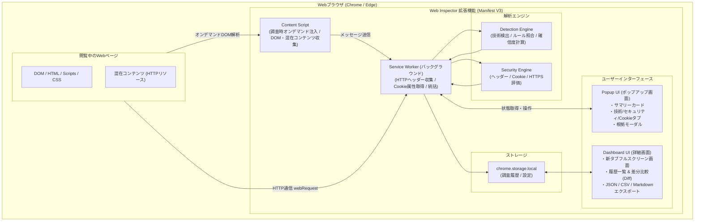
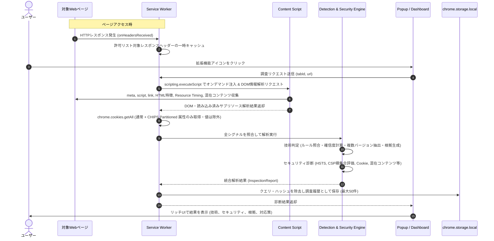
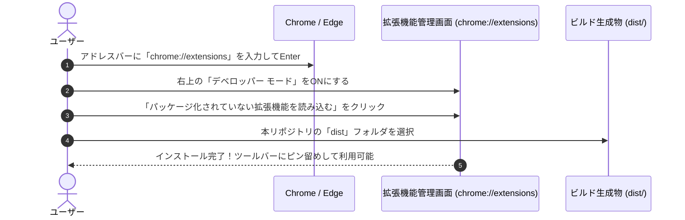

# Web Technology & Security Inspector

[](package.json)
[](public/manifest.json)
[](#インストール方法-chrome--edge)
[](tsconfig.json)

Google Chrome および Microsoft Edge に対応した、Webサイトの使用技術の特定、外部から確認できるセキュリティ設定の診断、**JavaScript/CSSライブラリのバージョン検出、CSS・JS整合性確認、EOL（サポート終了）照合、既知脆弱性（CVE/GHSA・CISA KEV名指し）照合、CSPディレクティブ構文解析（ヘッダー＋meta複数ポリシーの能力単位積集合評価・最大MEDIUM上限）、Cookie 6用途分類リスク判定、フレームワーク連動推定（Implication Engine 高度化）、ホスティング・外部サービス検出**を行うブラウザ拡張機能（Manifest V3）です。

Wappalyzerのような技術検出機能に加え、保守・セキュリティ管理に不可欠な**「検出根拠（エビデンス）」「直接検出と連動推定の厳密分離」「ランタイム稼働状態」「CSS/JS整合性」「サポート状況（EOL）」「既知脆弱性（CVE・修正状況 fixStatus・KEV悪用実績）」「CSP構文解析・ポリシー別問題点表」「Cookie用途別重み付けと一般Cookie独立検査」「Resource Timing主体の外部通信先分析」「完全オフライン突合」**まで、ブラウザ内で完結して確認できます。

---

## 目次

- [Web Technology \& Security Inspector](#web-technology--security-inspector)
  - [目次](#目次)
  - [主な特徴・原則](#主な特徴原則)
  - [機能一覧 (v1.8.0)](#機能一覧-v180)
  - [対応技術スタック \& 診断カバレッジ (Coverage)](#対応技術スタック--診断カバレッジ-coverage)
  - [システムアーキテクチャ](#システムアーキテクチャ)
    - [診断・通信シーケンス](#診断通信シーケンス)
  - [インストール方法 (Chrome / Edge)](#インストール方法-chrome--edge)
  - [クイックスタート・検証用テスト環境](#クイックスタート検証用テスト環境)
  - [開発・ビルドコマンド](#開発ビルドコマンド)
  - [セキュリティ・プライバシー設計](#セキュリティプライバシー設計)
  - [ディレクトリ構成](#ディレクトリ構成)
  - [ライセンス](#ライセンス)

---

## 主な特徴・原則

- **受動的な調査を基本とする**: 閲覧中のページとそのHTTP通信のみを解析し、ログイン試行や脆弱性攻撃（SQLインジェクション、XSS攻撃等）は一切行いません。
- **完全オフライン・外部送信ゼロ**: 検出されたライブラリや閲覧先URLを外部API（OSV APIやNVD API）へ送信せず、ビルド時に生成された圧縮スナップショットDB（`advisory-db.json`）によりローカルで高速照合します。
- **オンデマンドContent Script注入**: 閲覧中のすべてのページに常時スクリプトを配置せず、ユーザーが調査を実行したタブに対してのみ `chrome.scripting.executeScript` でContent Scriptを注入します。
- **直接検出と連動推定の分離**: 固有シグナルによる直接検出、技術依存関係による連動検知、証拠のない関連候補を明確に区別し、観測できないサーバー内部の実行状態や中・低確信度の検出は「稼働確認済」と断定せず安全に扱います。
- **ノイズ（誤検知）削減と整合性の徹底**: Cookie 6用途判定（認証、CSRF、解析、広告、同意管理、UI設定/一般）による実効的スコアリングに加え、「要確認件数」と「重大度内訳（CRITICAL〜LOW）」の完全一致、診断項目名のステータス間統一を徹底しています。
- **判定根拠の完全追跡**: 「なぜその技術・問題と判定したか」（HTTPレスポンスヘッダー名・値、metaタグ、DOMマーカー、URLパス、フレームワーク連動等）を重複なく整理して記録・表示します。

---

## 機能一覧 (v1.8.0)

| 機能ID | 項目 | 概要 |
|---|---|---|
| **IMP-14** | **バックエンドフレームワーク検出** | Spring Boot, ASP.NET Core, ASP.NET (CLR版表示), Classic ASP, Express, FastAPI, Symfony, Flask, NestJS, Fastify, CakePHP, Spring Security の検出と連動推論 |
| **IMP-15** | **フロントエンド・UIライブラリ検出** | Alpine.js, htmx, DataTables, Chart.js, Axios, D3.js, TinyMCE, CKEditor, Font Awesome, Material UI, Astro, SvelteKit の検出（Bootstrap 6 レスポンシブクラスと Tailwind CSS の誤認防止対応） |
| **IMP-16** | **ホスティング・外部サービス検出** | Vercel, Netlify, Firebase Hosting, Azure App Service, Azure Application Gateway, AWS ALB / API Gateway, Google Analytics, GTM, Facebook SDK, Clarity, Application Insights, Sentry, reCAPTCHA, hCaptcha の検出と廃止済み GA タグ（`ga.js` / `analytics.js`）の INFO 通知 |
| **IMP-17** | **Implication Engine 高度化** | 直接検出（`direct`）、連動検知（`inferred`）、関連候補（`associated`）の3層分離。ランタイム稼働状態（`confirmed` / `possible` / `unknown` / `not-applicable`）の導入、静的配信配慮、推論グラフの循環防止 |
| **IMP-18** | **検出結果の可視化** | UI上で直接・連動・候補をバッジ色分け表示。代表根拠3件＋残り件数表示、モーダルでの推論元・推論関係・推論経路および受動的調査制限の明記 |
| **IMP-19** | **CVE/EOL・レポート連携** | 未確定・連動推定技術の確定CVE誤報防止。包括的Markdown（第4節拡張）、Excel対応CSV、整形JSONへの検出方式・連動元・ランタイム状態反映 |
| **F01** | Webサーバー検出 | Apache, Tomcat, Nginx, Microsoft-IIS, LiteSpeed, Caddy 等の検出とバージョン特定（`Server` / `X-Powered-By` からの OS パッケージ版 `distroHint` 判定対応） |
| **F02** | サーバーサイド言語検出 | PHP, Java, Python, Ruby, Node.js, .NET 等の検出。`XSRF-TOKEN` 等の汎用Cookieは候補グループとして1行集約 |
| **F03** | CMS検出 | WordPress（コア `ver` 抽出・プラグインおよびテーマ一覧表示）, Drupal, Joomla, Shopify, Wix 等の検出とバージョン特定 |
| **F04** | JavaScriptフレームワーク検出 | React, Next.js, Vue.js, Nuxt, Angular, AngularJS, Svelte, Astro, SvelteKit 等の検出 |
| **F05** | JS / CSSライブラリ検出 | jQuery, Bootstrap, Tailwind CSS, Lodash, Moment.js, Alpine.js, htmx, DataTables, Chart.js, Axios 等の検出（同一技術の複数バージョン混在検出に対応） |
| **IMP-03/06** | オフライン既知脆弱性・EOL照合 | ビルド時静的DB（`advisory-db.json`）による完全ローカルCVE/GHSA/EOL突合（NVD自動取り込み対応・外部送信ゼロ）。`fixStatus`（解消可能件数と未修正件数の内訳推奨文）、CISA KEV 該当 CVE ID の名指し表示、重大度4段階（Critical/High/Medium/Low）を表示 |
| **F06** | CDN / WAF推定 | Cloudflare, Amazon CloudFront, Fastly, Akamai 等の検出 |
| **IMP-02** | CSPディレクティブ構文解析 | HTTPヘッダー複数行および `<meta http-equiv="Content-Security-Policy">` を能力単位の積集合で評価し、最大重大度を `MEDIUM` に統一。観測値での問題点要約とポリシー別問題点テーブル出力、XFO と `frame-ancestors` の優先関係注記に対応 |
| **F07** | HTTPセキュリティヘッダー診断 | HSTS（`max-age` 期間・`preload` 条件検証）、CSP、X-Frame-Options、X-Content-Type-Options、Referrer-Policy（未設定 `info`・危険値 `warning`）、Permissions-Policy、CORS、Server / X-Powered-By / X-AspNet-Version 情報露出（全項目で status 間の項目名を統一し、要確認件数と重大度内訳が完全一致） |
| **IMP-01** | Cookie属性用途別判定 | 認証・CSRF・解析・広告・同意管理・UI設定/一般の 6 用途分類に応じた動的重大度判定と、認証系指摘の有無に依存しない一般 Cookie の独立検査 |
| **F08** | Cookie属性診断 | Secure, HttpOnly, SameSite, CHIPS (`Partitioned`) 取得・評価、HTTP接続時の評価対象外明記、重複除外（値は非保持） |
| **F09** | HTTPS・混在コンテンツ診断 | 平文HTTP警告（証明書の有効性は対象外と明記）、アクティブ/パッシブ混在コンテンツの検出と対象要素・マスク済みURLの表示 |
| **F10** | 検出根拠・確信度表示 | エビデンス種別・値・取得元の重複統合、確信度スコア（高: 80〜100, 中: 50〜79, 低: 1〜49） |
| **F11 / IMP-12** | 多様なレポート出力 | 整形JSON、Excel対応UTF-8 BOM付きCSV、および**15セクション包括的Markdownレポート**（要確認指摘からの動的ロードマップ生成・コードスパン安全出力・URLクエリ/ハッシュ自動除去） |
| **F12 / IMP-09** | 調査履歴 & 差分比較 (Diff) | 過去の調査レポート保存（最大50件・直列化ロックによる競合防止）、一覧検索、2つのレポートの差分比較および推定原因分析 |
| **IMP-10** | 診断項目の許容・除外設定 | 運用要件に基づくリスク受容や誤検知を安定ID（FindingId）に基づいて登録・除外管理（旧診断項目名との後方互換対応） |
| **IMP-11** | 外部通信先・サードパーティ分析 | Performance Resource Timing API と読み込み対象 DOM 要素（`baseURI` 基準で絶対URL解決・`alternate` リンクや `form[action]` 等の非通信参照を除外）から実際に読み込まれたリソースの取得元を集計し、PSL ルールで eTLD+1・用途を分類 |
| **SEC-WAF** | **WAF・確認画面の検出と警告** | Cloudflare / AWS WAF などのボット確認・ブロック画面（インタースティシャル）をヘッダーと DOM から自動検出し、診断保留と警告を表示 |
| **SEC-HSTS** | **HSTS診断の整理** | 診断結果の1行集約、max-age 期間・preload 条件・プレリリース表記への対応 |
| **NEW-03** | **セキュリティ診断項目の追加** | SRI（integrity 属性の有無確認）、Cache-Control（キャッシュ制御診断）、認証系 Cookie の属性診断（SameSite=None・過大な有効期限の指摘）、CSP 追加項目（Trusted Types、upgrade-insecure-requests、form-action、Reporting-Endpoints）の診断 |
| **OPS-01** | **運用・CI 改善** | 脆弱性 DB リリース予行（`rehearse-db-release.mjs`）、拡張機能および DB のサイズ上限検証（`check-size.mjs`）、一括取得スクリプトの待機安定化 |

---

## 対応技術スタック & 診断カバレッジ (Coverage)

本拡張機能が検出・診断に対応している全 75 技術の一覧です（`npm run spec:generate` により `src/detection/rules/*.json` および `data/advisories/catalog.json` から自動生成）。  
※「バージョン特定」はシグナル定義に `versionRegex` を持つ技術、またはページ実行時（MAIN world）からバージョンを取得できる技術のみ `✅` としています。  
※「EOL判定」「既知脆弱性 (CVE)」が `✅` の技術は、外部送信を行わず拡張機能内蔵のオフライン脆弱性データベース（`advisory-db.json`）と完全ローカルで照合されます。

| 分類 | 対象技術名 | バージョン特定 | EOL判定 | 既知脆弱性 (CVE) | 主な検出手法 |
|---|---|:---:|:---:|:---:|---|
| **Webサーバー** | **Apache** (`apache`) | ✅ | ✅ | ✅ | header (server) |
|  | Tomcat (`tomcat`) | ✅ | - | - | header (server) |
|  | **Nginx** (`nginx`) | ✅ | ✅ | ✅ | header (server) |
|  | Microsoft-IIS (`iis`) | ✅ | - | - | header (server) |
|  | LiteSpeed (`litespeed`) | - | - | - | header (server) |
|  | Caddy (`caddy`) | - | - | - | header (server) |
| **プログラミング言語・ランタイム** | **PHP** (`php`) | ✅ | ✅ | ✅ | header (x-powered-by), header (server), cookie (PHPSESSID), url (path) |
|  | Java (`java`) | - | - | - | cookie (JSESSIONID), cookie (XSRF-TOKEN), url (path), header (x-powered-by) |
|  | Python (`python`) | ✅ | - | - | header (server) |
|  | Ruby (`ruby`) | - | - | - | header (x-powered-by) |
|  | Django (`python-django`) | - | - | - | cookie (csrftoken), dom (input[name='csrfmiddlewaretoken']) |
|  | Ruby on Rails (`ruby-on-rails`) | - | - | - | dom (meta[name='csrf-param']), header (x-powered-by) |
|  | **Laravel** (`laravel`) | ✅ | ✅ | ✅ | header (x-powered-by), cookie (laravel_session), cookie (app_session), cookie (XSRF-TOKEN) |
|  | **Node.js** (`nodejs`) | ✅ | ✅ | ✅ | header (x-powered-by), header (server), cookie (connect.sid), cookie (XSRF-TOKEN) |
|  | .NET (`dotnet`) | - | - | - | header (server) |
| **バックエンドFW** | Spring Boot (`spring-boot`) | - | - | - | header (x-application-context), dom (h1), script (src) |
|  | ASP.NET Core (`aspnet-core`) | - | - | - | cookie (.AspNetCore.Antiforgery.), cookie (.AspNetCore.Session), cookie (.AspNetCore.Cookies), header (server) |
|  | Express (`express`) | - | - | - | header (x-powered-by) |
|  | FastAPI (`fastapi`) | - | - | - | dom (title), header (x-fastapi) |
|  | Symfony (`symfony`) | - | - | - | cookie (symfony), cookie (sf_redirect), header (x-debug-token) |
|  | Flask (`flask`) | ✅ | - | - | header (server) |
|  | NestJS (`nestjs`) | ✅ | - | - | header (x-powered-by) |
|  | Fastify (`fastify`) | - | - | - | header (x-fastify-) |
|  | CakePHP (`cakephp`) | - | - | - | cookie (CAKEPHP) |
|  | Spring Security (`spring-security`) | - | - | - | dom (input[name='_csrf']), cookie (SESSION) |
|  | ASP.NET (`aspnet`) | ✅ | - | - | header (x-aspnet-version), header (x-aspnetmvc-version), header (x-powered-by), cookie (.ASPXAUTH), cookie (ASP.NET_SessionId), url (path) |
|  | Classic ASP (`classic-asp`) | - | - | - | cookie (ASPSESSIONID), url (path) |
| **CMS** | **WordPress** (`wordpress`) | ✅ | ✅ | ✅ | meta (generator), script (src), link (href), header (link) |
|  | Drupal (`drupal`) | ✅ | - | - | meta (generator), header (x-generator), header (x-drupal-cache), header (x-drupal-dynamic-cache), dom ([data-drupal-selector], [data-drupal-messages], [data-drupal-link-system-path], script[data-drupal-selector='drupal-settings-json']), script (src), link (href) |
|  | Joomla (`joomla`) | ✅ | - | - | meta (generator), script (src) |
|  | Shopify (`shopify`) | - | - | - | header (server), script (src), link (href) |
|  | Wix (`wix`) | - | - | - | meta (generator), header (x-wix-request-id), script (src) |
| **フロントエンドFW / UI** | **React** (`react`) | ✅ | ✅ | ✅ | dom ([data-reactroot], [data-reactid], __reactContainer$), script (src) |
|  | Next.js (`nextjs`) | - | - | - | dom (script#__NEXT_DATA__), script (src), link (href), header (x-powered-by) |
|  | **Vue.js** (`vue`) | ✅ | ✅ | ✅ | dom ([data-v-], [data-v-app], __vue_app__), script (src), dom (#__nuxt), 実行時バージョン取得 (MAIN world) |
|  | Nuxt (`nuxtjs`) | - | - | - | dom (#__nuxt, script#__NUXT_DATA__), script (src), link (href) |
|  | **Angular** (`angular`) | ✅ | ✅ | ✅ | dom ([ng-version]), dom ([_nghost-], [_ngcontent-], [ng-server-context]) |
|  | **AngularJS** (`angularjs`) | ✅ | ✅ | ✅ | dom ([ng-app], [data-ng-app], [ng-controller], [data-ng-controller], [ng-model], [data-ng-model], [ng-bind], [ng-repeat], [ng-cloak], .ng-scope, .ng-binding), script (src), 実行時バージョン取得 (MAIN world) |
|  | Svelte (`svelte`) | - | - | - | dom ([class*='svelte-']), script (src) |
|  | **jQuery** (`jquery`) | ✅ | ✅ | ✅ | script (src), 実行時バージョン取得 (MAIN world) |
|  | **Bootstrap** (`bootstrap`) | ✅ | ✅ | ✅ | link (href), script (src), dom (.container, .row, .col-), 実行時バージョン取得 (MAIN world) |
|  | Tailwind CSS (`tailwind`) | - | - | - | css (class), script (src) |
|  | Alpine.js (`alpine`) | - | - | - | dom ([x-data], [x-init], [x-bind]), script (src) |
|  | htmx (`htmx`) | - | - | - | dom ([hx-get], [hx-post], [hx-target], [hx-swap]), script (src) |
|  | DataTables (`datatables`) | - | - | - | dom (table.dataTable, .dataTables_wrapper), script (src), link (href) |
|  | Chart.js (`chartjs`) | - | - | - | script (src) |
|  | Axios (`axios`) | - | - | - | script (src) |
|  | D3.js (`d3`) | - | - | - | script (src) |
|  | TinyMCE (`tinymce`) | - | - | - | dom (.tox-tinymce, .mce-tinymce), script (src) |
|  | CKEditor (`ckeditor`) | - | - | - | dom (.ck-editor, .cke), script (src) |
|  | Font Awesome (`fontawesome`) | - | - | - | link (href), script (src), dom (i[class*='fa-'], [class*='fas '], [class*='fab ']) |
|  | Material UI (`material-ui`) | - | - | - | dom ([class*='MuiButton-'], [class*='MuiBox-'], [class*='MuiTypography-']) |
|  | Astro (`astro`) | ✅ | - | - | dom ([data-astro-cid-], astro-island), meta (generator) |
|  | SvelteKit (`sveltekit`) | - | - | - | dom (script[data-sveltekit-], div#svelte, link[rel='modulepreload'][href*='_app/immutable/']) |
|  | **Lodash** (`lodash`) | ✅ | ✅ | ✅ | script (src), 実行時バージョン取得 (MAIN world) |
|  | **Moment.js** (`moment`) | ✅ | ✅ | ✅ | script (src), 実行時バージョン取得 (MAIN world) |
| **クラウド・外部サービス** | Vercel (`vercel`) | - | - | - | header (server), header (x-vercel-id), header (x-vercel-cache) |
|  | Netlify (`netlify`) | - | - | - | header (server), header (x-nf-request-id) |
|  | Firebase Hosting (`firebase-hosting`) | - | - | - | header (x-firebase-hosting) |
|  | Azure App Service (`azure-app-service`) | - | - | - | cookie (ARRAffinity), cookie (ARRAffinitySameSite) |
|  | Azure Application Gateway (`azure-app-gateway`) | - | - | - | cookie (ApplicationGatewayAffinity) |
|  | AWS Application Load Balancer (`aws-alb`) | - | - | - | cookie (AWSALB), cookie (AWSALBCORS) |
|  | AWS API Gateway (`aws-api-gateway`) | - | - | - | header (x-amzn-requestid), header (x-amz-apigw-id) |
|  | Google Analytics (`google-analytics`) | - | - | - | script (src), cookie (_ga) |
|  | Google Tag Manager (`google-tag-manager`) | - | - | - | script (src), dom (iframe) |
|  | Facebook SDK (`facebook-sdk`) | - | - | - | script (src) |
|  | Microsoft Clarity (`microsoft-clarity`) | - | - | - | script (src), cookie (_clck) |
|  | Application Insights (`application-insights`) | - | - | - | script (src), cookie (ai_session), cookie (ai_user) |
|  | Sentry (`sentry`) | - | - | - | script (src) |
|  | reCAPTCHA (`recaptcha`) | - | - | - | script (src), dom (.g-recaptcha) |
|  | hCaptcha (`hcaptcha`) | - | - | - | script (src), dom (.h-captcha) |
| **CDN / WAF** | Cloudflare (`cloudflare`) | - | - | - | header (server), header (cf-ray), header (cf-cache-status), cookie (__cf_bm) |
|  | Amazon CloudFront (`cloudfront`) | - | - | - | header (x-amz-cf-id), header (via), header (x-cache) |
|  | Fastly (`fastly`) | - | - | - | header (x-served-by), header (fastly-debug-digest), header (x-fastly-request-id) |
|  | Akamai (`akamai`) | - | - | - | header (x-akamai-transformed), header (server) |

## システムアーキテクチャ



### 診断・通信シーケンス



---

## インストール方法 (Chrome / Edge)

ビルド済みのパッケージ（`dist` ディレクトリ）をブラウザに読み込ませることで、すぐに利用できます。



1. Google Chrome または Microsoft Edge を開きます。
2. アドレスバーに `chrome://extensions`（Edgeの場合は `edge://extensions`）と入力してEnterキーを押します。
3. 画面右上にある **「デベロッパー モード」** のトグルを **ON** にします。
4. 画面左上に表示される **「パッケージ化されていない拡張機能を読み込む」** ボタンをクリックします。
5. ファイル選択ダイアログで、本プロジェクトの **`dist`** フォルダを選択します。
6. 拡張機能一覧に「Web Technology & Security Inspector」が表示されればインストール完了です。

---

## クイックスタート・検証用テスト環境

拡張機能の全機能をローカルで安全にテストできるよう、PHP 8.2、Apache 2.4、WordPress 6.4、React、Next.js、Tailwind CSS、および各種セキュリティヘッダー・Cookieをシミュレートするテストサーバーが同梱されています。

```bash
# テストサーバーの起動 (ポート 3000)
npm run test-server
```

1. ブラウザで `http://localhost:3000` を開きます。
2. ナビゲーションから各テスト用エンドポイントを検証できます：
   - `http://localhost:3000/insecure-cookie`: **Cookie用途別判定 (IMP-01)**（認証系Cookie警告、CSRFのHttpOnly許容、設定Cookieのノイズ削減）
   - `http://localhost:3000/loose-csp`: **CSPディレクティブ構文解析 (IMP-02)**（`unsafe-inline`、`unsafe-eval`、`*`、`object-src` 未指定等の詳細検知）
   - `http://localhost:3000/legacy-lib`: **レガシーライブラリ照合 (IMP-03)**（古い jQuery 2.2.4、WordPress 5.2、PHP 7.4のオフライン既知脆弱性・EOL検知）
3. ツールバーの **「Web Inspector」アイコン** をクリックし、診断結果と根拠を確認できます。

---

## 開発・ビルドコマンド

```bash
# 依存パッケージのインストール
npm ci

# 本番用ビルド (dist/ フォルダに拡張機能アセットを生成)
npm run build

# ファイル変更監視ビルド (開発用)
npm run watch

# 仕様書カタログ・READMEカバレッジ表・DOMセレクタの再生成
npm run spec:generate

# 型検査 + リンク検査 + 単体テスト実行 (Vitest)
npm test

# レポート（JSON・Markdown組）の整合性チェッカー実行 (回帰フィクスチャ検証)
npm run reports:lint

# 公開テストサイト等の診断レポート一括取得 & チェッカー自動適用 (要ネットワーク・事前ビルド)
# ※実サイトの取得レポートは公開リポジトリにコミットしないこと (.gitignore 済み)
npm run reports:collect -- --sites scripts/report-sites.example.txt --timeout 90000

# Chrome 実機による E2E スモークテスト (テストサーバー自動起動・停止)
npm run test:e2e

# 検証用テストサーバー起動 (ポート 3000)
npm run test-server

# オフライン脆弱性DBの整合性・サイズ・NVD照合検証
npm run advisories:validate
npm run advisories:verify-nvd

# オフライン脆弱性DBの最新化 (OSV/NVD/endoflife.date/KEV から取得 → 生成 → 検証)
# ※通常は GitHub Actions「Advisory DB Update」が週次で自動実行し PR を作成します
npm run advisories:sync

# Chrome Web Store配布用ZIPパッケージ作成 (検証 → ビルド → ZIP生成)
npm run package
```

> [!TIP]
> **ドキュメント・運用ガイド:**  
> - **技術判定基準**: [技術検出仕様・判定基準書 (`docs/DETECTION_SPECIFICATION.md`)](./docs/DETECTION_SPECIFICATION.md) （全対応技術の観測シグナル・正規表現・Implication連動マトリクス）
> - **開発計画・設計書**: [全体統括開発計画書 (`docs/DEVELOPMENT_PLAN.md`)](./docs/DEVELOPMENT_PLAN.md) （アーキテクチャ・Phase 1〜6フェーズ別詳細計画）
> - **運用手順**: [保守・リリース運用ガイド (`docs/MAINTENANCE_GUIDE.md`)](./docs/MAINTENANCE_GUIDE.md) （バージョンアップ手順・脆弱性DB更新手順・チェックリスト）

---

## セキュリティ・プライバシー設計

本ツールはセキュリティ調査ツール自体がユーザーの情報を漏えいさせないよう、厳格なプライバシー設計を採用しています。

- **Cookie値の完全除外**: Cookieは名前、ドメイン、パス、Secure、HttpOnly、SameSite、Partitioned、有効期限のみを検査し、**Cookieの値（Value）は一切取得・保存・ログ出力しません**。
- **オンデマンドContent Script実行**: `manifest.json` による常時自動注入は行わず、ユーザーが調査を実行した対象タブにのみ `chrome.scripting.executeScript` でContent Scriptを注入します。
- **レスポンスヘッダーの一時保持と認証情報除外**:
  - **v1.6.4以前**: HTTPレスポンスヘッダー（`Set-Cookie` を含む場合がある）をブラウザのメモリ上（セッション限り）に一時保持します。外部への送信は一切行いません。
  - **v1.6.5以降**: `Set-Cookie` や `Authorization` など認証情報を含みうるヘッダーは一切保持しません。技術検出およびセキュリティ診断に必要な固定の許可リストに含まれるヘッダーのみを一時保持し、保持するURLからもクエリパラメータおよびフラグメントを除外します。
- **履歴・エクスポートにおけるURLクエリ除外**: 保存される調査履歴やJSON/CSV/Markdownエクスポートに含まれるURL（対象URL、検出根拠URL、外部通信先のサンプルURL、混在コンテンツURL等）からは、トークン等の機密パラメータ漏えいを防ぐためクエリ文字列（`?...`）とフラグメント（`#...`）を除外します。
- **外部送信ゼロ**: 収集した通信情報、DOM情報、および Performance Resource Timing API から受動的に読み取ったサブリソース取得元情報はブラウザ内（Service Workerおよび`chrome.storage.local`）でのみ処理され、外部の解析サーバーへ送信されることはありません。
- **受動的・安全**: 対象Webサイトに対して悪意あるペイロードや過度なリクエストを送信せず、通常のページ閲覧に伴う通信のみを分析します。
- **履歴管理**: 調査結果はローカルに保存され、ユーザー自身の操作により1件ずつの削除、または全履歴の完全クリアが可能です。

---

## ディレクトリ構成

```text
.
├── public/                        # 静的アセット
│   ├── manifest.json              # Manifest V3 定義
│   └── icons/                     # 拡張機能アイコン (16x16, 48x48, 128x128)
├── src/
│   ├── background/
│   │   └── service-worker.ts      # HTTPレスポンスヘッダー傍受・Cookie取得・オンデマンド注入・統括
│   ├── content/
│   │   ├── content-script.ts      # DOM・Resource Timing・混在コンテンツ収集
│   │   └── dom-selectors.generated.ts # ルールJSONから自動生成されたDOMセレクタ一覧
│   ├── detection/                 # 技術検出・脆弱性照合エンジン
│   │   ├── engine.ts              # 検出エンジン本体 (Implication・複数バージョン・根拠整理)
│   │   ├── advisory.ts            # オフライン脆弱性・EOL照合エンジン
│   │   ├── advisory-db.json       # ビルド済みオフライン脆弱性・EOLデータベース
│   │   ├── confidence.ts          # 確信度計算ロジック (0〜100, 高/中/低)
│   │   └── rules/                 # JSON検出ルール (計75技術)
│   │       ├── index.ts           # ルール統合・型定義
│   │       ├── server.json        # Webサーバー (Apache, Tomcat, Nginx等)
│   │       ├── language.json      # 開発言語・ランタイム (PHP, Python, Java, Node.js等)
│   │       ├── backend.json       # バックエンドFW (Spring, ASP.NET, Classic ASP, Express等)
│   │       ├── cms.json           # CMS (WordPress, Drupal等)
│   │       ├── frontend.json      # フロントエンド (React, Vue, Bootstrap, Tailwind等)
│   │       ├── services.json      # クラウド・外部サービス (Vercel, Azure, GA, GTM, Sentry等)
│   │       └── cdn-waf.json       # CDN / WAF (Cloudflare, CloudFront等)
│   ├── security/                  # セキュリティ診断エンジン
│   │   ├── engine.ts              # セキュリティ診断統括エンジン
│   │   ├── headers.ts             # HTTPヘッダー診断 (HSTS, XFO, XCTO, Referrer-Policy, CORS等)
│   │   ├── csp-parser.ts          # CSP構文解析・ヘッダー＋meta積集合評価 (最大MEDIUM)
│   │   ├── cookies.ts             # Cookie属性診断 (6用途分類・一般Cookie独立検査・CHIPS)
│   │   ├── https.ts               # HTTPS・混在コンテンツ診断 (要素・マスク済みURL表示)
│   │   ├── domain-analyzer.ts     # 読み込みリソース取得元・PSL登録可能ドメイン(eTLD+1)分析
│   │   ├── psl-rules.generated.ts # ビルド時生成の Public Suffix List ルール定義
│   │   └── version-matcher.ts     # SemVer・プレリリース・複数範囲のバージョン比較
│   ├── storage/
│   │   ├── history.ts             # 履歴管理 (URLサニタイズ・直列化保存・検索)
│   │   ├── diff.ts                # 履歴Diff比較・原因推定
│   │   └── exceptions.ts          # 許容・除外設定管理 (旧項目名との互換維持)
│   ├── export/
│   │   ├── json.ts                # JSONエクスポート
│   │   ├── csv.ts                 # Excel対応UTF-8 BOM付きCSVエクスポート
│   │   └── markdown.ts            # 15セクション包括的Markdownレポート出力 (動的ロードマップ)
│   ├── popup/                     # ポップアップ画面スクリプト・描画・スタイル
│   │   ├── popup.css
│   │   ├── popup.ts
│   │   └── render.ts
│   ├── dashboard/                 # 詳細ダッシュボード画面スクリプト・描画・スタイル
│   │   ├── dashboard.css
│   │   ├── dashboard.ts
│   │   └── render.ts
│   └── shared/
│       ├── types.ts               # 共通型定義
│       ├── security-status.ts     # 要確認件数・重大度内訳・ステータス表示の一元定義
│       ├── identity.ts            # 指摘項目の安定ID (FindingId)・URL正規化ヘルパー
│       ├── html.ts                # XSS防止エスケープ・safeHrefユーティリティ
│       └── coverage.ts            # 調査完全性 (Coverage) 評価
├── data/
│   ├── advisories/                # 脆弱性DBカタログ・キュレーション・上流スナップショット
│   └── psl/                       # Public Suffix List スナップショット
├── scripts/
│   ├── generate-spec-catalog.mjs  # 仕様書カタログ・README表・DOMセレクタ・PSL定義生成
│   ├── report-lint.mjs            # レポート（JSON・Markdown組）の整合性チェッカー
│   ├── collect-reports.mjs        # 実サイト・公開テストサイトの診断レポート一括取得
│   ├── check-links.mjs            # ドキュメント内ローカルリンク検証
│   ├── test-e2e-smoke.mjs         # Chrome実機E2Eスモークテスト
│   ├── advisories/                # 脆弱性DB取得・ビルド・検証・差分判定パイプライン
│   └── release/                   # リリース種別判定・ストア審査ステータス監視
├── test-server/                   # 動作検証用モックサーバー
│   └── server.mjs
├── tests/                         # 単体テスト・仕様整合テスト・回帰フィクスチャ (Vitest)
├── popup.html                     # ポップアップHTMLエントリー (ルート一本化)
├── dashboard.html                 # ダッシュボードHTMLエントリー (ルート一本化)
├── dist/                          # Chrome読み込み用ビルド生成物
├── package.json
├── tsconfig.json
└── vite.config.ts
```

---

## ライセンス

MIT License
