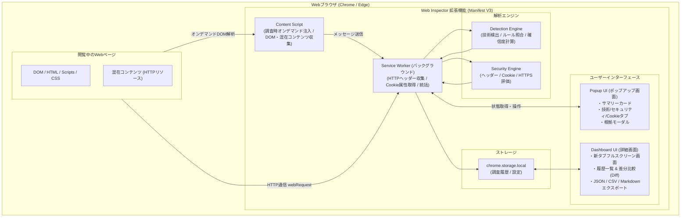
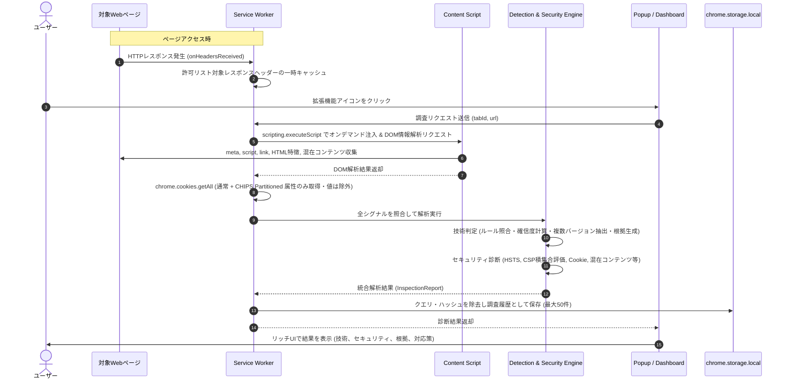
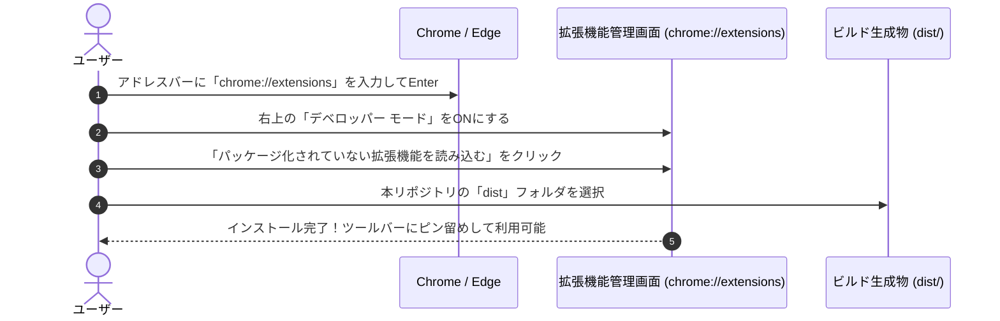

# Web Technology & Security Inspector

[](package.json)
[](public/manifest.json)
[](#インストール方法-chrome--edge)
[](tsconfig.json)

Google Chrome および Microsoft Edge に対応した、Webサイトの使用技術の特定、外部から確認できるセキュリティ設定の診断、**JavaScript/CSSライブラリのバージョン検出、CSS・JS整合性確認、EOL（サポート終了）照合、既知脆弱性（CVE/GHSA・CISA KEV）照合、CSPディレクティブ構文解析（複数ポリシーの積集合評価）、Cookie用途別リスク判定、フレームワーク連動推定（Implication Engine 高度化）、ホスティング・外部サービス検出**を行うブラウザ拡張機能（Manifest V3）です。

Wappalyzerのような技術検出機能に加え、保守・セキュリティ管理に不可欠な**「検出根拠（エビデンス）」「直接検出と連動推定の厳密分離」「ランタイム稼働状態」「CSS/JS整合性」「サポート状況（EOL）」「既知脆弱性（CVE・修正状況 fixStatus・KEV悪用実績）」「CSP構文解析・フォールバック評価」「Cookie用途別重み付け（誤検知削減）」「完全オフライン突合」**まで、ブラウザ内で完結して確認できます。

---

## 目次

- [Web Technology \& Security Inspector](#web-technology--security-inspector)
  - [目次](#目次)
  - [主な特徴・原則](#主な特徴原則)
  - [機能一覧 (v1.7.0)](#機能一覧-v170)
  - [対応技術スタック \& 診断カバレッジ (Coverage)](#対応技術スタック--診断カバレッジ-coverage)
  - [システムアーキテクチャ](#システムアーキテクチャ)
    - [診断・通信シーケンス](#診断通信シーケンス)
  - [インストール方法 (Chrome / Edge)](#インストール方法-chrome--edge)
  - [クイックスタート・検証用テスト環境](#クイックスタート検証用テスト環境)
  - [開発・ビルドコマンド](#開発ビルドコマンド)
  - [セキュリティ・プライバシー設計](#セキュリティプライバシー設計)
  - [ディレクトリ構成](#ディレクトリ構成)
  - [ライセンス](#ライセンス)

---

## 主な特徴・原則

- **受動的な調査を基本とする**: 閲覧中のページとそのHTTP通信のみを解析し、ログイン試行や脆弱性攻撃（SQLインジェクション、XSS攻撃等）は一切行いません。
- **完全オフライン・外部送信ゼロ**: 検出されたライブラリや閲覧先URLを外部API（OSV APIやNVD API）へ送信せず、ビルド時に生成された圧縮スナップショットDB（`advisory-db.json`）によりローカルで高速照合します。
- **オンデマンドContent Script注入**: 閲覧中のすべてのページに常時スクリプトを配置せず、ユーザーが調査を実行したタブに対してのみ `chrome.scripting.executeScript` でContent Scriptを注入します。
- **直接検出と連動推定の分離**: 固有シグナルによる直接検出、技術依存関係による連動検知、証拠のない関連候補を明確に区別し、観測できないサーバー内部の実行状態は「稼働未確認」として安全に扱います。
- **ノイズ（誤検知）削減**: Cookie用途別判定（認証、CSRF、解析タグ、UI設定）により、JavaScript連携が前提のCookieで不要なHttpOnly警告を出さない実効的なスコアリングを実現します。
- **判定根拠の完全追跡**: 「なぜその技術・問題と判定したか」（HTTPレスポンスヘッダー名・値、metaタグ、DOMマーカー、URLパス、フレームワーク連動等）を必ず記録・表示します。

---

## 機能一覧 (v1.7.0)

| 機能ID | 項目 | 概要 |
|---|---|---|
| **IMP-14** | **バックエンドフレームワーク検出** | Spring Boot, ASP.NET Core, Express, FastAPI, Symfony, Flask, NestJS, Fastify, CakePHP, Spring Security の検出と連動推論 |
| **IMP-15** | **フロントエンド・UIライブラリ検出** | Alpine.js, htmx, DataTables, Chart.js, Axios, D3.js, TinyMCE, CKEditor, Font Awesome, Material UI, Astro, SvelteKit の検出 |
| **IMP-16** | **ホスティング・外部サービス検出** | Vercel, Netlify, Firebase Hosting, Azure App Service, AWS ALB / API Gateway, Google Analytics, GTM, Clarity, Sentry, reCAPTCHA, hCaptcha の検出（ホスティング/クラウド、解析、セキュリティサービスに分類） |
| **IMP-17** | **Implication Engine 高度化** | 直接検出（`direct`）、連動検知（`inferred`）、関連候補（`associated`）の3層分離。ランタイム稼働状態（`confirmed` / `possible` / `unknown` / `not-applicable`）の導入、静的配信配慮、推論グラフの循環防止 |
| **IMP-18** | **検出結果の可視化** | UI上で直接・連動・候補をバッジ色分け表示。モーダルでの推論元・推論関係（基盤依存/実行環境候補等）・推論経路および受動的調査制限の明記 |
| **IMP-19** | **CVE/EOL・レポート連携** | 未確定・連動推定技術の確定CVE誤報防止。包括的Markdown（第4節拡張）、Excel対応CSV、整形JSONへの検出方式・連動元・ランタイム状態反映 |
| **F01** | Webサーバー検出 | Apache, Nginx, Microsoft-IIS, LiteSpeed, Caddy 等の検出とバージョン特定 |
| **F02** | サーバーサイド言語検出 | PHP, ASP.NET, Java, Python, Ruby, Node.js 等の検出。`XSRF-TOKEN` 等の汎用Cookieは候補グループとして1行集約 |
| **F03** | CMS検出 | WordPress, Drupal, Joomla, Shopify, Wix 等の検出とバージョン特定 |
| **F04** | JavaScriptフレームワーク検出 | React, Next.js, Vue.js, Nuxt, Angular, AngularJS, Svelte, Astro, SvelteKit 等の検出 |
| **F05** | JS / CSSライブラリ検出 | jQuery, Bootstrap, Tailwind CSS, Lodash, Moment.js, Alpine.js, htmx, DataTables, Chart.js, Axios 等の検出（同一技術の複数バージョン混在検出に対応） |
| **IMP-03/06** | オフライン既知脆弱性・EOL照合 | ビルド時静的DB（`advisory-db.json`）による完全ローカルCVE/GHSA/EOL突合（NVD自動取り込み対応・外部送信ゼロ）。`fixStatus`（修正状況）、CISA KEV（悪用が確認された脆弱性）、重大度4段階（Critical/High/Medium/Low）を表示 |
| **F06** | CDN / WAF推定 | Cloudflare, Amazon CloudFront, Fastly, Akamai 等の検出 |
| **IMP-02** | CSPディレクティブ構文解析 | HTTPヘッダー（複数行の積集合評価）および `<meta http-equiv="Content-Security-Policy">` をパースし、`script-src-elem` $\rightarrow$ `script-src` $\rightarrow$ `default-src` フォールバックや `nonce-`/`sha*`・`strict-dynamic`・`trusted-types` を詳細評価 |
| **F07** | HTTPセキュリティヘッダー診断 | HSTS（`max-age` 数値検証）、CSP、X-Frame-Options（値妥当性検証）、X-Content-Type-Options（`nosniff` 厳密一致）、Referrer-Policy（危険値・フォールバック評価）、Permissions-Policy、CORS、Server/X-Powered-By情報露出 |
| **IMP-01** | Cookie属性用途別判定 | 認証・CSRF・解析・UI設定に応じた動的重大度判定。誤検知（ノイズ）を大幅削減 |
| **F08** | Cookie属性診断 | Secure, HttpOnly, SameSite, `__Host-`/`__Secure-` プレフィックス整合性、CHIPS (`Partitioned`) 取得・評価、重複除外（値は非保持） |
| **F09** | HTTPS・混在コンテンツ診断 | 平文HTTP警告、アクティブ/パッシブ混在コンテンツ（`img[srcset]`, `source[src/srcset]`, `object[data]`, `form[action]`, インラインstyle `url(http://...)` 等を含む）の検出 |
| **F10** | 検出根拠・確信度表示 | エビデンス種別・値・取得元、確信度スコア（高: 80〜100, 中: 50〜79, 低: 1〜49） |
| **F11 / IMP-12** | 多様なレポート出力 | 整形JSON、Excel対応UTF-8 BOM付きCSV、および仕様書準拠の**15セクション包括的Markdownレポート**の出力（URLのクエリ・ハッシュは自動除去） |
| **F12 / IMP-09** | 調査履歴 & 差分比較 (Diff) | 過去の調査レポート保存（最大50件・直列化ロックによる競合防止）、一覧検索、2つのレポートの差分比較および推定原因分析 |
| **IMP-10** | 診断項目の許容・除外設定 | 運用要件に基づくリスク受容や誤検知を安定ID（FindingId）に基づいて登録・除外管理（URL正規化キー対応） |
| **IMP-11** | 外部通信先・サードパーティ分析 | ビルド時生成の Public Suffix List (PSL) ルールに基づく登録可能ドメイン（eTLD+1、日本の地域型・都道府県JPドメイン対応）特定と、First-Party / Third-Party / Local 分類および用途推定 |

---

## 対応技術スタック & 診断カバレッジ (Coverage)

本拡張機能が検出・診断に対応している全 70 技術の一覧です（`npm run spec:generate` により `src/detection/rules/*.json` および `data/advisories/catalog.json` から自動生成）。  
※「バージョン特定」はシグナル定義に `versionRegex` を持つ技術、またはページ実行時（MAIN world）からバージョンを取得できる技術のみ `✅` としています。  
※「EOL判定」「既知脆弱性 (CVE)」が `✅` の技術は、外部送信を行わず拡張機能内蔵のオフライン脆弱性データベース（`advisory-db.json`）と完全ローカルで照合されます。

| 分類 | 対象技術名 | バージョン特定 | EOL判定 | 既知脆弱性 (CVE) | 主な検出手法 |
|---|---|:---:|:---:|:---:|---|
| **Webサーバー** | **Apache** (`apache`) | ✅ | ✅ | ✅ | header (server) |
|  | **Nginx** (`nginx`) | ✅ | ✅ | ✅ | header (server) |
|  | Microsoft-IIS (`iis`) | ✅ | - | - | header (server) |
|  | LiteSpeed (`litespeed`) | - | - | - | header (server) |
|  | Caddy (`caddy`) | - | - | - | header (server) |
| **プログラミング言語・ランタイム** | **PHP** (`php`) | ✅ | ✅ | ✅ | header (x-powered-by), header (server), cookie (PHPSESSID), url (path) |
|  | ASP.NET (`aspnet`) | ✅ | - | - | header (x-aspnet-version), header (x-aspnetmvc-version), header (x-powered-by), cookie (.ASPXAUTH), cookie (ASP.NET_SessionId), url (path) |
|  | Java (`java`) | - | - | - | cookie (JSESSIONID), cookie (XSRF-TOKEN), url (path), header (x-powered-by) |
|  | Python (`python`) | ✅ | - | - | header (server) |
|  | Ruby (`ruby`) | - | - | - | header (x-powered-by) |
|  | Django (`python-django`) | - | - | - | cookie (csrftoken), dom (input[name='csrfmiddlewaretoken']) |
|  | Ruby on Rails (`ruby-on-rails`) | - | - | - | dom (meta[name='csrf-param']), header (x-powered-by) |
|  | **Laravel** (`laravel`) | ✅ | ✅ | ✅ | header (x-powered-by), cookie (laravel_session), cookie (app_session), cookie (XSRF-TOKEN) |
|  | **Node.js** (`nodejs`) | ✅ | ✅ | ✅ | header (x-powered-by), header (server), cookie (connect.sid), cookie (XSRF-TOKEN) |
|  | .NET (`dotnet`) | - | - | - | header (server) |
| **バックエンドFW** | Spring Boot (`spring-boot`) | - | - | - | header (x-application-context), dom (h1), script (src) |
|  | ASP.NET Core (`aspnet-core`) | - | - | - | cookie (.AspNetCore.Antiforgery.), cookie (.AspNetCore.Session), cookie (.AspNetCore.Cookies), header (server) |
|  | Express (`express`) | - | - | - | header (x-powered-by) |
|  | FastAPI (`fastapi`) | - | - | - | dom (title), header (x-fastapi) |
|  | Symfony (`symfony`) | - | - | - | cookie (symfony), cookie (sf_redirect), header (x-debug-token) |
|  | Flask (`flask`) | ✅ | - | - | header (server) |
|  | NestJS (`nestjs`) | ✅ | - | - | header (x-powered-by) |
|  | Fastify (`fastify`) | - | - | - | header (x-fastify-) |
|  | CakePHP (`cakephp`) | - | - | - | cookie (CAKEPHP) |
|  | Spring Security (`spring-security`) | - | - | - | dom (input[name='_csrf']) |
| **CMS** | **WordPress** (`wordpress`) | ✅ | ✅ | ✅ | meta (generator), script (src), link (href), header (link) |
|  | Drupal (`drupal`) | ✅ | - | - | meta (generator), header (x-generator), header (x-drupal-cache), script (src) |
|  | Joomla (`joomla`) | ✅ | - | - | meta (generator), script (src) |
|  | Shopify (`shopify`) | - | - | - | header (server), script (src), link (href) |
|  | Wix (`wix`) | - | - | - | meta (generator), header (x-wix-request-id), script (src) |
| **フロントエンドFW / UI** | **React** (`react`) | ✅ | ✅ | ✅ | dom ([data-reactroot], [data-reactid], __reactContainer$), script (src) |
|  | Next.js (`nextjs`) | - | - | - | dom (script#__NEXT_DATA__), script (src), link (href), header (x-powered-by) |
|  | **Vue.js** (`vue`) | ✅ | ✅ | ✅ | dom ([data-v-], [data-v-app], __vue_app__), script (src), dom (#__nuxt), 実行時バージョン取得 (MAIN world) |
|  | Nuxt (`nuxtjs`) | - | - | - | dom (#__nuxt, script#__NUXT_DATA__), script (src), link (href) |
|  | **Angular** (`angular`) | ✅ | ✅ | ✅ | dom ([ng-version]) |
|  | **AngularJS** (`angularjs`) | ✅ | ✅ | ✅ | dom ([ng-app], [ng-controller]), script (src), 実行時バージョン取得 (MAIN world) |
|  | Svelte (`svelte`) | - | - | - | dom ([class*='svelte-']), script (src) |
|  | **jQuery** (`jquery`) | ✅ | ✅ | ✅ | script (src), 実行時バージョン取得 (MAIN world) |
|  | **Bootstrap** (`bootstrap`) | ✅ | ✅ | ✅ | link (href), script (src), dom (.container, .row, .col-), 実行時バージョン取得 (MAIN world) |
|  | Tailwind CSS (`tailwind`) | - | - | - | css (class), script (src) |
|  | Alpine.js (`alpine`) | - | - | - | dom ([x-data], [x-init], [x-bind]), script (src) |
|  | htmx (`htmx`) | - | - | - | dom ([hx-get], [hx-post], [hx-target], [hx-swap]), script (src) |
|  | DataTables (`datatables`) | - | - | - | dom (table.dataTable, .dataTables_wrapper), script (src), link (href) |
|  | Chart.js (`chartjs`) | - | - | - | script (src) |
|  | Axios (`axios`) | - | - | - | script (src) |
|  | D3.js (`d3`) | - | - | - | script (src) |
|  | TinyMCE (`tinymce`) | - | - | - | dom (.tox-tinymce, .mce-tinymce), script (src) |
|  | CKEditor (`ckeditor`) | - | - | - | dom (.ck-editor, .cke), script (src) |
|  | Font Awesome (`fontawesome`) | - | - | - | link (href), script (src), dom (i[class*='fa-'], [class*='fas '], [class*='fab ']) |
|  | Material UI (`material-ui`) | - | - | - | dom ([class*='MuiButton-'], [class*='MuiBox-'], [class*='MuiTypography-']) |
|  | Astro (`astro`) | ✅ | - | - | dom ([data-astro-cid-], astro-island), meta (generator) |
|  | SvelteKit (`sveltekit`) | - | - | - | dom (script[data-sveltekit-], div#svelte, link[rel='modulepreload'][href*='_app/immutable/']) |
|  | **Lodash** (`lodash`) | ✅ | ✅ | ✅ | script (src), 実行時バージョン取得 (MAIN world) |
|  | **Moment.js** (`moment`) | ✅ | ✅ | ✅ | script (src), 実行時バージョン取得 (MAIN world) |
| **クラウド・外部サービス** | Vercel (`vercel`) | - | - | - | header (server), header (x-vercel-id), header (x-vercel-cache) |
|  | Netlify (`netlify`) | - | - | - | header (server), header (x-nf-request-id) |
|  | Firebase Hosting (`firebase-hosting`) | - | - | - | header (x-firebase-hosting) |
|  | Azure App Service (`azure-app-service`) | - | - | - | cookie (ARRAffinity), cookie (ARRAffinitySameSite) |
|  | AWS Application Load Balancer (`aws-alb`) | - | - | - | cookie (AWSALB), cookie (AWSALBCORS) |
|  | AWS API Gateway (`aws-api-gateway`) | - | - | - | header (x-amzn-requestid), header (x-amz-apigw-id) |
|  | Google Analytics (`google-analytics`) | - | - | - | script (src), cookie (_ga) |
|  | Google Tag Manager (`google-tag-manager`) | - | - | - | script (src), dom (iframe) |
|  | Microsoft Clarity (`microsoft-clarity`) | - | - | - | script (src), cookie (_clck) |
|  | Sentry (`sentry`) | - | - | - | script (src) |
|  | reCAPTCHA (`recaptcha`) | - | - | - | script (src), dom (.g-recaptcha) |
|  | hCaptcha (`hcaptcha`) | - | - | - | script (src), dom (.h-captcha) |
| **CDN / WAF** | Cloudflare (`cloudflare`) | - | - | - | header (server), header (cf-ray), header (cf-cache-status), cookie (__cf_bm) |
|  | Amazon CloudFront (`cloudfront`) | - | - | - | header (x-amz-cf-id), header (via), header (x-cache) |
|  | Fastly (`fastly`) | - | - | - | header (x-served-by), header (fastly-debug-digest), header (x-fastly-request-id) |
|  | Akamai (`akamai`) | - | - | - | header (x-akamai-transformed), header (server) |

## システムアーキテクチャ



### 診断・通信シーケンス



---

## インストール方法 (Chrome / Edge)

ビルド済みのパッケージ（`dist` ディレクトリ）をブラウザに読み込ませることで、すぐに利用できます。



1. Google Chrome または Microsoft Edge を開きます。
2. アドレスバーに `chrome://extensions`（Edgeの場合は `edge://extensions`）と入力してEnterキーを押します。
3. 画面右上にある **「デベロッパー モード」** のトグルを **ON** にします。
4. 画面左上に表示される **「パッケージ化されていない拡張機能を読み込む」** ボタンをクリックします。
5. ファイル選択ダイアログで、本プロジェクトの **`dist`** フォルダを選択します。
6. 拡張機能一覧に「Web Technology & Security Inspector」が表示されればインストール完了です。

---

## クイックスタート・検証用テスト環境

拡張機能の全機能をローカルで安全にテストできるよう、PHP 8.2、Apache 2.4、WordPress 6.4、React、Next.js、Tailwind CSS、および各種セキュリティヘッダー・Cookieをシミュレートするテストサーバーが同梱されています。

```bash
# テストサーバーの起動 (ポート 3000)
npm run test-server
```

1. ブラウザで `http://localhost:3000` を開きます。
2. ナビゲーションから各テスト用エンドポイントを検証できます：
   - `http://localhost:3000/insecure-cookie`: **Cookie用途別判定 (IMP-01)**（認証系Cookie警告、CSRFのHttpOnly許容、設定Cookieのノイズ削減）
   - `http://localhost:3000/loose-csp`: **CSPディレクティブ構文解析 (IMP-02)**（`unsafe-inline`、`unsafe-eval`、`*`、`object-src` 未指定等の詳細検知）
   - `http://localhost:3000/legacy-lib`: **レガシーライブラリ照合 (IMP-03)**（古い jQuery 2.2.4、WordPress 5.2、PHP 7.4のオフライン既知脆弱性・EOL検知）
3. ツールバーの **「Web Inspector」アイコン** をクリックし、診断結果と根拠を確認できます。

---

## 開発・ビルドコマンド

```bash
# 依存パッケージのインストール
npm ci

# 本番用ビルド (dist/ フォルダに拡張機能アセットを生成)
npm run build

# ファイル変更監視ビルド (開発用)
npm run watch

# 仕様書カタログ・READMEカバレッジ表・DOMセレクタ・PSL定義の再生成
npm run spec:generate

# 型検査 + リンク検査 + 単体テスト実行 (Vitest)
npm test

# Chrome 実機による E2E スモークテスト (テストサーバー自動起動・停止)
npm run test:e2e

# 検証用テストサーバー起動 (ポート 3000)
npm run test-server

# オフライン脆弱性DBの整合性・サイズ・NVD照合検証
npm run advisories:validate
npm run advisories:verify-nvd

# オフライン脆弱性DBの最新化 (OSV/NVD/endoflife.date/KEV/PSL から取得 → 生成 → 検証)
# ※通常は GitHub Actions「Advisory DB Update」が週次で自動実行し PR を作成します
npm run advisories:sync

# Chrome Web Store配布用ZIPパッケージ作成 (検証 → ビルド → ZIP生成)
npm run package
```

> [!TIP]
> **ドキュメント・運用ガイド:**  
> - **技術判定基準**: [技術検出仕様・判定基準書 (`docs/DETECTION_SPECIFICATION.md`)](./docs/DETECTION_SPECIFICATION.md) （全対応技術の観測シグナル・正規表現・Implication連動マトリクス）
> - **開発計画・設計書**: [全体統括開発計画書 (`docs/DEVELOPMENT_PLAN.md`)](./docs/DEVELOPMENT_PLAN.md) （アーキテクチャ・Phase 1〜6フェーズ別詳細計画）
> - **運用手順**: [保守・リリース運用ガイド (`docs/MAINTENANCE_GUIDE.md`)](./docs/MAINTENANCE_GUIDE.md) （バージョンアップ手順・脆弱性DB更新手順・チェックリスト）

---

## セキュリティ・プライバシー設計

本ツールはセキュリティ調査ツール自体がユーザーの情報を漏えいさせないよう、厳格なプライバシー設計を採用しています。

- **Cookie値の完全除外**: Cookieは名前、ドメイン、パス、Secure、HttpOnly、SameSite、Partitioned、有効期限のみを検査し、**Cookieの値（Value）は一切取得・保存・ログ出力しません**。
- **オンデマンドContent Script実行**: `manifest.json` による常時自動注入は行わず、ユーザーが調査を実行した対象タブにのみ `chrome.scripting.executeScript` でContent Scriptを注入します。
- **レスポンスヘッダーの一時保持と認証情報除外**:
  - **v1.6.4以前**: HTTPレスポンスヘッダー（`Set-Cookie` を含む場合がある）をブラウザのメモリ上（セッション限り）に一時保持します。外部への送信は一切行いません。
  - **v1.6.5以降**: `Set-Cookie` や `Authorization` など認証情報を含みうるヘッダーは一切保持しません。技術検出およびセキュリティ診断に必要な固定の許可リストに含まれるヘッダーのみを一時保持し、保持するURLからもクエリパラメータおよびフラグメントを除外します。
- **履歴・エクスポートにおけるURLクエリ除外**: 保存される調査履歴やJSON/CSV/Markdownエクスポートに含まれるURLからは、トークン等の機密パラメータ漏えいを防ぐためクエリ文字列（`?...`）とフラグメント（`#...`）を除外します。
- **外部送信ゼロ**: 収集した通信情報やDOM情報はブラウザ内（Service Workerおよび`chrome.storage.local`）でのみ処理され、外部の解析サーバーへ送信されることはありません。
- **受動的・安全**: 対象Webサイトに対して悪意あるペイロードや過度なリクエストを送信せず、通常のページ閲覧に伴う通信のみを分析します。
- **履歴管理**: 調査結果はローカルに保存され、ユーザー自身の操作により1件ずつの削除、または全履歴の完全クリアが可能です。

---

## ディレクトリ構成

```text
.
├── public/                        # 静的アセット
│   ├── manifest.json              # Manifest V3 定義
│   └── icons/                     # 拡張機能アイコン (16x16, 48x48, 128x128)
├── src/
│   ├── background/
│   │   └── service-worker.ts      # HTTPレスポンスヘッダー傍受・Cookie取得・オンデマンド注入・統括
│   ├── content/
│   │   ├── content-script.ts      # DOM・meta・script・混在コンテンツ収集
│   │   └── dom-selectors.generated.ts # ルールJSONから自動生成されたDOMセレクタ一覧
│   ├── detection/                 # 技術検出・脆弱性照合エンジン
│   │   ├── engine.ts              # 検出エンジン本体 (Implication・複数バージョン抽出)
│   │   ├── advisory.ts            # オフライン脆弱性・EOL照合エンジン
│   │   ├── advisory-db.json       # ビルド済みオフライン脆弱性・EOLデータベース
│   │   ├── confidence.ts          # 確信度計算ロジック (0〜100, 高/中/低)
│   │   └── rules/                 # JSON検出ルール (計70技術)
│   │       ├── server.json        # Webサーバー
│   │       ├── language.json      # 開発言語 (PHP, Python, Java, Node.js等)
│   │       ├── backend.json       # バックエンドFW (Spring, Express, FastAPI等)
│   │       ├── cms.json           # CMS (WordPress, Drupal等)
│   │       ├── frontend.json      # フロントエンド (React, Vue, Tailwind, Astro等)
│   │       ├── services.json      # クラウド・外部サービス (Vercel, GA, Sentry等)
│   │       └── cdn-waf.json       # CDN / WAF (Cloudflare, CloudFront等)
│   ├── security/                  # セキュリティ診断エンジン
│   │   ├── engine.ts              # 統合セキュリティエンジン
│   │   ├── headers.ts             # HTTPヘッダー診断 (HSTS, XFO, XCTO, Referrer-Policy, CORS等)
│   │   ├── csp-analyzer.ts        # CSPディレクティブ構文解析・複数ポリシー積集合評価
│   │   ├── cookies.ts             # Cookie属性診断 (Secure, HttpOnly, CHIPS, 用途分類)
│   │   ├── https.ts               # HTTPS・混在コンテンツ診断
│   │   ├── domain-analyzer.ts     # PSLに基づく登録可能ドメイン(eTLD+1)・サードパーティ分析
│   │   ├── psl-rules.generated.ts # 自動生成されたPublic Suffix Listルール定義
│   │   └── version-matcher.ts     # SemVer・プレリリース・複数範囲のバージョン比較
│   ├── storage/
│   │   ├── history.ts             # 履歴管理 (直列化保存・検索・Diff比較)
│   │   └── allowlist.ts           # 許容・除外リスト管理
│   ├── export/
│   │   ├── json.ts                # JSONエクスポート
│   │   ├── csv.ts                 # Excel対応UTF-8 BOM付きCSVエクスポート
│   │   └── markdown.ts            # 15セクション包括的Markdownレポート出力
│   ├── popup/                     # ポップアップ画面スクリプト・スタイル
│   │   ├── popup.css
│   │   └── popup.ts
│   ├── dashboard/                 # 詳細ダッシュボード画面スクリプト・スタイル
│   │   ├── dashboard.css
│   │   └── dashboard.ts
│   └── shared/
│       ├── types.ts               # 共通型定義
│       ├── html-escape.ts         # XSS防止エスケープ・safeHrefユーティリティ
│       └── url-normalize.ts       # クエリ・フラグメント除去URL正規化ユーティリティ
├── data/
│   ├── advisories/                # 脆弱性DBカタログ・キュレーション・上流スナップショット
│   └── psl/                       # Public Suffix List スナップショット配置先
├── scripts/
│   ├── generate-spec-catalog.mjs  # 仕様書カタログ・README表・DOMセレクタ・PSL生成
│   ├── advisories/                # 脆弱性DB取得・ビルド・検証・差分判定パイプライン
│   └── release/                   # リリース種別判定スクリプト
├── test-server/                   # 動作検証用モックサーバー
│   └── server.mjs
├── tests/                         # 単体テスト・仕様整合テスト (Vitest)
├── popup.html                     # ポップアップHTMLエントリー (ルート一本化)
├── dashboard.html                 # ダッシュボードHTMLエントリー (ルート一本化)
├── dist/                          # Chrome読み込み用ビルド生成物
├── package.json
├── tsconfig.json
└── vite.config.ts
```

---

## ライセンス

MIT License
