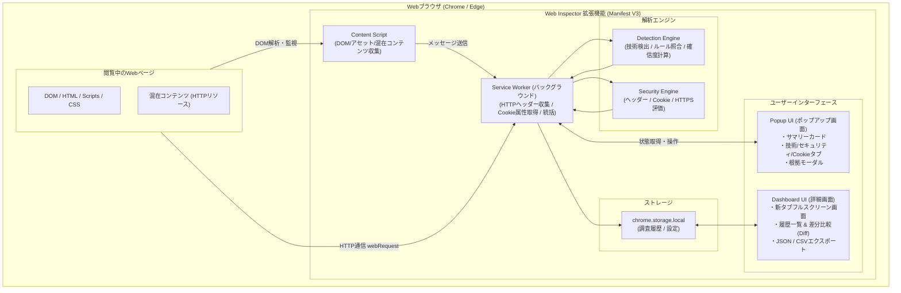
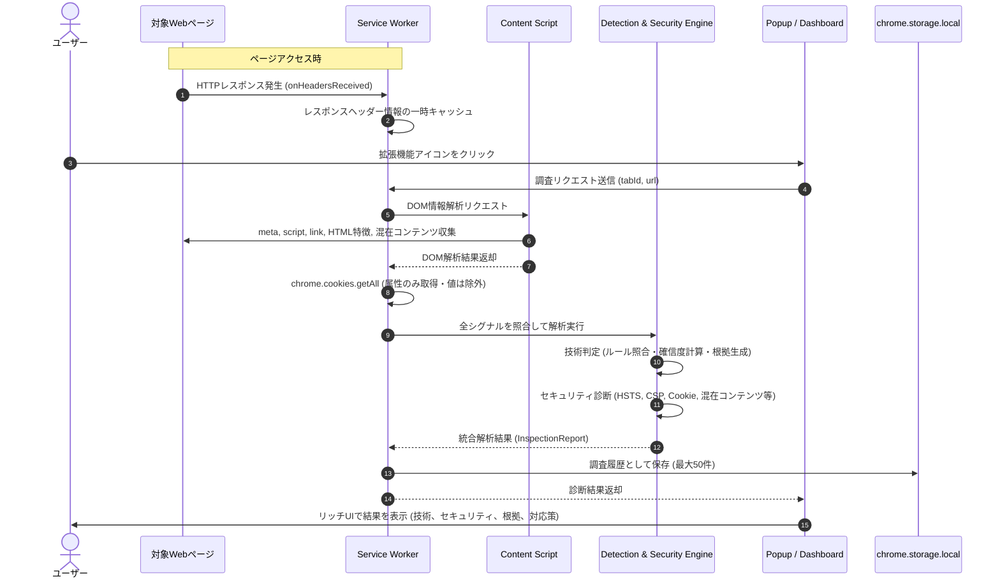
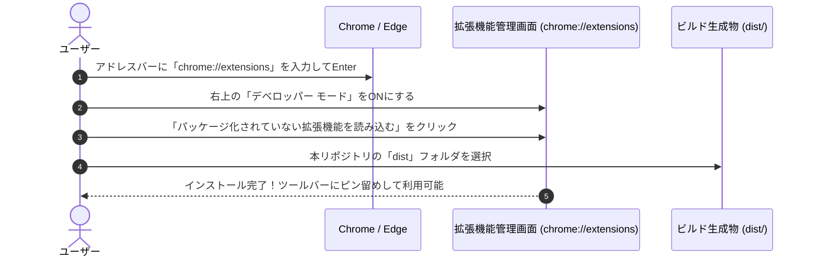

# Web Technology & Security Inspector

[](package.json)
[](public/manifest.json)
[](#インストール方法-chrome--edge)
[](tsconfig.json)

Google Chrome および Microsoft Edge に対応した、Webサイトの使用技術の特定、外部から確認できるセキュリティ設定の診断、**JavaScript/CSSライブラリのバージョン検出、CSS・JS整合性確認、EOL（サポート終了）照合、既知脆弱性（CVE/GHSA）照合、CSPディレクティブ構文解析、Cookie用途別リスク判定、フレームワーク連動推定（Implication Engine 高度化）、ホスティング・外部サービス検出**を行うブラウザ拡張機能（Manifest V3）です。

Wappalyzerのような技術検出機能に加え、保守・セキュリティ管理に不可欠な**「検出根拠（エビデンス）」「直接検出と連動推定の厳密分離」「ランタイム稼働状態」「CSS/JS整合性」「サポート状況（EOL）」「既知脆弱性（CVE）」「CSP構文解析・フォールバック評価」「Cookie用途別重み付け（誤検知削減）」「完全オフライン突合」**まで、ブラウザ内で完結して確認できます。

---

## 目次

- [Web Technology \& Security Inspector](#web-technology--security-inspector)
  - [目次](#目次)
  - [主な特徴・原則](#主な特徴原則)
  - [機能一覧 (v1.6.0)](#機能一覧-v160)
  - [対応技術スタック & 診断カバレッジ (Coverage)](#対応技術スタック--診断カバレッジ-coverage)
  - [システムアーキテクチャ](#システムアーキテクチャ)
    - [診断・通信シーケンス](#診断通信シーケンス)
  - [インストール方法 (Chrome / Edge)](#インストール方法-chrome--edge)
  - [クイックスタート・検証用テスト環境](#クイックスタート検証用テスト環境)
  - [開発・ビルドコマンド](#開発ビルドコマンド)
  - [セキュリティ・プライバシー設計](#セキュリティプライバシー設計)
  - [ディレクトリ構成](#ディレクトリ構成)
  - [ライセンス](#ライセンス)

---

## 主な特徴・原則

- **受動的な調査を基本とする**: 閲覧中のページとそのHTTP通信のみを解析し、ログイン試行や脆弱性攻撃（SQLインジェクション、XSS攻撃等）は一切行いません。
- **完全オフライン・外部送信ゼロ**: 検出されたライブラリや閲覧先URLを外部API（OSV APIやNVD API）へ送信せず、ビルド時に生成された圧縮スナップショットDB（`advisory-db.json`）によりローカルで高速照合します。
- **直接検出と連動推定の分離**: 固有シグナルによる直接検出、技術依存関係による連動検知、証拠のない関連候補を明確に区別し、観測できないサーバー内部の実行状態は「稼働未確認」として安全に扱います。
- **ノイズ（誤検知）削減**: Cookie用途別判定（認証、CSRF、解析タグ、UI設定）により、JavaScript連携が前提のCookieで不要なHttpOnly警告を出さない実効的なスコアリングを実現します。
- **判定根拠の完全追跡**: 「なぜその技術・問題と判定したか」（HTTPレスポンスヘッダー名・値、metaタグ、DOMマーカー、URLパス、フレームワーク連動等）を必ず記録・表示します。

---

## 機能一覧 (v1.6.0)

| 機能ID | 項目 | 概要 |
|---|---|---|
| **IMP-14** | **バックエンドフレームワーク検出** | Spring Boot, ASP.NET Core, Express, FastAPI, Symfony, Flask, NestJS, Fastify, CakePHP, Spring Security の検出と連動推論 |
| **IMP-15** | **フロントエンド・UIライブラリ検出** | Alpine.js, htmx, DataTables, Chart.js, Axios, D3.js, TinyMCE, CKEditor, Font Awesome, Material UI, Astro, SvelteKit の検出 |
| **IMP-16** | **ホスティング・外部サービス検出** | Vercel, Netlify, Firebase Hosting, Azure App Service, AWS ALB / API Gateway, Google Analytics, GTM, Clarity, Sentry, reCAPTCHA, hCaptcha の検出（ホスティング/クラウド、解析、セキュリティサービスに分類） |
| **IMP-17** | **Implication Engine 高度化** | 直接検出（`direct`）、連動検知（`inferred`）、関連候補（`associated`）の3層分離。ランタイム稼働状態（`confirmed` / `possible` / `unknown` / `not-applicable`）の導入、静的配信配慮、推論グラフの循環防止 |
| **IMP-18** | **検出結果の可視化** | UI上で直接・連動・候補をバッジ色分け表示。モーダルでの推論元・推論関係（基盤依存/実行環境候補等）・推論経路および受動的調査制限の明記 |
| **IMP-19** | **CVE/EOL・レポート連携** | 未確定・連動推定技術の確定CVE誤報防止。包括的Markdown（第4節拡張）、Excel対応CSV、整形JSONへの検出方式・連動元・ランタイム状態反映 |
| **F01** | Webサーバー検出 | Apache, Nginx, Microsoft-IIS, LiteSpeed, Caddy 等の検出とバージョン特定 |
| **F02** | サーバーサイド言語検出 | PHP, ASP.NET, Java, Python, Ruby, Node.js 等の検出。`XSRF-TOKEN` 等の汎用Cookieは候補グループとして1行集約 |
| **F03** | CMS検出 | WordPress, Drupal, Joomla, Shopify, Wix 等の検出とバージョン特定 |
| **F04** | JavaScriptフレームワーク検出 | React, Next.js, Vue.js, Nuxt, Angular, Svelte, Astro, SvelteKit 等の検出 |
| **F05** | JS / CSSライブラリ検出 | jQuery, Bootstrap, Tailwind CSS, Lodash, Alpine.js, htmx, DataTables, Chart.js, Axios 等の検出 |
| **IMP-03/06** | オフライン既知脆弱性・EOL照合 | ビルド時静的DB（`advisory-db.json`）による完全ローカルCVE/GHSA/EOL突合（外部送信ゼロ）。脆弱性DB更新日（`YYYY-MM-DD`）を常時明示 |
| **F06** | CDN / WAF推定 | Cloudflare, Amazon CloudFront, Fastly, Akamai 等の検出 |
| **IMP-02** | CSPディレクティブ構文解析 | CSP文字列をパースし、`script-src` $\rightarrow$ `default-src` フォールバックや危険キーワードを詳細評価 |
| **F07** | HTTPセキュリティヘッダー診断 | HSTS, CSP, X-Frame-Options, X-Content-Type-Options, Referrer-Policy, Permissions-Policy, CORS, Server/X-Powered-By情報露出 |
| **IMP-01** | Cookie属性用途別判定 | 認証・CSRF・解析・UI設定に応じた動的重大度判定。誤検知（ノイズ）を大幅削減 |
| **F08** | Cookie属性診断 | Secure, HttpOnly, SameSite, `__Host-`/`__Secure-` プレフィックス整合性、CHIPS (Partitioned) 対応（値は非保持） |
| **F09** | HTTPS・混在コンテンツ診断 | 平文HTTP警告、アクティブ/パッシブ混在コンテンツ（Mixed Content）の検出 |
| **F10** | 検出根拠・確信度表示 | エビデンス種別・値・取得元、確信度スコア（高: 80〜100, 中: 50〜79, 低: 1〜49） |
| **F11 / IMP-12** | 多様なレポート出力 | 整形JSON、Excel対応UTF-8 BOM付きCSV、および仕様書準拠の**15セクション包括的Markdownレポート**の出力 |
| **F12 / IMP-09** | 調査履歴 & 差分比較 (Diff) | 過去の調査レポート保存（最大50件）、一覧検索、2つのレポートの差分比較および推定原因分析 |
| **IMP-10** | 診断項目の許容・除外設定 | 運用要件に基づくリスク受容や誤検知を安定ID（FindingId）に基づいて登録・除外管理 |
| **IMP-11** | 外部通信先・サードパーティ分析 | Public Suffix List (PSL) に基づく登録可能ドメイン（eTLD+1）特定と、First-Party / Third-Party / Local 分類および用途推定 |

---

## 対応技術スタック & 診断カバレッジ (Coverage)

本拡張機能が検出・診断に対応している主要Web技術一覧です。  
※「EOL判定」「既知脆弱性(CVE)照合」が有効な技術は、外部送信を行わず拡張機能内蔵のオフライン脆弱性データベース（`advisory-db.json`）と完全ローカルで精密照合されます。

| 分類 | 対象技術名 | バージョン特定 | EOL判定 | 既知脆弱性 (CVE) | 主な検出手法 |
|---|---|:---:|:---:|:---:|---|
| **Webサーバー** | **Apache HTTP Server** | ✅ | ✅ | ✅ | Serverヘッダー / エビデンス照合 |
| | **Nginx** | ✅ | ✅ | ✅ | Serverヘッダー / エビデンス照合 |
| | Microsoft-IIS | ✅ | - | - | Serverヘッダー |
| | LiteSpeed / Caddy | ✅ | - | - | Serverヘッダー |
| **バックエンドFW / 言語** | Spring Boot / Spring Security | ✅ | - | - | X-Application-Context / エラーページ / Cookie (Javaへ連動) |
| | ASP.NET Core / ASP.NET | ✅ | - | - | Cookie (.AspNetCore.*) / Kestrel / X-AspNet-Version |
| | Express / NestJS / Fastify | ✅ | - | - | X-Powered-By / connect.sid / Cookie (Node.jsへ連動) |
| | FastAPI / Flask / Django | ✅ | - | - | Swagger UI / ReDoc / 固有ヘッダー / Cookie (Pythonへ連動) |
| | CakePHP / Symfony / Laravel | ✅ | - | - | Cookie (cakephp, symfony, laravel_session) (PHPへ連動) |
| | Ruby on Rails | ✅ | - | - | X-Powered-By / metaタグ (Rubyへ連動) |
| | **PHP (ランタイム)** | ✅ | ✅ | ✅ | X-Powered-By / Cookie (PHPSESSID) / 各種FWから連動 |
| | **Node.js (ランタイム)** | ✅ | ✅ | ✅ | Server / 各種FWから連動 (静的配信時は稼働未確認として記録) |
| | Java (ランタイム) | ✅ | - | - | X-Powered-By / Spring Boot等から連動 |
| | Python / Ruby (ランタイム) | ✅ | - | - | Serverヘッダー / 各種FWから連動 |
| **CMS / プラットフォーム** | **WordPress** | ✅ | ✅ | ✅ | meta(generator) / wp-contentパス等 (PHPへ連動) |
| | **Laravel** | ✅ | ✅ | ✅ | Cookie (laravel_session) / X-Powered-By (PHPへ連動) |
| | Drupal / Joomla | ✅ | - | - | generator / metaタグ (PHPへ連動) |
| | Shopify / Wix | ✅ | - | - | 静的アセットURL / DOM構造 |
| **フロントエンドFW / UI** | **React** | ✅ | ✅ | ✅ | DOM属性 / script / 実行時シンボル / Next.js等から連動 |
| | **Vue.js** | ✅ | ✅ | ✅ | DOM(__vue__) / script / Nuxtから連動 |
| | **Angular** | ✅ | ✅ | ✅ | DOM(ng-version) / script |
| | **jQuery** | ✅ | ✅ | ✅ | script.src / グローバル(window.jQuery) |
| | **Bootstrap** | ✅ | ✅ | ✅ | script / link(CSS) / CSS-JS整合性 |
| | Next.js / Nuxt | ✅ | - | - | `__NEXT_DATA__` / `__NUXT__` (React/Vue/Node.jsへ連動) |
| | Astro / SvelteKit / Svelte | ✅ | - | - | meta(generator) / DOMマーカー / アセットパス |
| | Alpine.js / htmx | ✅ | - | - | DOMマーカー (`[x-data]`, `[hx-get]`) |
| | DataTables / Chart.js / Axios / D3.js | ✅ | - | - | script.src / アセットURL |
| | TinyMCE / CKEditor | ✅ | - | - | DOMマーカー / script.src |
| | Font Awesome / Material UI | ✅ | - | - | link(CSS) / CSSクラス (`Mui*-`) |
| | Tailwind CSS / Lodash | ✅ | - | - | 固有ユーティリティクラス / script.src |
| **ホスティング / クラウド** | Vercel / Netlify | ✅ | - | - | Serverヘッダー / X-Vercel-Id / X-Nf-Request-Id |
| | Firebase Hosting | ✅ | - | - | X-Firebase-Hosting ヘッダー |
| | Azure App Service | ✅ | - | - | Cookie (ARRAffinity, ARRAffinitySameSite) |
| | AWS ALB / API Gateway | ✅ | - | - | Cookie (AWSALB) / X-Amzn-Trace-Id / x-amz-apigw-id |
| **CDN / WAF** | Cloudflare | ✅ | - | - | CF-Ray, Server, cf-cache-status |
| | Amazon CloudFront | ✅ | - | - | X-Amz-Cf-Id, Via |
| | Fastly / Akamai | ✅ | - | - | X-Served-By, Server |
| **アクセス解析 / 監視** | Google Analytics / GTM | ✅ | - | - | script.src (gtm.js, analytics.js等) |
| | Microsoft Clarity | ✅ | - | - | script.src (clarity.ms) |
| | Sentry | ✅ | - | - | script.src (browser.sentry-cdn.com) |
| **セキュリティサービス** | reCAPTCHA / hCaptcha | ✅ | - | - | script.src (recaptcha/api.js, hcaptcha.com) |

## システムアーキテクチャ



### 診断・通信シーケンス



---

## インストール方法 (Chrome / Edge)

ビルド済みのパッケージ（`dist` ディレクトリ）をブラウザに読み込ませることで、すぐに利用できます。



1. Google Chrome または Microsoft Edge を開きます。
2. アドレスバーに `chrome://extensions`（Edgeの場合は `edge://extensions`）と入力してEnterキーを押します。
3. 画面右上にある **「デベロッパー モード」** のトグルを **ON** にします。
4. 画面左上に表示される **「パッケージ化されていない拡張機能を読み込む」** ボタンをクリックします。
5. ファイル選択ダイアログで、本プロジェクトの **`dist`** フォルダを選択します。
6. 拡張機能一覧に「Web Technology & Security Inspector」が表示されればインストール完了です。

---

## クイックスタート・検証用テスト環境

拡張機能の全機能をローカルで安全にテストできるよう、PHP 8.2、Apache 2.4、WordPress 6.4、React、Next.js、Tailwind CSS、および各種セキュリティヘッダー・Cookieをシミュレートするテストサーバーが同梱されています。

```bash
# テストサーバーの起動 (ポート 3000)
npm run test-server
```

1. ブラウザで `http://localhost:3000` を開きます。
2. ナビゲーションから各テスト用エンドポイントを検証できます：
   - `http://localhost:3000/insecure-cookie`: **Cookie用途別判定 (IMP-01)**（認証系Cookie警告、CSRFのHttpOnly許容、設定Cookieのノイズ削減）
   - `http://localhost:3000/loose-csp`: **CSPディレクティブ構文解析 (IMP-02)**（`unsafe-inline`、`unsafe-eval`、`*`、`object-src` 未指定等の詳細検知）
   - `http://localhost:3000/legacy-lib`: **レガシーライブラリ照合 (IMP-03)**（古い jQuery 2.2.4、WordPress 5.2、PHP 7.4のオフライン既知脆弱性・EOL検知）
3. ツールバーの **「Web Inspector」アイコン** をクリックし、診断結果と根拠を確認できます。

---

## 開発・ビルドコマンド

```bash
# 依存パッケージのインストール
npm install

# 本番用ビルド (dist/ フォルダに拡張機能アセットを生成)
npm run build

# ファイル変更監視ビルド (開発用)
npm run watch

# 単体テスト実行 (Vitest / 全125テスト)
npm test

# 検証用テストサーバー起動 (ポート 3000)
npm run test-server

# オフライン脆弱性DBの整合性・サイズ検証
npm run advisories:validate

# オフライン脆弱性DBの最新化 (OSV/NVDから同期)
npm run advisories:sync

# Chrome Web Store配布用ZIPパッケージ作成 (検証 → ビルド → ZIP生成)
npm run package
```

> [!TIP]
> **ドキュメント・運用ガイド:**  
> - **技術判定基準**: [技術検出仕様・判定基準書 (`docs/DETECTION_SPECIFICATION.md`)](./docs/DETECTION_SPECIFICATION.md) （全対応技術の観測シグナル・正規表現・Implication連動マトリクス）
> - **開発計画・設計書**: [全体統括開発計画書 (`docs/DEVELOPMENT_PLAN.md`)](./docs/DEVELOPMENT_PLAN.md) （アーキテクチャ・Phase 1〜6フェーズ別詳細計画）
> - **運用手順**: [保守・リリース運用ガイド (`docs/MAINTENANCE_GUIDE.md`)](./docs/MAINTENANCE_GUIDE.md) （バージョンアップ手順・脆弱性DB更新手順・チェックリスト）

---

## セキュリティ・プライバシー設計

本ツールはセキュリティ調査ツール自体がユーザーの情報を漏えいさせないよう、厳格なプライバシー設計を採用しています。

- **Cookie値の完全除外**: Cookieは名前、ドメイン、パス、Secure、HttpOnly、SameSite、有効期限のみを検査し、**Cookieの値（Value）は一切取得・保存・ログ出力しません**。
- **外部送信ゼロ**: 収集した通信情報やDOM情報はブラウザ内（Service Workerおよび`chrome.storage.local`）でのみ処理され、外部の解析サーバーへ送信されることはありません。
- **受動的・安全**: 対象Webサイトに対して悪意あるペイロードや過度なリクエストを送信せず、通常のページ閲覧に伴う通信のみを分析します。
- **履歴管理**: 調査結果はローカルに保存され、ユーザー自身の操作により1件ずつの削除、または全履歴の完全クリアが可能です。

---

## ディレクトリ構成

```text
siteChecker/
├── public/                  # 静的アセット
│   ├── manifest.json        # Manifest V3 定義
│   └── icons/               # 拡張機能アイコン (16x16, 48x48, 128x128)
├── src/
│   ├── background/
│   │   └── service-worker.ts # HTTPレスポンスヘッダー傍受・Cookie取得・統括
│   ├── content/
│   │   └── content-script.ts # DOM・meta・script・混在コンテンツ収集
│   ├── detection/           # 技術検出エンジン
│   │   ├── engine.ts        # 検出エンジン本体
│   │   ├── confidence.ts    # 確信度計算ロジック (0〜100, 高/中/低)
│   │   └── rules/           # JSON検出ルール
│   │       ├── server.json   # Webサーバー
│   │       ├── language.json # 開発言語 (PHP, Python, Java, Node.js等)
│   │       ├── backend.json  # バックエンドFW (Spring, Express, FastAPI等)
│   │       ├── cms.json      # CMS (WordPress, Drupal等)
│   │       ├── frontend.json # フロントエンド (React, Vue, Tailwind, Astro等)
│   │       ├── services.json # クラウド・外部サービス (Vercel, GA, Sentry等)
│   │       └── cdn-waf.json  # CDN / WAF (Cloudflare, CloudFront等)
│   ├── security/            # セキュリティ診断エンジン
│   │   ├── engine.ts        # 統合セキュリティエンジン
│   │   ├── headers.ts       # HTTPヘッダー診断 (HSTS, CSP, XFO, CORS等)
│   │   ├── cookies.ts       # Cookie属性診断 (Secure, HttpOnly, プレフィックス)
│   │   └── https.ts         # HTTPS・混在コンテンツ診断
│   ├── storage/
│   │   └── history.ts       # 履歴管理 (保存・検索・Diff比較)
│   ├── export/
│   │   ├── json.ts          # JSONエクスポート
│   │   └── csv.ts           # Excel対応UTF-8 BOM付きCSVエクスポート
│   ├── popup/               # ポップアップ画面
│   │   ├── popup.css
│   │   └── popup.ts
│   ├── dashboard/           # 詳細ダッシュボード画面
│   │   ├── dashboard.css
│   │   └── dashboard.ts
│   └── shared/
│       └── types.ts         # 共通型定義
├── test-server/             # 動作検証用モックサーバー
│   └── server.mjs
├── tests/                   # 単体テスト (Vitest)
│   ├── detection.test.ts
│   ├── security.test.ts
│   └── export.test.ts
├── popup.html               # ポップアップHTMLエントリー
├── dashboard.html           # ダッシュボードHTMLエントリー
├── dist/                    # Chrome読み込み用ビルド生成物
├── package.json
├── tsconfig.json
└── vite.config.ts
```

---

## ライセンス

MIT License
