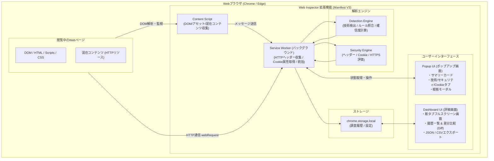
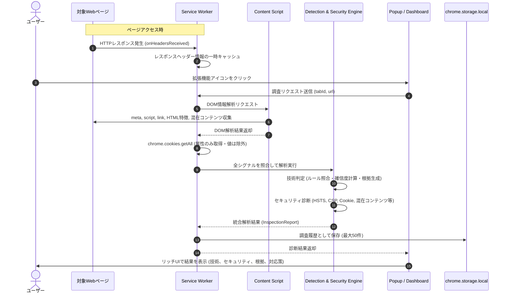
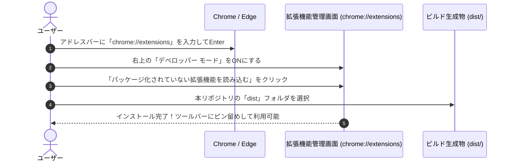

# Web Technology & Security Inspector

[](package.json)
[](public/manifest.json)
[](#インストール方法-chrome--edge)
[](tsconfig.json)

Google Chrome および Microsoft Edge に対応した、Webサイトの使用技術の特定、外部から確認できるセキュリティ設定の診断、**JavaScript/CSSライブラリのバージョン検出、CSS・JS整合性確認、EOL（サポート終了）照合、既知脆弱性（CVE/GHSA）照合、CSPディレクティブ構文解析、Cookie用途別リスク判定**を行うブラウザ拡張機能（Manifest V3）です。

Wappalyzerのような技術検出機能に加え、保守・セキュリティ管理に不可欠な**「検出根拠（エビデンス）」「CSS/JS整合性」「サポート状況（EOL）」「既知脆弱性（CVE）」「CSP構文解析・フォールバック評価」「Cookie用途別重み付け（誤検知削減）」「完全オフライン突合」**まで、ブラウザ内で完結して確認できます。

---

## 目次

- [Web Technology \& Security Inspector](#web-technology--security-inspector)
  - [目次](#目次)
  - [主な特徴・原則](#主な特徴原則)
  - [機能一覧 (v1.3.4)](#機能一覧-v134)
  - [対応技術スタック & 診断カバレッジ (Coverage)](#対応技術スタック--診断カバレッジ-coverage)
  - [システムアーキテクチャ](#システムアーキテクチャ)
    - [診断・通信シーケンス](#診断通信シーケンス)
  - [インストール方法 (Chrome / Edge)](#インストール方法-chrome--edge)
  - [クイックスタート・検証用テスト環境](#クイックスタート検証用テスト環境)
  - [開発・ビルドコマンド](#開発ビルドコマンド)
  - [セキュリティ・プライバシー設計](#セキュリティプライバシー設計)
  - [ディレクトリ構成](#ディレクトリ構成)
  - [ライセンス](#ライセンス)

---

## 主な特徴・原則

- **受動的な調査を基本とする**: 閲覧中のページとそのHTTP通信のみを解析し、ログイン試行や脆弱性攻撃（SQLインジェクション、XSS攻撃等）は一切行いません。
- **完全オフライン・外部送信ゼロ**: 検出されたライブラリや閲覧先URLを外部API（OSV APIやNVD API）へ送信せず、ビルド時に生成された圧縮スナップショットDB（`advisory-db.json`）によりローカルで高速照合します。
- **ノイズ（誤検知）削減**: Cookie用途別判定（認証、CSRF、解析タグ、UI設定）により、JavaScript連携が前提のCookieで不要なHttpOnly警告を出さない実効的なスコアリングを実現します。
- **判定根拠の完全追跡**: 「なぜその技術・問題と判定したか」（HTTPレスポンスヘッダー名・値、metaタグ、DOMマーカー、URLパス等）を必ず記録・表示します。
- **未検出と未使用の明確な区別**: 外部から確証が得られない場合は安易に「未使用」「安全」と断定せず、「不明」または未検出として扱います。

---

## 機能一覧 (v1.3.4)

| 機能ID | 項目 | 概要 |
|---|---|---|
| **F01** | Webサーバー検出 | Apache, Nginx, Microsoft-IIS, LiteSpeed, Caddy 等の検出とバージョン特定 |
| **F02** | サーバーサイド言語・FW検出 | PHP, ASP.NET, Java, Python (Django), Ruby on Rails, Laravel 等の検出 |
| **F03** | CMS検出 | WordPress, Drupal, Joomla, Shopify, Wix 等の検出とバージョン特定 |
| **F04** | JavaScriptフレームワーク検出 | React, Next.js, Vue.js, Nuxt, Angular, Svelte 等の検出 |
| **F05** | JS / CSSライブラリ検出 | jQuery, Bootstrap, Tailwind CSS, Lodash 等の検出 |
| **IMP-03/06** | オフライン既知脆弱性・EOL照合 | ビルド時静的DB（`advisory-db.json`）による完全ローカルCVE/GHSA/EOL突合（外部送信ゼロ）。脆弱性DB更新日（`YYYY-MM-DD`）をUIおよびレポートに常時明示 |
| **F06** | CDN / WAF推定 | Cloudflare, Amazon CloudFront, Fastly, Akamai 等の検出 |
| **IMP-02** | CSPディレクティブ構文解析 | CSP文字列をパースし、`script-src` $\rightarrow$ `default-src` フォールバックや危険キーワード（`'unsafe-inline'`, `'unsafe-eval'`, `*`, `data:`, `object-src`）を詳細評価 |
| **F07** | HTTPセキュリティヘッダー診断 | HSTS, CSP, X-Frame-Options, X-Content-Type-Options, Referrer-Policy, Permissions-Policy, CORS, Server/X-Powered-By情報露出 |
| **IMP-01** | Cookie属性用途別判定 | 認証・CSRF・解析・UI設定に応じた動的重大度判定。誤検知（ノイズ）を大幅削減 |
| **F08** | Cookie属性診断 | Secure, HttpOnly, SameSite, `__Host-`/`__Secure-` プレフィックス整合性、CHIPS (Partitioned) 対応（値は非保持） |
| **F09** | HTTPS・混在コンテンツ診断 | 平文HTTP警告、アクティブ/パッシブ混在コンテンツ（Mixed Content）の検出 |
| **F10** | 検出根拠・確信度表示 | エビデンス種別・値・取得元、確信度スコア（高: 80〜100, 中: 50〜79, 低: 1〜49） |
| **F11 / IMP-12** | 多様なレポート出力 | 整形JSON、Excel対応UTF-8 BOM付きCSV、および仕様書Rev.2.1準拠の**15セクション包括的Markdownレポート**の出力 |
| **F12 / IMP-09** | 調査履歴 & 差分比較 (Diff) | 過去の調査レポート保存（最大50件）、一覧検索、2つのレポートの差分比較および**推定原因分析（サイト側変更、脆弱性DB更新、調査権限差等）** |
| **IMP-10** | 診断項目の許容・除外設定 | 運用要件に基づくリスク受容や誤検知を安定ID（FindingId）に基づいて登録・除外管理（通知抑制） |
| **IMP-11** | 外部通信先・サードパーティ分析 | Public Suffix List (PSL) に基づく登録可能ドメイン（eTLD+1）特定と、First-Party / Third-Party / Local 分類および用途推定（CDN, Analytics, Ads, Fonts, API等） |

---

## 対応技術スタック & 診断カバレッジ (Coverage)

本拡張機能が検出・診断に対応している主要技術一覧です。  
※「EOL判定」「既知脆弱性(CVE)照合」が有効な技術は、外部送信を行わず拡張機能内蔵のオフライン脆弱性データベース（`advisory-db.json`）と完全ローカルで精密照合されます。

| 分類 | 対象技術名 | バージョン特定 | EOL判定 | 既知脆弱性 (CVE) | 主な検出手法 |
|---|---|:---:|:---:|:---:|---|
| **Webサーバー** | **Apache HTTP Server** | ✅ | ✅ | ✅ | Serverヘッダー / エビデンス照合 |
| | **Nginx** | ✅ | ✅ | ✅ | Serverヘッダー / エビデンス照合 |
| | Microsoft-IIS | ✅ | - | - | Serverヘッダー |
| | LiteSpeed / Caddy | ✅ | - | - | Serverヘッダー |
| **言語・ランタイム** | **PHP** | ✅ | ✅ | ✅ | X-Powered-By / Cookie (PHPSESSID) |
| | Python (Django) | ✅ | - | - | 固有ヘッダー / Cookie (csrftoken) |
| | Ruby on Rails | ✅ | - | - | X-Powered-By / metaタグ |
| | ASP.NET | ✅ | - | - | X-AspNet-Version / Cookie |
| | Java (Tomcat等) | ✅ | - | - | X-Powered-By / Cookie (JSESSIONID) |
| **CMS** | **WordPress** | ✅ | ✅ | ✅ | meta(generator) / wp-contentパス等 |
| | Drupal | ✅ | - | - | X-Generator / metaタグ |
| | Joomla | ✅ | - | - | meta(generator) |
| | Shopify / Wix | ✅ | - | - | 静的アセットURL / DOM構造 |
| **フロントエンド** | **jQuery** | ✅ | ✅ | ✅ | script.src / グローバル(window.jQuery) |
| | **Bootstrap** | ✅ | ✅ | ✅ | script / link(CSS) / CSS-JS整合性 |
| | **React** | ✅ | ✅ | ✅ | DOM属性 / script / 実行時シンボル |
| | **Vue.js** | ✅ | ✅ | ✅ | DOM(__vue__) / script |
| | **Angular** | ✅ | ✅ | ✅ | DOM(ng-version) / script |
| | **Lodash** | ✅ | ✅ | ✅ | script.src / グローバル(window._) |
| | Next.js / Nuxt | ✅ | - | - | `__NEXT_DATA__` / `__NUXT__` |
| | Svelte | ✅ | - | - | クラス名 / DOMマーカー |
| | Tailwind CSS | ✅ | - | - | 固有ユーティリティCSSクラス |
| **CDN / WAF** | Cloudflare | ✅ | - | - | CF-Ray, Server, cf-cache-status |
| | Amazon CloudFront | ✅ | - | - | X-Amz-Cf-Id, Via |
| | Fastly / Akamai | ✅ | - | - | X-Served-By, Server |

## システムアーキテクチャ



### 診断・通信シーケンス



---

## インストール方法 (Chrome / Edge)

ビルド済みのパッケージ（`dist` ディレクトリ）をブラウザに読み込ませることで、すぐに利用できます。



1. Google Chrome または Microsoft Edge を開きます。
2. アドレスバーに `chrome://extensions`（Edgeの場合は `edge://extensions`）と入力してEnterキーを押します。
3. 画面右上にある **「デベロッパー モード」** のトグルを **ON** にします。
4. 画面左上に表示される **「パッケージ化されていない拡張機能を読み込む」** ボタンをクリックします。
5. ファイル選択ダイアログで、本プロジェクトの **`dist`** フォルダを選択します。
6. 拡張機能一覧に「Web Technology & Security Inspector」が表示されればインストール完了です。

---

## クイックスタート・検証用テスト環境

拡張機能の全機能をローカルで安全にテストできるよう、PHP 8.2、Apache 2.4、WordPress 6.4、React、Next.js、Tailwind CSS、および各種セキュリティヘッダー・Cookieをシミュレートするテストサーバーが同梱されています。

```bash
# テストサーバーの起動 (ポート 3000)
npm run test-server
```

1. ブラウザで `http://localhost:3000` を開きます。
2. ナビゲーションから各テスト用エンドポイントを検証できます：
   - `http://localhost:3000/insecure-cookie`: **Cookie用途別判定 (IMP-01)**（認証系Cookie警告、CSRFのHttpOnly許容、設定Cookieのノイズ削減）
   - `http://localhost:3000/loose-csp`: **CSPディレクティブ構文解析 (IMP-02)**（`unsafe-inline`、`unsafe-eval`、`*`、`object-src` 未指定等の詳細検知）
   - `http://localhost:3000/legacy-lib`: **レガシーライブラリ照合 (IMP-03)**（古い jQuery 2.2.4、WordPress 5.2、PHP 7.4のオフライン既知脆弱性・EOL検知）
3. ツールバーの **「Web Inspector」アイコン** をクリックし、診断結果と根拠を確認できます。

---

## 開発・ビルドコマンド

```bash
# 依存パッケージのインストール
npm install

# 本番用ビルド (dist/ フォルダに拡張機能パッケージを生成)
npm run build

# ファイル変更監視ビルド (開発用)
npm run watch

# 単体テスト実行 (Vitest)
npm test

# 検証用テストサーバー起動
npm run test-server
```

---

## セキュリティ・プライバシー設計

本ツールはセキュリティ調査ツール自体がユーザーの情報を漏えいさせないよう、厳格なプライバシー設計を採用しています。

- **Cookie値の完全除外**: Cookieは名前、ドメイン、パス、Secure、HttpOnly、SameSite、有効期限のみを検査し、**Cookieの値（Value）は一切取得・保存・ログ出力しません**。
- **外部送信ゼロ**: 収集した通信情報やDOM情報はブラウザ内（Service Workerおよび`chrome.storage.local`）でのみ処理され、外部の解析サーバーへ送信されることはありません。
- **受動的・安全**: 対象Webサイトに対して悪意あるペイロードや過度なリクエストを送信せず、通常のページ閲覧に伴う通信のみを分析します。
- **履歴管理**: 調査結果はローカルに保存され、ユーザー自身の操作により1件ずつの削除、または全履歴の完全クリアが可能です。

---

## ディレクトリ構成

```text
siteChecker/
├── public/                  # 静的アセット
│   ├── manifest.json        # Manifest V3 定義
│   └── icons/               # 拡張機能アイコン (16x16, 48x48, 128x128)
├── src/
│   ├── background/
│   │   └── service-worker.ts # HTTPレスポンスヘッダー傍受・Cookie取得・統括
│   ├── content/
│   │   └── content-script.ts # DOM・meta・script・混在コンテンツ収集
│   ├── detection/           # 技術検出エンジン
│   │   ├── engine.ts        # 検出エンジン本体
│   │   ├── confidence.ts    # 確信度計算ロジック (0〜100, 高/中/低)
│   │   └── rules/           # JSON検出ルール
│   │       ├── server.json   # Webサーバー
│   │       ├── language.json # 開発言語・フレームワーク
│   │       ├── cms.json      # CMS
│   │       ├── frontend.json # フロントエンド (React, Vue, Tailwind等)
│   │       └── cdn-waf.json  # CDN / WAF
│   ├── security/            # セキュリティ診断エンジン
│   │   ├── engine.ts        # 統合セキュリティエンジン
│   │   ├── headers.ts       # HTTPヘッダー診断 (HSTS, CSP, XFO, CORS等)
│   │   ├── cookies.ts       # Cookie属性診断 (Secure, HttpOnly, プレフィックス)
│   │   └── https.ts         # HTTPS・混在コンテンツ診断
│   ├── storage/
│   │   └── history.ts       # 履歴管理 (保存・検索・Diff比較)
│   ├── export/
│   │   ├── json.ts          # JSONエクスポート
│   │   └── csv.ts           # Excel対応UTF-8 BOM付きCSVエクスポート
│   ├── popup/               # ポップアップ画面
│   │   ├── popup.css
│   │   └── popup.ts
│   ├── dashboard/           # 詳細ダッシュボード画面
│   │   ├── dashboard.css
│   │   └── dashboard.ts
│   └── shared/
│       └── types.ts         # 共通型定義
├── test-server/             # 動作検証用モックサーバー
│   └── server.mjs
├── tests/                   # 単体テスト (Vitest)
│   ├── detection.test.ts
│   ├── security.test.ts
│   └── export.test.ts
├── popup.html               # ポップアップHTMLエントリー
├── dashboard.html           # ダッシュボードHTMLエントリー
├── dist/                    # Chrome読み込み用ビルド生成物
├── package.json
├── tsconfig.json
└── vite.config.ts
```

---

## ライセンス

MIT License
