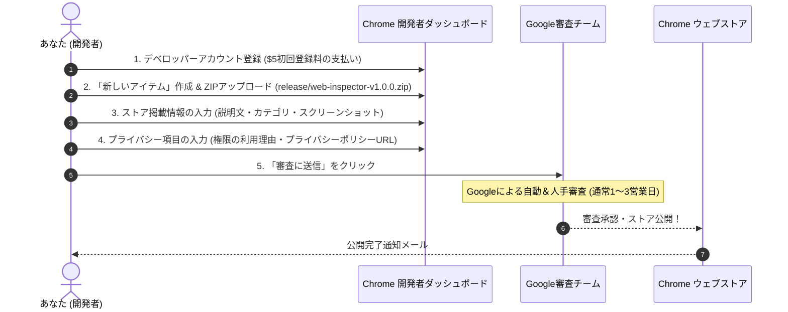

# Chrome ウェブストア 出展・公開完全ガイド

本ドキュメントは、**Web Technology & Security Inspector** を Chrome ウェブストア（Chrome Web Store）に公開するための手順書および申請用テンプレートです。

---

## 1. 全体公開フロー



---

## 2. 事前準備物チェックリスト

- [x] **配布用ZIPパッケージ**: `release/web-inspector-v1.0.0.zip`（`npm run package` で自動生成）
- [x] **プライバシーポリシー**: [PRIVACY_POLICY.md](../PRIVACY_POLICY.md)
  - 公開URL: `https://github.com/moritama/web-inspector/blob/main/PRIVACY_POLICY.md`
- [x] **アプリアイコン**: `public/icons/icon128.png`（128x128 PNG）
- [ ] **スクリーンショット**: 1280x800 または 640x400 のPNG/JPEG画像（最低1枚、最大5枚）
  - ※ブラウザで拡張機能のポップアップ画面や詳細ダッシュボードを開いてスクリーンショットを撮影してください。

---

## 3. Chrome デベロッパー登録（初回のみ）

1. **[Chrome 開発者ダッシュボード](https://chrome.google.com/webstore/devconsole)** にアクセスします。
2. Googleアカウントでログインし、開発者規約に同意します。
3. 初回登録手数料（$5 USD、1回のみの買い切り）をクレジットカードで支払います。

---

## 4. ストア掲載情報（コピペ用テンプレート）

ダッシュボードの **「ストアの掲載情報」** 欄に入力するテキストです。

### 拡張機能の名前
```text
Web Technology & Security Inspector
```

### 簡単な説明 (132文字以内)
```text
Webサイトの使用技術（CMS/サーバー/フレームワーク）の検出と、受動的なセキュリティ設定（ヘッダー/Cookie等）の診断を行います。
```
*(英語用 short description)*
```text
Inspect web technologies, CMS, server-side frameworks, and evaluate HTTP security headers and cookie configurations locally.
```

### 詳細な説明 (Description)
```text
Webサイトの使用技術の特定と、外部から確認できるセキュリティ設定の受動的診断を行うセキュリティ調査ツールです。

【主な特徴】
・受動的調査（パッシブ解析）: 閲覧中のページとHTTP通信をローカルで分析し、ログイン試行や攻撃リクエストは一切行いません。
・判定根拠（エビデンス）の完全追跡: 検出された技術やセキュリティ指摘について、どのヘッダーやmetaタグ、スクリプトURLから判定したかを明示します。
・ブラウザ内完結・プライバシー保護: 外部サーバーへのデータ送信は一切行いません。Cookieの値（Value）も保存・取得せず、属性（Secure, HttpOnly, SameSite）のみを安全に診断します。

【機能一覧】
1. 使用技術の特定
   - Webサーバー（Apache, Nginx, IIS, LiteSpeed, Caddy 等）
   - サーバーサイド言語・フレームワーク（PHP, ASP.NET, Java, Python/Django, Ruby on Rails, Laravel 等）
   - CMS（WordPress, Drupal, Joomla, Shopify, Wix 等）
   - フロントエンド（React, Next.js, Vue.js, Nuxt, Angular, Svelte, Tailwind CSS, Bootstrap, jQuery 等）
   - CDN / WAF（Cloudflare, AWS CloudFront, Fastly, Akamai 等）
2. セキュリティ診断
   - HTTPセキュリティヘッダー（HSTS, CSP, X-Frame-Options, X-Content-Type-Options, Referrer-Policy, Permissions-Policy, CORS設定）
   - バックエンド技術情報の露出（Server, X-Powered-By ヘッダー）
   - Cookie属性診断（Secure, HttpOnly, SameSite, __Host- / __Secure- プレフィックス整合性）
   - HTTPSおよび混在コンテンツ（Mixed Content）の検出
3. レポート＆履歴機能
   - ポップアップ画面でのクイック確認＆詳細モーダル
   - フルスクリーン詳細ダッシュボード画面
   - 調査結果のJSONおよびExcel対応UTF-8 BOM付きCSVエクスポート
   - 過去の調査履歴管理＆2つの調査結果の差分比較（Diff）
```

### カテゴリ
- **デベロッパー ツール (Developer Tools)**

---

## 5. プライバシー項目の入力（審査通過の最重要項目）

ダッシュボードの **「プライバシー規約」** タブで、Googleの審査チームに対して各パーミッションの利用理由（Justification）を申告します。
審査がスムーズに通るよう、英語で明確に記述した以下の文章をそのまま貼り付けてください。

### 1. 単一用途 (Single Purpose) の説明
```text
The extension serves a single purpose: to inspect and display the web technologies and passive security configurations of the web pages actively visited by the user.
```

### 2. 権限の正当化 (Permission Justifications)

> **重要**: 以下の文面が Chrome ウェブストア申請時（権限理由入力欄）の**正本**です。

#### 英語 (English - CWS Input)
| 要求される権限 | 入力する理由説明 (Justification) |
|---|---|
| **cookies** | Used to passively evaluate Cookie names and security attributes (Secure, HttpOnly, SameSite) via the Cookies API. Cookie values are not used, stored, or transmitted. The temporary header cache (browser session only) excludes credential-bearing headers such as Set-Cookie, and Set-Cookie headers are not received. |
| **webRequest** | Required to passively observe HTTP response headers (such as Strict-Transport-Security, Content-Security-Policy, X-Frame-Options, and Server) for security diagnosis without modifying requests. Only headers needed for technology detection and security checks are kept (a fixed allowlist). Stored URLs exclude query strings and fragments. |
| **activeTab** / **scripting** | Required to inject a lightweight content script to extract DOM signatures (meta tags, script URLs, CSS utility classes, and mixed content resources) of the active tab upon user request. |
| **storage** | Required to store user inspection history locally on the device (using chrome.storage.local) so that users can review past reports and compare diffs. |
| **Host Permissions (`<all_urls>`)** | Required to allow technology detection and header inspection on any public website visited and requested by the user. |

#### 日本語 (参考・日本語コンソール用)
| 要求される権限 | 入力する理由説明 (日本語) |
|---|---|
| **cookies** | 調査対象ドメインの Cookie の名前と、Secure、HttpOnly、SameSite などの属性を、Cookie API から受動的に診断します。Cookie の値(Value)は使用せず、保存も外部送信もしません。レスポンスヘッダーの一時保持(ブラウザのセッション限り)にも、Set-Cookie など認証情報を含みうるヘッダーは含めず、Set-Cookie ヘッダーは受信しません。 |
| **webRequest** | 外部から確認できるHTTPレスポンスヘッダー（HSTS, CSP, X-Frame-Options, Server等）を受動的に診断するために必要です（通信の改変は行いません）。保持するのは、技術検出とセキュリティ診断に必要なヘッダーだけです(固定の許可リスト)。保存する URL は、クエリとフラグメントを除いたものです。 |
| **activeTab** / **scripting** | ユーザーの操作時にアクティブなタブへ軽量なスクリプトを注入し、DOM特徴（metaタグ、スクリプトURL、CSSクラス、混在コンテンツ）を受動的に抽出するために必要です。 |
| **storage** | ユーザー自身の調査履歴を端末内（`chrome.storage.local`）にローカル保存し、過去の診断レポートの振り返りや差分比較を行えるようにするために必要です。 |
| **Host Permissions (`<all_urls>`)** | ユーザーが訪問し調査を要求した任意の公開Webサイトで使用技術の特定とヘッダー診断を実行できるようにするために必要です。 |

### 3. バージョン別更新内容 (What's New in This Version)

#### 【v1.6.5 更新内容 (ストア入力用)】
```text
【v1.6.5 更新内容】
・レスポンスヘッダーの一時保持を、技術検出とセキュリティ診断に必要なヘッダーだけに限定しました(Set-Cookie など認証情報を含みうるヘッダーは保持しません)。
・一時保持する URL から、クエリとフラグメントを除きました。
・ヘッダーを取得できたかどうかの判定を、保持したヘッダーの数に依存しないよう改善しました。
```

### 4. データ使用状況 (Data Usage)
- 「データを収集していますか？」の質問に対して：
  - **「いいえ、ユーザーデータを収集または使用していません (No, I do not collect or use user data)」** を選択します。
  - すべての処理はローカルで実行され、外部通信は行われません。

### 5. プライバシーポリシーのURL
```text
https://github.com/moritama/web-inspector/blob/main/PRIVACY_POLICY.md
```

---

## 6. アップロード手順

1. ターミナルで `npm run package` を実行し、最新の `release/web-inspector-v1.0.0.zip` を作成します。
2. Chrome デベロッパー ダッシュボードで **「新しいアイテム」** をクリックし、作成されたZIPファイルをアップロードします。
3. 上記の **ストア掲載情報** と **プライバシー情報** を入力します。
4. スクリーンショットを1〜5枚アップロードします。
5. 右上の **「審査に送信」** ボタンをクリックします。

通常、1〜3営業日以内にGoogle審査チームによる確認が行われ、承認されるとChromeウェブストアで一般公開されます！
