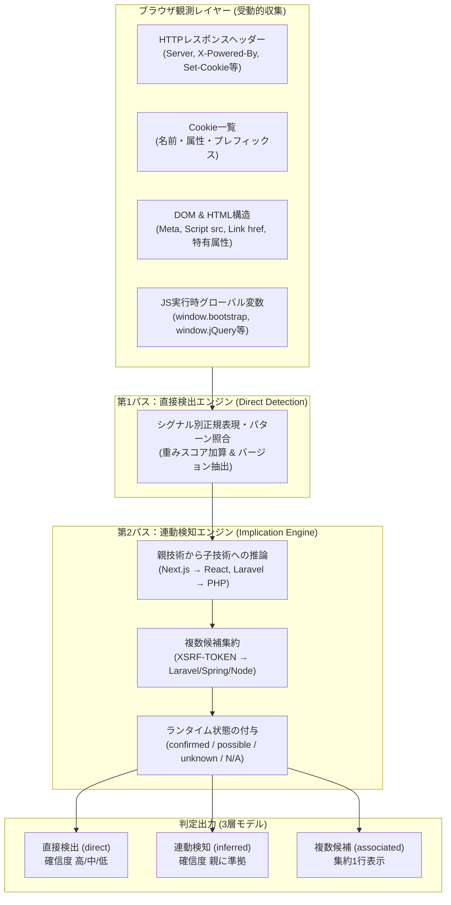
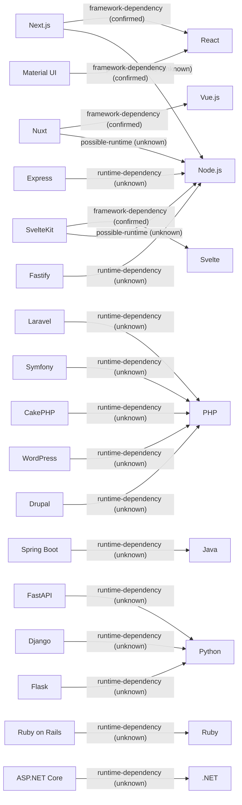
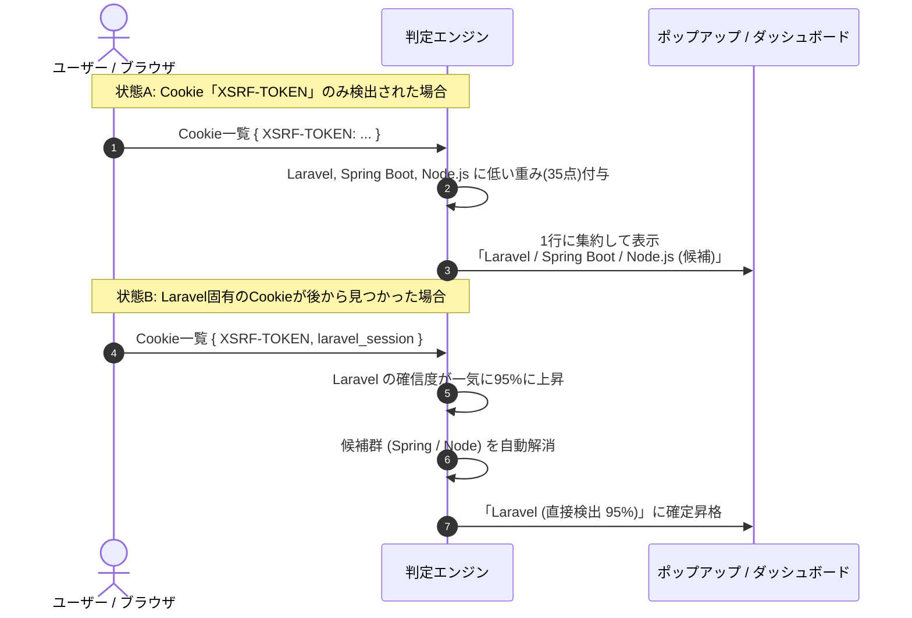

# Web Technology & Security Inspector 技術検出仕様および判定基準書

**対象バージョン：** v1.6.0  
**最終更新日：** 2026年10月24日  
**対象コンポーネント：** `src/detection/` (ルール定義・判定エンジン・推論エンジン)

---

## 1. 基本設計方針と判定アーキテクチャ

本ツール（Web Inspector）は、Webサイトの閲覧時に発生するHTTP通信やDOM構造、JavaScript実行環境の情報を**完全に受動的（パッシブ）に観測**し、背後で稼働または利用されている技術スタックを特定します。

### 1.1 受動的調査の原則（Passive Inspection Only）
- **追加リクエストの非送信**: 脆弱性探索やプロービング（`/admin/`, `/login.action` 等への能動的アクセス）は一切行わず、ユーザーが通常閲覧したページの応答データのみを利用します。
- **ローカル完結**: 判定ロジックおよび正規表現照合はすべてブラウザ内部で完結し、外部サーバーへの通信は一切行いません。
- **エビデンス（根拠）の保持**: すべての検出結果は「どのヘッダー」「どのCookie」「どのDOM要素」から判定されたかを必ず保持・明示します。

---

## 2. 判定シグナルの種類と確信度計算

### 2.1 9種類の検出シグナル分類
各技術の検出ルールは、以下の9種類のシグナル（`RuleSignal`）を組み合わせて定義されています。

| シグナル種別 (`type`) | 観測対象 (`target`) | 特徴と判定精度 |
| :--- | :--- | :--- |
| **`header`** | HTTPレスポンスヘッダー名 | `Server`, `X-Powered-By` など。明示的に宣言されている場合、極めて確信度が高い（重み 85〜95）。 |
| **`cookie`** | Cookieの名前 | `PHPSESSID`, `laravel_session`, `JSESSIONID`, `AWSALB` など。セッション命名規則から高い確度で特定可能。 |
| **`script`** | `<script>` タグの `src` URL | 外部CDN（cdnjs, jsdelivr等）やライブラリ特有のファイルパス。バージョン特定にも寄与。 |
| **`link`** | `<link>` タグの `href` URL | スタイルシート（CSS）やアイコン、WordPress REST APIリンクなど。 |
| **`meta`** | `<meta>` タグの `name` / `content` | `<meta name="generator" content="WordPress 6.4">` など。CMSやSSGの直接エビデンス。 |
| **`dom`** | DOMセレクタ / HTML要素 | 特有の属性（`[data-reactroot]`, `[ng-version]`）、CSRF隠しフィールド、固有classなど。 |
| **`runtime`** | JavaScript実行時オブジェクト | `window.bootstrap.Modal.VERSION` など、ブラウザ実行メモリから直接抽出（MAINワールド注入）。 |
| **`url`** | ページURLパス / 拡張子 | `\.php$` や `\.aspx$` など、リクエストされたパス自体の特徴。 |
| **`css`** | スタイルシート / クラスパターン | Tailwind CSS 等のユーティリティクラス群の出現パターン。 |

### 2.2 確信度スコア（Confidence Score）の計算基準
本ツールは、単なる累積加算ではなく、**最大重みをベースに異なる種別のシグナルを逓減加算（Diminishing Returns）する合成ロジック**（`src/detection/confidence.ts`）を採用しています。

1. **ベーススコアの決定**: 観測されたエビデンス種別（header, cookie, html等）ごとに最大の weight を集約し、その中の最大値をベーススコアとします。
2. **追加シグナルによるボーナス加算**: 異なる種別のシグナルが存在する場合、それぞれの最大重みの **20%** をボーナスとして加算します（同種シグナルの重複カウントによる過剰加算を防止）。
3. **確信度帯（レベル）**:
   - **高 (High / 80〜100%)**: 明確な決定打シグナル（`Server` ヘッダーや `generator` メタ、実行時シンボル等）が存在する。
   - **中 (Medium / 50〜79%)**: Cookie単体（例: `PHPSESSID` 55点）や、複数の間接的シグナルが存在する。
   - **低 (Low / 1〜49%)**: 補助的なクラス名や汎用Cookie（例: `XSRF-TOKEN` 35点）など、可能性を示すシグナルのみが存在する。
   - ※エビデンスが観測された技術は、低確信度であってもノイズ抑制（複数候補集約等）を適用した上でレポートに提示されます。

### 2.3 ランタイム稼働状態（Runtime Status）の4区分
v1.6.0で導入されたImplication Engineでは、「検出方式（直接検出か連動推論か）」とは独立した軸として、技術の性質に応じた以下の稼働状態を明記します。

| 状態値 | ラベル表示 | 定義・判定基準 | 代表例 |
| :--- | :--- | :--- | :--- |
| **`confirmed`** | 稼働確認済 | ブラウザ上で直接DOMマーカーや実行時変数が観測されたクライアント技術 | React（直接検出時）, Vue.js, jQuery, Bootstrap |
| **`possible`** | 稼働可能性あり | シグナルは存在するが、静的配信やプロキシの可能性がある技術 | Node.js (SSRか静的SSGか外部観測のみでは断定不可) |
| **`unknown`** | 稼働未確認 | バックエンド側で実行されているが、クライアントから内部状態を観測できない技術 | PHP, Java, Python, Ruby, C# |
| **`not-applicable`**| 対象外 | ランタイムの概念を持たない純粋なクライアントCSS・アセット | Tailwind CSS, Bootstrap (CSSのみ), Font Awesome |

> [!NOTE]
> **Next.js / Nuxt 経由の React / Vue の扱い:**  
> Next.js から連動推論された React は、ブラウザ上で実際に `[data-reactroot]` や `__NEXT_DATA__` 等が直接観測されている場合は `confirmed` と判定されます。一方、サーバーサイド側の Node.js は、Vercel 等の静的エクスポート（SSG）で配信されている可能性を考慮し、SSR の明確な証拠がない限り `unknown`（稼働未確認）として安全に扱われます。

---

## 3. 全調査対象技術 判定基準カタログ (計68技術)

> [!NOTE]
> **カタログの自動整合保証:**  
> 本カタログ（第3節）は `src/detection/rules/*.json` のルール定義から直接自動生成（`npm run spec:generate`）されており、自動整合テスト (`tests/spec-integrity.test.ts`) によって100%の一致が保証されています。

### 3.1 Webサーバー (`web-server`)
Webサーバーは主にHTTPレスポンスの `Server` ヘッダーを主たるエビデンスとして判定します。

| 技術ID | 技術名 | 判定シグナル | 照合パターン / 正規表現 | 重み |
| :--- | :--- | :--- | :--- | :--- |
| `apache` | **Apache** | `header`: `server` | Apache(?![-\w])(?:/([0-9.]+))? | 95 |
| `nginx` | **Nginx** | `header`: `server` | nginx(?:/([0-9.]+))? | 95 |
| `iis` | **Microsoft-IIS** | `header`: `server` | Microsoft-IIS(?:/([0-9.]+))? | 95 |
| `litespeed` | **LiteSpeed** | `header`: `server` | LiteSpeed | 95 |
| `caddy` | **Caddy** | `header`: `server` | Caddy | 95 |

> [!TIP]
> **CDN・リバースプロキシによるServerヘッダーの書き換えについて:**  
> Cloudflare 等のCDNを利用している場合、オリジンの `Server: Apache` は `Server: cloudflare` に書き換えられます。一方、Amazon CloudFront 等ではオリジンのヘッダーがそのまま通過します。

---

### 3.2 プログラミング言語・ランタイム (`programming-language`)

| 技術ID | 技術名 | 判定シグナル | 照合パターン / 正規表現 | 重み |
| :--- | :--- | :--- | :--- | :--- |
| `php` | **PHP** | `header`: `x-powered-by` `header`: `server` `cookie`: `PHPSESSID` `url`: `path` | PHP(?:/([0-9.]+))? PHP(?:/([0-9.]+))? ^PHPSESSID$ \.php(?:$\|\?) | 95 85 55 50 |
| `aspnet` | **ASP.NET** | `header`: `x-aspnet-version` `header`: `x-aspnetmvc-version` `header`: `x-powered-by` `cookie`: `.ASPXAUTH` `cookie`: `ASP.NET_SessionId` `url`: `path` | ^([0-9.]+)$ ^([0-9.]+)$ ASP\.NET ^\.ASPXAUTH$ ^ASP\.NET_SessionId$ \.(?:aspx\|axd\|asmx)(?:$\|\?) | 95 95 90 70 65 60 |
| `java` | **Java** | `cookie`: `JSESSIONID` `cookie`: `XSRF-TOKEN` `url`: `path` `header`: `x-powered-by` | ^JSESSIONID$ ^XSRF-TOKEN$ \.(?:jsp\|jspx\|do\|action)(?:$\|\?) (?:Servlet\|JSP\|Tomcat\|JBoss\|WildFly) | 60 35 55 85 |
| `python` | **Python** | `header`: `server` | Python(?:/([0-9.]+))? | 85 |
| `ruby` | **Ruby** | `header`: `x-powered-by` | Phusion Passenger.*Ruby | 85 |
| `python-django` | **Django** | `cookie`: `csrftoken` `dom`: `input[name='csrfmiddlewaretoken']` | ^csrftoken$ csrfmiddlewaretoken | 40 80 |
| `ruby-on-rails` | **Ruby on Rails** | `dom`: `meta[name='csrf-param']` `header`: `x-powered-by` | authenticity_token Phusion Passenger | 70 40 |
| `laravel` | **Laravel** | `header`: `x-powered-by` `cookie`: `laravel_session` `cookie`: `app_session` `cookie`: `XSRF-TOKEN` | Laravel(?:/([0-9.]+))? ^laravel_session$ ^(?!_)(?!ci_)[a-zA-Z0-9_-]+_session$ ^XSRF-TOKEN$ | 95 85 35 35 |
| `nodejs` | **Node.js** | `header`: `x-powered-by` `header`: `server` `cookie`: `connect.sid` `cookie`: `XSRF-TOKEN` | Node\.js(?:/([0-9.]+))? Node\.js(?:/([0-9.]+))? ^connect\.sid$ ^XSRF-TOKEN$ | 90 90 80 35 |
| `dotnet` | **.NET** | `header`: `server` | Kestrel | 80 |

> [!NOTE]
> **Node.js のバージョン観測とCVE/EOL照合について:**  
> Node.js のバージョンは通常本番環境のHTTPヘッダーには出力されないため、外部受動調査では「バージョン不明」となります。そのため、Node.js 向けのEOL/CVE照合は誤報防止の安全設計により原則として発火しません。

---

### 3.3 バックエンドフレームワーク (`programming-language` / `framework`)

| 技術ID | 技術名 | 判定シグナル | 照合パターン / 正規表現 | 重み | 連動推論先 |
| :--- | :--- | :--- | :--- | :--- | :--- |
| `spring-boot` | **Spring Boot** | `header`: `x-application-context` `dom`: `body` `script`: `src` | .* Whitelabel Error Page spring-boot | 95 90 80 | $\rightarrow$ **Java** (`unknown`) |
| `aspnet-core` | **ASP.NET Core** | `cookie`: `.AspNetCore.Antiforgery.` `cookie`: `.AspNetCore.Session` `cookie`: `.AspNetCore.Cookies` `header`: `server` | ^\.AspNetCore\.Antiforgery\. ^\.AspNetCore\.Session$ ^\.AspNetCore\.Cookies$ Kestrel | 90 90 90 90 | $\rightarrow$ **.NET** (`unknown`) |
| `express` | **Express** | `header`: `x-powered-by` | Express | 95 | $\rightarrow$ **Node.js** (`unknown`) |
| `fastapi` | **FastAPI** | `dom`: `title` `header`: `x-fastapi` | FastAPI - Swagger UI\|FastAPI - ReDoc .* | 95 90 | $\rightarrow$ **Python** (`unknown`) |
| `symfony` | **Symfony** | `cookie`: `symfony` `cookie`: `sf_redirect` `header`: `x-debug-token` | ^symfony$ ^sf_redirect$ .* | 85 85 80 | $\rightarrow$ **PHP** (`unknown`) |
| `flask` | **Flask** | `header`: `server` | Werkzeug(?:/([0-9.]+))? | 80 | $\rightarrow$ **Python** (`unknown`) |
| `nestjs` | **NestJS** | `header`: `x-powered-by` | Nest(?:/([0-9.]+))? | 90 | $\rightarrow$ **Node.js** (`unknown`) |
| `fastify` | **Fastify** | `header`: `x-fastify-` | .* | 90 | $\rightarrow$ **Node.js** (`unknown`) |
| `cakephp` | **CakePHP** | `cookie`: `CAKEPHP` | ^CAKEPHP$ | 85 | $\rightarrow$ **PHP** (`unknown`) |
| `spring-security` | **Spring Security** | `dom`: `input[name='_csrf']` | _csrf | 60 | $\rightarrow$ **Java** (`unknown`) |

---

### 3.4 CMS（コンテンツマネジメントシステム） (`cms`)

| 技術ID | 技術名 | 判定シグナル | 照合パターン / 正規表現 | 重み | 連動推論先 |
| :--- | :--- | :--- | :--- | :--- | :--- |
| `wordpress` | **WordPress** | `meta`: `generator` `script`: `src` `link`: `href` `script`: `src` `link`: `href` `header`: `link` | WordPress(?:\s+([0-9.]+))? /wp-includes/js/wp-embed(?:\.min)?\.js(?:\?ver=([0-9.]+))? /wp-includes/css/dist/block-library/style(?:\.min)?\.css(?:\?ver=([0-9.]+))? /wp-includes/\|/wp-content/ /wp-content/\|/wp-includes/\|/wp-json/ <https?://[^>]+/wp-json/>; rel="https://api\.w\.org/" | 95 90 90 85 80 85 | $\rightarrow$ **PHP** (`unknown`) |
| `drupal` | **Drupal** | `meta`: `generator` `header`: `x-generator` `header`: `x-drupal-cache` `script`: `src` | Drupal(?:\s+([0-9.]+))? Drupal(?:\s+([0-9.]+))? .* /sites/default/files/\|/misc/drupal\.js\|/core/misc/drupal\.js | 95 95 85 80 | $\rightarrow$ **PHP** (`unknown`) |
| `joomla` | **Joomla** | `meta`: `generator` `script`: `src` | Joomla!(?:\s+([0-9.]+))? /media/system/js/\|/media/jui/js/ | 95 80 | $\rightarrow$ **PHP** (`unknown`) |
| `shopify` | **Shopify** | `header`: `server` `script`: `src` `link`: `href` | cloudflare.*shopify\|Shopify cdn\.shopify\.com cdn\.shopify\.com | 90 90 85 | - |
| `wix` | **Wix** | `meta`: `generator` `header`: `x-wix-request-id` `script`: `src` | Wix\.com .* static\.wixstatic\.com | 95 95 90 | - |

---

### 3.5 フロントエンドフレームワーク・UIライブラリ (`js-framework`, `js-css-library`)

| 技術ID | 技術名 | 判定シグナル | 照合パターン / 正規表現 | 重み | 連動推論先 |
| :--- | :--- | :--- | :--- | :--- | :--- |
| `react` | **React** | `dom`: `[data-reactroot], [data-reactid], __reactContainer$` `script`: `src` | data-react\|__reactContainer\|__reactFiber (?<![\w-])react(?:-dom)?(?:@\|/v?)(\d[\d.]*)\|/react(?:\.production\.min\|\.development)?\.js\|react-dom | 90 85 | - |
| `nextjs` | **Next.js** | `dom`: `script#__NEXT_DATA__` `script`: `src` `link`: `href` `header`: `x-powered-by` | __NEXT_DATA__ /_next/static/ /_next/static/ Next\.js | 95 90 85 95 | $\rightarrow$ **React** (`possible`) $\rightarrow$ **Node.js** (`unknown`) |
| `vue` | **Vue.js** | `dom`: `[data-v-], [data-v-app], __vue_app__` `script`: `src` `dom`: `#__nuxt` | data-v-\|__vue_app__ (?<![\w-])vue(?:@\|/v?)(\d[\d.]*)\|/vue(?:\.runtime)?(?:\.global)?(?:\.min)?\.js __nuxt | 90 85 70 | - |
| `nuxtjs` | **Nuxt** | `dom`: `#__nuxt, script#__NUXT_DATA__` `script`: `src` `link`: `href` | __nuxt\|__NUXT_DATA__ /_nuxt/ /_nuxt/ | 95 90 85 | $\rightarrow$ **Vue.js** (`possible`) $\rightarrow$ **Node.js** (`unknown`) |
| `angular` | **Angular** | `dom`: `[ng-version]` | ng-version="([0-9.]+)" | 95 | - |
| `angularjs` | **AngularJS** | `dom`: `[ng-app], [ng-controller]` `script`: `src` | \bng-(?:app\|controller\|model\|bind)\b angular(?:\.min)?\.js | 90 85 | - |
| `svelte` | **Svelte** | `dom`: `[class*='svelte-']` `script`: `src` | svelte- /_app/immutable/ | 90 75 | - |
| `jquery` | **jQuery** | `script`: `src` `script`: `src` | jquery[.-\]\([0-9.]+)(?:\.min)?\.js jquery(?:\.min)?\.js | 90 75 | - |
| `bootstrap` | **Bootstrap** | `link`: `href` `script`: `src` `dom`: `.container, .row, .col-` | bootstrap(?:\.min)?\.css bootstrap(?:\.bundle)?(?:\.min)?\.js container | 85 80 40 | - |
| `tailwind` | **Tailwind CSS** | `css`: `class` `script`: `src` | (?:sm\|md\|lg\|xl\|2xl\|hover\|focus\|dark):[a-z0-9_-]+\|[a-z0-9_-]+-\[[^\]]+\]\|(?:text\|bg\|border\|ring\|from\|to\|via)-[a-z]+-(?:50\|[1-9]00\|950) tailwindcss\|cdn\.tailwindcss\.com | 70 90 | - |
| `alpine` | **Alpine.js** | `dom`: `[x-data], [x-init], [x-bind]` `script`: `src` | x-data\|x-init\|x-bind alpine(?:\.min)?\.js\|cdn\.jsdelivr\.net/npm/alpinejs | 90 85 | - |
| `htmx` | **htmx** | `dom`: `[hx-get], [hx-post], [hx-target], [hx-swap]` `script`: `src` | hx-get\|hx-post\|hx-target\|hx-swap\|hx-trigger htmx(?:\.org)?(?:\.min)?\.js | 90 85 | - |
| `datatables` | **DataTables** | `dom`: `table.dataTable, .dataTables_wrapper` `script`: `src` `link`: `href` | dataTable\|dataTables_wrapper (?:jquery\.)?dataTables(?:\.min)?\.js (?:jquery\.)?dataTables.*\.css | 85 90 80 | - |
| `chartjs` | **Chart.js** | `script`: `src` | (?:^\|/)chart(?:\.umd)?(?:\.min)?\.js\|/chart\.js@\|/npm/chart\.js | 85 | - |
| `axios` | **Axios** | `script`: `src` | axios(?:\.min)?\.js | 85 | - |
| `d3` | **D3.js** | `script`: `src` | (?:^\|/)d3(?:\.v[0-9]+)?(?:\.min)?\.js\|/d3@[0-9] | 85 | - |
| `tinymce` | **TinyMCE** | `dom`: `.tox-tinymce, .mce-tinymce` `script`: `src` | tox-tinymce\|mce-tinymce tinymce(?:\.min)?\.js | 90 85 | - |
| `ckeditor` | **CKEditor** | `dom`: `.ck-editor, .cke` `script`: `src` | ck-editor\|cke_ ckeditor(?:\.min)?\.js | 90 85 | - |
| `fontawesome` | **Font Awesome** | `link`: `href` `script`: `src` `dom`: `i[class*='fa-'], [class*='fas '], [class*='fab ']` | font-?awesome\|use\.fontawesome\.com\|kit\.fontawesome\.com kit\.fontawesome\.com\|font-?awesome fa-\|fas \|fab  | 85 85 70 | - |
| `material-ui` | **Material UI** | `dom`: `[class*='MuiButton-'], [class*='MuiBox-'], [class*='MuiTypography-']` | Mui[A-Z][a-zA-Z]+- | 85 | $\rightarrow$ **React** (`possible`) |
| `astro` | **Astro** | `dom`: `[data-astro-cid-], astro-island` `meta`: `generator` | data-astro-cid-\|astro-island Astro(?:\s+v?([0-9.]+))? | 95 95 | - |
| `sveltekit` | **SvelteKit** | `dom`: `script[data-sveltekit-], div#svelte, link[rel='modulepreload'][href*='_app/immutable/']` | data-sveltekit\|__sveltekit\|_app/immutable\|div#svelte | 95 | $\rightarrow$ **Svelte** (`possible`) $\rightarrow$ **Node.js** (`unknown`) |

---

### 3.6 クラウドホスティング・外部サービス・解析・セキュリティ (`hosting-cloud`, `analytics-tracking`, `security-service`)

| 技術ID | 技術名 | カテゴリ | 判定シグナル | 照合パターン / 正規表現 | 重み |
| :--- | :--- | :--- | :--- | :--- | :--- |
| `vercel` | **Vercel** | `hosting-cloud` | `header`: `server` `header`: `x-vercel-id` `header`: `x-vercel-cache` | ^Vercel$ .* .* | 95 95 90 |
| `netlify` | **Netlify** | `hosting-cloud` | `header`: `server` `header`: `x-nf-request-id` | ^Netlify$ .* | 95 95 |
| `firebase-hosting` | **Firebase Hosting** | `hosting-cloud` | `header`: `x-firebase-hosting` | .* | 95 |
| `azure-app-service` | **Azure App Service** | `hosting-cloud` | `cookie`: `ARRAffinity` `cookie`: `ARRAffinitySameSite` | ^ARRAffinity$ ^ARRAffinitySameSite$ | 90 90 |
| `aws-alb` | **AWS Application Load Balancer** | `hosting-cloud` | `cookie`: `AWSALB` `cookie`: `AWSALBCORS` | ^(?:AWSALB\|AWSELB)$ ^(?:AWSALBCORS\|AWSELBCORS)$ | 90 90 |
| `aws-api-gateway` | **AWS API Gateway** | `hosting-cloud` | `header`: `x-amzn-requestid` `header`: `x-amz-apigw-id` | .* .* | 85 95 |
| `google-analytics` | **Google Analytics** | `analytics-tracking` | `script`: `src` `cookie`: `_ga` | google-analytics\.com/(?:analytics\|ga)\.js\|googletagmanager\.com/gtag/js ^_ga$ | 90 85 |
| `google-tag-manager` | **Google Tag Manager** | `analytics-tracking` | `script`: `src` `dom`: `iframe` | googletagmanager\.com/gtm\.js googletagmanager\.com/ns\.html | 95 95 |
| `microsoft-clarity` | **Microsoft Clarity** | `analytics-tracking` | `script`: `src` `cookie`: `_clck` | clarity\.ms/tag/ ^_clck$ | 95 85 |
| `sentry` | **Sentry** | `security-service` | `script`: `src` | browser\.sentry-cdn\.com\|js\.sentry-cdn\.com | 95 |
| `recaptcha` | **reCAPTCHA** | `security-service` | `script`: `src` `dom`: `.g-recaptcha` | google\.com/recaptcha/api\.js\|recaptcha/enterprise\.js g-recaptcha | 95 90 |
| `hcaptcha` | **hCaptcha** | `security-service` | `script`: `src` `dom`: `.h-captcha` | hcaptcha\.com/1/api\.js\|js\.hcaptcha\.com h-captcha | 95 90 |

---

### 3.7 CDN / WAF (`cdn-waf`)

| 技術ID | 技術名 | 判定シグナル | 照合パターン / 正規表現 | 重み |
| :--- | :--- | :--- | :--- | :--- |
| `cloudflare` | **Cloudflare** | `header`: `server` `header`: `cf-ray` `header`: `cf-cache-status` `cookie`: `__cf_bm` | cloudflare .* .* ^__cf_bm$ | 95 95 90 85 |
| `cloudfront` | **Amazon CloudFront** | `header`: `x-amz-cf-id` `header`: `via` `header`: `x-cache` | .* CloudFront (?:Hit\|Miss\|Error) from cloudfront | 95 95 90 |
| `fastly` | **Fastly** | `header`: `x-served-by` `header`: `fastly-debug-digest` `header`: `x-fastly-request-id` | cache-[a-z0-9]+ .* .* | 85 95 95 |
| `akamai` | **Akamai** | `header`: `x-akamai-transformed` `header`: `server` | .* AkamaiGHost | 95 95 |

---

## 4. Implication Engine（連動推論）連動マトリクス

Implication Engine は、親技術が直接検出された際に、依存関係にある子技術を自動的に補完する第2パスエンジンです。

### 連動推論ルールと設計原則
1. **確信度上限クリップ**: 推論先の確信度は、推論元技術の確信度を超えないよう制御されます（$Score_{child} \le Score_{parent} \times Factor$）。
2. **循環防止**: `visitedEdges` によるトポロジカル探索を行い、`A -> B -> A` のような無限ループを完全に抑止します。
3. **静的配信への配慮**: Next.js や Nuxt からの Node.js 推論は、静的ホスティング（SSG）で配信されている可能性を考慮し、SSRの明確な証拠がない限り**「稼働未確認 (`unknown`)」**として記録します（※Astro は静的SSG配信が標準であるため、Node.js への自動連動推論は行いません）。

---

## 5. XSRF-TOKEN 等の複数候補集約ロジック (Associated Candidates)

SPA（Single Page Application）構成において、CSRF対策Cookieとして広く採用されている `XSRF-TOKEN` は、単独ではフレームワークを一意に特定できません。

- **集約のメリット**: 1つのCookieに対して3つの技術がバラバラに表示されて画面が埋まるノイズを防止します。
- **自動解消（Resolution）**: いずれかの技術に固有のシグナル（例: `laravel_session`, `JSESSIONID`, `X-Powered-By: Express` 等）が検出された瞬間、候補状態は即座に解除され、特定された技術のみが本採用されます。

---

## 6. バージョン特定・隠蔽時の挙動とセキュリティ設計

### 6.1 バージョン特定ができる条件・できない条件
Web Inspector では、受動的調査の原則に従ってバージョンを抽出します。

| 調査対象 | バージョン特定が成功する条件 | バージョンが「不明」となる要因（隠蔽） |
| :--- | :--- | :--- |
| **Apache / Nginx** | `Server` ヘッダーに `Apache/2.4.52` と明記 | `ServerTokens Prod` により `Server: Apache` のみ出力されている場合 |
| **PHP** | `X-Powered-By: PHP/8.2.1` が出力されている | `expose_php = Off` によりヘッダーが非表示化されている場合 |
| **WordPress** | `<meta name="generator">` またはコアアセット（`wp-embed.min.js?ver=6.4.2` 等）が存在 | テーマやCDN最適化でパラメータやgeneratorが除去されている場合 |
| **Bootstrap** | `window.bootstrap.Modal.VERSION` または CDN URL にバージョン記載 | Webpack等でバンドル・minifyされ、CSSクラスのみ使用されている場合 |
| **Angular** | DOMに `ng-version="16.2.0"` 属性が存在 | 本番ビルド時に属性が剥離されている場合 |

### 6.2 EOL / CVE 照合における安全設計とバックポート配慮
- **断定の回避**: バージョンが隠蔽されて特定できない場合は、「バージョン不明」として安全に扱い、**無関係なバージョンのCVEを誤報（False Positive）として出さない**安全機構（IMP-19）が働きます。
- **Linuxディストリビューション版（バックポート修正）への配慮**:
  `Server: Apache/2.4.41 (Ubuntu)` のように OS パッケージ版が使用されている場合、バージョン番号上は古く見えても、セキュリティパッチがバックポート（逆移植）されている可能性があります。そのため、診断レポート上では「バージョン表記上は該当。Linuxディストリビューション版（Ubuntu/RHEL等）の場合はバックポート修正済みの可能性あり（要確認）」と確度を分けてガイダンスします。
