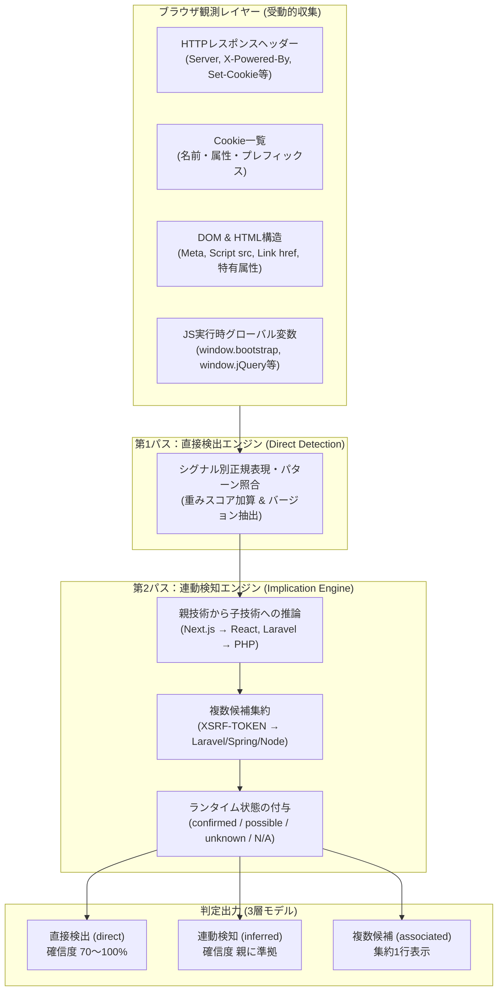
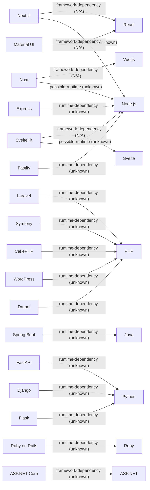
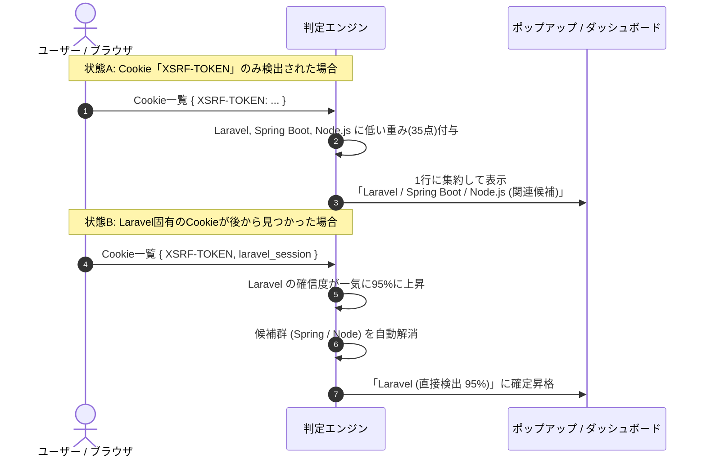

# Web Technology & Security Inspector 技術検出仕様および判定基準書

**対象バージョン：** v1.6.0  
**最終更新日：** 2026年10月24日  
**対象コンポーネント：** `src/detection/` (ルール定義・判定エンジン・推論エンジン)

---

## 1. 基本設計方針と判定アーキテクチャ

本ツール（Web Inspector）は、Webサイトの閲覧時に発生するHTTP通信やDOM構造、JavaScript実行環境の情報を**完全に受動的（パッシブ）に観測**し、背後で稼働または利用されている技術スタックを特定します。

### 1.1 受動的調査の原則（Passive Inspection Only）
- **追加リクエストの非送信**: 脆弱性探索やプロービング（`/admin/`, `/login.action` 等への能動的アクセス）は一切行わず、ユーザーが通常閲覧したページの応答データのみを利用します。
- **ローカル完結**: 判定ロジックおよび正規表現照合はすべてブラウザ内部で完結し、外部サーバーへの通信は一切行いません。
- **エビデンス（根拠）の保持**: すべての検出結果は「どのヘッダー」「どのCookie」「どのDOM要素」から判定されたかを必ず保持・明示します。

---

## 2. 判定シグナルの種類と確信度計算

### 2.1 7種類の検出シグナル分類
各技術の検出ルールは、以下の7種類のシグナル（`RuleSignal`）を組み合わせて定義されています。

| シグナル種別 (`type`) | 観測対象 (`target`) | 特徴と判定精度 |
| :--- | :--- | :--- |
| **`header`** | HTTPレスポンスヘッダー名 | `Server`, `X-Powered-By` など。明示的に宣言されている場合、極めて確信度が高い（重み 85〜95）。 |
| **`cookie`** | Cookieの名前 | `PHPSESSID`, `laravel_session`, `JSESSIONID` など。セッション命名規則から高い確度で特定可能。 |
| **`script`** | `<script>` タグの `src` URL | 外部CDN（jsdelivr等）やライブラリ特有のファイルパス。バージョン特定にも寄与。 |
| **`link`** | `<link>` タグの `href` URL | スタイルシート（CSS）やアイコン、WordPress REST APIリンクなど。 |
| **`meta`** | `<meta>` タグの `name` / `content` | `<meta name="generator" content="WordPress 6.4">` など。CMSやSSGの直接エビデンス。 |
| **`dom`** | DOMセレクタ / HTML要素 | 特有の属性（`[data-reactroot]`, `[ng-version]`）、CSRFトークン隠しフィールド、固有classなど。 |
| **`runtime`** | JavaScript実行時オブジェクト | `window.bootstrap.Modal.VERSION` など、ブラウザ実行メモリから直接抽出するため確信度100%。 |

### 2.2 確信度スコア（Confidence Score）の計算基準
- 単一のシグナルで確定できる決定打（`Server` ヘッダーや `generator` メタ等）には **85〜95点** の重みを付与します。
- 補助的なシグナル（一般的なCookie名、DOMクラス等）には **30〜60点** の重みを付与します。
- 複数のシグナルが同時に合致した場合はスコアを加算し、**上限は 100%** とします。
- 原則として、総合確信度が **60% 以上** の場合に技術リストへ採用されます。

### 2.3 ランタイム稼働状態（Runtime Status）の4区分
v1.6.0で導入されたImplication Engineでは、技術の性質に応じて以下の稼働状態を明記します。

| 状態値 | ラベル表示 | 定義・判定基準 | 代表例 |
| :--- | :--- | :--- | :--- |
| **`confirmed`** | 稼働確認済 | ブラウザ上で実行が直接確認された技術 | React, Vue.js, jQuery, Bootstrap (JS) |
| **`possible`** | 稼働可能性あり | シグナルは存在するが、静的配信やプロキシの可能性がある技術 | Node.js (SSRか静的SSGか外部観測のみでは断定不可) |
| **`unknown`** | 稼働未確認 | バックエンド側で実行されているが、クライアントから内部状態を観測できない技術 | PHP, Java, Python, Ruby, C# |
| **`not-applicable`**| 対象外 | ランタイムの概念を持たない純粋なクライアントUI・CSSなど | Tailwind CSS, Bootstrap (CSSのみ), Font Awesome |

---

## 3. 全調査対象技術 判定基準カタログ (50技術)

### 3.1 Webサーバー (`web-server`)
Webサーバーは主にHTTPレスポンスの `Server` ヘッダーを主たるエビデンスとして判定します。

| 技術ID | 技術名 | 判定シグナル | 照合パターン / 正規表現 | バージョン抽出方法 | 重み |
| :--- | :--- | :--- | :--- | :--- | :--- |
| `apache` | **Apache** | `header`: `server` | `Apache(?:/([0-9.]+))?` | `Apache/([0-9.]+)` より抽出 | 95 |
| `nginx` | **Nginx** | `header`: `server` | `nginx(?:/([0-9.]+))?` | `nginx/([0-9.]+)` より抽出 | 95 |
| `iis` | **Microsoft-IIS** | `header`: `server` | `Microsoft-IIS(?:/([0-9.]+))?` | `Microsoft-IIS/([0-9.]+)` より抽出 | 95 |
| `litespeed` | **LiteSpeed** | `header`: `server` | `LiteSpeed` | - | 95 |
| `caddy` | **Caddy** | `header`: `server` | `Caddy` | - | 95 |

---

### 3.2 プログラミング言語・ランタイム (`programming-language`)
バックエンド言語は受動的調査では実行状態を直接観測できないため、連動検知された場合は `unknown`（稼働未確認）として安全に扱われます。

| 技術ID | 技術名 | 判定シグナル | 照合パターン / 正規表現 | バージョン抽出方法 | 重み | 連動推論 (Implication) |
| :--- | :--- | :--- | :--- | :--- | :--- | :--- |
| `php` | **PHP** | `header`: `x-powered-by` `header`: `server` `cookie`: `PHPSESSID` `url`: `path` | `PHP(?:/([0-9.]+))?` `PHP(?:/([0-9.]+))?` `^PHPSESSID$` `\.php(?:$\|\?)` | ヘッダー内 `PHP/([0-9.]+)` より抽出 | 95 85 55 50 | - |
| `aspnet` | **ASP.NET** | `header`: `x-aspnet-version` `header`: `x-aspnetmvc-version` `header`: `x-powered-by` `cookie`: `.ASPXAUTH` `cookie`: `ASP.NET_SessionId` `url`: `path` | `^([0-9.]+)$` `^([0-9.]+)$` `ASP\.NET` `^\.ASPXAUTH$` `^ASP\.NET_SessionId$` `\.(?:aspx\|axd\|asmx)(?:$\|\?)` | ヘッダー値より抽出 | 95 95 90 70 65 60 | - |
| `java` | **Java** | `header`: `x-powered-by` `cookie`: `JSESSIONID` `cookie`: `XSRF-TOKEN` `url`: `path` | `(?:Servlet\|JSP\|Tomcat\|JBoss\|WildFly)` `^JSESSIONID$` `^XSRF-TOKEN$` `\.(?:jsp\|jspx\|do\|action)(?:$\|\?)` | - | 85 60 35 55 | - |
| `python` | **Python** | `header`: `server` | `Python(?:/([0-9.]+))?` | `Python/([0-9.]+)` より抽出 | 85 | - |
| `ruby` | **Ruby** | `header`: `x-powered-by` | `Phusion Passenger.*Ruby` | - | 85 | - |
| `nodejs` | **Node.js** | `header`: `x-powered-by` `header`: `server` `cookie`: `connect.sid` `cookie`: `XSRF-TOKEN` | `Node\.js(?:/([0-9.]+))?` `Node\.js(?:/([0-9.]+))?` `^connect\.sid$` `^XSRF-TOKEN$` | `Node\.js/([0-9.]+)` より抽出 | 90 90 80 35 | - |

---

### 3.3 バックエンドフレームワーク (`programming-language` / `framework`)
フレームワークが検出された場合、Implication Engine により背後のプログラミング言語が連動検出されます。

| 技術ID | 技術名 | 判定シグナル | 照合パターン / 正規表現 | バージョン抽出方法 | 重み | 連動推論先 |
| :--- | :--- | :--- | :--- | :--- | :--- | :--- |
| `laravel` | **Laravel** | `header`: `x-powered-by` `cookie`: `laravel_session` `cookie`: `XSRF-TOKEN` | `Laravel(?:/([0-9.]+))?` `laravel_session` `^XSRF-TOKEN$` | `Laravel/([0-9.]+)` より抽出 | 95 85 35 | $\rightarrow$ **PHP** (`unknown`) |
| `spring-boot` | **Spring Boot** | `header`: `x-application-context` `dom`: `body` `script`: `src` | 存在一致 (`.*`) `Whitelabel Error Page` `spring-boot` | - | 95 90 80 | $\rightarrow$ **Java** (`unknown`) |
| `aspnet-core` | **ASP.NET Core**| `cookie`: `.AspNetCore.Antiforgery.` `cookie`: `.AspNetCore.Session` `cookie`: `.AspNetCore.Cookies` `header`: `server` | `^\.AspNetCore\.Antiforgery\.` `^\.AspNetCore\.Session$` `^\.AspNetCore\.Cookies$` `Kestrel` | - | 90 90 90 90 | $\rightarrow$ **ASP.NET** (`unknown`) |
| `express` | **Express** | `header`: `x-powered-by` | `Express` | - | 95 | $\rightarrow$ **Node.js** (`unknown`) |
| `fastapi` | **FastAPI** | `dom`: `title` `header`: `x-fastapi` | `FastAPI - Swagger UI\|FastAPI - ReDoc` 存在一致 (`.*`) | - | 95 90 | $\rightarrow$ **Python** (`unknown`) |
| `symfony` | **Symfony** | `cookie`: `symfony` `cookie`: `sf_redirect` `header`: `x-debug-token` | `^symfony$` `^sf_redirect$` 存在一致 (`.*`) | - | 85 85 80 | $\rightarrow$ **PHP** (`unknown`) |
| `flask` | **Flask** | `header`: `server` | `Werkzeug(?:/([0-9.]+))?` | `Werkzeug/([0-9.]+)` より抽出 | 80 | $\rightarrow$ **Python** (`unknown`) |
| `nestjs` | **NestJS** | `header`: `x-powered-by` | `Nest(?:/([0-9.]+))?` | `Nest/([0-9.]+)` より抽出 | 90 | $\rightarrow$ **Node.js** (`unknown`) |
| `fastify` | **Fastify** | `header`: `x-fastify-` | 存在一致 (`.*`) | - | 90 | $\rightarrow$ **Node.js** (`unknown`) |
| `cakephp` | **CakePHP** | `cookie`: `CAKEPHP` | `^CAKEPHP$` | - | 85 | $\rightarrow$ **PHP** (`unknown`) |
| `spring-security`| **Spring Security**| `dom`: `input[name='_csrf']` | `_csrf` | - | 60 | $\rightarrow$ **Java** (`unknown`) |
| `python-django` | **Django** | `dom`: `input[name='csrfmiddlewaretoken']` `cookie`: `csrftoken` | `csrfmiddlewaretoken` `^csrftoken$` | - | 80 40 | $\rightarrow$ **Python** (`unknown`) |
| `ruby-on-rails` | **Ruby on Rails** | `header`: `x-powered-by` `dom`: `meta[name='csrf-param']` | `Phusion Passenger` `authenticity_token` | - | 80 70 | $\rightarrow$ **Ruby** (`unknown`) |

---

### 3.4 CMS（コンテンツマネジメントシステム） (`cms`)

| 技術ID | 技術名 | 判定シグナル | 照合パターン / 正規表現 | バージョン抽出方法 | 重み | 連動推論先 |
| :--- | :--- | :--- | :--- | :--- | :--- | :--- |
| `wordpress` | **WordPress** | `meta`: `generator` `header`: `link` `script`: `src` `link`: `href` | `WordPress(?:\s+([0-9.]+))?` `<https?://[^>]+/wp-json/>; rel="https://api\.w\.org/"` `/wp-includes/\|/wp-content/` `/wp-content/\|/wp-includes/\|/wp-json/` | `WordPress\s+([0-9.]+)` より抽出 | 95 85 85 80 | $\rightarrow$ **PHP** (`unknown`) |
| `drupal` | **Drupal** | `meta`: `generator` `header`: `x-generator` `header`: `x-drupal-cache` `script`: `src` | `Drupal(?:\s+([0-9.]+))?` `Drupal(?:\s+([0-9.]+))?` 存在一致 (`.*`) `/sites/default/files/\|/misc/drupal\.js` | `Drupal\s+([0-9.]+)` より抽出 | 95 95 85 80 | $\rightarrow$ **PHP** (`unknown`) |
| `joomla` | **Joomla** | `meta`: `generator` `script`: `src` | `Joomla!(?:\s+([0-9.]+))?` `/media/system/js/\|/media/jui/js/` | `Joomla!\s+([0-9.]+)` より抽出 | 95 80 | $\rightarrow$ **PHP** (`unknown`) |
| `shopify` | **Shopify** | `header`: `server` `script`: `src` `link`: `href` | `cloudflare.*shopify\|Shopify` `cdn\.shopify\.com` `cdn\.shopify\.com` | - | 90 90 85 | - |
| `wix` | **Wix** | `meta`: `generator` `header`: `x-wix-request-id` `script`: `src` | `Wix\.com` 存在一致 (`.*`) `static\.wixstatic\.com` | - | 95 95 90 | - |

---

### 3.5 フロントエンドフレームワーク・UIライブラリ (`js-framework`, `js-css-library`)

| 技術ID | 技術名 | 判定シグナル | 照合パターン / 正規表現 | バージョン抽出方法 | 重み | 連動推論先 |
| :--- | :--- | :--- | :--- | :--- | :--- | :--- |
| `react` | **React** | `dom`: `[data-reactroot], [data-reactid]` `script`: `src` | `data-react` `/react(?:\.production\.min\|\.development)?\.js\|react-dom` | - | 90 85 | - |
| `nextjs` | **Next.js** | `dom`: `script#__NEXT_DATA__` `header`: `x-powered-by` `script`: `src` `link`: `href` | `__NEXT_DATA__` `Next\.js` `/_next/static/` `/_next/static/` | - | 95 95 90 85 | $\rightarrow$ **React** (`N/A`) $\rightarrow$ **Node.js** (`unknown`) |
| `vue` | **Vue.js** | `dom`: `[data-v-]` `script`: `src` `dom`: `#__nuxt` | `data-v-` `/vue(?:\.runtime)?(?:\.global)?(?:\.min)?\.js` `__nuxt` | - | 90 85 70 | - |
| `nuxtjs` | **Nuxt** | `dom`: `#__nuxt, script#__NUXT_DATA__` `script`: `src` `link`: `href` | `__nuxt\|__NUXT_DATA__` `/_nuxt/` `/_nuxt/` | - | 95 90 85 | $\rightarrow$ **Vue.js** (`N/A`) $\rightarrow$ **Node.js** (`unknown`) |
| `angular` | **Angular** | `dom`: `[ng-version]` `dom`: `[ng-app], [ng-controller]` `script`: `src` | `ng-version="([0-9.]+)"` `ng-` `angular(?:\.min)?\.js` | `ng-version="([0-9.]+)"` より抽出 | 95 85 80 | - |
| `svelte` | **Svelte** | `dom`: `[class*='svelte-']` `script`: `src` | `svelte-` `/_app/immutable/` | - | 90 75 | - |
| `sveltekit` | **SvelteKit** | `dom`: `script[data-sveltekit-], div#svelte` | `data-sveltekit\|__sveltekit\|_app/immutable` | - | 95 | $\rightarrow$ **Svelte** (`N/A`) $\rightarrow$ **Node.js** (`unknown`) |
| `astro` | **Astro** | `dom`: `[data-astro-cid-], astro-island` `meta`: `generator` | `data-astro-cid-\|astro-island` `Astro(?:\s+v?([0-9.]+))?` | `Astro(?:\s+v?([0-9.]+))` より抽出 | 95 95 | $\rightarrow$ **Node.js** (`unknown`) |
| `alpine` | **Alpine.js** | `dom`: `[x-data], [x-init], [x-bind]` `script`: `src` | `x-data\|x-init\|x-bind` `alpine(?:\.min)?\.js` | - | 90 85 | - |
| `htmx` | **htmx** | `dom`: `[hx-get], [hx-post], [hx-target]` `script`: `src` | `hx-get\|hx-post\|hx-target\|hx-swap` `htmx(?:\.org)?(?:\.min)?\.js` | - | 90 85 | - |
| `jquery` | **jQuery** | `runtime`: `window.jQuery.fn.jquery` `script`: `src` (バージョン付き) `script`: `src` | 実行時変数取得 `jquery[.-]([0-9.]+)(?:\.min)?\.js` `jquery(?:\.min)?\.js` | JS変数またはファイル名より抽出 | 95 90 75 | - |
| `bootstrap` | **Bootstrap** | `runtime`: `window.bootstrap.Modal.VERSION` `runtime`: `jQuery.fn.modal.Constructor.VERSION` `link`: `href` `script`: `src` | v5実行時変数取得 v4実行時変数取得 `bootstrap(?:\.min)?\.css` `bootstrap(?:\.bundle)?(?:\.min)?\.js` | JS実行時変数、URLパス、クエリ (`?v=X`) より抽出 | 95 95 85 80 | - |
| `tailwind` | **Tailwind CSS** | `script`: `src` `css`: `class` | `tailwindcss\|cdn\.tailwindcss\.com` `(?:flex\|grid\|hidden)\s+(?:items-\|space-\|p-\|bg-)` | - | 90 80 | - |
| `material-ui` | **Material UI** | `dom`: `[class*='MuiButton-']` 等 | `Mui[A-Z][a-zA-Z]+-` | - | 85 | $\rightarrow$ **React** (`N/A`) |
| `datatables` | **DataTables** | `script`: `src` `dom`: `table.dataTable` `link`: `href` | `(?:jquery\.)?dataTables(?:\.min)?\.js` `dataTable\|dataTables_wrapper` `(?:jquery\.)?dataTables.*\.css` | - | 90 85 80 | - |
| `chartjs` | **Chart.js** | `script`: `src` | `chart(?:\.umd)?(?:\.min)?\.js` | - | 85 | - |
| `axios` | **Axios** | `script`: `src` | `axios(?:\.min)?\.js` | - | 85 | - |
| `d3` | **D3.js** | `script`: `src` | `d3(?:\.v[0-9]+)?(?:\.min)?\.js` | - | 85 | - |
| `tinymce` | **TinyMCE** | `dom`: `.tox-tinymce, .mce-tinymce` `script`: `src` | `tox-tinymce\|mce-tinymce` `tinymce(?:\.min)?\.js` | - | 90 85 | - |
| `ckeditor` | **CKEditor** | `dom`: `.ck-editor, .cke` `script`: `src` | `ck-editor\|cke_` `ckeditor(?:\.min)?\.js` | - | 90 85 | - |
| `fontawesome` | **Font Awesome** | `link`: `href` `dom`: `i[class*='fa-']` | `font-awesome\|fontawesome\|all(?:\.min)?\.css` `fa-\|fas \|fab ` | - | 85 70 | - |

---

### 3.6 クラウドホスティング・外部サービス・解析・セキュリティ (`hosting-cloud`, `analytics-tracking`, `security-service`)

| 技術ID | 技術名 | カテゴリ | 判定シグナル | 照合パターン / 正規表現 | 重み |
| :--- | :--- | :--- | :--- | :--- | :--- |
| `vercel` | **Vercel** | `hosting-cloud` | `header`: `server` `header`: `x-vercel-id` `header`: `x-vercel-cache` | `^Vercel$` 存在一致 (`.*`) 存在一致 (`.*`) | 95 95 90 |
| `netlify` | **Netlify** | `hosting-cloud` | `header`: `server` `header`: `x-nf-request-id` | `^Netlify$` 存在一致 (`.*`) | 95 95 |
| `firebase-hosting`| **Firebase Hosting** | `hosting-cloud` | `header`: `x-firebase-hosting` | 存在一致 (`.*`) | 95 |
| `azure-app-service`| **Azure App Service** | `hosting-cloud` | `cookie`: `ARRAffinity` `cookie`: `ARRAffinitySameSite` | `^ARRAffinity$` `^ARRAffinitySameSite$` | 90 90 |
| `aws-alb` | **AWS ALB** | `hosting-cloud` | `cookie`: `AWSELB` `cookie`: `AWSELBCORS` | `^AWSELB$` `^AWSELBCORS$` | 90 90 |
| `aws-api-gateway` | **AWS API Gateway** | `hosting-cloud` | `header`: `x-amz-apigw-id` `header`: `x-amzn-requestid` | 存在一致 (`.*`) 存在一致 (`.*`) | 95 85 |
| `google-analytics`| **Google Analytics** | `analytics-tracking`| `script`: `src` `cookie`: `_ga` | `google-analytics\.com/(?:analytics\|ga)\.js\|googletagmanager\.com/gtag/js` `^_ga$` | 90 85 |
| `google-tag-manager`| **Google Tag Manager**| `analytics-tracking`| `script`: `src` `dom`: `iframe` | `googletagmanager\.com/gtm\.js` `googletagmanager\.com/ns\.html` | 95 95 |
| `microsoft-clarity`| **Microsoft Clarity** | `analytics-tracking`| `script`: `src` `cookie`: `_clck` | `clarity\.ms/tag/` `^_clck$` | 95 85 |
| `sentry` | **Sentry** | `security-service` | `script`: `src` | `browser\.sentry-cdn\.com\|js\.sentry-cdn\.com` | 95 |
| `recaptcha` | **reCAPTCHA** | `security-service` | `script`: `src` `dom`: `.g-recaptcha` | `google\.com/recaptcha/api\.js\|recaptcha/enterprise\.js` `g-recaptcha` | 95 90 |
| `hcaptcha` | **hCaptcha** | `security-service` | `script`: `src` `dom`: `.h-captcha` | `hcaptcha\.com/1/api\.js\|js\.hcaptcha\.com` `h-captcha` | 95 90 |

---

### 3.7 CDN / WAF (`cdn-waf`)

| 技術ID | 技術名 | 判定シグナル | 照合パターン / 正規表現 | 重み |
| :--- | :--- | :--- | :--- | :--- |
| `cloudflare` | **Cloudflare** | `header`: `server` `header`: `cf-ray` `header`: `cf-cache-status` `cookie`: `__cf_bm` | `cloudflare` 存在一致 (`.*`) 存在一致 (`.*`) `^__cf_bm$` | 95 95 90 85 |
| `cloudfront` | **Amazon CloudFront** | `header`: `x-amz-cf-id` `header`: `via` `header`: `x-cache` | 存在一致 (`.*`) `CloudFront` `(?:Hit\|Miss\|Error) from cloudfront` | 95 95 90 |
| `fastly` | **Fastly** | `header`: `fastly-debug-digest` `header`: `x-fastly-request-id` `header`: `x-served-by` | 存在一致 (`.*`) 存在一致 (`.*`) `cache-[a-z0-9]+` | 95 95 85 |
| `akamai` | **Akamai** | `header`: `server` `header`: `x-akamai-transformed` | `AkamaiGHost` 存在一致 (`.*`) | 95 95 |

---

## 4. Implication Engine（連動推論）連動マトリクス

Implication Engine は、親技術が直接検出された際に、依存関係にある子技術を自動的に補完する第2パスエンジンです。

### 連動推論ルール一覧
1. **確信度上限クリップ**: 推論先の確信度は、推論元技術の確信度を超えないよう制御されます（$Score_{child} \le Score_{parent} \times Factor$）。
2. **循環防止**: `visitedEdges` によるトポロジカル探索を行い、`A -> B -> A` のような無限ループを完全に抑止します。
3. **静的配信への配慮**: Next.js や Nuxt、Astro からの Node.js 推論は、Vercel 等の静的ホスティング（SSG）で配信されている可能性を考慮し、**「稼働未確認 (`unknown`)」**として記録します。

---

## 5. XSRF-TOKEN 等の複数候補集約ロジック (Associated Candidates)

SPA（Single Page Application）構成において、CSRF対策Cookieとして広く採用されている `XSRF-TOKEN` は、単独ではフレームワークを一意に特定できません。

- **集約のメリット**: 1つのCookieに対して3つの技術がバラバラに表示されて画面が埋まるノイズを防止します。
- **自動解消（Resolution）**: いずれかの技術に固有のシグナル（例: `laravel_session`, `JSESSIONID`, `X-Powered-By: Express` 等）が検出された瞬間、候補状態は即座に解除され、特定された技術のみが本採用されます。

---

## 6. バージョン特定・隠蔽時の挙動とセキュリティ設計

### 6.1 バージョン特定ができる条件・できない条件
Web Inspector では、受動的調査の原則に従ってバージョンを抽出します。

| 調査対象 | バージョン特定が成功する条件 | バージョンが「不明」となる要因（隠蔽） |
| :--- | :--- | :--- |
| **Apache / Nginx** | `Server` ヘッダーに `Apache/2.4.52` と明記 | `ServerTokens Prod` により `Server: Apache` のみ出力されている場合 |
| **PHP** | `X-Powered-By: PHP/8.2.1` が出力されている | `expose_php = Off` によりヘッダーが非表示化されている場合 |
| **WordPress** | `<meta name="generator" content="WordPress 6.4.2">` が存在 | テーマやセキュリティプラグインで generator タグが除去されている場合 |
| **Bootstrap** | `window.bootstrap.Modal.VERSION` または CDN URL にバージョン記載 | Webpack等でバンドル・minifyされ、CSSクラスのみ使用されている場合 |
| **Angular** | DOMに `ng-version="16.2.0"` 属性が存在 | 本番ビルド時に属性が剥離されている場合 |

### 6.2 EOL / CVE 照合における安全設計
- **断定の回避**: バージョンが隠蔽されて特定できない場合は、「バージョン不明」として安全に扱い、**無関係なバージョンのCVEを誤報（False Positive）として出さない**安全機構（IMP-19）が働きます。
- **サポート状況の客観通知**: バージョンが特定できた場合のみ、オフラインEOLデータベースおよびCVEデータベースと照合し、「EOL（公式サポート終了）」または「既知の脆弱性あり」を最新バージョンへの移行ガイダンスとともに提示します。
