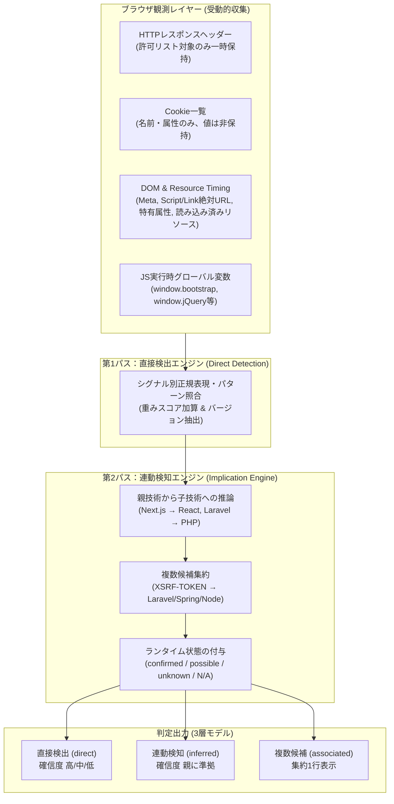
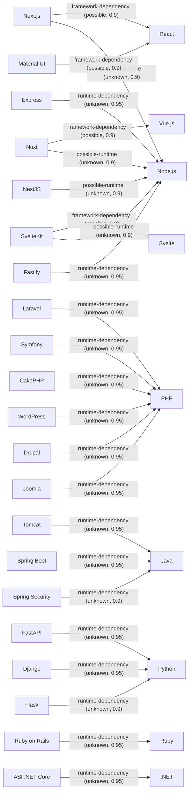
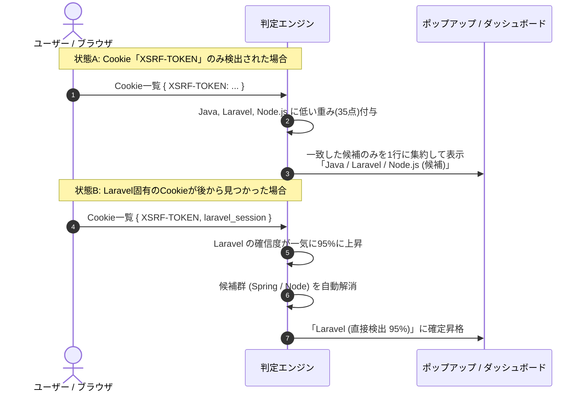

# Web Technology & Security Inspector 技術検出仕様および判定基準書

**対象バージョン：** v1.7.1  
**最終更新日：** 2026年11月8日  
**対象コンポーネント：** `src/detection/` (ルール定義・判定エンジン・推論エンジン・オフライン脆弱性照合), `src/security/` (セキュリティ診断・CSP解析・Cookie診断・PSLドメイン分析・バージョン比較), `src/shared/` (ステータス・要確認件数集計・完全性評価)

---

## 1. 基本設計方針と判定アーキテクチャ

本ツール（Web Inspector）は、Webサイトの閲覧時に発生するHTTP通信やDOM構造、Performance Resource Timing、JavaScript実行環境の情報を**完全に受動的（パッシブ）に観測**し、背後で稼働または利用されている技術スタックとセキュリティ設定を特定します。

### 1.1 受動的調査の原則（Passive Inspection Only）
- **追加リクエストの非送信**: 脆弱性探索やプロービング（`/admin/`, `/login.action` 等への能動的アクセス）は一切行わず、ユーザーが通常閲覧したページの応答データのみを利用します。
- **オンデマンドContent Script注入**: 閲覧中の全ページに常時スクリプトを配置せず、ユーザーが調査を実行した対象タブに対してのみ `chrome.scripting.executeScript` で Content Script を注入します（二重注入防止ガード付き）。
- **ローカル完結**: 判定ロジックおよび正規表現照合はすべてブラウザ内部で完結し、外部サーバーへの通信は一切行いません。
- **エビデンス（根拠）の保持**: すべての検出結果は「どのヘッダー」「どのCookie」「どのDOM要素」から判定されたかを必ず保持・明示します。

---

## 2. 判定シグナルの種類と確信度計算

### 2.1 9種類の検出シグナル分類
各技術の検出ルールは、以下の9種類のシグナル（`RuleSignal`）を組み合わせて定義されています。

| シグナル種別 (`type`) | 観測対象 (`target`) | 特徴と判定精度 |
| :--- | :--- | :--- |
| **`header`** | HTTPレスポンスヘッダー名 | `Server`, `X-Powered-By` など。明示的に宣言されている場合、極めて確信度が高い（重み 85〜95）。`target` が末尾ハイフン（例: `x-fastify-`）で終わる場合はヘッダー名の前方一致（`startsWith`）として照合する。 |
| **`cookie`** | Cookieの名前 | `PHPSESSID`, `laravel_session`, `JSESSIONID`, `AWSALB` など。セッション命名規則から高い確度で特定可能。 |
| **`script`** | `<script>` タグの `src` URL | 外部CDN（cdnjs, jsdelivr等）やライブラリ特有のファイルパス。バージョン特定にも寄与。 |
| **`link`** | `<link>` タグの `href` URL | スタイルシート（CSS）やアイコン、WordPress REST APIリンクなど。 |
| **`meta`** | `<meta>` タグの `name` / `content` | `<meta name="generator" content="WordPress 6.4">` など。CMSやSSGの直接エビデンス。 |
| **`dom`** | DOMセレクタ / HTML要素 | 特有の属性（`[data-reactroot]`, `[ng-version]`）、CSRF隠しフィールド、固有classなど。セレクタ一覧はルール定義から `src/content/dom-selectors.generated.ts` へ自動生成される。 |
| **`runtime`** | JavaScript実行時オブジェクト | `window.bootstrap.Modal.VERSION` など、ブラウザ実行メモリから直接抽出（MAINワールド注入・型および長さ検証付き）。 |
| **`url`** | ページURLパス / 拡張子 | `\.php$` や `\.aspx$` など、リクエストされたパス自体の特徴。 |
| **`css`** | スタイルシート / クラスパターン | Tailwind CSS 等のユーティリティクラス群の出現パターン。 |

### 2.2 確信度スコア（Confidence Score）の計算基準
本ツールは、単なる累積加算ではなく、**最大重みをベースに異なる種別のシグナルを逓減加算（Diminishing Returns）する合成ロジック**（`src/detection/confidence.ts`）を採用しています。

1. **ベーススコアの決定**: 観測されたエビデンス種別（header, cookie, html等）ごとに最大の weight を集約し、その中の最大値をベーススコアとします。
2. **追加シグナルによるボーナス加算**: 異なる種別のシグナルが存在する場合、それぞれの最大重みの **20%** をボーナスとして加算します（同種シグナルの重複カウントによる過剰加算を防止）。
3. **確信度帯（レベル）**:
   - **高 (High / 80〜100%)**: 明確な決定打シグナル（`Server` ヘッダーや `generator` メタ、実行時シンボル等）が存在する。
   - **中 (Medium / 50〜79%)**: Cookie単体（例: `PHPSESSID` 55点）や、複数の間接的シグナルが存在する。
   - **低 (Low / 1〜49%)**: 補助的なクラス名や汎用Cookie（例: `XSRF-TOKEN` 35点）など、可能性を示すシグナルのみが存在する。
   - ※エビデンスが観測された技術は、低確信度であってもノイズ抑制（複数候補集約等）を適用した上でレポートに提示されます。

### 2.3 ランタイム稼働状態（Runtime Status）の4区分と検出根拠の整理
v1.6.0で導入され、v1.7.1で確信度連動が強化されたImplication Engineでは、「検出方式（直接検出か連動推論か）」とは独立した軸として、技術の性質と確信度に応じた以下の稼働状態を明記します。

| 状態値 | ラベル表示 | 定義・判定基準 | 代表例 |
| :--- | :--- | :--- | :--- |
| **`confirmed`** | 稼働確認済 | 確信度が **高 (`high`: 80〜100%)** で、ブラウザ上で直接DOMマーカーや実行時変数・明確な固有シグナルが観測された技術 | React（直接検出・高確信度時）, Vue.js, jQuery |
| **`possible`** | 稼働可能性あり | 直接検出だが確信度が **中 (`medium`) 以下** の技術（例: バージョンを含まないファイル名のみの Bootstrap や `_csrf` 単体の Spring Security）、またはプロキシ・静的配信の可能性がある技術 | Spring Security (中確信度時), Bootstrap (ファイル名のみ) |
| **`unknown`** | 稼働未確認 | バックエンド側で実行されているが、クライアントから内部状態を観測できない技術 | PHP, Java, Python, Ruby, .NET, Node.js (SSG考慮) |
| **`not-applicable`**| 対象外 | ランタイムの概念を持たない純粋なクライアントCSS・アセット | Tailwind CSS, Font Awesome |

- **検出根拠（エビデンス）の重複統合と代表表示 (`src/detection/engine.ts` / v1.7.1 T09)**:
  1. 同一種別（`type`）・同一値（またはクエリ文字列除去後の同一ベースURL）の根拠は 1 件に統合します（バージョン付き表記がある場合は優先保持）。
  2. `.container` のような汎用クラス名のみの根拠は、他の明確な根拠が存在する場合に除外します。また `link[rel="alternate"]` や REST API リンク等の非 stylesheet リンクは種別を `'css-url'` ではなく `'link'` として記録します。
  3. JSON レポートには 1 技術あたり上限 20 件（IMPL-06）までの全根拠を保持し、ポップアップ・ダッシュボード・Markdown レポートでは技術ごとに**代表 3 件＋「他 ○ 件」**として簡潔に表示します。

> [!NOTE]
> **Next.js / Nuxt 経由の React / Vue の扱い:**  
> Next.js から連動推論された React は、ブラウザ上で実際に `[data-reactroot]` や `__NEXT_DATA__` 等が直接高確信度で観測されている場合は `confirmed` と判定されます。一方、サーバーサイド側の Node.js は、Vercel 等の静的エクスポート（SSG）で配信されている可能性を考慮し、SSR の明確な証拠がない限り `unknown`（稼働未確認）として安全に扱われます。

---

## 3. 全調査対象技術 判定基準カタログ (計75技術)

> [!NOTE]
> **カタログの自動整合保証:**  
> 本カタログ（第3節）は `src/detection/rules/*.json` のルール定義から直接自動生成（`npm run spec:generate`）されており、自動整合テスト (`tests/spec-integrity.test.ts`) によって100%の一致が保証されています。

### 3.1 Webサーバー (`web-server`)
Webサーバーは主にHTTPレスポンスの `Server` ヘッダーを主たるエビデンスとして判定します。

| 技術ID | 技術名 | 判定シグナル | 照合パターン / 正規表現 | 重み |
| :--- | :--- | :--- | :--- | :--- |
| `apache` | **Apache** | `header`: `server` | Apache(?![-\w]\|\s+(?:Tomcat\|Coyote))(?:/([0-9.]+))? | 95 |
| `tomcat` | **Tomcat** | `header`: `server` | Apache(?:-Coyote(?:/[0-9.]+)?\|[-\s]+Tomcat(?:(?:/\|\s+)([0-9.]+))?) | 95 |
| `nginx` | **Nginx** | `header`: `server` | nginx(?:/([0-9.]+))? | 95 |
| `iis` | **Microsoft-IIS** | `header`: `server` | Microsoft-IIS(?:/([0-9.]+))? | 95 |
| `litespeed` | **LiteSpeed** | `header`: `server` | LiteSpeed | 95 |
| `caddy` | **Caddy** | `header`: `server` | Caddy | 95 |

> [!TIP]
> **CDN・リバースプロキシによるServerヘッダーの書き換えについて:**  
> Cloudflare 等のCDNを利用している場合、オリジンの `Server: Apache` は `Server: cloudflare` に書き換えられます。一方、Amazon CloudFront 等ではオリジンのヘッダーがそのまま通過します。

---

### 3.2 プログラミング言語・ランタイム (`programming-language`)

| 技術ID | 技術名 | 判定シグナル | 照合パターン / 正規表現 | 重み |
| :--- | :--- | :--- | :--- | :--- |
| `php` | **PHP** | `header`: `x-powered-by` `header`: `server` `cookie`: `PHPSESSID` `url`: `path` | PHP(?:/([0-9.]+))? PHP(?:/([0-9.]+))? ^PHPSESSID$ \.php(?:$\|\?) | 95 85 55 50 |
| `java` | **Java** | `cookie`: `JSESSIONID` `cookie`: `XSRF-TOKEN` `url`: `path` `header`: `x-powered-by` | ^JSESSIONID$ ^XSRF-TOKEN$ \.(?:jsp\|jspx\|do\|action)(?:$\|\?) (?:Servlet\|JSP\|Tomcat\|JBoss\|WildFly) | 60 35 55 85 |
| `python` | **Python** | `header`: `server` | Python(?:/([0-9.]+))? | 85 |
| `ruby` | **Ruby** | `header`: `x-powered-by` | Phusion Passenger.*Ruby | 85 |
| `python-django` | **Django** | `cookie`: `csrftoken` `dom`: `input[name='csrfmiddlewaretoken']` | ^csrftoken$ csrfmiddlewaretoken | 40 80 |
| `ruby-on-rails` | **Ruby on Rails** | `dom`: `meta[name='csrf-param']` `header`: `x-powered-by` | csrf-param\|authenticity_token Phusion Passenger | 70 40 |
| `laravel` | **Laravel** | `header`: `x-powered-by` `cookie`: `laravel_session` `cookie`: `app_session` `cookie`: `XSRF-TOKEN` | Laravel(?:/([0-9.]+))? ^laravel_session$ ^(?!_)(?!ci_)[a-zA-Z0-9_-]+_session$ ^XSRF-TOKEN$ | 95 85 35 35 |
| `nodejs` | **Node.js** | `header`: `x-powered-by` `header`: `server` `cookie`: `connect.sid` `cookie`: `XSRF-TOKEN` | Node\.js(?:/([0-9.]+))? Node\.js(?:/([0-9.]+))? ^connect\.sid$ ^XSRF-TOKEN$ | 90 90 80 35 |
| `dotnet` | **.NET** | `header`: `server` | Kestrel | 80 |

> [!NOTE]
> **Node.js のバージョン観測とCVE/EOL照合について:**  
> Node.js のバージョンは通常本番環境のHTTPヘッダーには出力されないため、外部受動調査では「バージョン不明」となります。そのため、Node.js 向けのEOL/CVE照合は誤報防止の安全設計により原則として発火しません。

---

### 3.3 バックエンドフレームワーク (`programming-language` / `framework`)

| 技術ID | 技術名 | 判定シグナル | 照合パターン / 正規表現 | 重み | 連動推論先 |
| :--- | :--- | :--- | :--- | :--- | :--- |
| `spring-boot` | **Spring Boot** | `header`: `x-application-context` `dom`: `h1` `script`: `src` | .* Whitelabel Error Page spring-boot | 95 90 80 | $\rightarrow$ **Java** (`unknown`) |
| `aspnet-core` | **ASP.NET Core** | `cookie`: `.AspNetCore.Antiforgery.` `cookie`: `.AspNetCore.Session` `cookie`: `.AspNetCore.Cookies` `header`: `server` | ^\.AspNetCore\.Antiforgery\. ^\.AspNetCore\.Session$ ^\.AspNetCore\.Cookies$ Kestrel | 90 90 90 90 | $\rightarrow$ **.NET** (`unknown`) |
| `express` | **Express** | `header`: `x-powered-by` | Express | 95 | $\rightarrow$ **Node.js** (`unknown`) |
| `fastapi` | **FastAPI** | `dom`: `title` `header`: `x-fastapi` | FastAPI - Swagger UI\|FastAPI - ReDoc .* | 95 90 | $\rightarrow$ **Python** (`unknown`) |
| `symfony` | **Symfony** | `cookie`: `symfony` `cookie`: `sf_redirect` `header`: `x-debug-token` | ^symfony$ ^sf_redirect$ .* | 85 85 80 | $\rightarrow$ **PHP** (`unknown`) |
| `flask` | **Flask** | `header`: `server` | Werkzeug(?:/([0-9.]+))? | 80 | $\rightarrow$ **Python** (`unknown`) |
| `nestjs` | **NestJS** | `header`: `x-powered-by` | Nest(?:/([0-9.]+))? | 90 | $\rightarrow$ **Node.js** (`unknown`) |
| `fastify` | **Fastify** | `header`: `x-fastify-` | .* | 90 | $\rightarrow$ **Node.js** (`unknown`) |
| `cakephp` | **CakePHP** | `cookie`: `CAKEPHP` | ^CAKEPHP$ | 85 | $\rightarrow$ **PHP** (`unknown`) |
| `spring-security` | **Spring Security** | `dom`: `input[name='_csrf']` `cookie`: `SESSION` | _csrf ^SESSION$ | 60 45 | $\rightarrow$ **Java** (`unknown`) |
| `aspnet` | **ASP.NET** | `header`: `x-aspnet-version` `header`: `x-aspnetmvc-version` `header`: `x-powered-by` `cookie`: `.ASPXAUTH` `cookie`: `ASP.NET_SessionId` `url`: `path` | ^([0-9.]+)$ ^([0-9.]+)$ ASP\.NET ^\.ASPXAUTH$ ^ASP\.NET_SessionId$ \.(?:aspx\|axd\|asmx)(?:$\|\?) | 95 95 90 70 65 60 | - |
| `classic-asp` | **Classic ASP** | `cookie`: `ASPSESSIONID` `url`: `path` | ^ASPSESSIONID[A-Z0-9]*$ \.asp(?:$\|\?) | 85 60 | - |

---

### 3.4 CMS（コンテンツマネジメントシステム） (`cms`)

| 技術ID | 技術名 | 判定シグナル | 照合パターン / 正規表現 | 重み | 連動推論先 |
| :--- | :--- | :--- | :--- | :--- | :--- |
| `wordpress` | **WordPress** | `meta`: `generator` `script`: `src` `link`: `href` `script`: `src` `link`: `href` `header`: `link` | WordPress(?:\s+([0-9.]+))? /wp-includes/(?!js/(?:jquery/\|underscore\|backbone\|lodash\|moment\|tinymce/\|mediaelement/\|twemoji\|clipboard\|hoverIntent\|imagesloaded\|masonry\|plupload/\|swfupload/\|thickbox/\|jcrop/\|imgareaselect/\|codemirror/\|colorpicker/\|farbtastic\|iris\|json2\|sack\|schedule\|suggest\|wp-ajax-response\|dist/))[a-z0-9_./-]+\.js(?:[?&]ver=([0-9]+\.[0-9]+(?:\.[0-9]+)?(?:-[a-zA-Z0-9.-]+)?))? /wp-includes/[a-z0-9_./-]+\.css(?:[?&]ver=([0-9]+\.[0-9]+(?:\.[0-9]+)?(?:-[a-zA-Z0-9.-]+)?))? /wp-includes/\|/wp-content/ /wp-content/\|/wp-includes/\|/wp-json/ <https?://[^>]+/wp-json/>; rel="https://api\.w\.org/" | 95 90 90 85 80 85 | $\rightarrow$ **PHP** (`unknown`) |
| `drupal` | **Drupal** | `meta`: `generator` `header`: `x-generator` `header`: `x-drupal-cache` `header`: `x-drupal-dynamic-cache` `dom`: `[data-drupal-selector], [data-drupal-messages], [data-drupal-link-system-path], script[data-drupal-selector='drupal-settings-json']` `script`: `src` `link`: `href` | Drupal(?:\s+([0-9.]+))? Drupal(?:\s+([0-9.]+))? .* .* data-drupal- /sites/(?:default\|all)/(?:files\|themes\|modules)/\|/misc/drupal\.js\|/core/misc/drupal(?:\.init)?\.js\|/core/assets/vendor/\|/core/modules/ /sites/(?:default\|all)/(?:files\|themes\|modules)/\|/core/(?:themes\|modules\|assets)/ | 95 95 85 85 85 80 80 | $\rightarrow$ **PHP** (`unknown`) |
| `joomla` | **Joomla** | `meta`: `generator` `script`: `src` | Joomla!(?:\s+([0-9.]+))? /media/system/js/\|/media/jui/js/ | 95 80 | $\rightarrow$ **PHP** (`unknown`) |
| `shopify` | **Shopify** | `header`: `server` `script`: `src` `link`: `href` | cloudflare.*shopify\|Shopify cdn\.shopify\.com cdn\.shopify\.com | 90 90 85 | - |
| `wix` | **Wix** | `meta`: `generator` `header`: `x-wix-request-id` `script`: `src` | Wix\.com .* static\.wixstatic\.com | 95 95 90 | - |

---

### 3.5 フロントエンドフレームワーク・UIライブラリ (`js-framework`, `js-css-library`)

| 技術ID | 技術名 | 判定シグナル | 照合パターン / 正規表現 | 重み | 連動推論先 |
| :--- | :--- | :--- | :--- | :--- | :--- |
| `react` | **React** | `dom`: `[data-reactroot], [data-reactid], __reactContainer$` `script`: `src` | data-react\|__reactContainer\|__reactFiber (?<![\w-])react(?:-dom)?(?:@\|/v?)(\d[\d.]*)\|/react(?:\.production\.min\|\.development)?\.js\|react-dom | 90 85 | - |
| `nextjs` | **Next.js** | `dom`: `script#__NEXT_DATA__` `script`: `src` `link`: `href` `header`: `x-powered-by` | __NEXT_DATA__ /_next/static/ /_next/static/ Next\.js | 95 90 85 95 | $\rightarrow$ **React** (`possible`) $\rightarrow$ **Node.js** (`unknown`) |
| `vue` | **Vue.js** | `dom`: `[data-v-], [data-v-app], __vue_app__` `script`: `src` `dom`: `#__nuxt` | data-v-\|__vue_app__ (?<![\w-])vue(?:@\|/v?)(\d[\d.]*)\|/vue(?:\.runtime)?(?:\.global)?(?:\.min)?\.js __nuxt | 90 85 70 | - |
| `nuxtjs` | **Nuxt** | `dom`: `#__nuxt, script#__NUXT_DATA__` `script`: `src` `link`: `href` | __nuxt\|__NUXT_DATA__ /_nuxt/ /_nuxt/ | 95 90 85 | $\rightarrow$ **Vue.js** (`possible`) $\rightarrow$ **Node.js** (`unknown`) |
| `angular` | **Angular** | `dom`: `[ng-version]` `dom`: `[_nghost-], [_ngcontent-], [ng-server-context]` | ng-version="([0-9]+(?:\.[0-9]+)*(?:[-+][0-9A-Za-z.-]+)?)" _nghost-\|_ngcontent-\|\[ng-server-context\] | 95 85 | - |
| `angularjs` | **AngularJS** | `dom`: `[ng-app], [data-ng-app], [ng-controller], [data-ng-controller], [ng-model], [data-ng-model], [ng-bind], [ng-repeat], [ng-cloak], .ng-scope, .ng-binding` `script`: `src` | (?:\b\|data-)ng-(?:app\|controller\|model\|bind\|repeat\|cloak)\b\|\.ng-(?:scope\|binding)\b angular(?:\.min)?\.js | 90 85 | - |
| `svelte` | **Svelte** | `dom`: `[class*='svelte-']` `script`: `src` | svelte- /_app/immutable/ | 90 75 | - |
| `jquery` | **jQuery** | `script`: `src` `script`: `src` | jquery[.-\]\([0-9.]+)(?:\.min)?\.js jquery(?:\.min)?\.js | 90 75 | - |
| `bootstrap` | **Bootstrap** | `link`: `href` `script`: `src` `dom`: `.container, .row, .col-` | bootstrap(?:[.-][0-9]+(?:\.[0-9]+)*(?:-[a-z0-9.]+)?)?(?:\.[A-Za-z0-9_-]+)?(?:\.min)?\.css\|/bootstrap-[0-9]+(?:\.[0-9]+)*[^/]*/.*\.css bootstrap(?:\.bundle)?(?:[.-][0-9]+(?:\.[0-9]+)*(?:-[a-z0-9.]+)?)?(?:\.[A-Za-z0-9_-]+)?(?:\.min)?\.js\|/bootstrap-[0-9]+(?:\.[0-9]+)*[^/]*/.*\.js container\|(?:^\|\s)(?:sm\|md\|lg\|xl\|2xl):(?:d-(?:none\|block\|flex\|inline\|inline-block\|inline-flex\|grid\|table)\|navbar-expand\|col-\d+\|offset-\d+) | 85 80 40 | - |
| `tailwind` | **Tailwind CSS** | `css`: `class` `script`: `src` | (?:sm\|md\|lg\|xl\|2xl\|hover\|focus\|dark):[a-z0-9_-]+\|[a-z0-9_-]+-\[[^\]]+\]\|(?:text\|bg\|border\|ring\|from\|to\|via)-[a-z]+-(?:50\|[1-9]00\|950) tailwindcss\|cdn\.tailwindcss\.com | 70 90 | - |
| `alpine` | **Alpine.js** | `dom`: `[x-data], [x-init], [x-bind]` `script`: `src` | x-data\|x-init\|x-bind alpine(?:\.min)?\.js\|cdn\.jsdelivr\.net/npm/alpinejs | 90 85 | - |
| `htmx` | **htmx** | `dom`: `[hx-get], [hx-post], [hx-target], [hx-swap]` `script`: `src` | hx-get\|hx-post\|hx-target\|hx-swap\|hx-trigger htmx(?:\.org)?(?:\.min)?\.js | 90 85 | - |
| `datatables` | **DataTables** | `dom`: `table.dataTable, .dataTables_wrapper` `script`: `src` `link`: `href` | dataTable\|dataTables_wrapper (?:jquery\.)?dataTables(?:\.min)?\.js (?:jquery\.)?dataTables.*\.css | 85 90 80 | - |
| `chartjs` | **Chart.js** | `script`: `src` | (?:^\|/)chart(?:\.umd)?(?:\.min)?\.js\|/chart\.js@\|/npm/chart\.js | 85 | - |
| `axios` | **Axios** | `script`: `src` | axios(?:\.min)?\.js | 85 | - |
| `d3` | **D3.js** | `script`: `src` | (?:^\|/)d3(?:\.v[0-9]+)?(?:\.min)?\.js\|/d3@[0-9] | 85 | - |
| `tinymce` | **TinyMCE** | `dom`: `.tox-tinymce, .mce-tinymce` `script`: `src` | tox-tinymce\|mce-tinymce tinymce(?:\.min)?\.js | 90 85 | - |
| `ckeditor` | **CKEditor** | `dom`: `.ck-editor, .cke` `script`: `src` | ck-editor\|cke_ ckeditor(?:\.min)?\.js | 90 85 | - |
| `fontawesome` | **Font Awesome** | `link`: `href` `script`: `src` `dom`: `i[class*='fa-'], [class*='fas '], [class*='fab ']` | font-?awesome\|use\.fontawesome\.com\|kit\.fontawesome\.com kit\.fontawesome\.com\|font-?awesome fa-\|fas \|fab  | 85 85 70 | - |
| `material-ui` | **Material UI** | `dom`: `[class*='MuiButton-'], [class*='MuiBox-'], [class*='MuiTypography-']` | Mui[A-Z][a-zA-Z]+- | 85 | $\rightarrow$ **React** (`possible`) |
| `astro` | **Astro** | `dom`: `[data-astro-cid-], astro-island` `meta`: `generator` | data-astro-cid-\|astro-island Astro(?:\s+v?([0-9.]+))? | 95 95 | - |
| `sveltekit` | **SvelteKit** | `dom`: `script[data-sveltekit-], div#svelte, link[rel='modulepreload'][href*='_app/immutable/']` | data-sveltekit\|__sveltekit\|_app/immutable\|div#svelte | 95 | $\rightarrow$ **Svelte** (`possible`) $\rightarrow$ **Node.js** (`unknown`) |
| `lodash` | **Lodash** | `script`: `src` | (?:^\|/)lodash(?:[.-\]\(\d+(?:\.\d+)*))?(?:\.core)?(?:\.min)?\.js\|/lodash@(\d+(?:\.\d+)*)\|/lodash\.js/(\d+(?:\.\d+)*) | 85 | - |
| `moment` | **Moment.js** | `script`: `src` | (?:^\|/)moment(?:-with-locales)?(?:[.-\]\(\d+(?:\.\d+)*))?(?:\.min)?\.js\|/moment@(\d+(?:\.\d+)*)\|/moment\.js/(\d+(?:\.\d+)*) | 85 | - |

---

### 3.6 クラウドホスティング・外部サービス・解析・セキュリティ (`hosting-cloud`, `analytics-tracking`, `security-service`)

| 技術ID | 技術名 | カテゴリ | 判定シグナル | 照合パターン / 正規表現 | 重み |
| :--- | :--- | :--- | :--- | :--- | :--- |
| `vercel` | **Vercel** | `hosting-cloud` | `header`: `server` `header`: `x-vercel-id` `header`: `x-vercel-cache` | ^Vercel$ .* .* | 95 95 90 |
| `netlify` | **Netlify** | `hosting-cloud` | `header`: `server` `header`: `x-nf-request-id` | ^Netlify$ .* | 95 95 |
| `firebase-hosting` | **Firebase Hosting** | `hosting-cloud` | `header`: `x-firebase-hosting` | .* | 95 |
| `azure-app-service` | **Azure App Service** | `hosting-cloud` | `cookie`: `ARRAffinity` `cookie`: `ARRAffinitySameSite` | ^ARRAffinity$ ^ARRAffinitySameSite$ | 90 90 |
| `azure-app-gateway` | **Azure Application Gateway** | `hosting-cloud` | `cookie`: `ApplicationGatewayAffinity` | ^ApplicationGatewayAffinity[A-Za-z0-9_-]*$ | 90 |
| `aws-alb` | **AWS Application Load Balancer** | `hosting-cloud` | `cookie`: `AWSALB` `cookie`: `AWSALBCORS` | ^(?:AWSALB\|AWSELB)$ ^(?:AWSALBCORS\|AWSELBCORS)$ | 90 90 |
| `aws-api-gateway` | **AWS API Gateway** | `hosting-cloud` | `header`: `x-amzn-requestid` `header`: `x-amz-apigw-id` | .* .* | 85 95 |
| `google-analytics` | **Google Analytics** | `analytics-tracking` | `script`: `src` `cookie`: `_ga` | google-analytics\.com/(?:analytics\|ga)\.js\|googletagmanager\.com/gtag/js ^_ga$ | 90 85 |
| `google-tag-manager` | **Google Tag Manager** | `analytics-tracking` | `script`: `src` `dom`: `iframe` | googletagmanager\.com/(?:gtm\.js\|gtag/js) googletagmanager\.com/ns\.html | 95 95 |
| `facebook-sdk` | **Facebook SDK** | `analytics-tracking` | `script`: `src` | connect\.facebook\.net | 90 |
| `microsoft-clarity` | **Microsoft Clarity** | `analytics-tracking` | `script`: `src` `cookie`: `_clck` | clarity\.ms/tag/ ^_clck$ | 95 85 |
| `application-insights` | **Application Insights** | `analytics-tracking` | `script`: `src` `cookie`: `ai_session` `cookie`: `ai_user` | (?:^\|//)(?:[a-z0-9-]+\.)+vo\.msecnd\.net(?:/\|$)\|(?:^\|//)js\.monitor\.azure\.com(?:/\|$) ^ai_session$ ^ai_user$ | 90 85 85 |
| `sentry` | **Sentry** | `security-service` | `script`: `src` | browser\.sentry-cdn\.com\|js\.sentry-cdn\.com | 95 |
| `recaptcha` | **reCAPTCHA** | `security-service` | `script`: `src` `dom`: `.g-recaptcha` | google\.com/recaptcha/api\.js\|recaptcha/enterprise\.js g-recaptcha | 95 90 |
| `hcaptcha` | **hCaptcha** | `security-service` | `script`: `src` `dom`: `.h-captcha` | hcaptcha\.com/1/api\.js\|js\.hcaptcha\.com h-captcha | 95 90 |

---

### 3.7 CDN / WAF (`cdn-waf`)

| 技術ID | 技術名 | 判定シグナル | 照合パターン / 正規表現 | 重み |
| :--- | :--- | :--- | :--- | :--- |
| `cloudflare` | **Cloudflare** | `header`: `server` `header`: `cf-ray` `header`: `cf-cache-status` `cookie`: `__cf_bm` | cloudflare .* .* ^__cf_bm$ | 95 95 90 85 |
| `cloudfront` | **Amazon CloudFront** | `header`: `x-amz-cf-id` `header`: `via` `header`: `x-cache` | .* CloudFront (?:Hit\|Miss\|Error) from cloudfront | 95 95 90 |
| `fastly` | **Fastly** | `header`: `x-served-by` `header`: `fastly-debug-digest` `header`: `x-fastly-request-id` | cache-[a-z0-9]+ .* .* | 85 95 95 |
| `akamai` | **Akamai** | `header`: `x-akamai-transformed` `header`: `server` | .* AkamaiGHost | 95 95 |

---

## 4. Implication Engine（連動推論）連動マトリクス

Implication Engine は、親技術が直接検出された際に、依存関係にある子技術を自動的に補完する第2パスエンジンです。

### 連動推論マトリクス表

| 推論元技術 (Parent) | 推論先技術 (Child) | 推論関係 (`relation`) | 稼働状態 (`runtimeStatus`) | 確信度係数 (`confidenceFactor`) |
| :--- | :--- | :--- | :--- | :--- |
| **Next.js** (`nextjs`) | **React** (`react`) | `framework-dependency` | `possible` | `0.9` |
| **Next.js** (`nextjs`) | **Node.js** (`nodejs`) | `possible-runtime` | `unknown` | `0.9` |
| **Nuxt** (`nuxtjs`) | **Vue.js** (`vue`) | `framework-dependency` | `possible` | `0.9` |
| **Nuxt** (`nuxtjs`) | **Node.js** (`nodejs`) | `possible-runtime` | `unknown` | `0.9` |
| **SvelteKit** (`sveltekit`) | **Svelte** (`svelte`) | `framework-dependency` | `possible` | `0.9` |
| **SvelteKit** (`sveltekit`) | **Node.js** (`nodejs`) | `possible-runtime` | `unknown` | `0.9` |
| **Material UI** (`material-ui`) | **React** (`react`) | `framework-dependency` | `possible` | `0.9` |
| **Laravel** (`laravel`) | **PHP** (`php`) | `runtime-dependency` | `unknown` | `0.95` |
| **Symfony** (`symfony`) | **PHP** (`php`) | `runtime-dependency` | `unknown` | `0.95` |
| **CakePHP** (`cakephp`) | **PHP** (`php`) | `runtime-dependency` | `unknown` | `0.95` |
| **WordPress** (`wordpress`) | **PHP** (`php`) | `runtime-dependency` | `unknown` | `0.95` |
| **Drupal** (`drupal`) | **PHP** (`php`) | `runtime-dependency` | `unknown` | `0.95` |
| **Joomla** (`joomla`) | **PHP** (`php`) | `runtime-dependency` | `unknown` | `0.95` |
| **Tomcat** (`tomcat`) | **Java** (`java`) | `runtime-dependency` | `unknown` | `0.95` |
| **Spring Boot** (`spring-boot`) | **Java** (`java`) | `runtime-dependency` | `unknown` | `0.95` |
| **Spring Security** (`spring-security`) | **Java** (`java`) | `runtime-dependency` | `unknown` | `0.9` |
| **FastAPI** (`fastapi`) | **Python** (`python`) | `runtime-dependency` | `unknown` | `0.95` |
| **Django** (`python-django`) | **Python** (`python`) | `runtime-dependency` | `unknown` | `0.95` |
| **Flask** (`flask`) | **Python** (`python`) | `runtime-dependency` | `unknown` | `0.9` |
| **Ruby on Rails** (`ruby-on-rails`) | **Ruby** (`ruby`) | `runtime-dependency` | `unknown` | `0.95` |
| **Express** (`express`) | **Node.js** (`nodejs`) | `runtime-dependency` | `unknown` | `0.95` |
| **NestJS** (`nestjs`) | **Node.js** (`nodejs`) | `possible-runtime` | `unknown` | `0.9` |
| **Fastify** (`fastify`) | **Node.js** (`nodejs`) | `runtime-dependency` | `unknown` | `0.95` |
| **ASP.NET Core** (`aspnet-core`) | **.NET** (`dotnet`) | `runtime-dependency` | `unknown` | `0.95` |

### 連動推論ルールと設計原則
1. **確信度計算（子 = 親 × 係数）**: 推論先の確信度は、推論元技術の確信度に係数（`confidenceFactor`）を乗じ、端数を切り捨てて算出されます（$Score_{child} = \lfloor Score_{parent} \times Factor \rfloor$）。
2. **循環防止**: `visitedEdges` によるトポロジカル探索を行い、`A -> B -> A` のような無限ループを完全に抑止します。
3. **静的配信への配慮**: Next.js や Nuxt からの Node.js 推論は、静的ホスティング（SSG）で配信されている可能性を考慮し、SSRの明確な証拠がない限り**「稼働未確認 (`unknown`)」**として記録します（※Astro は静的SSG配信が標準であるため、Node.js への自動連動推論は行いません）。

---

## 5. XSRF-TOKEN 等の複数候補集約ロジック (Associated Candidates)

SPA（Single Page Application）構成において、CSRF対策Cookieとして広く採用されている `XSRF-TOKEN` は、単独ではフレームワークを一意に特定できません。

- **集約のメリット**: 1つのCookieに対して複数の技術がバラバラに表示されて画面が埋まるノイズを防止します。ラベルには実際に一致した候補技術のみを動的に連結して表示します（例: 2件のみ一致した場合は一致した2件のみを連結）。
- **自動解消（Resolution）**: いずれかの技術に固有のシグナル（例: `laravel_session`, `JSESSIONID`, `X-Powered-By: Express` 等）が検出された瞬間、候補状態は即座に解除され、特定された技術のみが本採用されます。

---

## 6. バージョン特定・隠蔽時の挙動とセキュリティ設計

### 6.1 バージョン特定と技術識別における個別設計
Web Inspector では、受動的調査の原則に従ってバージョンを抽出し、類似技術との誤認を防止します。

| 調査対象 | バージョン特定・識別ルール | バージョンが「不明」または制限される要因 |
| :--- | :--- | :--- |
| **Apache / Tomcat / Nginx** | `Server` ヘッダーの `Apache/2.4.52`、`Apache Tomcat/9.0.x`、`nginx/1.24.0` から抽出。`Apache-Coyote/*` や `Apache Tomcat*` は Tomcat（＋Java連動）とし、Apache httpd と混同しない | `ServerTokens Prod` や `Apache-Coyote/1.1`（コネクタプロトコル版のみ）の場合 |
| **PHP** | `X-Powered-By: PHP/8.2.1` 等から抽出 | `expose_php = Off` によりヘッダーが非表示化されている場合 |
| **ASP.NET / Classic ASP** | `X-AspNet-Version` の値を CLR の版として扱い、`.NET Framework 4.x（CLR 4.0.30319）` / `.NET Framework 2.0〜3.5（CLR 2.0.50727）` と表示。`ASPSESSIONID*` があり `ASP.NET_SessionId` も `X-AspNet-Version` もない場合は `Classic ASP` と識別 | ヘッダーが非表示で Cookie・拡張子のみの場合はバージョン不明 |
| **WordPress** | `<meta name="generator">` および `wp-includes/` 配下のコアアセットの `?ver=` パラメータ（クエリ除去前に抽出、jQuery 等の同梱ライブラリは除外）から特定。`wp-content/plugins/<名前>/` と `wp-content/themes/<名前>/` からプラグイン・テーマ名と `ver` を詳細一覧に表示（脆弱性DB照合は対象外） | テーマやCDN最適化で `ver` パラメータや `generator` が除去されている場合 |
| **Bootstrap / Tailwind CSS** | `window.bootstrap.*.VERSION`（実行時）や URL パス（`/bootstrap-4.3.1/`, `/docs/6.0/`, `bootstrap@5.3.3` 等）から特定。Bootstrap 6 の `lg:d-none` 等のレスポンシブクラスは Tailwind CSS の根拠から除外 | バージョンを含まないファイル名（`bootstrap.min.css` 等）のみの場合はバージョン不明かつ確信度 `medium` 上限 |
| **Angular** | DOM の `ng-version="22.2.5+sha-..."` 属性から SemVer 部分を抽出（属性剥離時は `_nghost-*` / `_ngcontent-*` / `[ng-server-context]` で技術のみ検出） | 本番ビルド時に `ng-version` 属性が剥離されている場合 |

### 6.2 複数バージョン同居時のインスタンス保持 (`instances` / SPEC-10)
- 同一ページ内で同じ技術の複数バージョン（例: レガシープラグインが読み込む `jQuery 1.12.4` とテーマ本体が読み込む `jQuery 3.7.1`）が同時に観測された場合、先に見つかった1件や最新バージョンだけで上書きせず、観測された各バージョンを SemVer 昇順で `DetectedTechnology.instances`（`TechnologyVersionInstance[]`）に保持します。
- 各インスタンスに対して個別に `matchOfflineAdvisories()` を実行し、技術全体の `advisories` は全インスタンスの脆弱性の和集合（ID で重複除去）、`supportStatus` は最も厳しい状態（`EOL > Unknown > Maintenance > Supported`）、代表バージョン（`DetectedTechnology.version`）には脆弱性診断の見逃しを防ぐため**最小 SemVer（最も古いバージョン）**を設定します。

### 6.3 EOL / CVE 照合における安全設計とバックポート・CLR配慮
- **断定の回避**: バージョンが隠蔽されて特定できない場合は、「バージョン不明」として安全に扱い、**無関係なバージョンのCVEを誤報（False Positive）として出さない**安全機構（IMP-19）が働きます。レポート上の推奨対応も「現状維持」ではなく「評価不可（バージョン不明）」または「評価不可（収録対象外）」と明記します。
- **ASP.NET CLR 2.0 / 4.0 バージョンの安全側 `Unknown` 判定 (v1.7.1 T08 / T11)**:
  `X-AspNet-Version: 2.0.50727`（CLR 2.0）は `.NET Framework 2.0 / 3.0`（2011-07-12 サポート終了）と `.NET Framework 3.5 SP1`（2029-01-09 までサポート）で共通の CLR バージョンであり、`4.0.30319`（CLR 4.0）もサポート終了済みの `4.0〜4.6.1` とサポート中の `4.8 / 4.8.1` で共通です。HTTP ヘッダー単体ではサーバー上の正確な .NET Framework バージョンを断定できないため、いずれも EOL と断定せず `status: 'Unknown'` とし、詳細（`eolInfo.note`）に各系列のサポート期限を併記します。
- **Linuxディストリビューション版（バックポート修正）への配慮 (SPEC-02 / v1.7.1 T08)**:
  `Server: Apache/2.4.41 (Ubuntu)` のように OS パッケージ版が使用されている場合、バージョン番号上は古く見えても、セキュリティパッチがバックポート（逆移植）されている可能性があります。そのため、診断レポート上では「バージョン表記上は該当。Linuxディストリビューション版（Ubuntu/RHEL等）の場合はバックポート修正済みの可能性あり（要確認）」と確度を分けてガイダンスします。
  1. **ディストリビューション判定 (`distroHint`)**: `DetectionEngine` において、`Server` および `X-Powered-By` ヘッダー値のみを対象に、括弧内の OS 名（`Ubuntu`, `Debian`, `RHEL`, `CentOS`, `Fedora`, `Amazon Linux` 等）および抽出されたバージョンの直後に続くパッケージ版の接尾辞（`-4ubuntu2.19`, `+deb11u1`, `.fc38` 等。Fedora の `fc` は `\.fc\d{2}\b` のみ）を自動検出し、`DetectedTechnology.distroHint` を設定します（`x-vercel-id` 等の無関係なリクエストIDヘッダーでは発火しません）。
  2. **オフライン脆弱性照合での安全処理と上流件数の併記**: `matchOfflineAdvisories()` は `distroHint` が存在する場合、Linux パッケージ版と判定して照合結果を `matchStatus: 'Needs Review'`, `offlineMatchStatus: 'Unknown Version'` とし、あわせて `distroHint` が無いと仮定した場合（上流版として照合した場合）に一致する脆弱性件数を `upstreamAdvisoriesCount` として算出します。
  3. **UI・エクスポート連携**: ポップアップ画面およびダッシュボードにおいて「ディストリ版（バックポートの可能性）」バッジと「参考: 上流版として照合すると N 件に該当」の案内を表示し、JSON / CSV / Markdown エクスポートにも `distroHint`・`upstreamAdvisoriesCount` および注記文を出力します。
- **「収録 DB 上は該当なし」と収録範囲の明示 (SPEC-03)**:
  脆弱性が 0 件だった場合でも、オフライン DB の収録範囲外である可能性を考慮し「安全（影響なし）」とは断定せず、「収録 DB 上は該当なし（収録 N 件・取得元: curated / OSV / NVD・dataVersion: YYYYMMDD）」と表示します。また、DB に脆弱性が 1 件も収録されていない技術については「この技術の脆弱性は収録していません」と区別して表示します。

---

## 7. オフライン脆弱性・EOL照合およびバージョン比較仕様 (v1.7.1)

### 7.1 SemVer・4要素以上・プレリリース・複数ブランチ範囲の比較 (`src/security/version-matcher.ts`)
- **多要素バージョンの正規化 (SPEC-05, v1.8.0 T03)**: `major.minor.patch` の3要素に加え、第4要素以降（例: `1.2.3.4`）や OpenSSL 型文字サフィックス（例: `1.1.1k`）、プレリリース識別子（SemVer 2.0 書式全般および `-rc1` などの既存表記）を解析し、ビルドメタデータ（`+sha-...` 等）は比較で無視します。辞書順ではなく数値・識別子優先順位に従って比較します。なお脆弱性 DB の range 比較節の版では固定の語（alpha, beta, rc, next 等）のみを受け付けます。
- **プレリリース版の同一ブランチ境界ガード (SPEC-05)**:
  `>= 18.0.0, < 18.2.15 || >= 19.0.0, < 19.2.15` のように `||`（OR）で複数ブランチが連結された範囲式や単一上限（`< 4.0.0` 等）において、プレリリース版（例: `4.0.0-beta.1` や `5.0.0-alpha.1`）は、同じ `major.minor` ブランチを対象とする条件節に対してのみ一致させます。これにより、別メジャー・マイナーのプレリリース版が過去ブランチの `< X` に誤って一致する偽陽性を防止します。
- **複合範囲表現の解釈**: カンマ区切り（`>= 4.0.0, < 4.3.1`）や空白区切り（`>=1.0.0 <1.2.0`）の AND 条件、チルダ範囲（`~1.2.3`）、キャレット範囲（`^1.2.3`）、ワイルドカード（`1.2.x`, `1.2.*`）をすべて解釈します。

### 7.2 修正状況 (`fixStatus`)・CISA KEV名指し・重大度4段階 (`src/detection/advisory.ts`)
- **修正状況 (`fixStatus` / SPEC-13 & v1.7.1 T11)**:
  各脆弱性エントリは `fixStatus: 'fixed' | 'partial' | 'none' | 'unknown'` を持ちます：
  - `'fixed'` / `'partial'`: 修正済みバージョン（`fixedVersion`）が提供されている状態。
  - `'none'`: 上流アドバイザリで修正版が存在しない（EOL 後の未修正脆弱性等）と確認された状態。
  - `'unknown'`: 複数ブランチの上限または上流データから単一の修正版を一意に特定できない状態。
  - **混在時の推奨対応文 (`formatAdvisoryRecommendation`)**: 該当 CVE に修正版あり（`fixed` / `partial`）と修正版なし（`none`）が混在する場合（例: AngularJS 1.5.8）、単一の文言で丸めず「最終版 1.8.3 で ○ 件解消、残り ○ 件は修正版なし（移行か緩和策）」のように解消可能件数と未修正件数を明示し、合計件数が該当 CVE 数と常に一致するように案内します。また EOL 時の推奨表現も、LTS 系列を持つ技術（Node.js, Angular, Laravel 等）のみ「最新LTS系列への移行」とし、Bootstrap 等は「サポート中のメジャーバージョンへの移行」とします。
- **CISA KEV（悪用が確認された脆弱性）の名指し表示 (v1.7.1 T11)**:
  CISA Known Exploited Vulnerabilities カタログに含まれる CVE は `kev: true`（および追加日 `kevDateAdded`）を保持し、セキュリティ診断項目の観測値（`observed`）・説明文および Markdown / CSV の脆弱性表において、`CISA KEV: CVE-2020-11023` のように該当する CVE ID を個別に名指し表示します（同時に検出された非 KEV の CVE が KEV と誤認されるのを防ぎます）。
- **重大度 4 段階 (`critical` / `high` / `medium` / `low` / SPEC-13)**:
  CVSS ベーススコアに基づき `critical`（9.0〜10.0）、`high`（7.0〜8.9）、`medium`（4.0〜6.9）、`low`（0.1〜3.9）の 4 段階で分類し、UIのフィルタ・サマリー集計・エクスポートで一貫して 4 段階を扱います。
- **サポート状態 `Maintenance` と補足説明 (D1)**:
  `Supported` / `EOL` / `Unknown` に加え、機能追加は終了し重大な修正のみが限定的に提供される状態を `Maintenance`（例: React 18 の `Limited Support (Maintenance)`）として定義し、`eolInfo.label` と `eolInfo.note` を UI・エクスポートに表示します。
- **アドバイザリ参照URLの解決 (SPEC-13)**:
  CVE ID（`CVE-YYYY-NNNN`）が存在する場合は NVD 詳細ページ（`https://nvd.nist.gov/vuln/detail/<CVE>`）、GHSA ID（`GHSA-...`）のみの場合は GitHub Advisory Database（`https://github.com/advisories/<GHSA>`）、それ以外は `referenceUrls` を使用し、GHSA ID を NVD URL に連結したリンク切れを防止します。

---

## 8. セキュリティ診断・CSP・Cookie・通信先・件数集計仕様 (v1.7.1)

### 8.1 ステータス表示と「要確認」件数・重大度内訳の定義 (`src/shared/security-status.ts` / T01, T02, T11)
- **「要確認 (`requiresAttentionCount`)」と重大度内訳の一元定義**:
  - 「要確認」となる指摘は、`status` が `'warning'` または `'fail'` であり、かつ許容・除外設定（`FindingException`）によって除外されていない項目です。
  - サマリーの重大度内訳（`securityFindings.critical` / `high` / `medium` / `low`）も**要確認の項目のみ**を集計するため、`CRITICAL + HIGH + MEDIUM + LOW === requiresAttentionCount` が常に成り立ちます。
  - `securityFindings.info` は `status` が `'pass'` または `'info'` の項目数（「参考情報・問題のない項目」）を集計します。
- **ステータス表示の厳密一致**:
  UI（ポップアップ・ダッシュボード）およびエクスポート（Markdown・CSV）のすべてにおいて、`pass` → `PASS`、`info` → `INFO`、`warning` → `WARN`、`fail` → `FAIL` として表示します（`info` の項目を `WARN` と表示しません）。
- **推奨対応ロードマップの動的生成 (`src/export/markdown.ts` / E3)**:
  Markdown レポートのセクション 13「推奨対応ロードマップ」は固定文を持たず、要確認の指摘のみから重大度別に「至急対応 (CRITICAL / HIGH)」「計画的対応 (MEDIUM)」「継続的改善 (LOW)」を動的に組み立てます（該当のない段は省略し、要確認 0 件の場合は「対応が必要な項目はありません。」と出力します）。
- **診断項目名のステータス間統一 (`R05`)**:
  `X-Frame-Options`、`HSTS (Strict-Transport-Security)`、`X-Content-Type-Options`、`Referrer-Policy`、`Permissions-Policy`、`HTTPS暗号化通信`、`CORS (Cross-Origin Resource Sharing)`、`CSP (Content-Security-Policy)` など、同一検査対象の項目名（`name`）は `status` によらず単一の正規名称に統一し、状態の違いは観測値（`observed`）で表します（`src/storage/exceptions.ts` では旧名称で保存された許容設定も引き続き同じ `checkId` に適用されます）。

### 8.2 CSP（Content Security Policy）の重大度上限・積集合評価・問題点表示 (`src/security/csp-parser.ts` / T10)
- **CSP 指摘の重大度上限（最大 `MEDIUM` / E1）**:
  CSP は多層防御の 1 層であり、「CSP を設定しているページ」が「CSP 未設定（`SEC-CSP-01`: `medium`）」より重い指摘にならないよう、CSP に関する指摘の最大重大度を **`medium`（`MEDIUM`）** とします（`high`・`critical` は出力しません）：
  - **`medium`**: CSP 未設定（`SEC-CSP-01`）、`script-src` / `default-src` の両方が未指定（`CSP-SCRIPT-MISSING`）、nonce・hash なしの `'unsafe-inline'`、`'unsafe-eval'`、任意ホスト許可（`*`, `https:`, ワイルドカードサブドメイン等）、`data:` スキーム許可（Report-Only ポリシーの場合はいずれも `low`）。
  - **`low`**: `object-src` 未指定・`'none'` 以外、`base-uri` 未指定、`frame-ancestors` 未指定。
  - **`info`**: `style-src` のみの `'unsafe-inline'`（`CSP-STYLE-UNSAFE-INLINE`。単独では要確認にならず `SEC-CSP-00`（`PASS`）を維持します）。
- **複数 CSP（HTTP ヘッダー＋`<meta>`）の能力単位積集合評価**:
  複数の強制 `Content-Security-Policy` レスポンスヘッダーおよび `<meta http-equiv="Content-Security-Policy">` が存在する場合、すべての強制ポリシーの能力（Capability）の積集合（AND）で評価します。たとえばレスポンスヘッダーが `frame-ancestors 'self'` のみであっても、`meta` に厳格な `script-src` が設定されていれば「スクリプトの制限なし（`CSP-SCRIPT-MISSING`）」とは判定しません。また `'nonce-...'` や `'sha256-...'` と `'strict-dynamic'` を併用した堅牢なポリシーは `PASS` となります。
- **問題点の要約とポリシー別テーブル出力**:
  `SEC-CSP-03` の観測値（`observed`）には主な問題点の要約（例: `script-src 未指定 / 'unsafe-inline' あり`）を表示し、Markdown レポートのセクション 8 には各ポリシーのコードブロック直下に問題点の表（ディレクティブ・重大度・内容・推奨）を出力します。また `X-Frame-Options` とレスポンスヘッダーの `frame-ancestors` の意味が異なる場合（例: XFO `DENY` と `frame-ancestors 'self'`）は、「実際に効くのは frame-ancestors」という `INFO` 注記（`SEC-CSP-XFO-CONFLICT`）を出力します。

### 8.3 HTTPセキュリティヘッダー・HTTPS・混在コンテンツ・廃止済みタグ診断 (`src/security/headers.ts`, `https.ts`, `domain-analyzer.ts`)
- **HSTS (`Strict-Transport-Security` / T11, v1.8.0 T03)**: `max-age` の数値を検証し、未設定・`max-age=0`・不正値・および **1 日（86400 秒）未満**の短期間設定は `warning`（`medium`）、1 日以上 1 年（31536000 秒）未満は `warning`（`low`）とします。`max-age` が 1 年未満で `preload` が指定されている場合は SEC-HSTS-02 の 1 行にまとめ、説明に「preload の登録条件も満たしていない」旨を追記します。`SEC-HSTS-03`（`info`）は、`max-age` が 1 年以上かつ `preload` があり `includeSubDomains` だけが未指定の場合にのみ出力します。
- **`X-Content-Type-Options` / `X-Frame-Options`**: `nosniff` の厳密一致および `DENY` / `SAMEORIGIN` の妥当性を検証します。CSP `frame-ancestors` により保護されている場合は `X-Frame-Options` の観測値に `CSP frame-ancestors により保護` と明記して `info` とします。
- **`Referrer-Policy` (T01)**: 未設定時（`SEC-REF-01`）はモダンブラウザの既定値（`strict-origin-when-cross-origin`）が安全であるため `status: 'info'`, `severity: 'info'` とし、`unsafe-url` 等の危険な値や無効な設定値のみ `warning` とします。
- **技術情報露出 (`SEC-DISC-01`〜`05` / T08, v1.8.0 T06)**: `Server`（詳細版露出時）、`X-Powered-By`、`X-AspNet-Version`（`SEC-DISC-03`）に加え、`X-AspNetMvc-Version`（`SEC-DISC-04` / `warning`・`low`）および `Server-Timing`（`SEC-DISC-05` / `info`・`info`）の露出を報告します。
- **Cross-Origin 系・X-XSS-Protection・Permissions-Policy の追加評価（v1.8.0 T06 / NEW-03a）**:
  - `SEC-COOP-01` (`info` / `info`): `Cross-Origin-Opener-Policy` が未設定、または `unsafe-none`（あるいは仕様外の値）の場合に出力します。同一オリジン間のコンテキスト分離を促します。
  - `SEC-COEP-01` (`info` / `info`): `Cross-Origin-Embedder-Policy` に仕様で定義されていない値（`require-corp`, `credentialless`, `unsafe-none` 以外）が指定されている場合に出力します（COEP 自体の設定は外部リソースを破壊しやすいため未設定時は推奨しません）。
  - `SEC-CORP-01` (`info` / `info`): `Cross-Origin-Resource-Policy` に仕様で定義されていない値（`same-origin`, `same-site`, `cross-origin` 以外）が指定されている場合に出力します。
  - `SEC-XXSS-01` (`info` / `info`): `X-XSS-Protection` に旧式の値 `1` または `1; mode=block` が指定されている場合に出力します（モダンブラウザでは非推奨であり、`0` またはヘッダー削除を推奨）。
  - `SEC-PERM-02` (`warning` / `low`): `Permissions-Policy` で強い権限（`camera`, `microphone`, `geolocation`, `payment`, `usb`）のいずれかが `*`（ワイルドカード）で許可されている場合に出力します（複数該当時も 1 件に集約）。
  - `SEC-PERM-03` (`info` / `info`): `Permissions-Policy` の構文が RFC 9651 Dictionary として解析できない場合に出力します（旧 Feature-Policy 記法や構文エラー等）。
- **HTTPS と証明書の対象外明示・混在コンテンツ URL 表示 (T06, T11)**:
  - HTTPS 接続時（`SEC-HTTPS-00`）の観測値を `HTTPS で接続（証明書の有効性は対象外）` とし、TLS/SSL 証明書の有効期限や信頼性は受動的拡張機能の診断対象外であることをレポートの制限事項に明記します。
  - アクティブ／パッシブ混在コンテンツ（`SEC-MIXED-ACTIVE` / `SEC-MIXED-PASSIVE`）では、観測値に対象要素とクエリ・フラグメントをマスクした URL（例: `script: http://...`, `form[action]: http://...`）を最大 3 件＋「他 ○ 件」で出力します。
- **廃止済み計測タグの通知 (`SEC-LEGACY-TAG-01` / E5, T09)**:
  廃止済みの旧 Google Analytics タグ（`ga.js`、`analytics.js`）が読み込まれているページでは、`status: 'info'`, `severity: 'info'`（「計測されていない可能性、削除を検討」）を 1 件出力します（要確認件数は増えません）。

### 8.4 Cookie の用途分類（6 区分）と一般 Cookie の独立チェック (`src/security/cookies.ts` / T07)
- **6 つの用途分類 (`CookieCategory`) と優先順位**:
  既知の Cookie 名・プレフィックス対応表を汎用パターン一致より優先し、以下の 6 区分に分類します（`ai_session` のような計測用 Cookie が `session` パターンで認証用にならず、`verification` や `forgery` を含むトークンは CSRF に分類されます）：
  1. **`authentication`（認証・セッション）**: `PHPSESSID`, `JSESSIONID`, `ASP.NET_SessionId`, `ASPSESSIONID*`, `_gh_sess`, `__Host-*` セッション等（`Secure`・`HttpOnly` 欠落は `HIGH`）。
  2. **`csrf`（CSRF トークン）**: `__RequestVerificationToken`, `anti_forgery*`, `antiforgery*`, `mw-wp-form-token`, `XSRF-TOKEN` 等（JS 参照前提のため `HttpOnly` 欠落は許容し、`Secure` 欠落は `MEDIUM`）。
  3. **`analytics`（解析・トラッキング）**: `_ga`, `_gid`, `ai_session`, `ai_user`（Application Insights）, `__utma`〜`__utmz`, `_mkto_trk`, `kndctr_*` 等。
  4. **`advertising`（広告・マーケティング）**: `_gcl_*`, `_fbp`, `_twpid`, `_twsid` 等。
  5. **`consent`（同意管理）**: `OptanonConsent`, `OptanonAlertBoxClosed`, `zaraz-consent`, `CookieConsent` 等。
  6. **`preferences` / `general`（UI 設定・一般・未分類）**: テーマ・言語設定および未分類の Cookie（v1.7.0 以前の履歴や未知の用途値も安全に `general` として読み込みます）。
- **一般 Cookie の独立チェック (`SEC-COOKIE-SECURE-GENERAL`) と HTTP 書き分け**:
  - HTTPS ページにおける一般・解析・広告・同意・設定 Cookie の `Secure` 属性欠落チェック（`SEC-COOKIE-SECURE-GENERAL`, `low`）は、認証系 Cookie の指摘（`FAIL` 等）の有無に依存せず独立して出力し、対象 Cookie 名を最大 3 件＋「他 ○ 件」で観測値に表示します。
  - HTTP ページでは `Secure` 属性を付与できないため、Cookie の `PASS` 時の観測値を `HTTP のため Secure は評価対象外` と書き分けます。また親ドメインスコープの Cookie がある場合に備え、Markdown レポートの Cookie 節に「このページが設定したとは限らない」旨の注記を付します。

### 8.5 外部通信先の定義と調査完全性 (`src/content/content-script.ts`, `src/security/domain-analyzer.ts`, `src/shared/coverage.ts` / T05, T06)
- **外部通信先（読み込まれたリソースの取得元）の定義 (E2)**:
  1. Performance Resource Timing API（`performance.getEntriesByType('resource')`）の `name` と `initiatorType` から取得した**実際に読み込まれたサブリソース**を主とします。
  2. DOM 上の読み込み対象要素（`script[src]`、`rel` が `stylesheet` / `preload` / `modulepreload` / `icon` / `manifest` の `link[href]`、`img`、`iframe`、メディア要素等。`noscript`・`template` 内は除外）を `document.baseURI` 基準の絶対 URL に解決して補完し、メイン文書自身の URL も自ホストの 1 リソースとして計上します。
  3. `<link rel="alternate">`（`hreflang` 等）、`canonical`、`prev`/`next`、`dns-prefetch`、`preconnect`、および `<form action>` の送信先は読み込みを伴わない参照（`referenceOnlyUrls`）として分離し、通信先には含めません。
  4. Public Suffix List（`src/security/psl-rules.generated.ts`）に基づき eTLD+1 単位で First-Party / Third-Party / Local に分類し、用途（`cdn`, `analytics`, `security` 等。Application Insights は `analytics`、reCAPTCHA は `security`）を推定します。保存・出力するサンプル URL からはクエリ文字列とフラグメントをマスクします。
- **調査完全性 (`Coverage`) の判定**:
  `domItemCount` は `meta` とスクリプト URL だけでなく、収集した DOM マーカー・スタイルシート・クラス名の件数も合算します。Content Script の一部ステップで例外が発生した場合（`collectionPartial: true`）や、DOM に読み込み対象リソースの参照があるのに通信先が 0 件となった場合は、完全性を `partial`（一部制限あり）とし、その理由を `partialReasons` に記録・表示します。

### 8.6 連動推論マージ・URLサニタイズ・Content Script 動的注入
- **直接証拠と連動推論の合算防止 (`src/detection/engine.ts` / SPEC-11)**:
  直接検出の合計重みが採用閾値（50）未満の技術（例: `Passenger` 単独で weight 40 の Ruby on Rails）に対して、連動推論（`implies`）によるスコアが合算されて `detectionMethod: 'direct'` に化けることを防ぎ、スコアが逆転した場合でも `detectionMethod: 'inferred'` と `inferredFrom` を維持します。
- **履歴・エクスポートにおける URL クエリ・フラグメント除去 (`src/storage/history.ts`, `src/export/` / IMPL-07)**:
  `normalizeUrlForStorage()` および `sanitizeReportUrls()` により、保存される履歴データと JSON / CSV / Markdown エクスポート内の URL（`report.url`, `evidence[].value`, `evidence[].source`, `securityChecks[].scope`, `mixedContent[].url`, `externalConnections[].sampleUrls`）からクエリ文字列（`?...`）とフラグメント（`#...`）を除去します。 Markdown 出力ではコードスパン（バッククォート長の自動拡張・バックスラッシュ不使用）と表セル（`|` のみエスケープ）の関数を分離し、記号を含む識別子が崩れないようにします。
- **Content Script のオンデマンド注入 (`src/background/service-worker.ts`, `public/manifest.json` / IMPL-08)**:
  `manifest.json` の常時 `content_scripts` 宣言を廃止し、ユーザーが調査を実行した対象タブに対してのみ `chrome.scripting.executeScript` で `content/content-script.js` を注入（二重注入防止ガード付き）します。
