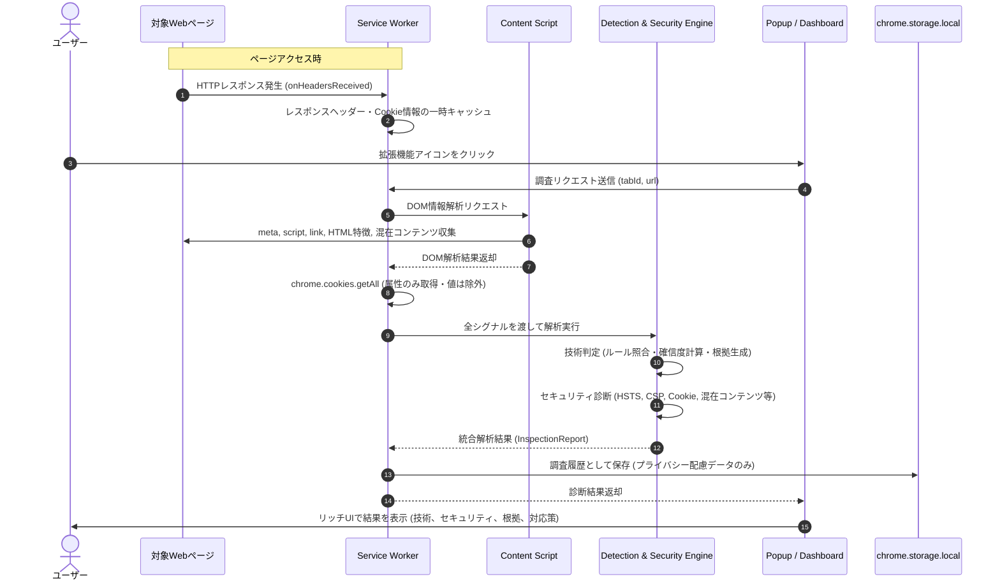

# Web Technology & Security Inspector - 開発計画書 (Version 1.0)

Chrome / Edge (Manifest V3) に対応したWeb技術検出＆セキュリティ診断拡張機能の開発計画書です。

## 1. システムアーキテクチャ構成

```mermaid
graph TD
    subgraph Browser ["Webブラウザ (Chrome / Edge)"]
        subgraph ActiveTab ["閲覧中のWebページ"]
            PageDOM["DOM / HTML / Scripts / CSS"]
            MixedRes["混在コンテンツ (HTTPリソース)"]
        end

        subgraph Extension ["Web Inspector 拡張機能 (Manifest V3)"]
            CS["Content Script<br>(DOM/アセット/混在コンテンツ収集)"]
            SW["Service Worker (バックグラウンド)<br>(HTTPヘッダー収集 / Cookie取得 / 統括)"]
            
            subgraph Engine ["解析エンジン"]
                DE["Detection Engine<br>(技術検出 / ルール照合 / 確信度計算)"]
                SE["Security Engine<br>(ヘッダー / Cookie / HTTPS評価)"]
            end

            subgraph StorageArea ["ストレージ"]
                LocalStorage["chrome.storage.local<br>(調査履歴 / 設定)"]
            end

            subgraph UI ["ユーザーインターフェース"]
                Popup["Popup UI (ポップアップ画面)<br>・サマリーカード<br>・技術/セキュリティ一覧<br>・根拠モーダル"]
                Dashboard["Dashboard UI (詳細画面)<br>・履歴一覧 & 差分比較<br>・詳細レポート<br>・JSON/CSVエクスポート"]
            end
        end
    end

    ActiveTab -->|DOM解析・監視| CS
    ActiveTab -->|HTTP通信 (webRequest)| SW
    CS -->|メッセージ送信| SW
    SW --> DE
    SW --> SE
    DE --> SW
    SE --> SW
    SW --> LocalStorage
    SW <-->|状態取得・操作| Popup
    LocalStorage <--> Dashboard
```

## 2. 診断・分析シーケンス



## 3. 実装フェーズ

| フェーズ | 主な作業内容 |
|---|---|
| **Phase 1: 環境構築・基盤** | package.json, tsconfig.json, Viteビルド設定, Manifest V3設定, 共通型定義 (`types.ts`) |
| **Phase 2: ルール定義・検出エンジン** | サーバー、言語、CMS、フロントエンドフレームワーク/ライブラリ、CDN/WAFのJSONルール、確信度計算ロジック |
| **Phase 3: セキュリティ診断エンジン** | HTTPセキュリティヘッダー診断 (HSTS, CSP, XFO, CORS等)、Cookie属性診断 (値非保持)、混在コンテンツ診断 |
| **Phase 4: Service Worker & Content Script** | webRequestヘッダー収集、Cookie収集、DOM抽出、メッセージング |
| **Phase 5: エクスポート・履歴機能** | JSONエクスポート、UTF-8 BOM付きCSVエクスポート、chrome.storage.local 履歴管理・差分比較 |
| **Phase 6: ポップアップ & ダッシュボードUI** | ガラスモーフィズム・ダークモード対応の美麗UI、インタラクティブ操作、詳細モーダル |
| **Phase 7: テスト・受入検証** | テスト用モックサーバー・Webページ構築、Vitest単体テスト、受入基準チェック |
