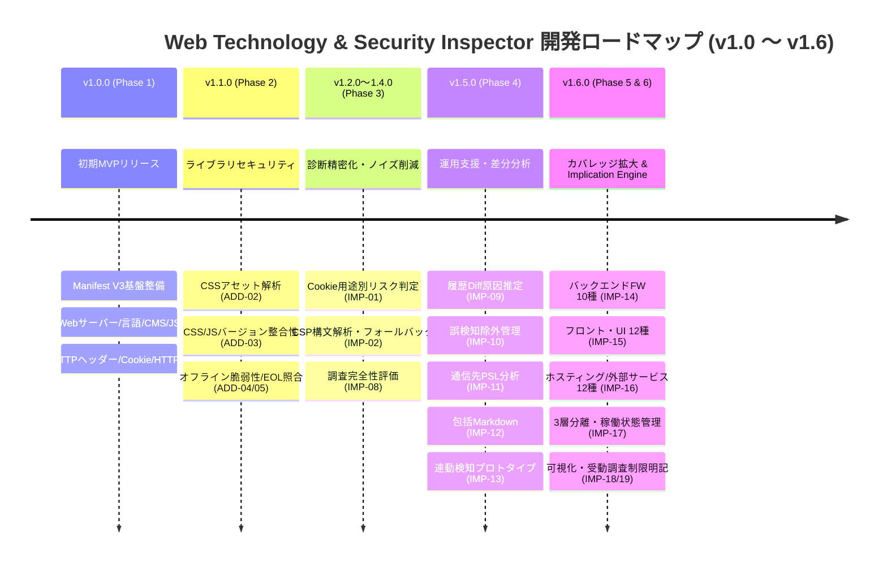
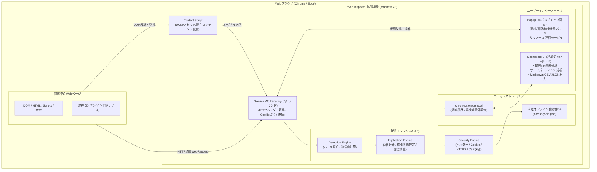
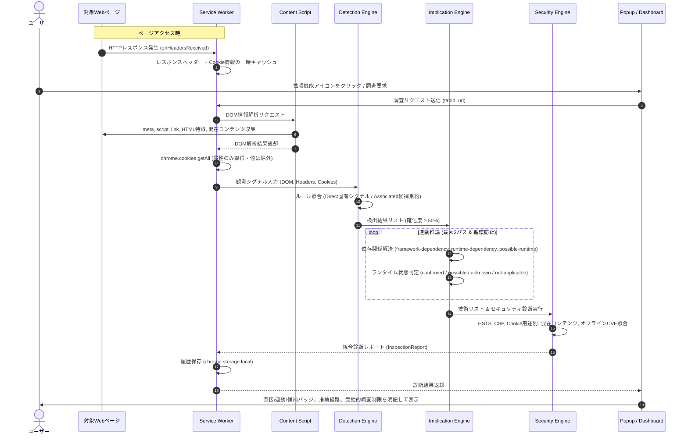

# Web Technology & Security Inspector - 開発・変更計画書 (Version 1.0 〜 1.6.0)

本書は、Chrome / Edge (Manifest V3) 対応ブラウザ拡張機能『Web Technology & Security Inspector』の初期開発から最新バージョン（v1.6.0）に至るまでの全体ロードマップ、システムアーキテクチャ、およびフェーズ別開発計画を体系化した統括計画書です。

各フェーズの詳細な開発計画・設計仕様については、[`docs/phases/`](./phases/) 配下の個別ドキュメントに記載しています。

---

## 1. ロードマップ変遷概要

---

## 2. フェーズ一覧と詳細計画へのリンク

各フェーズをクリックすると詳細な設計・受入基準・トレーサビリティ仕様書を確認できます。

| フェーズ | 対象バージョン | テーマ | 主な機能ID | 詳細ドキュメント |
|---|:---:|---|---|:---:|
| **Phase 1** | v1.0.0 | **初期MVP・基盤診断エンジン開発** | F01 〜 F12 | [詳細計画書 (Phase 1)](./phases/PHASE_1_INITIAL_FOUNDATION.md) |
| **Phase 2** | v1.1.0 | **ライブラリセキュリティ & オフラインCVE/EOL統合** | ADD-01 〜 ADD-08 | [詳細計画書 (Phase 2)](./phases/PHASE_2_LIBRARY_SECURITY.md) |
| **Phase 3** | v1.2.0 〜 1.4.0 | **診断エンジン精密化 & ノイズ（誤検知）削減** | IMP-01 〜 IMP-08 | [詳細計画書 (Phase 3)](./phases/PHASE_3_ENGINE_REFINEMENT.md) |
| **Phase 4** | v1.5.0 | **調査運用支援・差分分析・連動検知プロトタイプ** | IMP-09 〜 IMP-13 | [詳細計画書 (Phase 4)](./phases/PHASE_4_OPERATIONAL_SUPPORT.md) |
| **Phase 5** | v1.6.0 | **検出カバレッジの大幅拡大（主要技術網羅）** | IMP-14 〜 IMP-16 | [詳細計画書 (Phase 5)](./phases/PHASE_5_COVERAGE_EXPANSION.md) |
| **Phase 6** | v1.6.0 | **Implication Engine 高度化 & 可視化・レポート連携** | IMP-17 〜 IMP-19 | [詳細計画書 (Phase 6)](./phases/PHASE_6_IMPLICATION_ENGINE.md) |

### 関連運用ドキュメント
- [技術検出仕様・判定基準書 (`docs/DETECTION_SPECIFICATION.md`)](./DETECTION_SPECIFICATION.md) - 全対応技術の判定シグナル、正規表現、Implication推論マトリクス、バージョン抽出基準
- [保守・リリース運用ガイド (`docs/MAINTENANCE_GUIDE.md`)](./MAINTENANCE_GUIDE.md) - バージョンアップ手順、脆弱性DB更新手順、チェックリスト
- [Chrome Web Store 申請ガイド (`docs/CHROME_WEB_STORE_GUIDE.md`)](./CHROME_WEB_STORE_GUIDE.md) - 配布ZIPのストア提出手順と権限の正当化説明

---

## 3. システムアーキテクチャ構成 (v1.6.0)

---

## 4. 診断・分析シーケンス (v1.6.0)

---

## 5. 全機能トレーサビリティ・マトリクス

| 機能ID | 機能名 | 実装バージョン | 実装ファイル | 単体テスト | フェーズ |
|---|---|:---:|---|---|:---:|
| **F01** | Webサーバー検出 | v1.0.0 | `rules/server.json`, `engine.ts` | `detection.test.ts` | Phase 1 |
| **F02** | 言語・ランタイム検出 | v1.0.0 / v1.5.0 | `rules/language.json`, `engine.ts` | `detection.test.ts` | Phase 1 |
| **F03** | CMS検出 | v1.0.0 | `rules/cms.json`, `engine.ts` | `detection.test.ts` | Phase 1 |
| **F04** | JSフレームワーク検出 | v1.0.0 / v1.6.0 | `rules/frontend.json`, `engine.ts` | `detection.test.ts` | Phase 1 |
| **F05** | JS/CSSライブラリ検出 | v1.0.0 / v1.6.0 | `rules/frontend.json`, `engine.ts` | `detection.test.ts` | Phase 1 |
| **F06** | CDN / WAF推定 | v1.0.0 | `rules/cdn-waf.json`, `engine.ts` | `detection.test.ts` | Phase 1 |
| **F07** | セキュリティヘッダー診断 | v1.0.0 | `src/security/headers.ts` | `security.test.ts` | Phase 1 |
| **F08** | Cookie属性診断 | v1.0.0 / v1.3.0 | `src/security/cookies.ts` | `cookies.test.ts` | Phase 1 |
| **F09** | HTTPS・混在コンテンツ診断 | v1.0.0 | `src/security/https.ts` | `security.test.ts` | Phase 1 |
| **F10** | 判定根拠・確信度計算 | v1.0.0 | `src/detection/confidence.ts` | `detection.test.ts` | Phase 1 |
| **F11** | JSON / CSVエクスポート | v1.0.0 / v1.6.0 | `src/export/json.ts`, `csv.ts` | `export.test.ts` | Phase 1 |
| **F12** | 調査履歴保存・管理 | v1.0.0 | `src/storage/history.ts` | `diff.test.ts` | Phase 1 |
| **ADD-01〜03** | CSSアセット・整合性照合 | v1.1.0 | `content-script.ts`, `version-integrity.ts` | `version-check.test.ts` | Phase 2 |
| **ADD-04〜08** | オフラインCVE/EOL・セキュリティビュー | v1.1.0 | `advisory/matcher.ts`, `dashboard.ts` | `advisory.test.ts` | Phase 2 |
| **IMP-01** | Cookie用途別動的判定 | v1.2.0 | `security/cookies.ts` | `cookies.test.ts` | Phase 3 |
| **IMP-02/05** | CSPディレクティブ構文解析 | v1.2.0 / v1.3.0 | `security/csp-parser.ts` | `csp-parser.test.ts` | Phase 3 |
| **IMP-03/06/07** | 脆弱性DB鮮度・パッケージ除外 | v1.3.0 | `advisory/matcher.ts` | `advisory.test.ts` | Phase 3 |
| **IMP-04** | プレフィックス整合性・CHIPS | v1.3.0 | `security/cookies.ts` | `cookies.test.ts` | Phase 3 |
| **IMP-08** | 調査完全性・エビデンス品質 | v1.3.0 | `shared/coverage.ts` | `coverage.test.ts` | Phase 3 |
| **IMP-09** | 履歴Diff原因自動推定 | v1.5.0 | `storage/diff.ts` | `diff.test.ts` | Phase 4 |
| **IMP-10** | 誤検知・許容除外管理 (FindingId) | v1.5.0 | `storage/exceptions.ts`, `identity.ts` | `exceptions.test.ts` | Phase 4 |
| **IMP-11** | 外部通信先PSLサードパーティ分析 | v1.5.0 | `network/domain-analyzer.ts` | `domain-analyzer.test.ts` | Phase 4 |
| **IMP-12** | 15セクション包括Markdownレポート | v1.5.0 / v1.6.0 | `export/markdown.ts` | `markdown.test.ts` | Phase 4 |
| **IMP-13** | 連動検知プロトタイプ・候補集約 | v1.5.0 | `detection/engine.ts` | `detection.test.ts` | Phase 4 |
| **IMP-14** | バックエンドFW 10種検出 | **v1.6.0** | `rules/backend.json`, `engine.ts` | `detection.test.ts` | Phase 5 |
| **IMP-15** | フロント・UI 12種検出 | **v1.6.0** | `rules/frontend.json`, `engine.ts` | `detection.test.ts` | Phase 5 |
| **IMP-16** | ホスティング・外部サービス 12種検出 | **v1.6.0** | `rules/services.json`, `engine.ts` | `detection.test.ts` | Phase 5 |
| **IMP-17** | Implication Engine 高度化 (3層/状態) | **v1.6.0** | `detection/engine.ts`, `types.ts` | `detection.test.ts` | Phase 6 |
| **IMP-18** | 検出結果可視化 (バッジ/制限明記) | **v1.6.0** | `popup.ts`, `dashboard.ts`, CSS | - | Phase 6 |
| **IMP-19** | CVE/EOL誤報防止・レポート連携 | **v1.6.0** | `export/markdown.ts`, `csv.ts` | `markdown.test.ts`, `export.test.ts` | Phase 6 |
