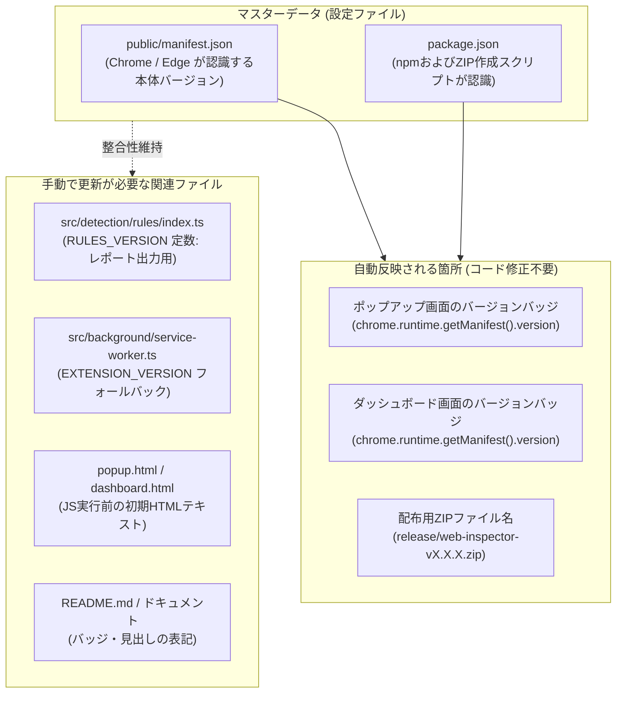
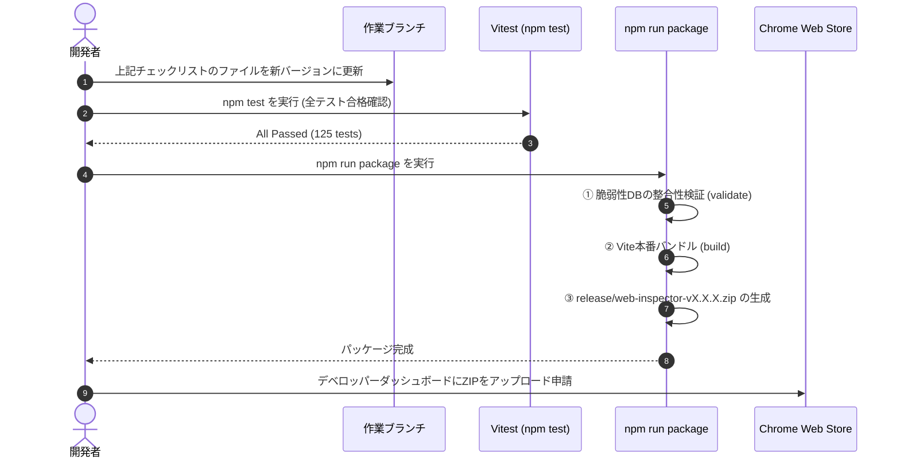
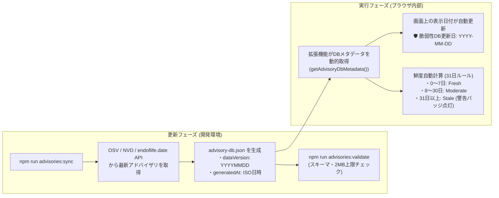

# Web Technology & Security Inspector - 保守・リリース運用ガイド

本書は、『Web Technology & Security Inspector』のバージョンアップ手順、内蔵オフライン脆弱性データベース（`advisory-db.json`）の更新手順、および配布用パッケージ作成・ストア申請フローをまとめた開発者・メンテナー向け運用ガイドです。

---

## 1. バージョンアップの仕組みと手順

### 1.1 バージョン管理の仕組み

本拡張機能では、ブラウザの Manifest V3 仕様および npm の慣例に基づきバージョンを管理しています。



- **画面バッジの自動取得**: ポップアップ画面やダッシュボード画面のバージョンバッジ（`v1.6.0` 等）は、実行時に `chrome.runtime.getManifest().version` から動的に読み込まれます。
- **ZIPファイル名の自動連動**: `npm run package` 実行時、`scripts/package.mjs` が `package.json` の `version` を読み取り、自動的に `release/web-inspector-v{version}.zip` を出力します。

---

### 1.2 バージョン変更時の更新対象ファイル・チェックリスト

バージョン（例: `1.6.0` $\rightarrow$ `1.7.0`）を変更する際は、以下のファイルを更新します。

| No | ファイルパス | 役割・更新内容 | 必須区分 |
|:---:|---|---|:---:|
| 1 | [`public/manifest.json`](../public/manifest.json) | `"version": "X.X.X"`（Chrome Web Store認識用） | **【必須】** |
| 2 | [`package.json`](../package.json) | `"version": "X.X.X"`（ZIP出力スクリプト用） | **【必須】** |
| 3 | [`src/detection/rules/index.ts`](../src/detection/rules/index.ts) | `export const RULES_VERSION = 'X.X.X';`（レポート記録用） | **【必須】** |
| 4 | [`src/background/service-worker.ts`](../src/background/service-worker.ts) | `EXTENSION_VERSION` のフォールバック文字列 | 推奨 |
| 5 | [`src/popup/popup.ts`](../src/popup/popup.ts) | `setupVersionBadge()` のフォールバック文字列 | 推奨 |
| 6 | [`src/dashboard/dashboard.ts`](../src/dashboard/dashboard.ts) | `setupVersionBadge()` のフォールバック文字列 | 推奨 |
| 7 | [`src/popup/popup.html`](../src/popup/popup.html) / `popup.html` | `<span id="brandVersion">vX.X.X</span>` 初期HTMLテキスト | 推奨 |
| 8 | [`src/dashboard/dashboard.html`](../src/dashboard/dashboard.html) / `dashboard.html` | `<span id="dashboardVersion">vX.X.X</span>` 初期HTMLテキスト | 推奨 |
| 9 | [`README.md`](../README.md) | バッジ（`version-X.X.X-blue.svg`）および機能一覧見出し | 推奨 |

---

### 1.3 バージョンアップ作業フロー



---

## 2. 脆弱性データベース (advisory-db) の更新手順

### 2.1 オフラインDBの仕組みと更新日自動反映

本拡張機能は、プライバシー保護と高速動作のため、閲覧先URLや検出技術を外部APIへ送信しません。拡張機能に内蔵された静的スナップショットDB（`src/detection/advisory-db.json`）を用いて**完全ローカル突合**を行います。



- **コード修正不要**: `advisories:sync` が実行日の日付（例: `20261024`）をメタデータとして自動埋め込むため、画面表示やレポート（Markdown / CSV）の日付を変更するためのソースコード修正は一切不要です。
- **鮮度警告の自動判定**: DBの `generatedAt` から経過日数が動的に計算され、31日を超過すると `⚠️ DB鮮度: 31日以上経過` バッジが自動点灯します。

### 2.2 脆弱性スコア・重大度 採用ポリシー

本拡張機能では、客観的かつ機械的なセキュリティ診断を行うため、以下のスコア採用基準と重大度導出ルールを定めています。手書きによる恣意的な重大度の設定は禁止されています。

#### ① スコア採用の優先順位
1. **第一優先 (Primary)**: NIST NVD (`nvd@nist.gov`) の公式評価「Type: Primary」の CVSS v3.1 ベーススコアを採用する。
2. **第二優先 (Secondary)**: NVD の Primary 評価が存在しない場合は、CISA-ADP（Cybersecurity and Infrastructure Security Agency Automated Data Processing）または CNA（CVE Numbering Authority）の評価を採用する（評価主体ラベルは「CISA-ADP」と明記する）。
3. **第三優先 (Fallback)**: NVD に CVSS v3.x が登録されていない場合は、GitHub Advisory Database (GHSA) の公式スコアを採用する。
※ CVSS v3.1 と v4.0 が併記されている場合は、エコシステムの互換性維持のため **CVSS v3.1 を優先** します。

#### ② 重大度 (Severity) の機械的導出ルール
重大度はスコア値から以下の閾値に基づき機械的に導出します：
- **`CRITICAL`**: CVSS スコア 9.0 〜 10.0
- **`HIGH`**: CVSS スコア 7.0 〜 8.9
- **`MEDIUM`**: CVSS スコア 4.0 〜 6.9
- **`LOW`**: CVSS スコア 0.1 〜 3.9

#### ③ 評価乖離時の透明性
Primary 評価と Secondary（CISA-ADP 等）評価の間で重大度レベルに乖離がある場合（例: Primary 9.8 Critical に対し Secondary 7.5 High など）、Primary のスコアを採用した上で、`scoreSource: "nvd@nist.gov (Primary)"` と記録し、要約・注記欄に `CISA-ADP評価: X.X (重大度)` を併記します。

#### ④ 適用条件のある脆弱性の扱い
特定環境・特定モジュール（例: Windows上のPHP-CGI、Apacheのmod_lua、Node.jsの実験的パーミッションモデルなど）が有効化されている場合のみ成立する脆弱性は、バージョン単体で断定せず、データ側の文面（要約・根拠）に `該当の可能性あり (条件: ○○)` を必ず明記します。

---

### 2.3 脆弱性DBの更新手順（ステップ・バイ・ステップ）

> **v1.6.6 以降の更新方式 (自動化):** 脆弱性DBは GitHub Actions `Advisory DB Update` (毎週月曜 05:23 JST) が
> 上流 (OSV / NVD / endoflife.date / CISA KEV) から自動取得・生成し、PR を作成します。手作業は PR のレビューのみです。
> 設計・必要な設定・段階的な有効化は [レビュー結果・開発指示書 第5章](./REVIEW_v1.6.5.md) を参照してください。
> `src/detection/advisory-db.json` は手編集禁止です (CI の `build-db.mjs --check` で検出されます)。
> 人手で管理するデータは `data/advisories/catalog.json` (対象製品・取得元) と `data/advisories/curated.json` (レビュー済みエントリ・除外・静的EOL) です。

#### ステップ 1: 最新アドバイザリの同期 (ローカルで手動実行する場合)
```bash
npm run advisories:fetch   # 上流スナップショット取得 (要ネットワーク, 任意で NVD_API_KEY)
npm run advisories:build   # スナップショットから advisory-db.json を決定的に生成
npm run advisories:diff    # origin/main との差分と分類 (none / minor / major)
```
- `advisories:sync` は上記 fetch → build → validate を連続実行します。

#### ステップ 2: DBの整合性・サイズ検証
```bash
npm run advisories:validate
```
- スキーマ構造、バージョン範囲の書式、ファイルサイズが2MB以内（拡張機能の軽量性維持）であることを自動検証します。

#### ステップ 3: 単体テストの実行
```bash
npm test
```
- 脆弱性突合ロジックやバージョン判定テストがすべてパスすることを確認します。

#### ステップ 4: NVD 一次情報・CPE との機械的照合検証
```bash
npm run advisories:verify-nvd
# またはオンライン直接取得: node scripts/verify-advisories-nvd.mjs --online
```
- NVD の Primary CVSS スコアおよび CPE バージョン範囲と全件自動突合し、未解決差異が 0 件であることを確認します。

#### ステップ 5: 新しいDBを内包したZIPパッケージの作成
```bash
npm run package
```
- 検証、ビルド、ZIP圧縮が一括で実行され、`release/web-inspector-vX.X.X.zip` が生成されます。

---

### 2.4 NVD CPE 照合検証・既知の逸脱および凍結基準 (Freeze Criteria)

本拡張機能では、手作業による恣意的な判定の排除と継続的再現性を保証するため、NVD の CPE 定義と機械的に照合する検証スクリプト（`scripts/verify-advisories-nvd.mjs`）を運用しています。

#### ① 凍結基準 (Freeze Criteria)
リリース前、および週次 CI ジョブにおいて、以下の基準が満たされていることを**凍結条件**とします：
1. **完全照合性**: 脆弱性DBの全エントリについて、`scripts/verify-advisories-nvd.mjs` の実行結果が `[PASS]`（終了コード 0、未解決差異 0 件）であること。
2. **逸脱の限定適用と期待値検証**: 既知の逸脱（許可リスト）は**実際に NVD CPE と差異がある場合のみ適用**され、一致するエントリ（AngularJS 7676 や WordPress 21661 等）は自動的に `MATCH` と判定されること。また、許可リストに登録された `expectedDbRange` および `expectedNvdRange` と完全一致し、公式根拠となる `sourceUrl`（ベンダー公式アドバイザリ等）が必須記載されていること。

#### ② 既知の逸脱一覧 (Known Deviations from NVD CPE)

※ WordPress CVE-2022-21661 (22ブランチ網羅)、nginx CVE-2023-44487 (`>= 1.9.5, < 1.25.3`)、AngularJS CVE-2020-7676 は NVD CPE と完全一致（`MATCH`）したため逸脱から除外されました。

| CVE | ソフトウェア | DB range (期待値) | NVD range (期待値) | 分類 | 公式根拠・採用理由 | 出典 URL |
|---|---|---|---|---|---|---|
| **CVE-2023-39332** | Node.js | `>= 20.0.0, < 20.8.1` | `>= 20.0.0, < 20.8.0` | ベンダー公式優先 | Node.js公式セキュリティリリース(2023-10-13)において20.8.1でパッチ提供。NVD CPEは`< 20.8.0`で登録されているが、20.8.0も脆弱であるためベンダー公式パッチバージョンを優先採用。 | [Node.js Security Release](https://nodejs.org/en/blog/vulnerability/october-2023-security-release) |
| **CVE-2024-4577** | PHP | `< 8.1.29 \|\| ...` | `>= 8.1.0, < 8.1.29 \|\| ...` | 安全側包括 (EOL連動) | EOLのPHP 8.0以前は公式パッチ未提供だが、Windows上のPHP-CGI環境では本脆弱性に該当する。DBでは安全側に倒して`< 8.1.29`として検知対象に含めEOL判定と併せて更新を促す。NVD CPEはパッチ提供ブランチである`>= 8.1.0`から定義。 | [PHP Security Advisory](https://www.php.net/archive/2024.php#2024-06-06-1) |
| **CVE-2021-3129** | Laravel | `< 8.4.3` | `< 2.5.2` (Ignition) | 連動パッケージ置換 | NVD CVE-2021-3129 の configurations において、`cpe:2.3:a:facade:ignition < 2.5.2` (vulnerable: true) と `cpe:2.3:a:laravel:laravel < 8.4.2` (vulnerable: false) が連動ノードとして定義。Laravel 8.4.3 で ignition 2.5.2 以降に依存引き上げが行われたため、本体バージョン `< 8.4.3` としてマッピング。<br/>**※【既知の制約】**: 本脆弱性はデバッグページライブラリ `facade/ignition` の脆弱性であり、`< 8.4.3` はアプリ雛形 (`laravel/laravel`) の番号体系です。Web Inspector が外部から受動検出するのはフレームワークや Cookie であり、外部からバージョンが特定されないため実環境ではほぼ発火しません。次期版でエントリの是非を見直し、Ignition デバッグページの直接検出等への移行を検討します。 | [NVD CVE-2021-3129](https://nvd.nist.gov/vuln/detail/CVE-2021-3129) |
| **CVE-2022-25869** | AngularJS | `<= 1.8.3` | `(CPE未定義)` | GHSA 主導エントリ | NVDにCVSSスコア(6.1)は登録されているがCPE該当範囲情報が未定義のため、一次情報としてGitHub Advisory Database (GHSA-prc3-vjfx-vhm9: `<= 1.8.3`) を採用。EOLのため公式パッチなし (fixedVersion: null)。 | [GHSA-prc3-vjfx-vhm9](https://github.com/advisories/GHSA-prc3-vjfx-vhm9) |

---

### 2.5 公開中バージョン (v1.3.3) における過去の脆弱性DB誤記一覧

v1.6.4 への改訂に伴う NVD CPE 機械的突合により、公開中バージョン (v1.3.3) に存在していた以下の不正確なエントリが特定され、是正・除外されました。

1. **Vue.js CVE-2020-13426 の誤登録 (除外)**:
   - 1.3.3 では `CVE-2020-13426` が「ReDoS in vue template compiler (< 2.6.10)」として登録されていましたが、NVD の一次情報では WordPress のサードパーティプラグイン「Multi-Scheduler」の CSRF 脆弱性であることが判明しました。Vue.js 本体とは無関係のため除外しました（Vue 2 系は全件 EOL として保護）。
2. **WordPress CVE-2023-32243 の誤登録 (除外)**:
   - WordPress 本体ではなくサードパーティプラグイン「Essential Addons for Elementor」の脆弱性であったため除外。
3. **React CVE-2018-6341 の範囲過不足 (是正)**:
   - 1.3.3 の `< 16.0.0` から、NVD CPE 通りの 16 系 SSR 5 ブランチ (`>= 16.0.0, < 16.0.1 || ...`) に是正。
4. **nginx CVE-2021-23017 の範囲過剰 (是正)**:
   - `< 1.21.0` から、修正版 1.20.1 を除外した `>= 0.6.18, < 1.20.1` に是正。
5. **PHP CVE-2022-31628 の種別・重大度・範囲誤記 (是正)**:
   - 「Pharデシリアライズ・High(7.5)」から、NVD一次情報通りの「DoS(gzip展開無限ループ)・Medium(5.5)」および複数ブランチ網羅に是正。
6. **Lodash CVE-2021-23337 のタイトル混同 (是正)**:
   - 「プロトタイプ汚染」から「コマンドインジェクション (_.template)」に是正。
*(※なお、Node.js CVE-2022-35255 や Laravel CVE-2021-3129、AngularJS CVE-2022-25869 は 1.3.3 には存在せず、v1.4.0 以降の機能拡張で新設されたエントリです)*

---

### 2.6 NVD CPE 範囲と semver 表記の同一視規則

NVD の CPE criteria はベンダー提供の版数記法（`versionEndIncluding` / `versionEndExcluding`）に基づいており、semver 上で以下の等価性規則を適用して機械照合を行っています。

1. **離散バージョンにおける上限等価性**:
   - リリース間に中間バージョンが存在しない場合、`<= X.Y.Z` と `< X.Y.(Z+1)` は実質同一の範囲として扱われます。
   - 例: nginx CVE-2023-44487 において、NVD CPE は `<= 1.25.2` と定義されていますが、公式リリース体系上 1.25.2 の次の版は 1.25.3 であるため、DB の `< 1.25.3` と等価（MATCH）として照合します。
   - 例: Laravel CVE-2018-15133 において、NVD CPE の `<= 5.5.40` は 5.5 系パッチ体系上 `< 5.5.41` と等価として照合します。
2. **商用・別エディション criteria の除外**:
   - NVD の configurations にオープンソース版と商用版（例: F5 NGINX Plus の `r25` 〜 `r29` など）が同一エントリ内に混在している場合、検証スクリプトは本拡張機能が対象とするオープンソース版のバージョン体系（`1.x.x`）の criteria を抽出して突合を行います。

---

### 2.7 既知の退行と修正の記録 (v1.6.5 開発時)

1. **SSR連動推論ヘッダーの許可リストからの脱落と是正 (コミット `dd1fd8a`)**:
   - **事象**: コミット `6f72f60` においてレスポンスヘッダーキャッシュの機密情報保護（許可リスト化）を導入した際、`src/detection/engine.ts` でサーバーサイドレンダリング（SSR）判定のために直接参照されていたヘッダー（`x-nextjs-cache`, `x-nitro-cache`）が許可リストから一時的に脱落し、Next.js / Nuxt / SvelteKit からの Node.js 連動推論が発火しなくなっていた。
   - **発見と修正**: 提出前追加確認 (A1) におけるコード内ヘッダー参照文字列の網羅走査により特定。コミット `dd1fd8a` にて `SSR_INFERENCE_HEADER_NAMES` を定義し、Service Worker の `ALLOWED_RESPONSE_HEADERS` に正式追加・統合した。
   - **影響範囲**: ストア未提出の開発ブランチ作業（コミット `6f72f60`）における内部的な退行であり、公開版（v1.6.4 以前）および利用者への実影響は皆無。
   - **テスト強化の経緯**:
     - 当初作成された単体テスト（A1）は、モックオブジェクト内で直接 `headers: { 'x-nextjs-cache': ['HIT'] }` を設定していたため、変異テスト（`SSR_INFERENCE_HEADER_NAMES` をコメントアウト）を実行した際の初回結果は**緑（PASS）**となってしまい、退行を検知できない脆弱なテストとなっていました。
     - そこで、テスト内で生ヘッダーを必ず `filterAndSanitizeHeaders` に通してからキャッシュモックへ渡すよう改修し、変異時に確実に**赤（FAIL）**となることを実証しました。
     - さらに、回帰防止として以下のテスト群を整備しました：
       - 単体テスト: A1 テスト（キャッシュ経由の Node.js 連動推論）
       - 単体テスト: 3-3 許可リスト期待値テスト（包含ヘッダーおよび除外機密ヘッダーの網羅性アサート）
       - 実機 E2E テスト: `/next-ssr-positive`（SSR 指標経由の Node.js 推論確認）
       - 実機 E2E テスト: `/next-static-negative`（Next.js 本体直接検出あり、かつ SSR 指標なし環境で Node.js が除外されることの確認）
   - **許可リストを変更・追加する際の手順**:
     1. rules (`src/detection/rules/*.json`) に `type: "header"` の `target` を追加した場合、`tests/service-worker.test.ts` の許可リスト期待値テスト（3-3）に期待ヘッダー名を更新・追記する。
     2. SSR 推論などルール外のエンジンロジックで直接参照するヘッダーを追加した場合、`src/detection/rules/index.ts` の `SSR_INFERENCE_HEADER_NAMES` に追加する。
     3. 一時的に該当ヘッダーを除外する変異テストを実行し、テストが赤（FAIL）になることを確認する。

---

### 2.8 既知の制限と将来の課題 (v1.7.0 以降の検討項目)

1. **末尾ハイフン付きヘッダーターゲット (`x-fastify-`) の挙動**:
   - `src/detection/rules/backend.json:245` に定義されている `"target": "x-fastify-"` は、エンジン側（`src/detection/engine.ts:180`）が完全一致（Exact Key Lookup）でヘッダーマップを参照しているため、接頭辞ルールとして意図通りに発火していません（`x-fastify-` という完全一致キーのみを参照）。
   - 他に「-」で終わるヘッダーターゲットが存在しないことは走査確認済みです（`git grep -nE '"target": *"[^"]*-"' -- src/detection/rules/` の出力は本件 1 件のみ）。
   - これは以前からの既存仕様であり v1.6.5 の退行ではないため、エンジンの接頭辞マッチング対応は v1.7.0 以降の課題とします。
2. **`data:` URL スキームのサニタイズ**:
   - `data:text/html,...` 等の URL はクエリとフラグメントが除去されますが、データ本体が保持 URL に残りうる仕様となっています。スキームのみ（`data:`）へ丸める改善は v1.7.0 にて検討します。
3. **パス部分に埋め込まれた機密情報**:
   - 保持する URL からクエリパラメータおよびフラグメント（`?token=...#hash`）は確実に除去されますが、URL パスセグメント内に埋め込まれた値（例: `/reset-password/<token>` 等）は除去されません。
4. **弱い直接証拠と連動推論の合算時の detectionMethod 判定**:
   - 弱い直接証拠（例: `XSRF-TOKEN` 35点）が連動推論と合算されて採用閾値（50%）を超えた場合、`detectionMethod` が `direct` になります（`src/detection/engine.ts:707-710`）。E2E は、この影響を避けるため `/next-ssr-positive` の前に `/clear-cookies` を挟んでいます。
5. **調査履歴・エクスポートにおけるクエリ文字列の保持**:
   - 調査履歴（`chrome.storage.local`）および JSON・CSV エクスポートには、URL のクエリ文字列がそのまま含まれます（Markdown のみ、特定キーをマスク）。見直しは R06 として 1.6.6 以降に検討します。

---


## 3. Chrome Web Store 申請・リリースフロー

> **リリース記録 (v1.6.5)**:
> `release/web-inspector-v1.6.5.zip` はタグ `v1.6.5`（コミット `c825dc9`）から作成されました。以後の main の差分は、ビルド入力(src/、public/、package.json、ロックファイル、ビルド設定、scripts/package.mjs)を含まず、公開用 zip の内容には影響しません。

1. **パッケージの確認**:
   - `release/web-inspector-vX.X.X.zip` のサイズ（約70〜100KB）および中身を確認します。
2. **ローカル実機検証**:
   - Chromeの `chrome://extensions/` を開き、「パッケージ化されていない拡張機能を読み込む」で `dist/` フォルダを読み込みます。
   - ポップアップのバージョンバッジおよび脆弱性DB更新日が正しく表示されることを確認します。
3. **ストア提出**:
   - [Chrome デベロッパー ダッシュボード](https://chrome.google.com/webstore/devconsole/) にログインします。
   - 対象アイテムを選択し、「パッケージのアップロード」から生成されたZIPファイルをアップロードします。
   - 変更点サマリーを入力し、「審査に送信」をクリックします。
