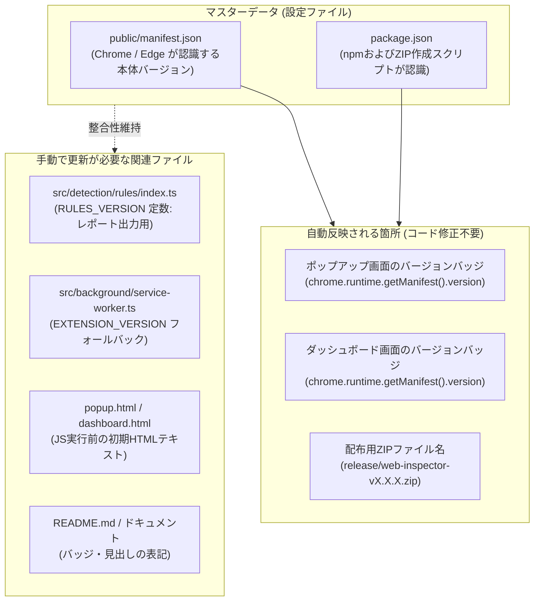
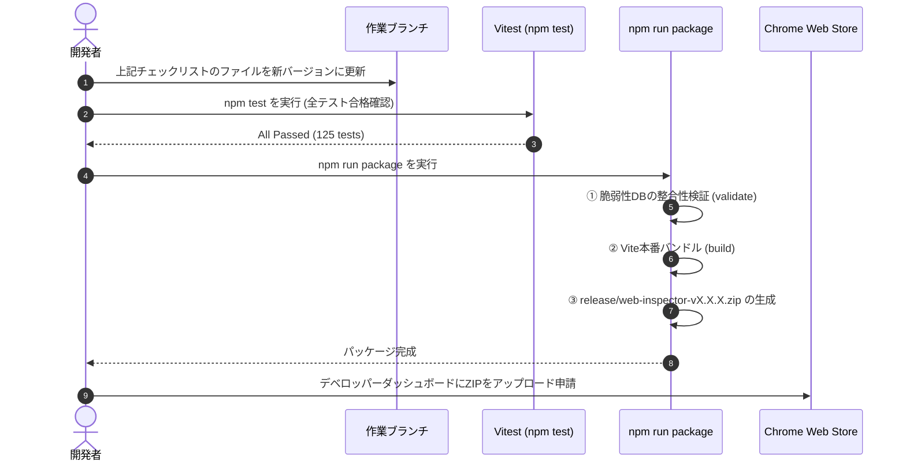
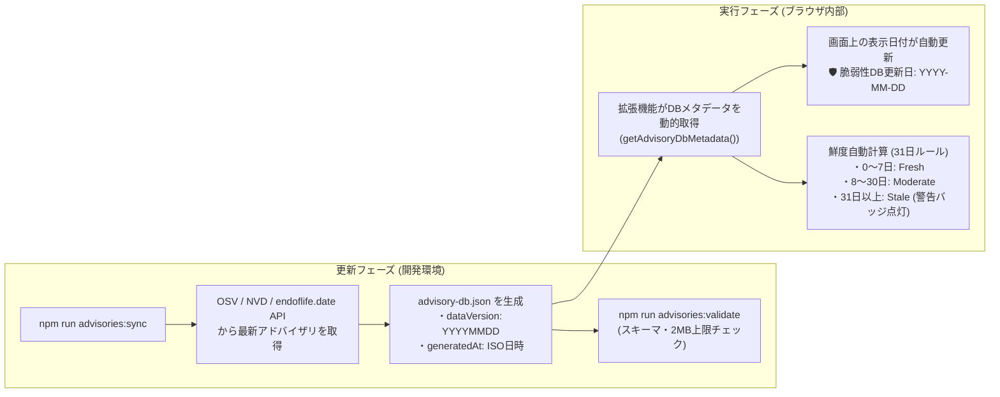

# Web Technology & Security Inspector - 保守・リリース運用ガイド

本書は、『Web Technology & Security Inspector』のバージョンアップ手順、内蔵オフライン脆弱性データベース（`advisory-db.json`）の更新手順、および配布用パッケージ作成・ストア申請フローをまとめた開発者・メンテナー向け運用ガイドです。

---

## 1. バージョンアップの仕組みと手順

### 1.1 バージョン管理の仕組み

本拡張機能では、ブラウザの Manifest V3 仕様および npm の慣例に基づきバージョンを管理しています。



- **画面バッジの自動取得**: ポップアップ画面やダッシュボード画面のバージョンバッジ（`v1.6.0` 等）は、実行時に `chrome.runtime.getManifest().version` から動的に読み込まれます。
- **ZIPファイル名の自動連動**: `npm run package` 実行時、`scripts/package.mjs` が `package.json` の `version` を読み取り、自動的に `release/web-inspector-v{version}.zip` を出力します。

---

### 1.2 バージョン変更時の更新対象ファイル・チェックリスト

バージョン（例: `1.6.0` $\rightarrow$ `1.7.0`）を変更する際は、以下のファイルを更新します。

| No | ファイルパス | 役割・更新内容 | 必須区分 |
|:---:|---|---|:---:|
| 1 | [`public/manifest.json`](../public/manifest.json) | `"version": "X.X.X"`（Chrome Web Store認識用） | **【必須】** |
| 2 | [`package.json`](../package.json) | `"version": "X.X.X"`（ZIP出力スクリプト用） | **【必須】** |
| 3 | [`src/detection/rules/index.ts`](../src/detection/rules/index.ts) | `export const RULES_VERSION = 'X.X.X';`（レポート記録用） | **【必須】** |
| 4 | [`src/background/service-worker.ts`](../src/background/service-worker.ts) | `EXTENSION_VERSION` のフォールバック文字列 | 推奨 |
| 5 | [`src/popup/popup.ts`](../src/popup/popup.ts) | `setupVersionBadge()` のフォールバック文字列 | 推奨 |
| 6 | [`src/dashboard/dashboard.ts`](../src/dashboard/dashboard.ts) | `setupVersionBadge()` のフォールバック文字列 | 推奨 |
| 7 | [`src/popup/popup.html`](../src/popup/popup.html) / `popup.html` | `<span id="brandVersion">vX.X.X</span>` 初期HTMLテキスト | 推奨 |
| 8 | [`src/dashboard/dashboard.html`](../src/dashboard/dashboard.html) / `dashboard.html` | `<span id="dashboardVersion">vX.X.X</span>` 初期HTMLテキスト | 推奨 |
| 9 | [`README.md`](../README.md) | バッジ（`version-X.X.X-blue.svg`）および機能一覧見出し | 推奨 |

---

### 1.3 バージョンアップ作業フロー



---

## 2. 脆弱性データベース (advisory-db) の更新手順

### 2.1 オフラインDBの仕組みと更新日自動反映

本拡張機能は、プライバシー保護と高速動作のため、閲覧先URLや検出技術を外部APIへ送信しません。拡張機能に内蔵された静的スナップショットDB（`src/detection/advisory-db.json`）を用いて**完全ローカル突合**を行います。



- **コード修正不要**: `advisories:sync` が実行日の日付（例: `20261024`）をメタデータとして自動埋め込むため、画面表示やレポート（Markdown / CSV）の日付を変更するためのソースコード修正は一切不要です。
- **鮮度警告の自動判定**: DBの `generatedAt` から経過日数が動的に計算され、31日を超過すると `⚠️ DB鮮度: 31日以上経過` バッジが自動点灯します。

---

### 2.2 脆弱性DBの更新手順（ステップ・バイ・ステップ）

#### ステップ 1: 最新アドバイザリの同期
ターミナルで以下のコマンドを実行します。
```bash
npm run advisories:sync
```
- 主要ライブラリ（jQuery, React, Vue, Bootstrap, PHP, WordPress, Laravel等）の最新CVEおよびEOL情報が取得され、`src/detection/advisory-db.json` が上書き更新されます。

#### ステップ 2: DBの整合性・サイズ検証
```bash
npm run advisories:validate
```
- スキーマ構造、バージョン範囲の書式、ファイルサイズが2MB以内（拡張機能の軽量性維持）であることを自動検証します。

#### ステップ 3: 単体テストの実行
```bash
npm test
```
- 脆弱性突合ロジックやバージョン判定テストがすべてパスすることを確認します。

#### ステップ 4: 新しいDBを内包したZIPパッケージの作成
```bash
npm run package
```
- 検証、ビルド、ZIP圧縮が一括で実行され、`release/web-inspector-vX.X.X.zip` が生成されます。

---

## 3. Chrome Web Store 申請・リリースフロー

1. **パッケージの確認**:
   - `release/web-inspector-vX.X.X.zip` のサイズ（約70〜100KB）および中身を確認します。
2. **ローカル実機検証**:
   - Chromeの `chrome://extensions/` を開き、「パッケージ化されていない拡張機能を読み込む」で `dist/` フォルダを読み込みます。
   - ポップアップのバージョンバッジおよび脆弱性DB更新日が正しく表示されることを確認します。
3. **ストア提出**:
   - [Chrome デベロッパー ダッシュボード](https://chrome.google.com/webstore/devconsole/) にログインします。
   - 対象アイテムを選択し、「パッケージのアップロード」から生成されたZIPファイルをアップロードします。
   - 変更点サマリーを入力し、「審査に送信」をクリックします。
