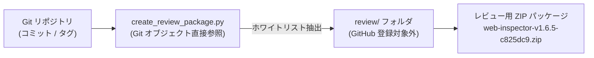
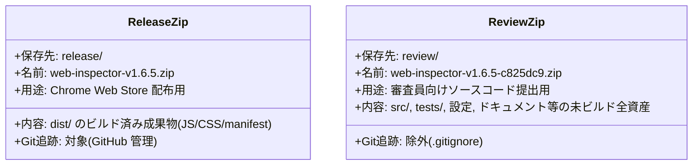

# レビュー用パッケージ作成ガイド (Review Package Guide)

本ドキュメントは、Chrome Web Store の審査や第三者コードレビュー向けに、不要な中間生成物・機密情報・作業ツールログを除外した「クリーンなソースコード ZIP パッケージ」を作成するスクリプト（`scripts/create_review_package.py`）のマニュアルです。

---

## 1. 概要と目的

拡張機能の公開審査（Chrome Web Store レビュー等）では、ビルド済み拡張機能本体（`release/` 配下の ZIP）とは別に、審査員向けに「完全かつ再現可能なソースコード」の提出を求められる場合があります。

本スクリプトは、Git リポジトリ内の特定のコミットやタグから、レビューに必要な構成要素（ソースコード、テスト、ビルド設定、ドキュメント）のみを厳密なホワイトリスト方式で抽出し、安全な ZIP パッケージを生成します。



### 主な特長
- **安全な抽出**: ワーキングツリーの作業ファイルではなく、Git のオブジェクト（`git show`）から直接ファイルデータを抽出するため、ローカルの未コミット変更や作業ツールの痕跡が一切混入しません。
- **Git 管理外の出力先**: 生成された ZIP はすべて `review/` ディレクトリに格納され、`.gitignore` により GitHub に誤ってプッシュされるのを防止します。
- **明確な命名規則**: 「どのタグ／どのコミットから作成されたか」がファイル名から一目で特定できます。

---

## 2. コマンドの使い方

Python 3 がインストールされた環境で、プロジェクトルートまたは任意のディレクトリから実行します。

### 基本的なコマンド

#### (1) 現在の最新コミット (HEAD) から作成
タグまたはコミットを指定しない場合、現在の `HEAD` が対象となります。
```bash
python3 scripts/create_review_package.py
```
- 出力例: `review/web-inspector-v1.6.5-7e5c0fa.zip`

#### (2) バージョンタグを指定して作成 (推奨)
リリース提出時は、該当のリリースタグ（例: `v1.6.5`）を指定して実行します。
```bash
python3 scripts/create_review_package.py v1.6.5
```
- 出力例: `review/web-inspector-v1.6.5-c825dc9.zip`
- アノテーション付きタグの場合でも、指し示しているコミットの短縮 SHA（7桁）が正確に付与されます。

#### (3) 任意のコミットハッシュやブランチを指定して作成
```bash
python3 scripts/create_review_package.py c825dc9
python3 scripts/create_review_package.py main
```

#### (4) 出力先ディレクトリを変更する場合 (`-o` / `--output-dir`)
デフォルトの `review/` 以外の場所に保存したい場合は、`-o` オプションを指定します。
```bash
python3 scripts/create_review_package.py v1.6.5 -o /tmp/review-workspace
```

---

## 3. ファイル収録仕様 (ホワイトリストと除外対象)

レビューに必要なファイル群を確実に含め、不要・有害なファイルは除外します。

| 区分 | 対象ファイル / ディレクトリ | 目的・理由 |
|---|---|---|
| **含める<br/>(収録)** | `src/` | 拡張機能の本体ソースコード (TypeScript, CSS, HTML, SVG) |
| | `public/` | 静的アセット (`manifest.json`、アイコン画像群) |
| | `tests/` | 単体・結合テストスイート |
| | `test-server/` | E2E テスト・検証用ローカルモックサーバー |
| | `scripts/` | ビルド・パッケージング・リンク検証用スクリプト群 |
| | `docs/` | 仕様書、運用ガイド、Chrome Web Store 提出ガイド等 |
| | `.github/workflows/` | CI/CD パイプライン設定 (テスト・ビルド・ガード検証) |
| | `package.json`, `package-lock.json` | 依存関係および再現可能なビルドの定義 |
| | `tsconfig*.json`, `vite.config*.ts` | TypeScript および Vite ビルド設定 |
| | `data/nvd-snapshot.json` | 脆弱性アドバイザリのローカルスナップショット |
| | `README.md`, `PRIVACY_POLICY.md` | プロジェクト概要およびプライバシーポリシー |
| **除く<br/>(除外)** | `node_modules/` | 外部依存パッケージ (再現ビルド時に `npm ci` で取得) |
| | `dist/`, `.tmp/` | ビルド成果物および一時ファイル |
| | `.env*` | 認証情報・環境変数ファイル (存在する場合) |
| | `release/*.zip` | 過去および現在の配布用拡張機能本体 ZIP |
| | `.git/` | Git リポジトリ内部データ |
| | `.gemini/`, `.venv/` | AI 作業ツールや Python 仮想環境の痕跡 |
| | `review/`, `review-packages/` | 既存のレビュー用 ZIP 群 |

---

## 4. 公開用 ZIP とレビュー用 ZIP の違い

本プロジェクトでは、用途に応じて 2 種類の ZIP を使い分けています。



---

## 5. ストア審査提出時の運用フロー

1. **リリースバージョンのタグ付けと公開用 ZIP 作成**:
   - 通常の手順（`npm run build && npm run package`）に従い、`release/web-inspector-v1.6.5.zip` を作成します。
2. **レビュー用ソースコード ZIP の生成**:
   ```bash
   python3 scripts/create_review_package.py v1.6.5
   ```
   - `review/web-inspector-v1.6.5-c825dc9.zip` が生成されます。
3. **ZIP の内容確認**:
   - 必要に応じて展開し、不要なファイルが含まれていないか確認します。
4. **Chrome デベロッパーダッシュボードへの提出**:
   - 配布用パッケージ: `release/web-inspector-v1.6.5.zip`
   - ソースコード提供欄（審査員向け）: `review/web-inspector-v1.6.5-c825dc9.zip` を添付し、ビルド手順（`npm ci && npm run build`）を添えて提出します。
