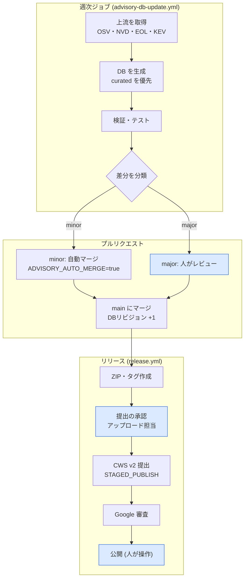

# WEB INSPECTOR v1.6.5 レビュー結果・開発指示書

作成日: 2026-10-26 / 対象: v1.6.5 (commit 7e5c0fa) / 共有ドキュメント版と同内容

## 概要

結論：設計方針（受動的調査・外部送信ゼロ・根拠表示）は妥当です。一方で、**誤検知・見逃しにつながる仕様上の欠陥が9件、ドキュメントに書いてあるのに動かない機能が複数、UIの不具合が1件**見つかりました。脆弱性DBの自動更新パイプラインは実装済みで、差分として同梱しています。

- 対象：v1.6.5（commit 7e5c0fa）のソース一式。ZIPを展開して読み、typecheck・既存テスト174件（全件合格）・ビルドを実行しました。指摘の多くはプローブテストと、拡張を読み込んだ Chromium の実機で再現を確認しています。
- 指摘ID：SPEC（検出仕様）／DOC（ドキュメントとの齟齬）／IMPL（実装上の問題）／NEW（改善提案）。
- 重大度：高＝利用者に誤った結論を見せる、または機能しない。中＝条件付きで誤る。低＝品質・保守性の問題。

| 区分 | 高 | 中 | 低 |
| --- | --- | --- | --- |
| SPEC 検出仕様 | 4 | 7 | 5 |
| DOC 齟齬 | 2 | 7 | 3 |
| IMPL 実装 | 1 | 5 | 6 |

**同梱パッチ（web-inspector-review-v1.6.5.patch）**

- 脆弱性DB自動更新パイプライン（`scripts/advisories/`、`data/advisories/`）
- GitHub Actions：`ci.yml`（更新）、`advisory-db-update.yml`（新規）、`release.yml`（新規）。アクションはすべてコミットSHAで固定しています。
- Chrome Web Store API v2 クライアント（`scripts/cws-publish.mjs`）。v1.1 は 2026-10-15 でサポートが終了しています。
- テスト：パイプラインのテスト42件（合格）と、受け入れテスト24件（`tests/review-v1.6.5-acceptance.test.ts`）。受け入れテストは本書の指摘に対応し、現行コードでは失敗するため skip にしています。修正したら skip を外してください。
- アプリ本体（src/）のロジックは変更していません。修正は本書第6章の指示に従って開発担当が行います。

**ルート HTML について（2026-10-26 追記）**：ZIPに入っていなかったルートの `popup.html` と `dashboard.html` を受け取り、それを使ってビルドとテスト（216件合格、24件 skip）をやり直しました。IMPL-01（履歴ボタンが CSP でブロックされる問題）は、実物のHTMLでも Chromium 上で再現しています。`src/` 配下の HTML は古いコピーのままなので、削除して一本化してください（DOC-10）。

## 1. 検出仕様の問題 (SPEC)

最も影響が大きいのは、次の4点です。いずれも「本当は安全なのに警告が出る」か「危険なのに安全と表示される」方向の誤りです。

1. ヘッダーを取得できなかった場合に、それを「未設定」と扱っている（SPEC-01）
2. ディストリビューション版のバックポートを判定する仕組みが、実際には動いていない（SPEC-02）
3. 「該当なし」の表示が、収録件数わずか24件のDBに基づいている（SPEC-03）
4. EOLの判定が、知らない古いサイクルを「Supported」と返す（SPEC-04）

| ID | 重大度 | 問題 | 再現・根拠 | 対応方針 |
| --- | --- | --- | --- | --- |
| SPEC-01 | 高 | ヘッダーを取得できなかったタブでも、HSTS・CSP・XFO・XCTO・Referrer-Policy・Permissions-Policy を「ヘッダー未設定」として警告し、要確認件数とバッジに加算している | `getCachedHeaders` が undefined を返すと、要確認件数は4件、警告は6件になる。拡張の導入前に開いていたタブや、Service Worker の起動直後のナビゲーションで発生する（Chromium の実機で確認） | `headersObserved=false` のときは、ヘッダーに依存するチェックを status `unknown`（未観測）にする。要確認件数とバッジからも除外する。バナーの文言は残す |
| SPEC-02 | 高 | `versionRegex` が数字部分しか取り出さない。そのため `Apache/2.4.41 (Ubuntu)` の `(Ubuntu)` や、`PHP/7.4.3-4ubuntu2.19` の `-4ubuntu2.19` が失われる。結果として `isLinuxPackageVersion` が一度も真にならず、仕様書6.2のバックポート配慮が働かない | 実機で `Apache 2.4.41` が Potentially Affected（CVE-2021-44790）と判定された。PHP も同様 | ヘッダーの生の値から、ディストリビューションの印（括弧内のOS名、`-NubuntuM`、`~debNuM`、`.elN` など）を `packageHint` として保持し、照合に渡す。第1段階では Needs Review にとどめ、バックポートの注記を付ける（NEW-04で拡張） |
| SPEC-03 | 高 | 「該当なし／Not Affected」が、24件しか収録していないDBで照合した結果を意味している。例えば Apache 2.4.52〜2.4.62 は、既知の重大CVE（2.4.56未満の CVE-2023-25690 など）があっても「該当なし」と表示される | `advisory-db.json` の収録は Apache 3件・PHP 2件・nginx 2件。照合結果に「収録範囲」の情報が出ていない | 表示を「収録DB上は該当なし」に変える。製品ごとの収録件数と最終更新日を併記する。DBは自動更新で拡充する（5章） |
| SPEC-04 | 高 | `matchEolPolicy` は、どのサイクルにも一致しない場合、先頭エントリが Supported なら Supported を返す。加えて、`'1.x'.startsWith('1')` 型の前方一致にも誤りがある | Angular 8.2.14・Laravel 5.4.36・nginx 0.8.55・PHP 4.4.9・Node.js 0.12.18・React 0.14.9・Bootstrap 1.4.0 が、すべて Supported と判定された | 未知のサイクルは「既知の最古サイクルより古ければ EOL、それ以外は Unknown」にする。cycle の比較は数値で行う。Supported を既定値にしない |
| SPEC-05 | 中 | EOLデータの誤り。React 15〜17 が Supported、jQuery の eolDate が文字列 `"EOL"` になっている | endoflife.date の `eol:false` をそのまま採用しているため | パイプラインの `supportedLatestCycles` で修正済み（React は最新1系列のみ Supported） |
| SPEC-06 | 中 | 解析できないバージョン文字列が、すべての `< X` 範囲に一致する（`compareVersions` が null を -1 として扱う） | `jQuery "custom-build"` が CVE 2件に該当と判定された。MAIN world の値はページ側で書き換えられる | `parseVersionParts` が null を返したら Unknown Version にする。実行時バージョンは `typeof string`、64文字以下、`^\d` のときだけ採用する |
| SPEC-07 | 中 | CSP が複数ある場合、各ポリシーの指摘を和集合で評価している。ブラウザは積集合で適用するため、片方が厳格でも high になる。さらに SW は `content-security-policy` の `[0]` だけを、headers.ts は `join(', ')` で1本につないで解析しており、扱いが食い違っている | `'unsafe-inline'` のポリシーと nonce＋strict-dynamic のポリシーを併用すると、high と判定された | 能力単位（インライン実行・任意ホスト・eval など）で、「すべての強制ポリシーが許可するか」を判定する。ヘッダーは配列の要素ごと、さらにカンマ区切りごとに別ポリシーとして扱う |
| SPEC-08 | 中 | CSP の判定漏れと過剰判定。`https:`・`http:`・`*.example.com` を任意ホスト許可として扱っていない。strict-dynamic の info 注記のせいで、堅牢な CSP が warning になる。meta の Report-Only（ブラウザは無視する）を enforce として扱っている | `script-src https:` は unsafe-eval しか指摘されない。nonce＋strict-dynamic の CSP は SEC-CSP-03 の warning になる | 3点とも修正する。info は issue の件数に含めない |
| SPEC-09 | 中 | 正規表現の誤検知。Tailwind が Bootstrap の `d-flex justify-content-*` に一致する（重み80、確信度 High）。Font Awesome が `all.css` や `small.css` に一致する。Chart.js・D3 の正規表現にアンカーがない。`Phusion Passenger` だけで Rails（80）と判定する（Passenger は Node や Python も動かす）。`*_session` と XSRF-TOKEN の組み合わせで Laravel 70 と判定する。`.container` だけで Bootstrap 40 と判定する | 実機の Bootstrap ページで Tailwind CSS が検出された。プローブでも全件を再現した | Tailwind は「Tailwind 固有のトークン（`tw-`、`[`任意値`]`、`sm:`/`md:` などのバリアント接頭辞）が2種類以上」で判定する。ファイル名は \`(^ |
| SPEC-10 | 中 | 同じライブラリの複数バージョンを1件にまとめてしまう | jquery-1.12.4 と 3.7.1 が同居すると 3.7.1 しか評価されず、1.12.4 の CVE 4件が報告されない（WordPress とプラグインの組み合わせで頻出） | 技術ごとに「インスタンス（version＋根拠）」の配列を持たせ、すべてのインスタンスを照合する |
| SPEC-11 | 低 | プレリリース版を無視している（3.5.0-rc1 を 3.5.0 として扱う） | `< 3.5.0` の CVE が漏れる | prerelease を比較対象に含める |
| SPEC-12 | 低 | ヘッダー値を検証していない。XFO は `ALLOWALL` でも PASS、HSTS の max-age=0（明示的な無効化）は low、Referrer-Policy の `unsafe-url` も PASS。CORS の `*`＋credentials はブラウザが拒否する組み合わせなのに high としている。Cookie のプレフィックス違反・SameSite=None で Secure なし・Partitioned で Secure なしは、ブラウザがそもそも保存しないため検出されない | プローブで確認した | 値を検証する。到達しないチェックは、info に落とすか削除する |
| SPEC-13 | 低 | CVE の重大度を SW で high/medium の2値に丸めている（critical→high、low→medium、既定値6.1）。EOL は一律 medium | MAINTENANCE\_GUIDE 2.2 の4段階と一致しない | DB の severity をそのまま使う |
| SPEC-14 | 中 | 連動推論の確信度。仕様は「子 ≤ 親×係数」だが、実装は親が80以上なら一律80、それ以外は最低50に切り上げている | Material UI（85）から React（80）が推論された。係数0.9なら77のはず | 仕様どおりに直すか、仕様書を実装に合わせる（推奨は前者） |
| SPEC-15 | 低 | 混在コンテンツの検出が、属性が `http://` で始まる img・script・link・iframe だけ。srcset・video・audio・source・object・embed・form action を見ていない | — | 対象要素を追加する。パッシブ混在はブラウザが自動でHTTPSに昇格させることを説明文に反映する |
| SPEC-16 | 低 | ヘッダーの取得漏れ。SW のインストールや起動の直後に発生したナビゲーションを取りこぼす。プリレンダー由来のタブ（`tabs.onReplaced`）も考慮していない | 実機で、起動直後のナビゲーションのヘッダーが空になった | `onReplaced` でキャッシュを移す。未観測時は SPEC-01 の扱いにする |

## 2. ドキュメントと実装の齟齬 (DOC)

仕様書の判定基準カタログは、`rules/*.json` から生成した「定義」とは一致しています。ただし、定義されたシグナルの一部は、収集側が対応していないため実際には発火しません。`spec-integrity.test.ts` は文字列が一致するかどうかしか検証しておらず、シグナルが発火するかどうかは検証していません。

| ID | 重大度 | 記載（どこに何とあるか） | 実装（実際） | 対応 |
| --- | --- | --- | --- | --- |
| DOC-01 | 高 | DETECTION\_SPECIFICATION §3 に、Alpine.js `[x-data]`、htmx `[hx-get]`、Material UI `[class*='MuiButton-']`、Font Awesome `i[class*='fa-']`、Spring Security `input[name='_csrf']`、Rails `meta[name='csrf-param']`、Spring Boot の Whitelabel Error Page が判定シグナルとして記載されている | content-script がこれらのマーカーを収集していない。属性セレクタは domMarkers でしか評価されない。Rails はマーカー文字列と pattern（authenticity\_token）が一致しない。本文テキストは収集していない。以上により、これらは**一度も検出されない** | rules の dom target をすべて `querySelector` で評価し、一致した target 文字列と属性値を marker として返す汎用の収集に切り替える。「全シグナルが発火する」ことを確かめる到達性テストを追加する |
| DOC-02 | 高 | README のカバレッジ表に「Tailwind CSS / Lodash」がある。DB にも Lodash の CVE が2件ある | lodash・moment のルールが存在しない。engine.ts の実行時バージョン取得コードは到達不能で、一度も報告されない | `frontend.json` に Lodash・Moment.js を追加する（実行時バージョン＋script.src） |
| DOC-03 | 中 | MAINTENANCE\_GUIDE §2.1・§2.3 に「`advisories:sync` が OSV / NVD / endoflife.date から取得する」とある。§2.4 には「週次 CI ジョブで凍結基準を確認する」とある | 実際には、スクリプト内に手書きしたカタログを書き出しているだけ（取得しているのは EOL のみ）。週次ジョブも存在しない | 同梱パッチで解消済み。旧 `sync-advisories.mjs` は削除し、カタログは `data/advisories/curated.json` に移した |
| DOC-04 | 中 | 仕様書 §6.2 に「(Ubuntu) などはバックポートの可能性を案内する」とある | 発火しない（SPEC-02） | SPEC-02 で対応する |
| DOC-05 | 中 | 仕様書 §4 の図では Next.js→React が `confirmed` だが、表では `possible`。確信度の計算式も実装と異なる | SPEC-14 | 図・表・実装を揃える |
| DOC-06 | 中 | README と仕様書に「CSSコメントからバージョンを抽出する」とある | `<link>` 要素の `ownerNode.textContent` は常に空のため、この処理は一度も動かない | 同一オリジンなら `sheet.cssRules[0].cssText` などで取得する。それが難しければ記載を削除する |
| DOC-07 | 中 | README のカバレッジ表で、GA・Cloudflare・LiteSpeed・Caddy などほぼ全技術が「バージョン特定 ✅」。さらに「全125テスト」、見出しが v1.6.0、ディレクトリ構成が古い（`siteChecker/`、存在しないファイルを列挙） | versionRegex を持つのは一部の技術のみ。テストは174件 | `spec:generate` で README の表も自動生成する |
| DOC-08 | 中 | PRIVACY\_POLICY に「Cookie values are NEVER read」「activeTab / scripting はユーザー操作時のみ」とある | content-script は `document.cookie` を読み（値を含む）、名前だけを残している。`cookies.getAll` の戻り値にも値が含まれる。content\_scripts は全ページに常時注入され、webRequest は全ページの main\_frame を常時観測している | 「値は一時的に読み取るが、保持・保存・送信しない」「閲覧中の全ページのレスポンスヘッダー（許可リストのもののみ）をセッション中に保持する」など、実際の動作どおりに書き直す。ストアのデータ開示との整合も確認する（IMPL-08で実装側を記載に寄せる方針もあり） |
| DOC-09 | 中 | どの文書にも記載がない | `cve/cve-database.json` と `eol/eol-database.json` が、advisory-db で No Data になったときの代替として使われている。中身には誤りがある（Node CVE-2023-39332 が `< 18.19.0`、jQuery 3.0〜3.4 が「EOL」など） | 2つのDBと cve-engine / eol-engine を削除し、advisory-db に一本化する |
| DOC-10 | 低 | MAINTENANCE\_GUIDE §1.2 に「popup.html と src/popup/popup.html の両方」とある | src 側の HTML は古い（IDが4件不足）。実際に使われているのはルート側（後日受領し、確認済み） | HTML は1か所にまとめる（vite の root を設定するか、src 側を削除する） |
| DOC-11 | 低 | 仕様書 §5 に「Laravel / Spring Boot / Node.js（候補）」とある | 実装は Java / Laravel / Node.js の固定ラベルで、2件しか一致しなかった場合も同じラベルになる | 一致した候補だけを表示する |
| DOC-12 | 低 | README IMP-11 に「Public Suffix List (PSL) に基づく」とある。COOP・COEP・CORP は許可リストに含まれている | 実際の PSL は約45件を手書きしたもの（`tokyo.jp` などの地域型ドメインがない）。COOP・COEP・CORP は取得しているが評価していない | PSL はビルド時に生成する（パイプラインで更新）。COOP などの評価は NEW-03 で対応する |

## 3. 実装上の脆弱性・問題 (IMPL)

外部から直接悪用できる重大な脆弱性は見つかりませんでした。理由は、MV3 の既定 CSP でインラインスクリプトが封じられ、ページ由来の値は escapeHtml を通しており、externally\_connectable も未設定だからです。ただし、脆弱性DBを自動で取り込むようになると、IMPL-03 がサプライチェーン経由の注入点になります。そのため、自動更新を有効にする前に修正が必要です。

| ID | 重大度 | 問題 | 再現・根拠 | 対応 |
| --- | --- | --- | --- | --- |
| IMPL-01 | 高 | ダッシュボードの調査履歴にある「表示」「削除」ボタンが、インライン `onclick` で実装されている。MV3 の既定 CSP（`script-src 'self'`）がこれをブロックするため、**ボタンが動かない** | Chromium に拡張を読み込み、クリックすると「Executing inline event handler violates … Content Security Policy」となることを確認した（dashboard.ts:580-581） | `data-id` 属性と `addEventListener`（イベント委譲）に置き換える。E2E でクリック操作を検証する |
| IMPL-02 | 中 | ヘッダーキャッシュがタブIDだけで引かれており、現在のタブURLと照合していない。バックフォワードキャッシュからの復帰や Service Worker が応答したナビゲーションなど、webRequest が発火しない遷移では、別のページのヘッダーで診断する恐れがある | コード上の不整合。ヘッドレス環境ではバックフォワードキャッシュが効かず、再現できていない（要実機確認） | `cachedData.url`（origin＋path）がタブURLと異なる場合は未観測として扱う（SPEC-01） |
| IMPL-03 | 中 | DB 由来の値を、エスケープせずに innerHTML へ出力している。対象は `adv.title`（dashboard）、`referenceUrls` の href と表示文字、`eol.sourceUrl`、`t.website`、エラーメッセージ | 現状は信頼できる同梱データだが、OSV や NVD の summary を取り込むと第三者が値を制御できるようになる | 全箇所を escapeHtml を通すか、DOM API（textContent）で描画する。URL は https と許可ホストを検証してから使う。パイプライン側でも無害化と検証を実装済み（多層防御） |
| IMPL-04 | 中 | MAIN world から得た値はページが自由に制御できるが、型も長さも検証していない。その値が履歴の容量を圧迫したり、照合を誤らせたりする。また `div[id]` の全件に対して `Object.keys` を実行しており、重いページでは負荷になる | SPEC-06 | 文字列かどうか・長さ・書式を検証する。走査する要素数に上限を設ける（例：200件） |
| IMPL-05 | 中 | `onMessage` で送信元を検証していない。履歴の全件取得・削除や許容設定の登録といった特権的なメッセージを、全ページで動く content script の文脈からも受け付けている。未知のメッセージにも `return true` を返し、ポートを開いたままにしている | コード上の問題（多層防御の観点） | 特権的なメッセージは `sender.id === chrome.runtime.id` かつ `sender.url` が拡張のページである場合だけ受け付ける。メッセージのスキーマを検証する。未知のメッセージには false を返す |
| IMPL-06 | 中 | 履歴は「最大50件・サイズ無制限」で、保存先の chrome.storage.local は unlimitedStorage なしでは10MBが上限。保存に失敗すると例外が executeInspection まで伝わり、**調査そのものが失敗する**。読み出してから書き戻す方式のため、同時に調査すると一方の結果が消える | コード上の問題 | 保存失敗は捕捉して通知だけ行う。レポートごとにサイズ上限（evidence の件数など）を設ける。保存先を IndexedDB に移すことも検討する |
| IMPL-07 | 低 | 履歴・JSON・CSV に、クエリを含む完全な URL を保存している（既知の R06） | — | 既定で Markdown と同じマスクをかける |
| IMPL-08 | 低 | content\_scripts を `<all_urls>` に常時注入している。実際に必要なのはクリックしたときだけで、executeScript による代替経路も実装済み | — | 宣言型の content\_scripts を廃止し、必要なときに注入する方式にする。実行されるコードが減り、プライバシーポリシーの記述とも一致する。webRequest には `<all_urls>` が引き続き必要 |
| IMPL-09 | 低 | 許容設定の安定IDが、完全な URL（クエリを含む）や、CSP の場合は指摘の集合に依存している。そのため少しの変化で許容設定が外れる | — | ID は origin＋checkId（＋リソースキー）を基本にする。特定パスだけに適用したい場合は scope で指定する |
| IMPL-10 | 低 | CI が Node 20（2026-04 に EOL）で動いている。アクションはタグ参照で、permissions も未指定 | — | 同梱パッチで対応済み（Node 22、SHA 固定、`contents: read`） |
| IMPL-11 | 低 | `cookies.getAll({url})` は、partitionKey を指定しないとパーティション化 Cookie（CHIPS）を返さない。そのため CHIPS の評価が不完全 | — | `partitionKey: { topLevelSite }` を指定した取得を併用する |
| IMPL-12 | 低 | `document.cookie` と cookies API の両方から同じ Cookie 名を得ており、根拠が重複して表示される | — | 名前で重複を除く |

## 4. 今後の改善・追加検出 (NEW)

ご希望の4領域すべてについて、「どう検出するか」と「脆弱性データをどこから得るか」を、自動更新パイプラインに乗せる前提で整理しました。受動的調査の原則（追加のリクエストを送らない）は守ります。下表の「候補シグナル」はそのまま採用せず、実サイトとテストサーバーの両方で検証してから採用してください。

### NEW-01 国内 CMS / EC

| 対象 | 候補シグナル（要検証） | 脆弱性データの入手先 |
| --- | --- | --- |
| EC-CUBE | アセットのパス（`/html/template/`、`/html/user_data/`）、既定のセッション Cookie 名、管理画面由来のパス | JVN iPedia（MyJVN API）、NVD |
| Movable Type | `meta generator`、`/mt-static/`、`mt.js` | JVN iPedia、NVD（Six Apart の CPE） |
| a-blog cms / baserCMS / Concrete CMS | `meta generator`、テーマのパス | JVN iPedia |
| Welcart | `/wp-content/plugins/usc-e-shop/`（WordPress から連動して推論） | JVN、WPScan（利用規約の確認が必要） |
| ホステッド EC（MakeShop、カラーミーショップ、BASE、STORES、futureshop） | script や CDN のドメイン | なし（SaaS なので、技術の特定だけを行う） |

パイプラインには JVN の取得元を追加する想定です。実装方法は `catalog.json` に `jvn: { cpe: [...] }` を足し、`lib/jvn.mjs` を nvd.mjs と同じ形（compact、ToAdvisories）で作ります。

### NEW-02 JS ライブラリの網羅拡大

- 検出シグネチャの入手元として Retire.js の `jsrepository` を使います。ライセンスが Apache-2.0 なので、表示義務を守ります。このデータには、約100種類のライブラリについて、URI・ファイル名の抽出正規表現と、実行時のバージョンを読むための式が含まれます。パイプラインでこれを変換し、`rules/generated-js.json` を生成します。
- **セキュリティ上の条件**：Retire.js の `func` は JS の式です。これを MAIN world で eval してはいけません。`window.a.b.c` のようなドット区切りのパスだけを許可リストとして取り込み、拡張に同梱した関数でたどって読みます。
- `filecontent`（スクリプトの本文を照合する方式）は追加リクエストが必要になるため、受動的調査の原則に反します。採用しないか、利用者が明示的に有効にしたときだけ使うようにします。
- 脆弱性は OSV（npm）から取得できます。catalog にパッケージ名を追記すれば、そのまま収録されます。
- 優先して追加する候補は、jQuery UI、jQuery Migrate、Handlebars、DOMPurify、Underscore、Select2、Swiper、Video.js、Knockout、Ember、Backbone、Dojo、Prototype、CKEditor 4（2023年にEOL）、TinyMCE の各バージョンです。

### NEW-03 新しいセキュリティヘッダー等

| 項目 | 評価内容 | 受動的に評価できるか |
| --- | --- | --- |
| COOP / COEP / CORP | 値の妥当性を評価する。取得はすでに行っており、未評価なだけ | 可 |
| CSP：Trusted Types、`upgrade-insecure-requests`、`form-action`、`report-to`＋Reporting-Endpoints | 存在しているか、値が妥当か | 可 |
| SRI（外部 script / stylesheet の `integrity` 属性） | サードパーティの CDN で integrity が欠けていないか | 可（content-script で収集） |
| X-XSS-Protection | `0` または未設定を推奨。`1; mode=block` は旧式として指摘する | 可 |
| Cache-Control | 認証 Cookie を持つページで `no-store` がないこと | 可 |
| Permissions-Policy | 内容を評価する（camera・microphone・geolocation などを `*` で許可していないか） | 可 |
| Cookie | 認証 Cookie の有効期限が長すぎないか（例：1年超）、認証 Cookie が SameSite=None でないか | 可 |
| Server-Timing / X-AspNet-Version など | 内部情報の露出 | 可 |
| security.txt、HTTP/3、TLS 設定 | 追加リクエストが必要、または拡張の API では取得できない | 不可（利用者が有効にしたときだけ、または対象外） |

### NEW-04 サーバーのバックポート対応（3段階）

1. **第1段階（SPEC-02 に含めて実施）**：ディストリビューションの印を検出し、CVE は Needs Review（バックポートの可能性あり）として断定しない。
2. **第2段階：ディストリビューションのリリースを推定し、そのライフサイクルで判定する**：例えば `Apache/2.4.41 (Ubuntu)` は Ubuntu 20.04 LTS の標準パッケージと一致します。その場合、「Ubuntu 20.04 の標準サポートは終了（ESM が必要）」という形で、上流版ではなく OS のライフサイクルで EOL を判定します。対応表は endoflife.date（ubuntu、debian、rhel）と、各ディストリビューションのパッケージ版の一覧から、パイプラインで生成します。
3. **第3段階：パッケージの版が取れる場合は、CVE ごとに修正済みかどうかを判定する**：`PHP/7.4.3-4ubuntu2.19` のようにパッケージの版まで得られる場合は、Debian Security Tracker（JSON）や Ubuntu OVAL / USN にある「修正済みの版」と dpkg の版比較で照合します。RHEL 系（`.el8` など）は Red Hat CSAF / VEX を使います。

## 5. 脆弱性DB自動更新（実装済み）と将来設計

配布方式は「同梱」を維持し、外部通信ゼロを守ります。そのうえで、取得からストアへの提出までを GitHub Actions で自動化しました。人が判断するのは次の3か所です。「major 差分のレビュー」「ストアへの提出の承認」「Google 審査を通過した後の公開」。完全に自動化したい場合は、Environment のレビュアーを外し、`CWS_PUBLISH_TYPE=DEFAULT_PUBLISH` を設定します。

上流の取得は週次ジョブだけで行います。DB はコミットされたスナップショットから決定的に生成されるため、PR の差分を見れば何が変わったかを確認できます。

### 構成ファイル

| パス | 役割 | 管理者 |
| --- | --- | --- |
| `data/advisories/catalog.json` | 対象製品と取得元（OSV のパッケージ、NVD の CPE、endoflife.date のスラッグ）、NVD のフィルタ、EOL のポリシー | 人（PRレビュー） |
| `data/advisories/curated.json` | レビュー済みの24件（自動取得より優先）、除外リスト、静的EOL | 人（PRレビュー） |
| `data/advisories/upstream/` | 上流スナップショット（必要な項目だけに圧縮したもの）と manifest | ボット |
| `scripts/advisories/fetch-upstream.mjs` | ネットワークにアクセスする唯一の工程。レート制限、再試行、失敗したときに前回のデータを保持する処理を含む | — |
| `scripts/advisories/build-db.mjs` | スナップショットから `advisory-db.json`（schema 2.2）と `build-report.json` を生成。`--check` で再現性を検証する | — |
| `scripts/validate-advisories.mjs` | スキーマ、重大度の導出、range の書式、URL の許可リスト、HTML 特殊文字、integrity を検証する | — |
| `scripts/advisories/diff-db.mjs` | 差分を none / minor / major に分類し、PR 本文を生成する。21日以上古い場合は、鮮度を更新するため minor として扱う | — |
| `scripts/advisories/bump-db-revision.mjs` | DB だけを更新するリリースで、manifest.version の第4要素を採番する（例：1.6.5 → 1.6.5.1） | — |
| `scripts/cws-publish.mjs` | Chrome Web Store API v2 で status / upload / publish（STAGED\_PUBLISH が既定）を行う | — |

### GitHub 側で必要な設定

| 種別 | 名前 | 必須 | 用途 |
| --- | --- | --- | --- |
| secret | `NVD_API_KEY` | 推奨 | NVD のレート制限を 5 から 50 req/30s に緩和する |
| var + secret | `BOT_APP_CLIENT_ID` / `BOT_APP_PRIVATE_KEY` | 推奨 | GitHub App のトークン。GITHUB\_TOKEN で作った PR では CI が起動しないため |
| var | `ADVISORY_AUTO_MERGE` | 任意 | `true` で minor を自動マージする（リポジトリで auto-merge を有効にする必要あり） |
| var | `CWS_ENABLED` / `CWS_PUBLISHER_ID` / `CWS_EXTENSION_ID` | 提出する場合 | ストアへの提出を有効にする |
| var | `GCP_WORKLOAD_IDENTITY_PROVIDER` / `GCP_SERVICE_ACCOUNT` | 推奨 | 鍵なしの認証。サービスアカウントを CWS ダッシュボードの Account に登録しておく |
| secret | `CWS_CLIENT_ID` / `CWS_CLIENT_SECRET` / `CWS_REFRESH_TOKEN` | 代替手段 | OAuth のリフレッシュトークン |
| Environment | `chrome-web-store` | 推奨 | 必須レビュアーにストアのアップロード担当を設定する（職務分離） |
| var | `CWS_PUBLISH_TYPE` | 任意 | `DEFAULT_PUBLISH` にすると、審査を通過した時点で自動公開される |

### 段階的な有効化

1. パッチをマージする。その後、Advisory DB Update を手動で実行する。初回は schema 2.1 から 2.2 への移行と、OSV 由来の追加分が PR になる。
2. \*\*NVD の自動取り込み（Apache・nginx・PHP・WordPress・Node.js）は、初期状態では `autoIngest:false` にしている。\*\*理由：NVD の `versionEndIncluding` だけのエントリは修正版が不明なので、`fixStatus:'unknown'` になる。ところが v1.6.5 の拡張は、fixedVersion が null だと「公式の修正版はありません」と表示してしまう。有効にするのは、拡張が fixStatus に対応した後である。その際は IMPL-03・SPEC-02・SPEC-03 も反映済みであることが前提で、`MIN_EXTENSION_VERSION` を引き上げる。自動取り込みが無効の間も、NVD は取得して curated との乖離を検出しており、その結果は build-report に記録される。
3. 将来「拡張が定期的にDBを取得する」方式へ移行する場合の設計。schema 2.2 にすでに `integrity.digest` と `minExtensionVersion` を含めてある。追加で必要になるのは次の点。
   - Ed25519 の署名（秘密鍵は CI の Environment secret、公開鍵は拡張に同梱）
   - 配布先（GitHub Pages など）と、`optional_host_permissions` による取得の同意
   - 「同梱版より新しく、かつ署名を検証できた場合だけ採用し、失敗したら同梱版に戻す」実装
   - プライバシーポリシーの改定（送信先と送信する情報を記載し、閲覧URLは送らないことを明記する）

## 6. 開発担当への指示

作業は3つのフェーズに分けます。P0 は、利用者に誤った結論を見せている問題と、機能していない機能の修正です（v1.6.6）。P1 は判定精度の向上と、NVD の自動取り込みへの対応です（v1.7.0）。P2 は検出対象の拡張です（v1.8.x）。各指示の「完了条件」を満たしたら、チェックを入れてください。

### 共通ルール

- 受け入れテスト `tests/review-v1.6.5-acceptance.test.ts` は、指摘IDごとに `it.skip` にしてある。修正したら skip を外し、緑になることを完了条件とする。期待値を変える場合は、本書と合わせて変更する。
- バージョン体系。コードを変更するリリースは3要素（例：1.6.6）、DBだけのリリースはボットが第4要素を採番する（例：1.6.6.3）。package.json は常に3要素とする。
- `advisory-db.json` を手で編集しない。変更は `curated.json` または `catalog.json` に対して行い、CI の `build-db --check` で検証する。

### P0：v1.6.6（最優先）

- [ ] **同梱パッチの取り込み**：`git apply` したうえで `npm ci && npm test && npm run build` が通ること。ルートの HTML はリポジトリにあるものをそのまま使う（パッチには含めていない）。次に Advisory DB Update を手動実行し、最初の PR（schema 2.2）をレビューしてマージする。
- [ ] **IMPL-01** 履歴のボタンを、インライン onclick からイベント委譲に変える。完了条件：E2E（test-e2e-smoke）に「履歴の表示と削除」を追加し、CSP 違反のログが 0 件であること。
- [ ] **SPEC-01** ヘッダーが未観測のときは、ヘッダーに依存するチェックを status `unknown` にし、要確認件数から除外する。IMPL-02 の URL 照合も一緒に実装する。
- [ ] **SPEC-04 / SPEC-06** EOLの既定値で Supported を返さないようにする。解析できないバージョンは Unknown Version にする。MAIN world の値を検証する（IMPL-04）。
- [ ] **SPEC-02（第1段階）** ディストリビューションの印を保持し、Needs Review としてバックポートの注記を付ける。
- [ ] **SPEC-09** Tailwind・Font Awesome・Chart.js・D3・Rails（Passenger）の正規表現と重みを修正する。完了条件：受け入れテストに加え、Bootstrap 5 の公式サンプルページで Tailwind が検出されないこと。
- [ ] **DOC-01 / DOC-02** DOM マーカーの収集を、rules に定義されたセレクタに基づく汎用的な方式に切り替える。Lodash と Moment.js のルールを追加する。完了条件：「全ルールの全シグナルについて、発火するフィクスチャが存在する」ことを確かめる到達性テストを追加する。
- [ ] **IMPL-03** innerHTML への未エスケープ出力をすべて解消する（`\${` を grep して網羅的に確認する）。URL は https と許可ホストを検証する。
- [ ] **DOC-08** プライバシーポリシーとストアのデータ開示を、実際の動作どおりに修正する。
- [ ] **DOC-09** `cve-database.json`・`eol-database.json` と、それを使う engine を削除する。

### P1：v1.7.0

- [ ] **SPEC-03** 「収録DB上は該当なし」の表示と、収録件数・最終更新日を表示する。
- [ ] **fixStatus への対応** `advisory.ts` と `formatAdvisoryRecommendation` で `fixStatus` と `kev` を使う。GHSA だけの ID の場合は NVD リンクを作らない。そのうえで `MIN_EXTENSION_VERSION` を 1.7.0 にし、catalog の NVD 製品を `autoIngest:true` に切り替える。
- [ ] **SPEC-07 / SPEC-08** CSP を積集合で評価する。scheme-source を扱う。info を指摘の件数から除外する。meta の Report-Only を除外する。複数行・カンマ区切りを分割する。
- [ ] **SPEC-10** 複数インスタンスを照合できるようにする（型を拡張し、UI とエクスポートも対応させる）。
- [ ] **SPEC-11〜16、IMPL-05〜12** メッセージの送信元検証、履歴の容量対策、URLマスクの既定化、content\_scripts の廃止、重大度の統一。
- [ ] **DOC-03〜07、10〜12** README・仕様書・保守ガイドを更新する。README のカバレッジ表は `spec:generate` で生成する。HTML は1か所にまとめる。PSL はビルド時に生成する。

### P2：v1.8.x

- [ ] **NEW-03** ヘッダー・SRI・Cookie の評価を拡充する（受動的に可能な項目のみ）。
- [ ] **NEW-04** バックポート対応の第2・第3段階（ディストリビューションのライフサイクルと、セキュリティトラッカーの取り込み）。
- [ ] **NEW-02** Retire.js のシグネチャを取り込む。func はドット区切りのパスの許可リストだけを使い、eval はしない。
- [ ] **NEW-01** 国内 CMS / EC のルールと、JVN の取得元を追加する。テストサーバーに各 CMS の模擬ページを追加する。
- [ ] （任意）署名付きのリモートDBを取得する方式を評価する（5章の3）。
