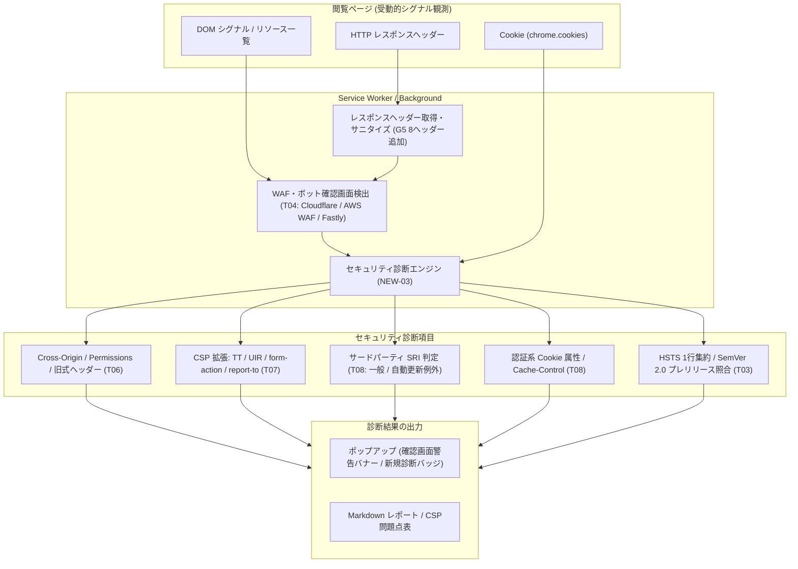
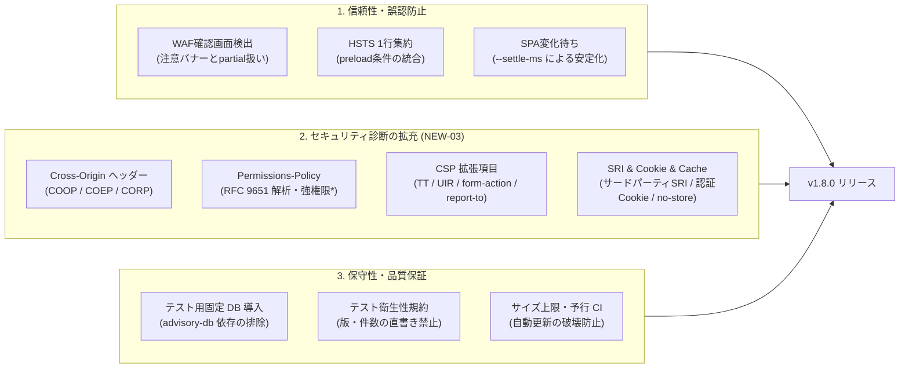

# v1.8.0 完了報告書

## 1. サマリー

- 作業期間: 2026-11-11 22:19 〜 2026-11-12 16:55
- ブランチ / 最終コミット: `feature/v1.8.0` / `acf5fb6`（起点は main の `a5bd583`）
- 結果: 完了 9 / 一部完了 0 / 停止・未完了 0（夜間キットのタスク 9 件。T00 は人の作業）
- 総合チェック（`node scripts/dev/check-v1.8.0.mjs`）: 22 PASS / 1 FAIL / 0 WARN（FAIL の C14 は本報告書の作成で解消、スクリプトが再チェック）
- 実施体制: 夜間（無人）モードで実施。設計とテスト・差分のレビューと、実装を、別々の AI コーディングエージェントが担当。変更範囲の確認・テスト・コミットは夜間スクリプトが実行。
- 一言で: テスト基盤の固定DB化と衛生化、DB単独更新のCI予行とサイズ監視の自動化、HSTSの1行集約とSemVer 2.0プレリリース対応、WAF確認画面検出と警告、SPA一括取得の待ち安定化、NEW-03セキュリティ診断拡充（Cross-Originヘッダー、Permissions-Policy詳細評価、CSP 4項目追加、サードパーティSRI、認証Cookie属性・Cache-Control）およびv1.8.0版上げ・文書整備をすべて完了。



## 2. 実行環境

| 項目 | 値 |
| --- | --- |
| OS | macOS 27.2 |
| Node.js / npm | v24.13.0 / 11.6.2 |
| 実装の担当 / モデル | AI コーディングエージェント CLI 1.5.6 / Gemini 3.8 Flash (High)（差分レビュー: Gemini 4 Argon (High)） |
| 設計・レビューの担当 / モデル | AI コーディングエージェント CLI 2.1.311 / 既定（未指定） |

## 3. タスク別結果

| ID | 内容 | 結果 | 実装のコミット | 実装の試行 / retry | 所要（分） | テストレビューの指摘（採用 / 却下） | 期待値を変えた既存テスト | 備考 |
| --- | --- | --- | --- | --- | --- | --- | --- | --- |
| T01 | テストの点検 | done | `4dbca8a` | 1 / 0 | 16 | 0件（0 / 0） | 8件 | setupFiles 追加による固定 DB 適用、版・件数直書きの排除 |
| T02 | DB だけのリリースの予行とサイズ上限 | done | `93f018c` | 1 / 0 | 24 | 0件（0 / 0） | なし | rehearse-db-release.mjs, check-size.mjs, CIジョブ追加 |
| T03 | HSTS の 1 行化とプレリリース表記 | done | `2e4809d` | 2 / 1 | 33 | レビュー省略 | 1件 | 試行1で停止（needsTestChange: SemVer順序矛盾）。人の判断でテスト期待値を修正後に再実行し完了 |
| T04 | WAF・ボット確認画面 | done | `4c9948f` | 1 / 0 | 23 | 0件（0 / 0） | なし | 最初の夜間で設計工程エラーによる未完了後、再実行で完了 |
| T05 | 一括取得の待ち方 | done | `5a599fc` | 1 / 0 | 15 | レビュー省略 | なし | 最初の夜間で設計工程エラーによる未完了後、再実行で完了。実機確認は人 |
| T06 | NEW-03a ヘッダー | done | `5ac1725` | 2 / 1 | 215 | 0件（0 / 0） | なし | retry 1回（Permissions-Policy Inner List解析修正など）。8つのID追加 |
| T07 | NEW-03b CSP | done | `ed9f5ae` | 1 / 0 | 27 | 0件（0 / 0） | なし | csp-extras.ts新設、csp-parser.ts差分11行（30行以内厳守）。4つのID追加 |
| T08 | NEW-03c SRI・Cache-Control・Cookie | done | `8821d47` | 1 / 0 | 23 | 0件（0 / 0） | なし | sri.ts新設。integrity属性値非収集・非保持。5つのID追加 |
| T09 | 版上げと文書 | done | `acf5fb6` | 4 / 3 | 32 | レビュー省略 | なし | 試行1で停止（needsTestChange: advisory-pipeline.test.mjs の版重複）。人の判断反映後に差分レビュー指摘反映を含め試行4（retry 3）で完了 |

- 設計で書いたテストが実装の前から通っていたタスク（夜間ログの red-check。無ければ「なし」）: なし

## 4. テスト結果

| コマンド | 結果 | 件数・要点 |
| --- | --- | --- |
| `npm test`（vitest） | PASS | passed 1083 / skipped 0 / failed 0 |
| `npm run reports:lint` | PASS | 回帰用フィクスチャで全項目合格（違反 0 件） |
| `npm run build` | PASS | content-script 12.03 KB、service-worker 233.38 KB、dist 合計 848.53 KB |
| 同梱 DB | PASS | 収録件数 417 件（fixed 300 / none 12 / partial 9 / unknown 96）、サイズ 453.69 KB（a5bd583 から変更なし、手編集なし） |
| DB だけのリリースの予行（`scripts/ci/rehearse-db-release.mjs`） | PASS | 一時ツリーで dataVersion 翌日更新・manifest 第4要素採番の予行を実施、全 1083 件 passed で合格 |
| `npm run test:e2e` | 未実行（夜間モード。人間が確認） | 実機確認が必要なため |
| `node scripts/dev/check-v1.8.0.mjs` | PASS（22 PASS / 1 FAIL / 0 WARN） | C14 は本報告書の作成で解消（スクリプトが再チェック）。WARN なし |

- v1.7.1 ベースライン: passed 588 / skipped 0 / failed 0
- skip 中のテスト（REPORT_DATA.json の vitest.skipped をそのまま転記。0 件なら「なし」）: なし
- 期待値を変えた既存テスト（全件。設計メモの「期待値を変えた既存テスト」から。なければ「なし」）:
  - **T01（8件）**:
    1. `tests/spec-integrity.test.ts`「package.json, manifest.json, 各HTML, README のバージョン表記が完全に一致していること」: manifest との比較を自前の分割から `isSameRelease` に変更（4つ目の数字付きリリースに対応）。
    2. `tests/spec-integrity.test.ts`「v1.7.1 T12: 版の表記が…」: `targetVersion` を固定値 `'1.7.1'` から `package.json` の版に変更。manifest は `isSameRelease`。同梱 DB の minExtensionVersion（`'1.7.0'`）の確認を削除（advisory-db-invariants に移動）。題名を変更。
    3. `tests/advisory-db-invariants.test.ts`「schemaVersion が 2.2 であり…」: 期待値 `'2.2'` を build-db の `OUTPUT_SCHEMA_VERSION` に変更。
    4. `tests/advisory-db-invariants.test.ts`「全 14 製品が libraries に存在し…」: 製品の固定リスト（14件）を `catalog.json` の products のキーに変更。
    5. `tests/advisory-db-invariants.test.ts`「全エントリの必須項目が揃い…」: `productCount` の期待値を固定リストの件数から catalog の製品数に変更。
    6. `tests/advisory-db-invariants.test.ts`「T05 (P1): NVD 自動取り込みが有効化され、minExtensionVersion が 1.7.0 であり…」: 削除し、「v1.8.0 T01: manifest の版と minExtensionVersion」（`isSameRelease`、`MIN_EXTENSION_VERSION` と一致）と「T05 (P1): 固定 DB で Apache の照合」（2.4.49 の該当と Ubuntu 版 Needs Review 等を固定 DB で検証）の 2 件に分割。版や特定 CVE の直書きを排除。
    7. `tests/advisory.test.ts`「D17: getAdvisoryDbMetadata() で Rev.2.1 スキーマメタデータが取得できること」: 削除し、advisory-db-invariants.test.ts の「v1.8.0 T01（旧 D17）」に移動。件数の下限確認を同梱 DB の値との一致に変更。
    8. `tests/security.test.ts`「status が info の項目が Markdown・CSV・ポップアップ・ダッシュボードで WARN と表示されないこと」: 入力データ `extensionVersion: '1.7.1'` を `readPackageVersion()` に変更（期待値は不変）。
    - ※ `tests/advisory-pipeline.test.mjs`「リリース種別判定 (classify-release) の (c)」: 合成データの版 `'1.7.1'` を `'1.7.2'` に変更（判定結果は不変、test-hygiene 抵触回避）。
  - **T03（1件）**:
    1. `tests/security.test.ts`「v1.7.1 T11: HSTS (N11)…」の `it.each` 1件目（ヘッダー `max-age=15552000; includeSubDomains; preload`）: `expectPreloadInfo` を `true` → `false` に変更、題名を変更。理由: T03 の仕様変更により、max-age が 1 年未満の場合は `SEC-HSTS-03` を出さず `SEC-HSTS-02` の 1 行に集約するため（SEC-HSTS-02 の判定・重大度は不変）。
  - **T09（人の判断による調整 1件）**:
    - `tests/advisory-pipeline.test.mjs` 444行目: 合成データの版 `'1.8.0'` が新バージョンと重なり test-hygiene に抵触したため、人の判断（needsTestChange 承認）により `'1.8.9'` に変更（判定結果は不変）。

## 5. 変更の概要（利用者から見た変化）

v1.8.0 では、受動的調査の原則（追加リクエスト送信ゼロ・外部通信ゼロ）を維持しつつ、診断項目の拡充・実用的な精度向上・運用の堅牢化が行われました。



1. **WAF・ボット確認画面の検知と注意表示（T04）**
   - Cloudflare (`cf-mitigated: challenge`)、AWS WAF (`x-amzn-waf-action: captcha / challenge`)、Fastly（タイトルおよびロゴ等の複数DOM要素）の確認画面を自動検出。
   - ポップアップの最上部に目立つ警告バナーを表示し、調査ステータスを「一部のみ調査（partial）」として確認画面の診断中であることを明示。Markdown レポートにも警告ブロック（`> [!WARNING]`）を出力。
2. **HSTS の指摘の 1 行集約とプレリリース表記対応（T03）**
   - preload 属性があるものの max-age が 1 年未満の場合、これまで SEC-HSTS-02（警告）と SEC-HSTS-03（情報）の 2 行に分かれていた指摘を、SEC-HSTS-02 の 1 行に集約（説明文に「preload の登録条件も満たしていない」旨を追加）。
   - SemVer 2.0 に準拠したプレリリース表記（`-alpha.1`, `-rc2`, `-preview+build` など）を適切に比較・照合できるようになり、プレリリース版の脆弱性判定の精度が向上。
3. **新規セキュリティチェック項目の追加（NEW-03: T06, T07, T08）**
   - **Cross-Origin ヘッダー・情報露出（T06）**:
     - `SEC-COOP-01` (INFO): Cross-Origin-Opener-Policy の未設定・無効値を指摘。
     - `SEC-COEP-01` (INFO): Cross-Origin-Embedder-Policy の構文・仕様外の値を指摘（未設定は指摘しない）。
     - `SEC-CORP-01` (INFO): Cross-Origin-Resource-Policy の構文・仕様外の値を指摘。
     - `SEC-PERM-02` (LOW): Permissions-Policy で強力な権限（camera, microphone, geolocation, payment, usb）へのワイルドカード `*` 許可を指摘。
     - `SEC-PERM-03` (INFO): Permissions-Policy の RFC 9651 Dictionary 構文不正を指摘。
     - `SEC-XXSS-01` (INFO): 旧式で脆弱性を誘発しうる `X-XSS-Protection: 1` を指摘（0 や未設定は指摘しない）。
     - `SEC-DISC-04` (LOW): `X-AspNetMvc-Version` による技術詳細露出を指摘。
     - `SEC-DISC-05` (INFO): `Server-Timing` ヘッダーによる内部処理情報露出を指摘。
   - **CSP 拡張診断（T07）**:
     - `SEC-CSPX-TT-01` (INFO): XSS 対策を強化する Trusted Types (`require-trusted-types-for 'script'`) の未設定を指摘。
     - `SEC-CSPX-UIR-01` (INFO): 混在コンテンツ防止の `upgrade-insecure-requests` の未設定を指摘（Report-Only では評価せず強制ポリシーで評価）。
     - `SEC-CSPX-FORM-01` (LOW): フォーム送信先を制限する `form-action` ディレクティブの未設定を指摘。
     - `SEC-CSPX-REPORT-01` (INFO): CSP `report-to` で指定されたレポート先が `Reporting-Endpoints` ヘッダーに未定義であることを指摘。
     - これらの指摘は Markdown レポート第 8 節の「CSP の問題点」表にも同様の重大度・内容で反映。
   - **SRI・認証系 Cookie・キャッシュ制御（T08）**:
     - `SEC-SRI-01` (LOW): サードパーティ（PSL 判定）から読み込まれる script / stylesheet に SRI（integrity 属性）が付与されていない場合に指摘（URL を最大 10 件まで集約）。
     - `SEC-SRI-02` (INFO): 頻繁に自動更新される外部サービス（Google タグマネージャー、Stripe、PayPal、Google Identity）のスクリプトで integrity が無い場合を別枠（INFO）として指摘。
     - `SEC-CACHE-01` (LOW): 認証系 Cookie が存在する保護対象ページで `Cache-Control: no-store` が指定されていない場合に指摘。
     - `SEC-COOKIE-EXPIRY` (LOW): 認証系 Cookie の有効期限が 1 年（365日）を超過している場合に指摘。
     - `SEC-COOKIE-SAMESITE-NONE` (LOW): 認証系 Cookie に `SameSite=None`（Secure あり）が設定されている場合に指摘。
4. **SPA ページの一括調査における待ち安定化（T05）**
   - レポート一括取得スクリプト（`scripts/collect-reports.mjs`）で、SPA のルーティング遷移（URL ハッシュ変化）や DOM 変化（MutationObserver）が落ち着くまで待機する機能（`--settle-ms`）を追加。SPA サイトでの調査漏れを防止。
5. **プライバシー配慮の徹底**
   - SRI 診断にあたっては integrity 属性値そのものは一切取得・保持・出力せず、属性の「有無（boolean）」のみを受動的に確認。
   - Set-Cookie ヘッダーは引き続き収集・保持対象外を厳格に維持。

## 6. 指示からの逸脱・判断事項

| 箇所 | 指示 | 実際に行ったこと | 理由 |
| --- | --- | --- | --- |
| T01 | テストの点検（固定 DB、版・件数直書き排除） | `tests/setup/advisory-db.ts` を作成し `vite.config.ts` の `test.setupFiles` に登録。全テストで固定 DB を既定化。同梱 DB の直接読み取りは `advisory-db-invariants.test.ts` のみ許可リストとして残した。 | 脆弱性 DB の自動更新パイプライン実行時にテストが破損するのを機械的に防ぐため。 |
| T02 | DB だけのリリースの予行とサイズ上限 | `scripts/ci/check-size.mjs`（advisoryDb 2 MiB / dist 3 MiB、80% WARN）および `scripts/ci/rehearse-db-release.mjs` を作成し、`.github/workflows/ci.yml` に検査ジョブを追加した。 | 週次自動 DB 更新時の予期せぬ破壊や拡張機能サイズの肥大化を CI 上で未然に検出するため。 |
| T03 | HSTS 1 行化とプレリリース表記 | 観測された版（第1引数）は SemVer 2.0 書式全般を受け付けるが、DB の range 比較節は従来の固定語規則（`validate-advisories.mjs` の `isValidRange`）を厳格に維持。また、tests/hsts-prerelease.test.ts 250 行目の期待値が SemVer 順序と矛盾したため、`needsTestChange: true` で停止後、人の判断で期待値を修正（2.1.0-SNAPSHOT < 2.1.0）。 | 既存の脆弱性 DB とのバリデーション整合性を保ちつつ、観測されたプレリリース版を正確に照合するため。 |
| T06 | NEW-03a ヘッダー評価 | Permissions-Policy の解析を RFC 9651 Dictionary に準拠して実装。強力な権限は指示書指定の 5 つ（camera, microphone, geolocation, payment, usb）に限定。COEP は未設定時は指摘せず仕様外の値のみ指摘。 | 誤検知（過大な警告）を防ぎ、標準仕様に沿った安全側の判定を行うため。 |
| T07 | NEW-03b CSP 追加 4 項目 | 新規モジュール `src/security/csp-extras.ts` を作成し、`csp-parser.ts` の変更は 11 行（30 行以内制限）に抑制。新しい指摘は `analyzeCSPPolicies` の結果には混ぜず、Markdown 問題点表と全体の診断結果にのみ連携。 | 既存の CSP 解析・積集合評価および大量の既存テストへの影響を完全に排除するため。 |
| T08 | NEW-03c SRI・Cookie・Cache-Control | サードパーティ判定に PSL を用いて同一サイトを除外。更新頻度の高い配信元（GTM, Stripe, PayPal, Google Identity）は `SEC-SRI-02`（INFO）に分離。integrity 属性値は一切集めず boolean のみ取得。`SEC-SRI-` はヘッダー非依存のため接頭辞に追加せず、`SEC-CACHE-` のみ接頭辞に追加。 | 外部送信ゼロ・プライバシー配慮の原則を守り、ヘッダー未観測時の挙動を適切に保つため。 |
| T09 | 版上げと文書 | `tests/advisory-pipeline.test.mjs` 444 行目の合成データ `'1.8.0'` が新バージョンと重なり test-hygiene に抵触したため、`needsTestChange: true` で停止後、人の判断で `'1.8.9'` に変更。また G5 の `report-to` ヘッダーを `SECURITY_HEADER_NAMES` に追加。 | test-hygiene 規約を満たし、G5 で合意済みの許可レスポンスヘッダーを網羅するため。 |

## 7. 未解決の問題・既知の制限

- **夜間モードでの停止・未完了の経緯と現状**:
  - T03: 試行 1 で tests/hsts-prerelease.test.ts の期待値矛盾により停止（needsTestChange）。人の判断で期待値を修正し、再実行で正常完了。
  - T04, T05: 最初の夜間で設計工程エラーにより一時未完了となったが、再実行で正常完了。
  - T09: 試行 1 で tests/advisory-pipeline.test.mjs の合成データの版重複により停止（needsTestChange）。人の判断で '1.8.9' に修正し、再実行で正常完了。
  - 現在は T01〜T09 すべて done であり、停止・未完了のタスクは残っていない。
- **退避した変更**: なし（停止時の stash はすべて人の判断・再実行で解消・適用済み）。
- **失敗しているテスト**: なし（Vitest 1083 件全件 PASS、skip 0 件）。
- **既知の制限**:
  - `SEC-COOP-01`: COOP 未設定のほぼすべての Web サイトで INFO が 1 件増加する（重大度は INFO のため「要確認」件数は増加しない）。
  - `SEC-CSPX-FORM-01`: form-action 未指定の CSP を持つサイトで LOW が 1 件増加し「要確認」件数が増加する。
  - `SEC-CACHE-01`: 認証系 Cookie があり no-store のないページで LOW が 1 件増加し「要確認」件数が増加する。
  - CSP の `report-to` について、旧式の `Report-To` ヘッダーのみでグループを定義しているサイトは未考慮（`Reporting-Endpoints` ヘッダーのみを参照する仕様。指摘は INFO）。
  - Apple Pay JS SDK など、公式の一次資料で配信元ホスト名が確認できなかったサービスは `SEC-SRI-02` の例外リストに含めていない。

## 8. 人間の確認が必要な事項

- [ ] E2E（`node scripts/dev/check-v1.8.0.mjs --e2e`）の実行
  - 夜間モードではブラウザ実機確認を行っていないため、実ブラウザ環境で E2E テストが PASS することを確認する。
- [ ] ポップアップ・ダッシュボードの目視確認（確認画面の注意、新しい指摘、HSTS の 1 行化）
  - WAF・ボット確認画面の警告バナー（Cloudflare, AWS WAF, Fastly）の表示・レイアウト崩れがないこと。
  - HSTS の指摘が SEC-HSTS-02 の 1 行にまとまり、preload 登録条件未達の注記が表示されること。
  - 新規セキュリティチェック項目（Cross-Origin、Permissions-Policy、CSP 拡張、SRI、Cookie 等）のカード・バッジ表示。
- [ ] 一括取得の実機確認（test-server の SPA ページを 3 回、demo.owasp-juice.shop）
  - `test-server` の SPA ページ（`/spa-settle`）を 3 回取得し、検出技術一覧が同一であることを確認する。
  - 外部の SPA サイト（`demo.owasp-juice.shop` 等）で `--settle-ms` による待ち合わせが正常に機能することを確認する。
- [ ] `PRIVACY_POLICY.md` の文言の承認とストアのデータ開示の見直し:
  - **取得ヘッダーの追加（G5）**: `x-xss-protection`, `cache-control`, `server-timing`, `x-aspnetmvc-version`, `reporting-endpoints`, `report-to`, `cf-mitigated`, `x-amzn-waf-action` の 8 ヘッダーを受動的に取得・保持する用途説明の文面（日英両表記）が適切であるかの承認。また、Chrome Web Store のプライバシー開示内容の更新要否の確認。
  - **SRI integrity 属性の有無の確認**: スクリプトおよびスタイルシートの URL と integrity 属性の「有無（boolean）」のみを受動的に確認し、属性値そのものは一切取得・保持・外部送信しない旨の文面（日英両表記）の承認。
  - **Set-Cookie の非収集維持**: Set-Cookie ヘッダーを一切取得・保持しない方針が維持されていることの確認。
- [ ] 外部の事実に基づく判定の根拠（事実・URL・確認日）:
  - **SemVer 2.0.0 仕様（T03）**: プレリリース・ビルドメタデータの書式および順位規則 — https://semver.org/spec/v2.0.0.html （2026-11-11 確認）
  - **HSTS Preload 登録基準（T03）**: max-age 31536000 以上、includeSubDomains、preload — https://hstspreload.org/ （2026-11-11 確認）
  - **Cloudflare 確認画面（T04）**: チャレンジ応答ヘッダー `cf-mitigated: challenge` — https://developers.cloudflare.com/cloudflare-challenges/challenge-types/challenge-pages/detect-response/ （2026-11-12 確認）
  - **Cloudflare JS Detections（T04）**: 全 HTML ページへの `/cdn-cgi/challenge-platform/` 挿入 — https://developers.cloudflare.com/cloudflare-challenges/challenge-types/javascript-detections/ （2026-11-12 確認）
  - **AWS WAF Challenge / CAPTCHA（T04）**: レスポンスヘッダー `x-amzn-waf-action: challenge`（202）/ `captcha`（405） — https://docs.aws.amazon.com/waf/latest/developerguide/waf-captcha-and-challenge-actions.html （2026-11-12 確認）
  - **Playwright 初期化スクリプト仕様（T05）**: `page.addInitScript` の動作特性 — https://playwright.dev/docs/api/class-page （2026-11-12 確認）
  - **Cross-Origin Opener / Embedder Policy 仕様（T06）**: COOP / COEP の仕様値および無効値の扱い — https://html.spec.whatwg.org/multipage/browsers.html#cross-origin-opener-policies （2026-11-12 確認）
  - **Cross-Origin Resource Policy 仕様（T06）**: CORP の ABNF（大文字・小文字を厳格に区別） — https://fetch.spec.whatwg.org/#cross-origin-resource-policy-header （2026-11-12 確認）
  - **Permissions-Policy 仕様（T06）**: ワイルドカード `*` の仕様 — https://w3c.github.io/webappsec-permissions-policy/ （2026-11-12 確認）
  - **RFC 9651 Structured Field（T06）**: Dictionary 解析仕様 §4.2 — https://www.rfc-editor.org/rfc/rfc9651.html （2026-11-12 確認）
  - **OWASP HTTP Headers Cheat Sheet（T06）**: X-XSS-Protection の非推奨性、X-AspNetMvc-Version の情報漏洩性 — https://cheatsheetseries.owasp.org/cheatsheets/HTTP_Headers_Cheat_Sheet.html （2026-11-12 確認）
  - **W3C CSP Level 3（T07）**: meta 要素における制限、default-src のフォールバック範囲 — https://w3c.github.io/webappsec-csp/ （2026-11-12 確認）
  - **W3C Upgrade Insecure Requests（T07）**: Report-Only での無視仕様 — https://w3c.github.io/webappsec-upgrade-insecure-requests/#delivery （2026-11-12 確認）
  - **W3C Reporting API（T07）**: Reporting-Endpoints ヘッダー仕様 — https://w3c.github.io/reporting/#header （2026-11-12 確認）
  - **Chrome Reporting API Migration（T07）**: Reporting-Endpoints と Report-To の移行 — https://developer.chrome.com/blog/reporting-api-migration （2026-11-12 確認）
  - **W3C Trusted Types（T07）**: require-trusted-types-for 'script' 仕様 — https://w3c.github.io/trusted-types/dist/spec/ （2026-11-12 確認）
  - **Google タグマネージャー（T08）**: 公開のたびに動的更新されるコンテナ仕様 — https://support.google.com/tagmanager/answer/6107163 、ホスト名 https://developers.google.com/tag-platform/security/guides/csp （2026-11-12 確認）
  - **Stripe.js（T08）**: 直接読み込み推奨、バンドル・自前ホスト禁止 — https://docs.stripe.com/js/including （2026-11-12 確認）
  - **PayPal JS SDK（T08）**: 直接読み込み推奨、自動更新仕様 — https://developer.paypal.com/sdk/js/configuration/ （2026-11-12 確認）
  - **Google Identity Services（T08）**: 自前ホスト非対応、自動更新仕様 — https://developers.google.com/identity/gsi/web/guides/client-library （2026-11-12 確認）
  - **RFC 9111 HTTP Caching（T08）**: no-store による保存禁止規定 §3、no-cache の仕様 §4 — https://www.rfc-editor.org/rfc/rfc9111.html （2026-11-12 確認）
  - **Chrome Cookies API（T08）**: expirationDate（秒）および no_restriction（SameSite=None）の仕様 — https://developer.chrome.com/docs/extensions/reference/api/cookies （2026-11-12 確認）
  - **W3C Subresource Integrity（T08）**: 空の integrity の非検証仕様 — https://w3c.github.io/webappsec-subresource-integrity/ （2026-11-12 確認）
- [ ] その他:
  - `report-to` レスポンスヘッダーを `ALLOWED_RESPONSE_HEADERS` に追加したことの確認（G5 方針の適用）。
  - `Server-Timing` ヘッダー指摘（`SEC-DISC-05`）の文面と重要度（INFO）の妥当性確認。

## 9. 変更ファイル一覧

```
 .github/workflows/ci.yml               |  25 +
 PRIVACY_POLICY.md                      |  24 +-
 README.md                              |  10 +-
 dashboard.html                         |   2 +-
 docs/DETECTION_SPECIFICATION.md        |  29 +-
 docs/MAINTENANCE_GUIDE.md              |  38 ++
 docs/dev/v1.8.0/WORKLOG.md             | 457 ++++++++++++++++++
 docs/dev/v1.8.0/design/T01.md          | 132 ++++++
 docs/dev/v1.8.0/design/T02.md          | 208 ++++++++
 docs/dev/v1.8.0/design/T03.md          | 140 ++++++
 docs/dev/v1.8.0/design/T04.md          | 120 +++++
 docs/dev/v1.8.0/design/T05.md          | 117 +++++
 docs/dev/v1.8.0/design/T06.md          | 175 +++++++
 docs/dev/v1.8.0/design/T07.md          | 228 +++++++++
 docs/dev/v1.8.0/design/T08.md          | 203 ++++++++
 docs/dev/v1.8.0/design/T09.md          |  91 ++++
 package-lock.json                      |   4 +-
 package.json                           |   2 +-
 popup.html                             |   2 +-
 public/manifest.json                   |   2 +-
 scripts/ci/check-size.mjs              | 188 ++++++++
 scripts/ci/rehearse-db-release.mjs     | 321 +++++++++++++
 scripts/collect-reports.mjs            | 142 +++++-
 src/background/service-worker.ts       |  36 +-
 src/content/content-script.ts          |  60 +++
 src/dashboard/dashboard.ts             |   2 +-
 src/detection/interstitial.ts          | 109 +++++
 src/detection/rules/index.ts           |   2 +-
 src/export/csv.ts                      |   4 +-
 src/export/markdown.ts                 |  26 +-
 src/popup/popup.ts                     |  20 +-
 src/popup/render.ts                    |  27 ++
 src/security/cookies.ts                |  57 +++
 src/security/csp-extras.ts             | 357 ++++++++++++++
 src/security/csp-parser.ts             |  11 +-
 src/security/engine.ts                 |  11 +-
 src/security/headers.ts                | 550 ++++++++++++++++++++-
 src/security/sri.ts                    | 152 ++++++
 src/security/version-matcher.ts        |  93 +++-
 src/shared/types.ts                    |  44 ++
 test-server/server.mjs                 |  45 ++
 tests/advisory-db-invariants.test.ts   |  94 ++--
 tests/advisory-fixture-default.test.ts |  60 +++
 tests/advisory-pipeline.test.mjs       |   7 +-
 tests/advisory.test.ts                 |  14 +-
 tests/ci-check-size.test.ts            | 192 ++++++++
 tests/ci-db-release-rehearsal.test.ts  | 334 +++++++++++++
 tests/ci-workflow.test.ts              | 192 ++++++++
 tests/collect-settle.test.ts           | 318 +++++++++++++
 tests/csp-extras.test.ts               | 841 +++++++++++++++++++++++++++++++++
 tests/header-extras.test.ts            | 514 ++++++++++++++++++++
 tests/helpers/release-version.ts       |  34 ++
 tests/helpers/test-hygiene.ts          | 156 ++++++
 tests/hsts-prerelease.test.ts          | 344 ++++++++++++++
 tests/interstitial.test.ts             | 470 ++++++++++++++++++
 tests/release-docs.test.ts             | 122 +++++
 tests/release-version.test.ts          |  46 ++
 tests/security.test.ts                 |   8 +-
 tests/setup/advisory-db.ts             |  19 +
 tests/spec-integrity.test.ts           |  26 +-
 tests/sri-cache-cookie.test.ts         | 741 +++++++++++++++++++++++++++++
 tests/test-hygiene.test.ts             | 175 +++++++
 vite.config.ts                         |   4 +
 63 files changed, 8824 insertions(+), 153 deletions(-)
```

## 10. 次回（v1.8.1）への申し送り

- **テスト衛生性（test-hygiene）と合成データの版採番**:
  - `tests/advisory-pipeline.test.mjs` で合成データのバージョンに `'1.8.0'` を用いていたため、v1.8.0 版上げ時に test-hygiene 違反となり一時停止が発生しました。今後は合成データのバージョンに `9.9.9` や `0.0.0-test` のような将来の現実のバージョンと重複しない固定値を使用することを推奨します。
- **CSP Report-To ヘッダーの互換性検討**:
  - 現在は標準勧告の動向に合わせ `Reporting-Endpoints` ヘッダーのみを対象に CSP `report-to` の妥当性を検証しています。従来の `Report-To` ヘッダーのみを指定しているレガシー実装への対応要否を今後検討することを推奨します。
- **SRI 自動更新例外配信元の拡充**:
  - 現在 GTM、Stripe、PayPal、Google Identity を例外（INFO）としていますが、Apple Pay JS SDK など一次資料で確証が得られなかった配信元について、公式ドキュメント等の調査を継続し、必要に応じて追加することを推奨します。
- **夜間キットの自動化運用**:
  - needsTestChange 発生時の自動停止フローは安全側に正常機能しましたが、人の判断が必要な場面での連絡や再実行手順の自動化（CI連携）をさらに円滑化する余地があります。
  - Permissions-Policy の Inner List パースのように RFC 仕様の細部に起因する実装 retry が発生したため、外部仕様に依存する複雑な構文解析はパーサー仕様のテストケースをより細粒度に設計することが望まれます。
