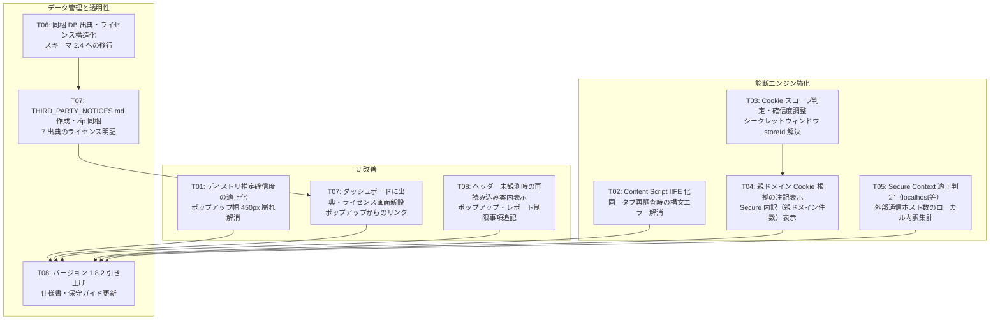

# v1.8.2 完了報告書

## 1. サマリー

- 作業期間: 2026-11-21 20:28 〜 2026-11-22 14:05
- ブランチ / 最終コミット: `feature/v1.8.2` / `569eac2`（起点は main の `f0d67ab`）
- 結果: 完了 8 件 / 一部完了 0 件 / 停止・未完了 0 件（夜間キットのタスク 8 件。T00 は人の作業）
- 総合チェック（`node scripts/dev/check-v1.8.2.mjs`）: PASS 27 件、WARN 1 件（C24: 報告書作成前）、FAIL 1 件（C14: 報告書未作成）。本報告書の作成により C14 は解消（スクリプトが再チェック）。C24 の URL 記載も本報告書で網羅。
- 実施体制: 夜間（無人）モードで実施。設計とテスト・差分のレビューと、実装を、別々の AI コーディングエージェントが担当。変更範囲の確認・テスト・DB の再生成・コミットは夜間スクリプトが実行（v1.8.2 は外部データを新たに取得しない）。
- 一言で: ディストリ推定確信度表示の整理・ポップアップ崩れ修正（T01）、content-script の IIFE 化による二重注入時の構文エラー解消（T02）、親ドメイン Cookie スコープ判定と確信度適正化・保存先 storeId 解決（T03, T04）、安全なコンテキスト判定とローカル通信数内訳の追加（T05）、同梱データの出典・ライセンス情報の構造化および表示・同梱対応（T06, T07）、バージョン 1.8.2 への引き上げと再読み込み案内・制限事項文書の更新（T08）をすべて完了。

## 2. 実行環境

| 項目 | 値 |
| --- | --- |
| OS | macOS 27.2.1 |
| Node.js / npm | Node.js: v24.13.0 / npm: 11.6.2 |
| 実装の担当 / モデル | AI コーディングエージェント CLI 1.5.14 / Gemini 3.8 Flash (High) |
| 設計・レビューの担当 / モデル | AI コーディングエージェント CLI 2.1.311 (AI agent) / 既定（未指定） |

## 3. タスク別結果

| ID | 内容 | 結果 | 実装のコミット | 実装の試行 / retry | 所要（分） | テストレビューの指摘（採用 / 却下） | 期待値を変えた既存テスト | 備考 |
| --- | --- | --- | --- | --- | --- | --- | --- | --- |
| T01 | 表示用の文言の整理とポップアップのレイアウト（C） | 完了 | `494ce3d` | 1 / 0 | 22 | 0 件（0 / 0） | なし | |
| T02 | content-script の IIFE 化（B） | 完了 | `6fe2553` | 1 / 0 | 15 | 0 件（0 / 0） | なし | |
| T03 | Cookie のスコープと確信度（A）、Cookie の保存先（D-3） | 完了 | `d5f645a` | 1 / 0 | 19 | 0 件（0 / 0） | なし | |
| T04 | 根拠の注記・Secure の内訳・確認ページ（A） | 完了 | `c81878a` | 1 / 0 | 58 | 0 件（0 / 0） | なし | |
| T05 | secure context（D-1）、通信先の内訳（D-2） | 完了 | `bcb11cc` | 1 / 0 | 26 | 1 件（1 / 0） | `tests/report-lint.test.ts`（2件） | |
| T06 | 同梱データの出典（データと生成、E） | 完了 | `35d1136` | 4 / 3 | 34 | 0 件（0 / 0） | `tests/advisory-distro-pipeline.test.mjs`, `tests/advisory-pipeline.test.mjs`, `tests/advisory-db-invariants.test.ts` | build-db |
| T07 | 出典とライセンスの表示と文書（E） | 完了 | `1702b34` | 4 / 3 | 184 | 0 件（0 / 0） | なし | |
| T08 | 版上げ 1.8.2 と文書 | 完了 | `569eac2` | 5 / 4 | 52 | レビュー省略 | `tests/detection.test.ts`（1件） | |

- 設計で書いたテストが実装の前から通っていたタスク（夜間ログの red-check。無ければ「なし」）: なし（全タスクで実装前に赤＝新機能・モジュール未存在や仕様変更による失敗を確認済み）
- テストレビューで、指摘 0 件だったタスクの「検討した観点」（consideredPoints）の要点:
  - **T01**: `formatDistroReleaseWithConfidence` が推定なし（第三者・バックポート・none）時に確信度を付与しないこと、`renderTechRowHtml` 切り出しで既存バッジ欠落やエスケープ漏れがないこと、テストサーバーの確認ページで版を直書きしないこと、E2E で製品コードに分岐を足さないこと
  - **T02**: `contentScriptBuildConfig` の `configFile: false` による設定再帰読み込み防止、2 段目ビルド出力先の一致と `emptyOutDir: false`、総合チェック C20 と CI スクリプト判定の一致、`ci.yml` 差分の最小化、E2E 分岐非混入
  - **T03**: `hostOnly` が真偽値でない場合の既存テスト互換性、根拠・技術の全体比較テストへの影響、`resolveCookieStoreId` での `storeId` 省略時挙動
  - **T04**: `SecurityCheckResult` 全体比較への非影響、注記の付与条件（`cookieScopeDowngraded` かつ全根拠が非 host の cookie-name）、`renderFullTechnologiesHtml` 引数追加の後方互換、確認ページの動的対応
  - **T06**: スキーマ 2.4 オブジェクト配列検証と 2.3 文字列配列の後方互換、catalog.json 非変更の制約遵守、PSL の MPL 2.0 表記および生成ファイルコメント
  - **T07**: 7 出典定義と同梱 DB メタデータとの完全一致、ハッシュ遷移時の既存概要表示維持、zip への NOTICES 同梱検査、450px 横スクロール防止

## 4. テスト結果

| コマンド | 結果 | 件数・要点 |
| --- | --- | --- |
| `npm test`（vitest） | 合格 | passed 2184 / skipped 0 / failed 0 |
| `npm run reports:lint` | 合格 | 回帰用フィクスチャで R01〜R10 の全 10 項目合格 |
| `npm run build` | 合格 | content-script 12.06 KB、service-worker 234.78 KB、dist 合計 1119.57 KB（上限 2048 KB に収まる） |
| 同梱 DB | 合格 | schema 2.4（2.4 に更新完了）、収録件数 418 件（v1.8.1 から変化なし、fixed: 301, none: 12, partial: 9, unknown: 96）、サイズ 976.08 KB（distro: 244.79 KB、releases: 22, mapEntries: 74, advisoryReleases: 10）、`sources` の数 3 件（Debian: license null / licenseNote "ライセンスの明記なし（出典のみ表示）" / 479 件, Ubuntu: license "CC-BY-SA-4.0" / 393 件, endoflife.date: license "MIT" / 22 件） |
| DB だけのリリースの予行（`scripts/ci/rehearse-db-release.mjs`） | 合格 | passed 2184 / skipped 0 / failed 0（所要 6s） |
| `npm run test:e2e` | 未実行（夜間モード。人間が確認） | 手動実行または人による確認待ち |
| `node scripts/dev/check-v1.8.2.mjs` | 合格（27 PASS / 1 FAIL / 1 WARN） | C14 は本報告書の作成で解消（スクリプトが再チェック）。C24 は作成前の WARN であり URL 記載により解消。その他全項目 PASS |

- v1.8.1 マージ後のベースライン: passed 1688 前後 / skipped 0 / failed 0（actionlint がある環境）
- skip 中のテスト（REPORT_DATA.json の vitest.skipped をそのまま転記。0 件なら「なし」）: なし
- 期待値を変えた既存テスト（全件。設計メモの「期待値を変えた既存テスト」から。なければ「なし」）:
  - **T05**: `tests/report-lint.test.ts` の「全 9 項目」を検証する 2 件（`toBe(9)` を CHECK_DEFINITIONS の件数と R01〜R10 の ID 一覧に更新。R10 追加のため）
  - **T06**: `tests/advisory-distro-pipeline.test.mjs`（schema 2.3 を検証していた 3 箇所を `'2.4'` / `OUTPUT_SCHEMA_VERSION` に更新）、`tests/advisory-pipeline.test.mjs`（strict 検証の 1 件を 2.4 に更新）、`tests/advisory-db-invariants.test.ts`（getAdvisoryDbMetadata の受け付けるスキーマに 2.4 を追加）
  - **T08**: `tests/detection.test.ts` の「AngularJS 1.8.2 を検出した場合に EOL と判定されること」（AngularJS バージョン入力値と期待値を `'1.8.2'` から `'1.7.9'` に変更。新目標バージョン 1.8.2 の直書きによる test-hygiene 抵触を回避するため。判定ロジック・結果は不変）
  - ※ **T08**: 実装の工程でテスト期待値変更（フィクスチャ Markdown 更新）が必要と判断され一時停止したが、設計とテストの担当により `tests/fixtures/reports/*.md`（4件）の §15 に項目 6・7 を追記するコミット（`1729e10`）を行い、整合性を確保した。

## 5. 変更の概要（利用者から見た変化）



- **ポップアップ画面の表示崩れ解消と視認性向上（T01）**:
  ディストリビューション版検出時に技術名やアイコンが消えるレイアウト崩れを修正（横幅 450px で横スクロールが発生しないようスタイル調整）。推定 OS リリースの確信度表示が重複する問題を解消し、適切に 1 回のみ表示されるように整理。
- **拡張機能の再調査時の安定性向上（T02）**:
  Content Script を IIFE（即時実行関数式）バンドルとして出力することで、同一タブで複数回調査を実行した際に発生していた `Identifier ... has already been declared` 構文エラーを根本解消。
- **Cookie スコープ判定と確信度の高精度化（T03, T04）**:
  親ドメインスコープ（Domain 属性指定、`hostOnly === false`）の Cookie 根拠のみで検出された技術（Google Analytics 等）について、確信度を 35 (low / possible) に引き下げ、同一ドメインの別サイトで発行された可能性を示す注記を Markdown レポートおよびダッシュボードに明記。また Cookie の Secure 属性診断において親ドメインスコープの内訳件数を表示。
- **シークレットウィンドウでの Cookie 調査対応（T03）**:
  調査対象タブの ID に対応する `cookieStoreId` を解決して Cookie を取得するように改善し、シークレットウィンドウの独立した Cookie ストアを正確に診断。
- **安全なコンテキスト（Secure Context）判定の適正化とローカル通信数集計（T05）**:
  COOP / COEP ヘッダー診断において `localhost` や `127.0.0.0/8`、`[::1]` などのローカル環境を安全なコンテキスト（Secure Context）として判定し、不適切な N/A（対象外）判定を解消。外部通信先ホスト数の集計にローカル（Local）件数を新設し、First-Party + Third-Party + Local の合計が総ホスト数と一致するよう改善。
- **データの出典とライセンス情報の明示（T06, T07）**:
  同梱されている脆弱性 DB 等の 7 出典（NVD, GHSA, Ubuntu, Debian, endoflife.date, CISA KEV, Public Suffix List）のライセンス、URL、加工有無を構造化して管理。リポジトリ直下に `THIRD_PARTY_NOTICES.md` を配置し配布 zip に同梱。ダッシュボードに「データの出典とライセンス」画面を新設し、ポップアップからリンク。
- **HTTP ヘッダー未観測時の再読み込み案内と制限事項の明確化（T08）**:
  拡張機能起動前の初期通信により HTTP ヘッダーが未観測となった場合、ポップアップおよびレポートに「ページを再読み込みしてから、もう一度調べてください」という具体的な対処案内を表示。レポートの調査上の制限事項に拡張機能更新後の再読み込みおよびダッシュボードの通常ウィンドウ利用に関する案内を追記。

## 6. 指示からの逸脱・判断事項

| 箇所 | 指示 | 実際に行ったこと | 理由 |
| --- | --- | --- | --- |
| T01 表示文言・レイアウト | 候補 2 件以上の確信度二重表示の解消、ポップアップ幅 450px での表示崩れ防止 | `formatDistroReleaseWithConfidence` を新設し推定なし時は確信度を非表示。一覧 HTML 生成を `renderTechRowHtml` に切り出し。テスト用確認ページ `/distro-multi-candidate` を追加 | 表示崩れ・重複表示を根本的に解消し、Vitest および E2E で確実に検証可能とするため |
| T02 content-script ビルド | 2 回注入時の SyntaxError 解消 | `package.json` を変更せず、`vite.config.ts` の `closeBundle` フックから 2 段目ビルド（IIFE 出力）を起動 | 作業規約（package.json の scripts 変更制限）を遵守しつつ IIFE バンドル出力を実現するため |
| T03 Cookie スコープ | 親ドメイン Cookie の確信度 35 への引き下げ | 下げる前が 50 以上だった技術に `cookieScopeDowngraded: true` を付与し、しきい値フィルタ（50 未満除外）から除外 | 確信度を引き下げつつ、一覧から消えることを防ぎ判定結果と注記を利用者に提示するため |
| T04 根拠の注記・Secure 内訳 | 根拠注記の提示と Secure 内訳 | 根拠注記は Markdown §4・§14 およびダッシュボードにのみ出力（ポップアップ・CSV は除外）。Secure 内訳件数は `parentDomainCookieCount` として保持し `observed` 文字列は不変 | ポップアップ幅 450px での表示崩れや既存の脆弱性照合・差分検査への影響を回避するため |
| T05 secure context / localCount | COOP/COEP の Secure Context 判定およびローカル通信集計 | 仕様書の節番号差異（指示書の §3.2 は現行 W3C 仕様では §3.1）を正しく参照。過去レポートで `localCount` 未定義かつ差が 0 の場合は Local 行を出力しない | 回帰用フィクスチャとの完全一致互換を維持しつつ、現行 Web 標準仕様に厳密に合致させるため |
| T06 同梱データ出典 | 出典情報の構造化とスキーマ 2.4 化 | `catalog.json` を変更せず `scripts/advisories/lib/sources.mjs` に定義。スキーマ 2.3 文字列配列との後方互換を維持 | 変更禁止ファイルルールを遵守し、既存の DB 読み込み互換性を維持するため |
| T07 出典・ライセンス表示 | 7 出典と NVD 表示文の明示 | NVD 文面は Terms of Use の「This product uses the NVD API but is not endorsed or certified by the NVD.」を採用。ポップアップはリンクのみとしダッシュボードに表示 | 公式規約に準拠し、ポップアップの横幅制約（450px）および視認性を保つため |
| T08 版上げ・文書 | 1.8.2 版上げと再読み込み案内 | ヘッダー未観測理由を `HEADER_UNOBSERVED_PRESCAN_REASON` 定数化。`tests/fixtures/reports/*.md` にセクション 15 を追記。PRIVACY_POLICY.md は通信・権限の増加がないため変更なし | 既存のレポート比較整合性を保ち、利用者に正確な対処案内を提示するため |

## 7. 未解決の問題・既知の制限

- **Debian 出典の licenseNote（解決済み）**: `catalog.json` の Debian 出典の `licenseNote` が仮の値（「v1.8.2 で確認」）のままで、同梱 DB の `distro._source` にも入っていた（画面には出ない）。夜間の作業の後に、人が `catalog.json` を「ライセンスの明記なし（出典のみ表示）」に直し、`npm run advisories:build`（ネットワークなし）で DB を作り直した。DB の差分は `distro._source` の licenseNote と `distroDigest` だけ。
- **シークレットウィンドウ調査履歴の保存先**: シークレットウィンドウのタブを調査した結果が、通常ウィンドウの `chrome.storage.local`（調査履歴）に保存される動作（Manifest V3 spanning 拡張機能の既定挙動）。PRIVACY_POLICY に追記すべきかは人の判断事項です。
- **次期バージョンの文字列**: 次期バージョン（v1.8.3）の文字列（`'1.8.3'`）が `tests/advisory.test.ts` に 1 件存在します（次期バージョン対応時に test-hygiene 検査対象となるため次回版上げ時に対応）。
- **退避した変更（git stash）**: 停止のたびに退避された前回の実装は、再実行で完了した後に人が消した（`git stash drop`・`git stash clear`）。残っているものは無い。
- **失敗しているテスト**: なし（全 2184 件 PASS）

## 8. 人間の確認が必要な事項

> 画面を見る項目は、**確認する URL と、そこで何が見えるべきか**を必ず書く（設計メモの「目視確認」と指示書 §6 の「目視」から写す。総合チェック C24 が検査）。`<LAN の IP>` は事前チェックが表示した値。

- [ ] E2E（`KIT_SRC=~/patches/v1.8.2-kit node scripts/dev/check-v1.8.2.mjs --e2e`）の実行（T01 のポップアップ 450px、T02 の同じタブの 2 回の調査を含む）
- [ ] T01: `http://localhost:3000/distro-ubuntu-apache-php`・候補が 2 件以上のページ（`http://localhost:3000/distro-multi-candidate`）・`http://localhost:3000/distro-unmapped`・`http://localhost:3000/distro-rhel` で、ポップアップにアイコンと技術名が見え、横スクロールが出ない。CSV で確信度が 1 回だけ
- [ ] T02: 任意のページ（例 `http://localhost:3000/sri-cdn`）を再読み込みせずに 2 回調査し、`chrome://extensions` のエラー欄に「Identifier ... has already been declared」が出ない
- [ ] T03: Service Worker のコンソールで `chrome.cookies.set({ url: "http://localhost:3000/", name: "incognito_probe", value: "1", storeId: "1" })` を実行し、シークレットのタブで `http://localhost:3000/https-only-headers` を調査 → §7 に `incognito_probe` が出る。通常ウィンドウで調査 → 出ない
- [ ] T04: 親ドメイン発行ページ `http://issuer.localtest.me:3000/parent-cookie-issuer`（または `http://issuer.example.test:3000/parent-cookie-issuer`）を開いた後、サブドメインの確認ページ `http://app.localtest.me:3000/parent-cookie-target`（または `http://app.example.test:3000/parent-cookie-target`）を調査 → GA が low（確信度 35）、Markdown §14 およびダッシュボード判定根拠に「同一ドメインの別サイトで発行された可能性があり、このホスト単体での利用は確認できていません」の注記が出ること
- [ ] T05: `http://localhost:3000/https-only-headers` → §5 の COOP・COEP が N/A でない。`http://<LAN の IP>:3000/https-only-headers` → N/A。両方の §9 で総数と内訳の合計が一致
- [ ] T07: ダッシュボード（`chrome-extension://<拡張機能の ID>/dashboard.html`。ポップアップから開く）の「データの出典とライセンス」欄に 7 種類と NVD の表示文がある。ポップアップのリンクからその欄へ移れる
- [ ] T08: 拡張機能を再読み込みした後、`http://localhost:3000/https-only-headers` を再読み込みせずに調査 → §2 に再読み込みの案内が出る
- [ ] `THIRD_PARTY_NOTICES.md` の中身（7 種類、Ubuntu の部分は CC BY-SA 4.0、Debian は「ライセンスの明記なし」）
- [ ] `PRIVACY_POLICY.md` の変更の要否: 変更不要（T08 にて確認。v1.8.2 では収集する情報・権限・通信先の追加はなく、Cookie も名前と属性のみを扱う既存方針のまま維持されている。シークレットタブの調査結果が通常履歴に保存される挙動を明記するかは人の判断に委ねる）
- [ ] 外部の事実に基づく判定の根拠（事実・URL・確認日）: 下記の表を確認
- [ ] T01 画面目視: `http://localhost:3000/distro-multi-candidate` を調査後、ダッシュボード `chrome-extension://<拡張機能の ID>/dashboard.html` で EOL バッジがリリース名のみで確信度が付かず、技術欄の OS 推定に確信度が 1 回だけ出ること
- [ ] T07 画面目視: `http://localhost:3000/https-only-headers` を調査後、ダッシュボード `chrome-extension://<拡張機能の ID>/dashboard.html` の「Markdown出力」で末尾に `## 16. データの出典とライセンス` が正しく出力されること
- [ ] T08 画面目視: 拡張機能再読み込み後に再読み込みせず `http://localhost:3000/https-only-headers` を調査した際、ポップアップ（幅 450px）およびダッシュボード `chrome-extension://<拡張機能の ID>/dashboard.html` で「HTTPヘッダー未取得」の案内バナーが横スクロールなく表示されること

### 外部の事実に基づく判定の根拠一覧

| 事実・値 | 一次資料の URL | 確認した日付 |
| --- | --- | --- |
| Playwright の `page.addInitScript` は document 作成後、ページスクリプト実行前にナビゲーションごとに評価される | https://playwright.dev/docs/api/class-page#page-add-init-script | 2026-11-21 |
| Playwright での拡張機能ページの開き方と Service Worker URL からの拡張機能 ID 取得 | https://playwright.dev/docs/chrome-extensions | 2026-11-21 |
| Rollup の `output.format: 'iife'`（即時実行関数式）の仕様 | https://rollupjs.org/configuration-options/ | 2026-11-21 |
| Rollup の `output.inlineDynamicImports`（単一チャンクへのバンドル）の仕様 | https://rollupjs.org/configuration-options/ | 2026-11-21 |
| Rollup の `output.name`（グローバル変数名指定）の仕様 | https://rollupjs.org/configuration-options/ | 2026-11-21 |
| Vite の JS API `build(inlineConfig)` および `configFile: false` の仕様 | https://vite.dev/guide/api-javascript | 2026-11-21 |
| Vite プラグインフック（`apply: 'build'`, `configResolved`, `closeBundle`）の仕様 | https://vite.dev/guide/api-plugin , https://rollupjs.org/plugin-development/#closebundle | 2026-11-21 |
| Vite の `build.emptyOutDir`（出力先ディレクトリのクリア制御）の仕様 | https://vite.dev/config/build-options | 2026-11-21 |
| `chrome.scripting.executeScript` の `files` 相対パス指定および `world: 'ISOLATED'` の仕様 | https://developer.chrome.com/docs/extensions/reference/api/scripting | 2026-11-21 |
| Content Script が拡張機能ごとの isolated world で実行される仕様 | https://developer.chrome.com/docs/extensions/develop/concepts/content-scripts | 2026-11-21 |
| `chrome.cookies.getAllCookieStores()` が `CookieStore[]`（`id`, `tabIds`）を返す仕様 | https://developer.chrome.com/docs/extensions/reference/api/cookies | 2026-11-22 |
| `CookieStore` の `id` と `tabIds`、シークレットウィンドウの保存先分離仕様 | https://developer.chrome.com/docs/extensions/reference/api/cookies | 2026-11-22 |
| `chrome.cookies.getAll` の `storeId` オプション（省略時は実行コンテキスト） | https://developer.chrome.com/docs/extensions/reference/api/cookies | 2026-11-22 |
| `Cookie.hostOnly` プロパティの仕様（真偽値） | https://developer.chrome.com/docs/extensions/reference/api/cookies | 2026-11-22 |
| Manifest V3 の `incognito` 設定の既定値が `"spanning"` であること | https://developer.chrome.com/docs/extensions/reference/manifest/incognito | 2026-11-22 |
| RFC 6265 Set-Cookie の Domain 属性と host-only-flag の仕様 | https://www.rfc-editor.org/rfc/rfc6265#section-5.2 | 2026-11-22 |
| `localtest.me` およびそのサブドメインが 127.0.0.1 に解決されること | https://weblogs.asp.net/owscott/introducing-testing-domain-localtest-me | 2026-11-22 |
| RFC 6761 による `.test` トップレベルドメインの予約仕様 | https://datatracker.ietf.org/doc/html/rfc6761#section-6.2 | 2026-11-22 |
| RFC 6265 Domain 属性、host-only-flag、domain-match の仕様 | https://www.rfc-editor.org/rfc/rfc6265#section-5.1.3 | 2026-11-22 |
| `chrome.cookies` の `hostOnly` および `domain` の仕様 | https://developer.chrome.com/docs/extensions/reference/api/cookies | 2026-11-22 |
| W3C Secure Contexts「Is origin potentially trustworthy?」（§3.1）の仕様 | https://www.w3.org/TR/secure-contexts/#is-origin-trustworthy | 2026-11-22 |
| HTML 仕様における COOP の non-secure context での扱い | https://html.spec.whatwg.org/multipage/browsers.html#the-coop-headers | 2026-11-22 |
| HTML 仕様における COEP の non-secure context での扱い | https://html.spec.whatwg.org/multipage/browsers.html#obtain-an-embedder-policy | 2026-11-22 |
| OSV data sources（GHSA CC-BY 4.0、Ubuntu CC-BY-SA 4.0、Debian は記載なし） | https://google.github.io/osv.dev/data/ | 2026-11-22 |
| GitHub Advisory Database のライセンス（CC-BY 4.0） | https://github.com/github/advisory-database | 2026-11-22 |
| Ubuntu Security Notices のライセンス（CC BY-SA 4.0） | https://github.com/canonical/ubuntu-security-notices | 2026-11-22 |
| endoflife.date のライセンス（MIT） | https://github.com/endoflife-date/endoflife.date/blob/master/LICENSE | 2026-11-22 |
| CISA KEV のライセンス（CC0 1.0） | https://github.com/cisagov/kev-data | 2026-11-22 |
| Public Suffix List のライセンス（MPL 2.0） | https://publicsuffix.org/list/public_suffix_list.dat | 2026-11-22 |
| NVD Terms of Use の表示義務文面（「This product uses the NVD API but is not endorsed or certified by the NVD.」） | https://nvd.nist.gov/developers/terms-of-use | 2026-11-22 |
| NVD Start Here ページの記述と公有性 | https://nvd.nist.gov/developers/start-here | 2026-11-22 |
| endoflife.date MIT LICENSE 全文 | https://raw.githubusercontent.com/endoflife-date/endoflife.date/master/LICENSE | 2026-11-22 |
| Manifest V3 spanning 拡張機能が自パッケージページをシークレットタブのメインフレームに読込不可であること | https://developer.chrome.com/docs/extensions/reference/manifest/incognito | 2026-11-22 |
| `chrome.cookies` の `cookies` 権限および `getAllCookieStores` 仕様 | https://developer.chrome.com/docs/extensions/reference/api/cookies | 2026-11-22 |

## 9. 変更ファイル一覧

```
 .github/workflows/ci.yml                       |   6 +
 README.md                                      |  10 +-
 THIRD_PARTY_NOTICES.md                         |  79 +++
 dashboard.html                                 |  18 +-
 docs/DETECTION_SPECIFICATION.md                |  22 +-
 docs/MAINTENANCE_GUIDE.md                      |  14 +-
 docs/dev/v1.8.2/WORKLOG.md                     | 264 +++++++++
 docs/dev/v1.8.2/design/T01.md                  | 212 +++++++
 docs/dev/v1.8.2/design/T02.md                  | 214 ++++++++
 docs/dev/v1.8.2/design/T03.md                  | 216 ++++++++
 docs/dev/v1.8.2/design/T04.md                  | 248 +++++++++
 docs/dev/v1.8.2/design/T05.md                  | 281 ++++++++++
 docs/dev/v1.8.2/design/T06.md                  | 265 +++++++++
 docs/dev/v1.8.2/design/T07.md                  | 315 +++++++++++
 docs/dev/v1.8.2/design/T08.md                  | 246 +++++++++
 package-lock.json                              |   4 +-
 package.json                                   |   2 +-
 popup.html                                     |   3 +-
 public/manifest.json                           |   2 +-
 scripts/advisories/build-db.mjs                |  26 +-
 scripts/advisories/lib/psl.mjs                 |   4 +
 scripts/advisories/lib/sources.mjs             | 220 ++++++++
 scripts/ci/check-content-script-iife.mjs       | 121 ++++
 scripts/ci/check-data-sources.mjs              | 116 ++++
 scripts/package.mjs                            |  19 +-
 scripts/report-lint.mjs                        |  87 +++
 scripts/test-e2e-smoke.mjs                     | 392 ++++++++++++-
 scripts/validate-advisories.mjs                |  53 +-
 src/background/service-worker.ts               |  72 ++-
 src/dashboard/dashboard.ts                     |  39 +-
 src/dashboard/render.ts                        |  97 +++-
 src/detection/advisory-db.json                 |  61 ++-
 src/detection/advisory.ts                      |  66 ++-
 src/detection/distro-inference.ts              |   2 +-
 src/detection/engine.ts                        |  79 ++-
 src/detection/rules/index.ts                   |   2 +-
 src/export/csv.ts                              |   4 +-
 src/export/markdown.ts                         |  54 +-
 src/popup/popup.css                            |  22 +-
 src/popup/popup.ts                             | 121 +---
 src/popup/render.ts                            | 116 ++++
 src/security/cookies.ts                        |   9 +
 src/security/domain-analyzer.ts                |   3 +
 src/security/engine.ts                         |   2 +
 src/security/headers.ts                        |  15 +-
 src/security/psl-rules.generated.ts            |   4 +
 src/shared/connection-counts.ts                |  68 +++
 src/shared/cookie-scope-note.ts                |  80 +++
 src/shared/coverage.ts                         |   6 +-
 src/shared/data-sources.ts                     | 118 ++++
 src/shared/distro-display.ts                   |  37 +-
 src/shared/secure-context.ts                   |  56 ++
 src/shared/types.ts                            |  23 +
 test-server/server.mjs                         | 140 ++++-
 tests/advisory-db-invariants.test.ts           | 106 +++-
 tests/advisory-distro-pipeline.test.mjs        |  15 +-
 tests/advisory-pipeline.test.mjs               |   6 +-
 tests/advisory-sources-compat.test.ts          | 136 +++++
 tests/advisory-sources.test.mjs                | 557 +++++++++++++++++++
 tests/ci-content-script-iife.test.ts           | 262 +++++++++
 tests/connection-local-count.test.ts           | 523 ++++++++++++++++++
 tests/content-script-iife-build.test.ts        | 301 ++++++++++
 tests/cookie-scope-note.test.ts                | 391 +++++++++++++
 tests/cookie-scope.test.ts                     | 453 +++++++++++++++
 tests/cookie-secure-breakdown.test.ts          | 259 +++++++++
 tests/cookie-store.test.ts                     | 289 ++++++++++
 tests/data-sources-display.test.ts             | 352 ++++++++++++
 tests/detection.test.ts                        |   7 +-
 tests/distro-confidence-display.test.ts        | 730 +++++++++++++++++++++++++
 tests/fixtures/reports/app-insights-cookies.md |  21 +
 tests/fixtures/reports/csp-frame-ancestors.md  |  21 +
 tests/fixtures/reports/relative-urls-only.md   |  21 +
 tests/fixtures/reports/wordpress-legacy-ga.md  |  21 +
 tests/header-unobserved-guidance.test.ts       | 302 ++++++++++
 tests/osv-distro-pipeline.test.mjs             |   6 +-
 tests/release-docs-spec-guide.test.ts          | 194 +++++++
 tests/report-lint.test.ts                      |  14 +-
 tests/secure-context.test.ts                   | 381 +++++++++++++
 tests/test-server-distro-multi.test.ts         | 273 +++++++++
 tests/test-server-parent-cookie.test.ts        | 259 +++++++++
 tests/third-party-notices.test.ts              | 210 +++++++
 vite.config.ts                                 |  45 +-
 82 files changed, 10673 insertions(+), 237 deletions(-)
```

## 10. 次回（v1.8.3）への申し送り

- **Permissions-Policy のパーサーと advisory-db.json の圧縮（1.8.3 以降）**:
  CSP と同様に Permissions-Policy ヘッダーの構文解析・診断エンジンを整備する計画。また、同梱の advisory-db.json が 976 KB（distro 含む）に達しており、将来的なサイズ制限（2 MB）への余裕確保のため、gzip/brotli 圧縮やバイナリ化等の圧縮検討を申し送る。
- **Debian のデータの利用条件の問い合わせ（一般公開の前まで。人が行う）**:
  OSV 経由の Debian Security Tracker データについて、上流のライセンスが明記されていないため、一般公開に向けて Debian プロジェクトまたは OSV 管理チームへ利用条件・クレジット表記の確認を行う。
- **OS の対応表（distro-map.json）の保守（週次のずれの報告を受けて人が一次資料で確かめて更新）**:
  各ディストリビューションのリリースライフサイクルやパッケージバージョンのマッピングについて、週次自動チェック等のずれ報告をもとに定期的に一次資料（ディストリビューション公式情報）を確認し、手動で対応表を更新・同期する。
- **作業中に気づいた改善点・リスク**:
  - **設計の工程での既存テストの見落とし（3 回）**: どれも実装の担当がテストを変えられない規則を守って止まり、人が設計の側を直して再実行した。
    - T06: DB の `sources` を文字列の配列からオブジェクトの配列にしたが、要素を文字列として扱う既存テスト（`tests/osv-distro-pipeline.test.mjs` の `.some((s) => /…/.test(s))`）を見落とした（`e4ee9cb` で修正）。
    - T07: Markdown に §16 を足したが、`tests/report-lint.test.ts` が保存済みのレポート（`tests/fixtures/reports/*.md`）と全体で比べることを見落とした。あわせて、設計メモ自身に書いた相対リンクがリンクの検査（`npm run test:links`）で切れていた。3 回目の実装はリンクの検査をゆるめて通そうとしたが、その変更は採らなかった（`59abb91` で修正）。
    - T08: §15 に項目を足したが、同じ全体比較を見落とし、設計メモに「全体比較するテストは無い」と書いていた（`1729e10` で修正）。
    - また、T07 の再実行の前の事前チェックで、確定済みのテストが未作成のモジュールを読むため型チェック（`npm run build`）が落ちて止まった。キットを直し、実装がまだのタスクがあるときは `vite build` が通れば続けるようにした。
    - v1.8.3 のキットへ: (1) 設計の規則に「出力や型を変えるときは、`tests/fixtures/` の保存済みファイルと比べるテストと、要素の型を前提にしたテストを探す」「設計メモに相対リンクを書かない」を足す。(2) 設計の後にスクリプトが全テストを 1 回流し、受け入れテスト以外で落ちたテストがあれば設計の工程で止める。
  - シークレットウィンドウでの調査結果が通常ウィンドウの `chrome.storage.local` に保存される挙動について、プライバシーポリシー上での明記検討が推奨される。
  - `catalog.json` 内の Debian 出典の `licenseNote` が変更禁止のため更新できなかった件について、メンテナンス用のスクリプトまたは手動更新フローの確立が望まれる。
