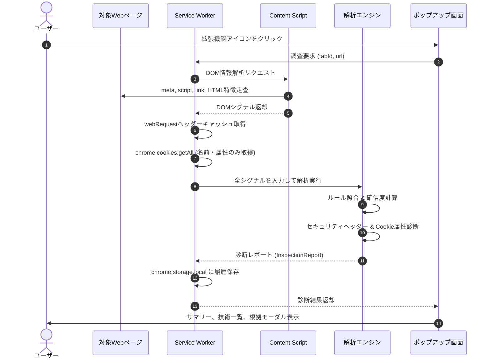

# フェーズ1詳細開発計画書: 初期MVP・基盤診断エンジン開発 (v1.0.0)

**フェーズ番号:** Phase 1  
**対応バージョン:** v1.0.0  
**主目的:** 受動的調査・完全ローカル処理を原則とする Manifest V3 拡張機能の基盤構築および初期MVP機能の実装  
**対象機能ID:** F01 〜 F12  

---

## 1. フェーズ概要と目的

Webブラウザ（Chrome / Edge）上で動作し、閲覧中のWebサイトに対して能動的な攻撃リクエストを一切送信せず、ブラウザが通常受信するレスポンスヘッダー、Cookieメタデータ、DOM構造のみを受動的に解析して技術スタックの特定とセキュリティ診断を行う拡張機能の初期コアエンジンを構築する。

```mermaid
graph TD
    subgraph BrowserEnvironment ["ブラウザ実行環境 (Manifest V3)"]
        ActiveTab["閲覧中タブ (Webページ)"]
        CS["Content Script<br>(DOM/アセット情報収集)"]
        SW["Service Worker<br>(HTTPヘッダー・Cookie取得・統括)"]
        Engine["診断エンジン<br>(Detection & Security)"]
        Storage["chrome.storage.local<br>(ローカル履歴保存)"]
        Popup["Popup UI (ポップアップ)"]
        Dashboard["Dashboard UI (詳細ダッシュボード)"]
    end

    ActiveTab -->|DOM走査・アセット収集| CS
    ActiveTab -->|HTTP通信 (webRequest)| SW
    CS -->|シグナル送信| SW
    SW --> Engine
    Engine --> SW
    SW --> Storage
    SW <-->|表示・操作| Popup
    Storage <--> Dashboard
```

---

## 2. 実装機能一覧 (F01 〜 F12)

| 機能ID | 機能名 | 概要・仕様 | 主な対象技術 / 診断項目 |
|---|---|---|---|
| **F01** | Webサーバー検出 | HTTP `Server` ヘッダーや固有レスポンスヘッダーを正規表現照合し、サーバー種別とバージョンを特定 | Apache, Nginx, Microsoft-IIS, LiteSpeed, Caddy |
| **F02** | サーバーサイド言語検出 | `X-Powered-By` ヘッダー、セッションCookie名（`PHPSESSID`等）、URL拡張子から言語を検出 | PHP, Node.js, Python, Ruby, Java, ASP.NET |
| **F03** | CMS検出 | `<meta name="generator">`、固有アセットURLパス、DOM特徴からCMSを検出 | WordPress, Drupal, Joomla, Shopify, Wix |
| **F04** | JSフレームワーク検出 | DOM属性（`[data-reactroot]`, `[ng-version]`）、スクリプトURLから検出 | React, Vue.js, Angular, Next.js, Nuxt, Svelte |
| **F05** | JS/CSSライブラリ検出 | `<script src>`、`<link href>`、グローバルオブジェクト、CSSクラス名から検出 | jQuery, Bootstrap, Tailwind CSS, Lodash |
| **F06** | CDN / WAF推定 | 固有エッジヘッダー（`CF-Ray`, `X-Amz-Cf-Id`等）からリバースプロキシ・CDNを推定 | Cloudflare, Amazon CloudFront, Fastly, Akamai |
| **F07** | セキュリティヘッダー診断 | 外部から確認できるHTTPセキュリティヘッダーの有無・設定値を検証 | HSTS, CSP, X-Frame-Options, X-Content-Type-Options, Referrer-Policy, CORS |
| **F08** | Cookie属性診断 | `chrome.cookies.getAll` によりCookieのセキュリティ属性を検証（※値は除外） | Secure, HttpOnly, SameSite (Strict/Lax/None), 有効期間 |
| **F09** | HTTPS・混在コンテンツ診断 | 現在のプロトコルおよびページ内の非HTTPSサブリソース（画像、スクリプト等）を検出 | 平文HTTP警告、アクティブ/パッシブ混在コンテンツ |
| **F10** | 判定根拠・確信度計算 | エビデンス（ヘッダー、DOM、Cookie等）ごとに重み付け（1〜100）を行い確信度スコアを算出 | 確信度レベル (High: ≥80, Medium: 50〜79, Low: <50) |
| **F11** | エクスポート機能 | 調査結果をローカル環境で保存・活用するための出力形式を提供 | 整形JSON、Excel対応UTF-8 BOM付きCSV |
| **F12** | 調査履歴保存・管理 | 過去の調査レポートをブラウザローカル（`chrome.storage.local`）に最大50件保持 | 履歴一覧表示、個別削除、全削除 |

---

## 3. シーケンス設計



---

## 4. プライバシー & セキュリティ設計原則

1. **受動的解析の徹底**:
   - 外部サーバーへの追加リクエスト、アクティブスキャン、脆弱性攻撃コードの送信は一切行わない。
2. **Cookie値（Value）の非保持・完全除外**:
   - セッションハイジャック等のリスクを排除するため、Cookieの `value` はメモリおよびストレージに一切保持せず、属性（`secure`, `httpOnly`, `sameSite`, `domain`, `path`）のみを診断対象とする。
3. **完全ローカル処理**:
   - 診断処理はすべてブラウザ内部で完結し、第三者サーバーへの診断結果送信は行わない。

---

## 5. 受入基準 & テスト計画

- [x] Apache, Nginx, PHP, WordPress, React 等の主要技術がテスト環境で正確に検出されること。
- [x] HSTS未設定、CSP未設定、HttpOnly未付与Cookieが重大度判定とともに警告されること。
- [x] ポップアップ画面およびダッシュボード画面で判定根拠が確認できること。
- [x] JSONおよびCSV形式でレポートが正常にダウンロードできること。
- [x] Vitest単体テストがすべてパスすること。
