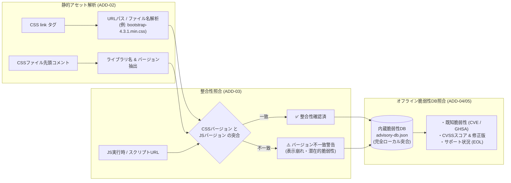

# フェーズ2詳細開発計画書: ライブラリセキュリティ & オフラインCVE/EOL統合 (v1.1.0)

**フェーズ番号:** Phase 2  
**対応バージョン:** v1.1.0  
**主目的:** 静的配信アセットからのバージョン推定精度向上と、外部送信ゼロでの完全オフライン既知脆弱性・サポート終了（EOL）照合  
**対象機能ID:** ADD-01 〜 ADD-08  

---

## 1. フェーズ概要と目的

Webサイトで広く使用されるオープンソースライブラリ（jQuery, Bootstrap等）は、静的アセットとして配信されることが多く、ヘッダー隠蔽環境でもCSSやJSファイルから検出可能です。  
本フェーズでは、静的アセット解析とCSS/JSバージョンの整合性照合を実装し、さらに拡張機能内にローカルスナップショット脆弱性データベース（`advisory-db.json`）を内蔵することで、**閲覧URLやライブラリ情報を外部APIに一切漏洩させず**に既知脆弱性（CVE/GHSA）およびEOLを高速に自動照合する基盤を構築しました。

---

## 2. 実装機能一覧 (ADD-01 〜 ADD-08)

| 機能ID | 機能名 | 概要・仕様 |
|---|---|---|
| **ADD-01** | 静的アセット調査基盤 | Content Scriptによる `<link rel="stylesheet">` の網羅的走査およびアセット属性収集 |
| **ADD-02** | CSSアセット解析 | CSSのファイル名、URLパス、および先頭コメント（`/*! Bootstrap v4.3.1 ... */`）からライブラリ名・バージョンを推定 |
| **ADD-03** | CSS/JSバージョン整合性照合 | 同一ライブラリにおいて、JS側で検出されたバージョンとCSS側で検出されたバージョンを比較し、不一致（Mismatch）を検知 |
| **ADD-04** | オフライン脆弱性データベース | OSVおよびNVDのアドバイザリデータをビルド時に圧縮JSON（`advisory-db.json`）として拡張機能内に同梱。外部API依存を排除 |
| **ADD-05** | 既知脆弱性 (CVE) & EOL突合エンジン | Semantic Versioning範囲判定に基づき、特定されたバージョンに該当する脆弱性（CVE識別子、深刻度、CVSSスコア、修正バージョン）およびサポート終了状況（EOL日、推奨対応）を算出 |
| **ADD-06** | ライブラリセキュリティビュー | ダッシュボードに「ライブラリセキュリティ」専用タブを新設し、検出技術ごとのEOL状態・脆弱性件数・整合性を一覧表示 |
| **ADD-07** | エビデンス詳細モーダル拡張 | 脆弱性詳細（概要、影響範囲、NVDリンク）およびEOL情報をモーダル内で表示 |
| **ADD-08** | CSV/JSONエクスポート拡張 | 出力ファイルにEOLステータス、該当CVEリスト、最大CVSSスコア、整合性ステータスを追加 |

---

## 3. CSS/JS整合性判定マトリクス

同一ページ内で複数のバージョンシグナルが観測された場合の判定ロジック：

| JS側観測バージョン | CSS側観測バージョン | 判定結果 (`status`) | 説明・UI表示 |
|:---:|:---:|:---:|---|
| `v5.3.0` | `v5.3.0` | **`match` (一致)** | バージョン整合性が確認され、正常に運用されている状態 |
| `v5.3.0` | `v4.6.0` | **`mismatch` (不一致)** | ライブラリ更新漏れや混合インクルードの疑い。表示崩れや古い側の脆弱性に注意を促す |
| `v5.3.0` | 未検出 (`null`) | **`js-only` (JSのみ)** | CSSアセットが存在しないかCDN等でバージョン特定不能 |
| 未検出 (`null`) | `v4.6.0` | **`css-only` (CSSのみ)** | JSスクリプトがインライン化または別名化されている状態 |

---

## 4. 受入基準 & テスト計画

- [x] `test-server` 上のモックHTMLにおいて、Bootstrap 4.3.1 (CSS) と 5.2.0 (JS) の不一致が正確に検出され、`badge-mismatch` が表示されること。
- [x] jQuery 1.12.4 検出時に、内蔵DBから `CVE-2015-9251` などの既知脆弱性および EOL が外部通信なしで照合されること。
- [x] 脆弱性DBファイル（`advisory-db.json`）のファイルサイズが軽量（< 100KB）に保たれ、ブラウザの読み込み遅延を引き起こさないこと。
- [x] Vitest単体テスト（`version-check.test.ts`, `advisory.test.ts`）がすべてパスすること。
