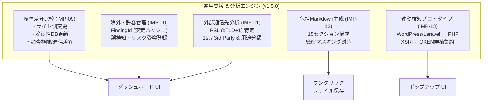
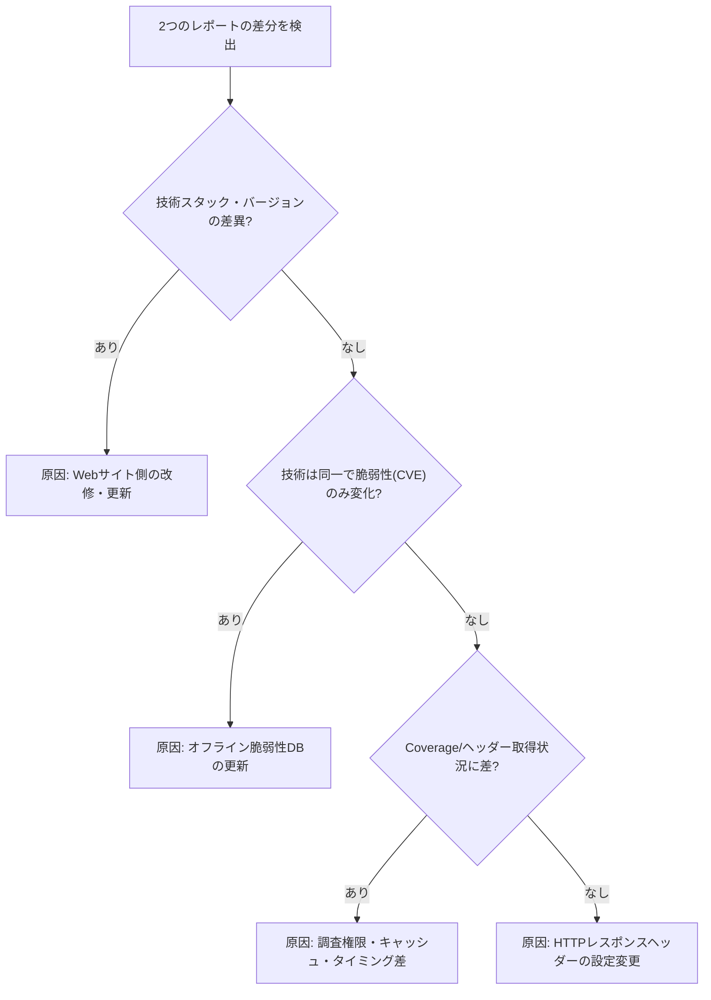

# フェーズ4詳細開発計画書: 調査運用支援・分析機能の拡張 (v1.5.0)

**フェーズ番号:** Phase 4  
**対応バージョン:** v1.5.0  
**主目的:** 定期的なセキュリティ監査運用のための差分原因分析、誤検知除外管理、包括的Markdown報告書、および連動検知プロトタイプ  
**対象機能ID:** IMP-09 〜 IMP-13  

---

## 1. フェーズ概要と目的

Webサイトのセキュリティ診断を実務に定着させるためには、「単発の調査」だけでなく「前回の診断結果との比較」「仕様上許容された指摘の管理」「経営層・開発チームに提出可能な包括的レポート」が不可欠です。  
本フェーズでは、差分比較における推定原因分析、FindingIdに基づく安定した除外管理、PSL（Public Suffix List）を用いた外部通信先の精査、およびヘッダー隠蔽対策としての連動検知プロトタイプを導入しました。

---

## 2. 実装機能一覧 (IMP-09 〜 IMP-13)

| 機能ID | 機能名 | 概要・仕様 |
|---|---|---|
| **IMP-09** | 履歴Diff原因自動推定 | 2つの過去診断結果の差分（技術の追加・削除、脆弱性の増減、設定変更）を算出し、「サイト側の更新」「内蔵脆弱性DBの更新」「調査権限やキャッシュの差異」の3要因から自動推定して提示 |
| **IMP-10** | 診断項目の許容・除外管理 | URL、チェックID、対象リソースの正規化ハッシュに基づく安定識別子（`FindingId`）を導入。運用上対応不要な項目を「誤検知」または「リスク受容（許容）」として登録し、次回以降の警告を抑制 |
| **IMP-11** | 外部通信先サードパーティ分析 | Public Suffix List (PSL) に基づき、読み込まれた外部アセットの組織ドメイン（eTLD+1）を特定。First-Party / Third-Party / Local 分類および用途カテゴリ（CDN, Analytics, Ads, Fonts, API等）を自動判定 |
| **IMP-12** | 15セクション包括Markdownレポート | 仕様書Rev.2.1に完全準拠した15セクション構成のMarkdown報告書生成。Cookie値・機密ヘッダーを自動マスキングし、監査証跡として即時提出可能な形式で出力 |
| **IMP-13** | 連動検知エンジン (Implication) プロトタイプ | ヘッダー隠蔽対策として、確信度50%以上の技術からサーバー言語（例: Laravel $\rightarrow$ PHP）を自動連動推定。汎用Cookie（`XSRF-TOKEN`）単体時は3行乱立を避け『Java / Laravel / Node.js (候補)』として1行集約 |

---

## 3. 差分原因推定ロジック (IMP-09)

差分比較時に、変更内容のパターンから原因を論理的に判定するアルゴリズム：

---

## 4. 外部通信先ドメイン分析仕様 (IMP-11)

- **eTLD+1の特定**: `sub.example.co.jp` $\rightarrow$ `example.co.jp`（`co.jp` を公開サフィックスとして正しく認識）。
- **当事者分類**:
  - `first-party`: 調査対象ページのeTLD+1と同一組織のドメイン。
  - `third-party`: 異なる組織ドメイン（外部サービス）。
  - `local`: `localhost`, `127.0.0.1` などのプライベート空間。
- **用途分類**: ホスト名パターンに基づき `cdn`, `analytics`, `advertising`, `fonts`, `social`, `api`, `other` に自動分類。

---

## 5. 受入基準 & テスト計画

- [x] 過去履歴の比較画面で、新旧レポートの技術・脆弱性・セキュリティ差分および推定原因が分かりやすく表示されること。
- [x] 誤検知登録した指摘項目が次回調査時に正しく「除外済」として扱われ、要確認カウントから除外されること。
- [x] サードパーティドメインがPSLに基づいて正確に分類され、ダッシュボードにテーブル表示されること。
- [x] 生成されたMarkdownファイルが仕様書の15セクションすべてを含み、機密トークンが `***MASKED***` されていること。
- [x] Vitest単体テスト（`diff.test.ts`, `exceptions.test.ts`, `domain-analyzer.test.ts`, `markdown.test.ts`）がすべてパスすること。
