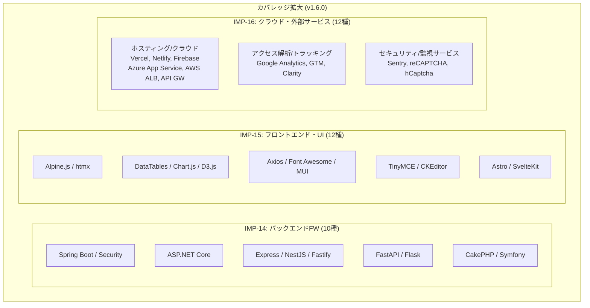

# フェーズ5詳細開発計画書: 検出カバレッジの大幅拡大 (v1.6.0)

**フェーズ番号:** Phase 5  
**対応バージョン:** v1.6.0  
**主目的:** モダンWeb開発エコシステムを網羅するバックエンドフレームワーク、フロントエンドUI、およびクラウド・外部サービスの検出カバレッジ拡大  
**対象機能ID:** IMP-14, IMP-15, IMP-16  

---

## 1. フェーズ概要と目的

現代のWebアーキテクチャでは、Next.jsやAstroのようなメタフレームワーク、TailwindやMaterial UI等のUIライブラリ、VercelやAWS ALB等のエッジ・クラウド基盤、そしてアクセス解析やセキュリティ監視SaaSが複雑に組み合わさって稼働しています。  
本フェーズでは、主要なバックエンドフレームワーク10種（IMP-14）、フロントエンド・UIライブラリ12種（IMP-15）、およびホスティング・外部サービス12種（IMP-16）のルールを新規策定・拡張し、主要技術スタック（全対応技術）を高精度に特定できるカバレッジを実現しました。

---

## 2. 実装機能一覧 (IMP-14 〜 IMP-16)

### IMP-14: バックエンドフレームワーク検出 (10技術)

新規ルール定義ファイル [`src/detection/rules/backend.json`](../../src/detection/rules/backend.json) を策定。

| 技術名 | カテゴリ | 主な検出シグナル | 連動推論 (`implies`) |
|---|---|---|---|
| **Spring Boot** | `programming-language` | ヘッダー `X-Application-Context`, 固有Whitelabelエラーページ | Java (`runtime-dependency`) |
| **Spring Security** | `programming-language` | Cookie `JSESSIONID` + CSRFトークン, Basic認証Realm | Java, Spring Boot |
| **ASP.NET Core** | `programming-language` | Cookie `.AspNetCore.Antiforgery.*`, `.AspNetCore.Session`, Server: `Kestrel` | ASP.NET (`framework-dependency`) |
| **Express** | `programming-language` | ヘッダー `X-Powered-By: Express`, Cookie `connect.sid` | Node.js (`runtime-dependency`) |
| **NestJS** | `programming-language` | ヘッダー `X-Powered-By: NestJS`, 固有エラーJSON構造 | Node.js, Express |
| **Fastify** | `programming-language` | ヘッダー `X-Powered-By: Fastify`, エラーレスポンス特徴 | Node.js (`runtime-dependency`) |
| **FastAPI** | `programming-language` | タイトル `FastAPI - Swagger UI` / `ReDoc`, ヘッダー `X-FastAPI` | Python (`runtime-dependency`) |
| **Flask** | `programming-language` | Cookie `session` (Flask固有シグネチャ), Server: `Werkzeug` | Python (`runtime-dependency`) |
| **Symfony** | `programming-language` | Cookie `symfony`, ヘッダー `X-Debug-Token` | PHP (`runtime-dependency`) |
| **CakePHP** | `programming-language` | Cookie `cakephp`, URLシグネチャ | PHP (`runtime-dependency`) |

---

### IMP-15: フロントエンド・UIライブラリ検出 (12技術)

既存ルール定義ファイル [`src/detection/rules/frontend.json`](../../src/detection/rules/frontend.json) を拡張。

| 技術名 | カテゴリ | 主な検出シグナル | 連動推論 (`implies`) |
|---|---|---|---|
| **Alpine.js** | `js-framework` | DOM属性 `[x-data]`, `[x-init]`, `[x-show]` | - |
| **htmx** | `js-framework` | DOM属性 `[hx-get]`, `[hx-post]`, `[hx-target]` | - |
| **DataTables** | `js-css-library` | スクリプトURL `jquery.dataTables.js`, クラス名 `dataTable` | - |
| **Chart.js** | `js-css-library` | スクリプトURL `chart.js`, `chart.umd.js` | - |
| **D3.js** | `js-css-library` | スクリプトURL `d3.js`, `d3.v*.js` | - |
| **Axios** | `js-css-library` | スクリプトURL `axios.js`, `axios.min.js` | - |
| **TinyMCE** | `js-css-library` | スクリプトURL `tinymce.min.js`, クラス `tox-tinymce` | - |
| **CKEditor** | `js-css-library` | スクリプトURL `ckeditor.js`, DOM `.ck-editor` | - |
| **Font Awesome** | `js-css-library` | link(CSS) `font-awesome`, クラス `fa-`, `fas`, `fab` | - |
| **Material UI** | `js-css-library` | クラス名 `MuiButton-`, `MuiBox-`, `MuiTypography-` | React (`framework-dependency`) |
| **Astro** | `js-framework` | メタ `<meta name="generator" content="Astro">`, DOM `[data-astro-cid-]` | Node.js (`possible-runtime`) |
| **SvelteKit** | `js-framework` | DOM `data-sveltekit-`, アセットパス `_app/immutable/` | Svelte, Node.js (`possible-runtime`) |

---

### IMP-16: ホスティング・外部サービス検出 (12技術)

新規ルール定義ファイル [`src/detection/rules/services.json`](../../src/detection/rules/services.json) を策定。

| 技術名 | 新設カテゴリ | 主な検出シグナル | 特徴・セキュリティ配慮 |
|---|---|---|---|
| **Vercel** | `hosting-cloud` | Server: `Vercel`, ヘッダー `X-Vercel-Id`, `X-Vercel-Cache` | クラウドエッジ基盤 |
| **Netlify** | `hosting-cloud` | Server: `Netlify`, ヘッダー `X-Nf-Request-Id` | Jamstackホスティング |
| **Firebase Hosting** | `hosting-cloud` | ヘッダー `X-Firebase-Hosting` | 静的/動的ホスティング |
| **Azure App Service** | `hosting-cloud` | Cookie `ARRAffinity`, `ARRAffinitySameSite` | Azureマネージドルーティング |
| **AWS ALB** | `hosting-cloud` | Cookie `AWSALB`, `AWSALBCORS` | AWS負荷分散基盤 |
| **AWS API Gateway** | `hosting-cloud` | ヘッダー `x-amzn-RequestId`, `x-amz-apigw-id` | AWSマネージドAPI |
| **Google Analytics** | `analytics-tracking` | スクリプトURL `google-analytics.com/analytics.js` | アクセス解析SaaS |
| **Google Tag Manager** | `analytics-tracking` | スクリプトURL `googletagmanager.com/gtm.js` | タグ管理SaaS |
| **Microsoft Clarity** | `analytics-tracking` | スクリプトURL `clarity.ms/tag/` | ヒートマップ・セッション記録 |
| **Sentry** | `security-service` | スクリプトURL `browser.sentry-cdn.com` | エラートラッキングSaaS |
| **Google reCAPTCHA** | `security-service` | スクリプトURL `google.com/recaptcha/api.js` | BOT対策認証サービス |
| **hCaptcha** | `security-service` | スクリプトURL `hcaptcha.com/1/api.js` | プライバシー配慮BOT対策 |

---

## 3. 負例シグナルと誤検知防止の配慮

外部サービスやライブラリの検出において、以下の誤検知防止措置を講じています：
1. **Cookie名単体での断定回避**: 一般的なCookie名は前後のプレフィックス・完全一致正規表現（例: `^ARRAffinity$`）で厳格に照合。
2. **CDN配信スクリプトの限定照合**: サードパーティURLにクエリパラメータ等でライブラリ名が含まれるだけのケースを除外するため、ホスト名またはパスセグメントの構造を検証。
3. **脆弱性DB（CVE）照合対象からの安全な隔離**: ホスティングやSaaSなどのマネージドサービスは、オフラインCVE照合の対象外（`Not Covered`）とし、不要な脆弱性警告を防止。

---

## 4. 受入基準 & テスト計画

- [x] Spring Boot, ASP.NET Core, Express, FastAPI, CakePHP がテスト環境で直接検出されること。
- [x] Alpine.js, htmx, DataTables, Chart.js, Axios, Astro, SvelteKit がDOM・スクリプトシグナルから検出されること。
- [x] Vercel, Netlify, Azure, Google Analytics, Sentry が新設カテゴリとして正確に分類されること。
- [x] Vitest単体テスト（`tests/detection.test.ts` 内の IMP-14, IMP-15, IMP-16 テスト群）がすべてパスすること。
