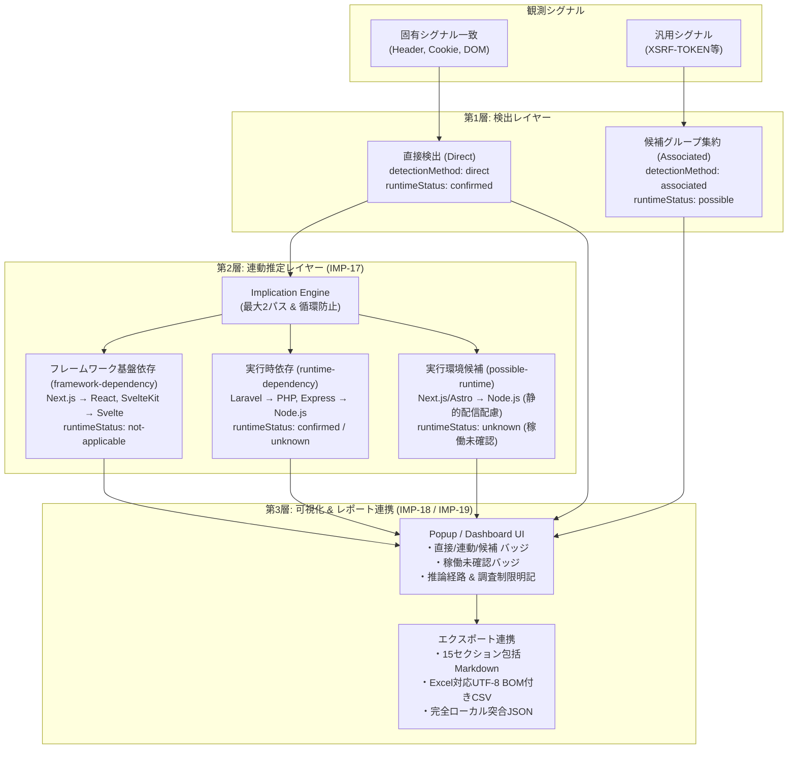
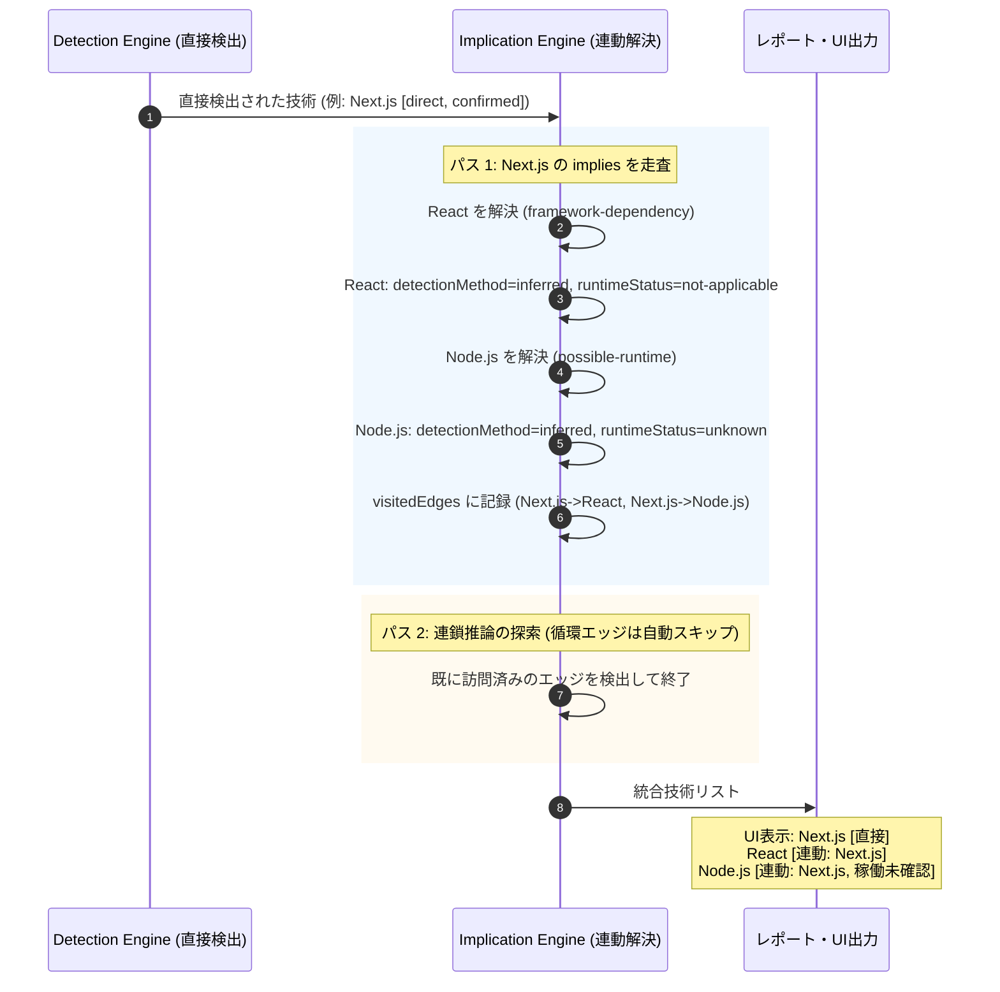

# フェーズ6詳細開発計画書: Implication Engine 高度化 & 可視化・レポート連携 (v1.6.0)

**フェーズ番号:** Phase 6  
**対応バージョン:** v1.6.0  
**主目的:** 直接検出・連動検知・関連候補の厳密な3層分離、ランタイム稼働状態管理、受動的調査制限の明文化、およびレポート連携  
**対象機能ID:** IMP-17, IMP-18, IMP-19  

---

## 1. フェーズ概要と目的

ヘッダー隠蔽対策としての連動検知（Implication）は強力である一方、「直接観測した事実」と「依存関係に基づく推定」が混同されると、静的ホスティング上のNext.jsサイトに対して「Node.jsサーバーが稼働している」と断定してしまったり、推論された技術に対して確定的な脆弱性（CVE）警告を発して誤解を生むリスクがありました。  
本フェーズでは、Implication Engineを抜本的に高度化し、**直接検出・連動検知・関連候補の3層分離**、**ランタイム稼働状態（`runtimeStatus`）の導入**、および**受動的調査の制限事項の明示**をUIおよび全レポート出力（Markdown, CSV, JSON）に貫徹させました。



---

## 2. 実装機能一覧 (IMP-17 〜 IMP-19)

| 機能ID | 機能名 | 概要・仕様 |
|---|---|---|
| **IMP-17** | **Implication Engine 高度化** | ・直接検出（`direct`）、連動検知（`inferred`）、関連候補（`associated`）の3層分離。<br>・ランタイム稼働状態（`confirmed`, `possible`, `unknown`, `not-applicable`）の導入。<br>・SSG/静的配信構成を考慮し、Next.js/NuxtからのNode.jsは断定せず `runtimeStatus: unknown` と記録。<br>・推論エッジ訪問履歴（`visitedEdges`）による $A \rightarrow B \rightarrow A$ 等の循環・重複防止。<br>・推論先の確信度がトリガー元を上回らない上限クリップ。 |
| **IMP-18** | **検出結果の可視化** | ・PopupおよびDashboardで、検出方式バッジ（`[直接]`、`[連動]`、`[候補]`）およびランタイム状態バッジ（`[稼働未確認]`、`[稼働可能性]`）を表示。<br>・詳細モーダルおよびアコーディオンに推論元技術、推論種別、推論経路（例: `Next.js → React`）を明記。<br>・**受動的調査の制限事項を明記**: 「受動的調査の原則に基づき、サーバー内部の稼働状態を観測できないため断定を保留」する旨の注記を掲載。 |
| **IMP-19** | **CVE/EOL・レポート連携** | ・推論技術（特に未確定・連動・候補）に対する確定CVE誤報の防止。<br>・包括的Markdownレポート（第4節テーブルに検出方式・連動元・ランタイム状態を追加 & 注記掲載）。<br>・Excel対応CSVに `検出方式`, `連動種別`, `推論元`, `ランタイム状態` の4列を追加。<br>・配布用ZIPパッケージ（`release/web-inspector-v1.6.0.zip`）の自動作成。 |

---

## 3. 型定義・データモデル拡張 (`src/shared/types.ts`)

```typescript
// 連動・推論関係の種別 (IMP-17)
export type ImplicationType =
  | 'runtime-dependency'       // 実行時依存（例: Laravel → PHP, Express → Node.js）
  | 'framework-dependency'     // フレームワーク基盤依存（例: Next.js → React, Nuxt → Vue）
  | 'possible-runtime'         // 実行環境の候補（例: Next.js → Node.js [静的配信の可能性あり]）
  | 'technology-association';  // 関連技術

// 検出方式の区分 (IMP-18)
export type DetectionMethod =
  | 'direct'                   // 直接検出（固有の観測情報あり）
  | 'inferred'                 // 連動検知（技術的依存関係から推定）
  | 'associated';              // 関連技術（使用を裏付ける直接証拠なし）

// ランタイム実行状態 (IMP-17)
export type RuntimeStatus =
  | 'confirmed'                // 稼働確認済み
  | 'possible'                 // 稼働可能性あり
  | 'unknown'                  // 稼働状態未確認（外部から観測できない）
  | 'not-applicable';          // 該当なし（フロントエンド技術等）

// DetectedTechnology への追加フィールド
export interface DetectedTechnology {
  // ... 既存フィールド
  detectionMethod?: DetectionMethod;
  implicationType?: ImplicationType;
  inferredFrom?: string;
  runtimeStatus?: RuntimeStatus;
  inferencePath?: string[];
}
```

---

## 4. 推論・状態決定シーケンス



---

## 5. 受入基準 & テスト計画

- [x] Next.js 検出時に React は `framework-dependency`（`not-applicable`）、Node.js は `possible-runtime`（`unknown`）として連動検出されること。
- [x] Express 検出時に Node.js が `runtime-dependency` として連動検出されること。
- [x] Spring Boot 検出時に Java が `runtime-dependency` として連動検出されること。
- [x] 推論グラフに循環参照（$A \rightarrow B, B \rightarrow A$）があっても無限ループせず2パスで正常終了すること。
- [x] ポップアップおよびダッシュボードで直接・連動・候補・稼働未確認の各バッジが正確にレンダリングされること。
- [x] MarkdownおよびCSVエクスポートに検出方式、連動元、ランタイム状態が欠落なく出力されること。
- [x] 全13テストファイル、125テストケースすべてがパスすること。
- [x] `npm run package` により `release/web-inspector-v1.6.0.zip` が正常に生成されること。
